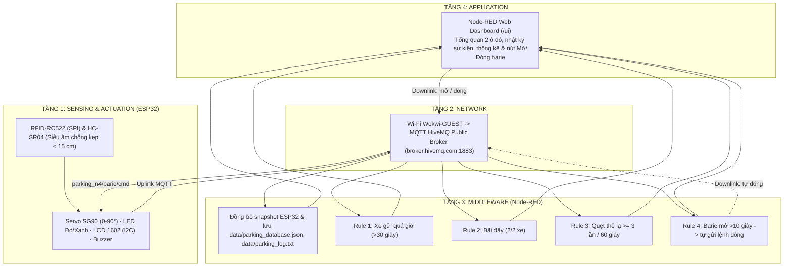

# HỆ THỐNG BÃI GIỮ XE MÁY TỰ QUẢN SỬ DỤNG RFID

Đồ án **Internet of Things (IoT)** — **Nhóm 4**.  
Mô phỏng hệ thống bãi giữ xe máy tự quản theo kiến trúc IoT 4 tầng: đọc thẻ RFID và điều khiển barie tại cổng trên Wokwi (ESP32), truyền dữ liệu hai chiều qua MQTT, xử lý 4 rule tự động trên Node-RED và giám sát qua Web Dashboard.

---

## 1. Kiến trúc 4 tầng và luồng dữ liệu hai chiều



**Nguyên tắc đồng bộ:** ESP32 là nguồn dữ liệu gốc (source of truth) quyết định vào/ra/từ chối ngay tại cổng kể cả khi mất mạng; Node-RED đồng bộ trạng thái qua MQTT (`retained` + Last Will), chạy 4 rule, hiển thị lên Dashboard và tự khôi phục thống kê khi khởi động lại.

---

## 2. Sơ đồ đấu nối GPIO trên ESP32

| Linh kiện | Chân linh kiện | Chân ESP32 | Điện áp | Chức năng |
| :--- | :--- | :--- | :---: | :--- |
| **RFID-RC522** | SDA / SCK / MOSI / MISO / RST | GPIO 5 / 18 / 23 / 19 / 4 | 3.3V | Đọc UID thẻ RFID 13.56 MHz (SPI) |
| **HC-SR04** | TRIG / ECHO | GPIO 27 / GPIO 32 | 5.0V | Đo khoảng cách chống kẹp xe (< 15 cm hoãn đóng) |
| **Servo SG90** | PWM | GPIO 13 | 5.0V | Nâng/hạ thanh chắn barie ($0^\circ - 90^\circ$) |
| **LED Đỏ** | Anode (+) | GPIO 25 | 3.3V | Báo cổng đóng / bãi đầy / thẻ lạ |
| **LED Xanh** | Anode (+) | GPIO 26 | 3.3V | Báo cổng mở, mời xe qua |
| **Active Buzzer** | Signal | GPIO 14 | 3.3V | Còi báo (kênh LEDC riêng, không chặn `loop()`) |
| **LCD 1602 I2C** | SDA / SCL | GPIO 21 / GPIO 22 | 5.0V | Hiển thị chỗ trống, biển số, cước phí (`0x27`) |

---

## 3. Danh mục Topics MQTT

* **Broker:** `broker.hivemq.com` | **Port:** `1883` | **Tiền tố:** `parking_n4/`

| Topic | Chiều | Retained | Nội dung |
| :--- | :---: | :---: | :--- |
| `parking_n4/rfid/scan` | Uplink | Không | Sự kiện `check_in` / `check_out`, biển số, ô đỗ (`1..2`), thời gian gửi, cước phí |
| `parking_n4/barie/status` | Uplink | Có | Trạng thái barie (`open`/`closed`), góc servo, chế độ (`auto`/`hold`), nguồn |
| `parking_n4/alert` | Uplink | Không | Cảnh báo `INVALID_CARD`, `LOT_FULL`, `ANTI_PINCH` (kèm khoảng cách `cm`) |
| `parking_n4/status` | Uplink | Có + LWT | Snapshot toàn bộ bãi xe (online/offline, danh sách xe trong 2 ô) |
| `parking_n4/barie/cmd` | Downlink | Không | Lệnh điều khiển `open`, `close`, `sync` từ Dashboard hoặc Rule 4 |

---

## 4. Hướng dẫn chạy hệ thống

### 4.1. Khởi chạy Node-RED & Dashboard (Docker)
```bash
docker compose up -d --build
# Hoặc chạy script: start_docker.bat
```
* **Web Dashboard:** [http://localhost:1880/ui](http://localhost:1880/ui)
* **Node-RED Flow Editor:** [http://localhost:1880](http://localhost:1880)
* **Thư mục lưu dữ liệu:** `data/parking_log.txt` và `data/parking_database.json`

### 4.2. Biên dịch firmware và chạy mô phỏng Wokwi
1. Biên dịch firmware bằng PlatformIO (tạo `.pio/build/esp32dev/firmware.bin`):
   ```bash
   pio run
   ```
2. Mở dự án trong VS Code (extension **Wokwi Simulator**), mở [diagram.json](diagram.json) và bấm **Play**.
3. Thao tác kiểm thử trên Wokwi (chạm thẻ mẫu trên MFRC522 hoặc nhập Serial Monitor):
   * Phím `1` / thẻ **Blue** (`01 02 03 04`): Xe `29A-123.45` (Nguyễn Văn A) vào/ra.
   * Phím `2` / thẻ **Green** (`11 22 33 44`): Xe `51F-999.88` (Trần Thị B) vào/ra.
   * Phím `3` / thẻ **Yellow** (`55 66 77 88`): Xe `43C-678.90` (Lê Văn C) dùng thử khi bãi đầy.
   * Phím `4` / thẻ **Red** (`AA BB CC DD`) hoặc `scan 99 99 99 99`: Thẻ chưa đăng ký (bị từ chối).
   * `open`, `close`, `sonar`, `status`: Kiểm tra barie, khoảng cách siêu âm và trạng thái thiết bị.

---

## 5. Cấu trúc thư mục

```text
├── data/
│   ├── parking_database.json           # Lưu trữ trạng thái & thống kê bền vững (runtime)
│   └── parking_log.txt                 # Nhật ký từng sự kiện theo thời gian (runtime)
├── docker/
│   ├── mosquitto/config/mosquitto.conf # Cấu hình Mosquitto MQTT Broker dự phòng
│   └── nodered/
│       ├── Dockerfile                  # Cài sẵn node-red-dashboard@^3.6.6
│       └── flows.json                  # Flow Node-RED dùng trong container
├── include/
│   ├── Config.h                        # Chân GPIO, ngưỡng demo, cấu hình Wi-Fi & MQTT
│   ├── GateController.h                # Điều khiển barie, đèn giao thông và chống kẹp HC-SR04
│   ├── MqttService.h                   # Kết nối Wi-Fi/MQTT, LWT và tự kết nối lại mỗi 5 giây
│   └── ParkingSystem.h                 # Danh sách thẻ, ô đỗ, tính phí, LCD và Buzzer
├── src/
│   ├── GateController.cpp
│   ├── MqttService.cpp
│   ├── ParkingSystem.cpp
│   └── main.cpp                        # Vòng lặp điều phối chính (non-blocking)
├── diagram.json                        # Sơ đồ mạch phần cứng Wokwi
├── docker-compose.yml                  # Đóng gói dịch vụ Node-RED & Mosquitto
├── nodered_flow.json                   # Bản đồng bộ flow Node-RED
├── platformio.ini                      # Cấu hình biên dịch ESP32 DevKit V1
├── start_docker.bat
├── stop_docker.bat
└── wokwi.toml                          # Liên kết firmware cho Wokwi
```
