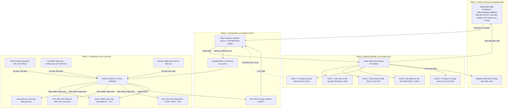

# HỆ THỐNG QUẢN LÝ BÃI GIỮ XE THÔNG MINH IOT (ESP32 SMART PARKING)

Dự án bãi giữ xe thông minh ứng dụng kiến trúc IoT 4 tầng toàn diện: Nhận diện xe qua thẻ RFID, tự động đóng/mở barie với thuật toán chống kẹp xe bằng cảm biến siêu âm, quan trắc môi trường và báo cháy hầm xe qua DHT22, thanh toán tự động qua mã VietQR và quản lý giám sát thời gian thực qua Web Dashboard.

---

## 1. Kiến Trúc 4 Tầng IoT



---

## 2. Sơ Đồ Đấu Nối Chân GPIO (ESP32)

| Thiết bị | Chân linh kiện | Chân ESP32 | Điện áp | Chức năng |
| :--- | :--- | :--- | :---: | :--- |
| **RFID-RC522** | SDA / SCK / MOSI / MISO / RST | GPIO 5 / 18 / 23 / 19 / 4 | 3.3V | Đọc mã thẻ xe (SPI) |
| **HC-SR04** | TRIG / ECHO | GPIO 27 / GPIO 32 | 5.0V | Cảm biến khoảng cách chống kẹp xe |
| **DHT22** | DATA | GPIO 15 | 3.3V | Quan trắc nhiệt độ & độ ẩm hầm xe |
| **Servo SG90** | PWM | GPIO 13 | 5.0V | Điều khiển cánh tay Barie |
| **LED ĐỎ** | Anode (+) | GPIO 25 | 3.3V | Đèn tín hiệu Dừng (Cổng đóng / Bãi đầy) |
| **LED XANH** | Anode (+) | GPIO 26 | 3.3V | Đèn tín hiệu Đi (Cổng mở) |
| **Buzzer** | Signal | GPIO 14 | 3.3V | Còi chíp phản hồi & cảnh báo |
| **LCD 1602** | SDA / SCL | GPIO 21 / GPIO 22 | 5.0V | Màn hình hiển thị I2C (0x27) |

---

## 3. Hướng Dẫn Vận Hành Hệ Thống

### 3.1. Khởi chạy cụm Backend (Docker Stack)
```bash
# Khởi động cụm Mosquitto MQTT Broker & Node-RED Dashboard
docker compose up -d

# Hoặc nhấp đúp file: start_docker.bat
```
* **Node-RED Web Dashboard**: `http://localhost:1880/ui`
* **Node-RED Flow Editor**: `http://localhost:1880`
* **Mosquitto MQTT Broker**: `localhost:1883`

### 3.2. Chạy mô phỏng trên Wokwi
1. Mở file [diagram.json](diagram.json) trong VS Code hoặc trên [Wokwi Web](https://wokwi.com).
2. Nhấn nút **Play (Màu xanh)** để bắt đầu mô phỏng.
3. Nhập các phím tắt trên Serial Monitor để điều khiển nhanh:
   * Phím `1`, `2`, `3`, `4`: Quẹt thẻ xe 1 đến 4 (Vào bãi / Ra bãi & Tính cước).
   * Lệnh `scan <UID>`: Giả lập thẻ bất kỳ (Ví dụ: `scan 99 99 99 99`).
   * Lệnh `open` / `close`: Mở hoặc đóng barie thủ công.
   * Lệnh `fire` / `nofire`: Kích hoạt hoặc tắt chế độ thoát hiểm khẩn cấp.
   * Lệnh `sonar` / `env`: Xem khoảng cách vật cản và nhiệt độ hầm xe.

---

## 4. Danh Mục Topic MQTT

Broker: `broker.hivemq.com` / `localhost` | Cổng: `1883` | Tiền tố: `parking_n4/`

| Topic | Hướng | Vai trò | Mẫu Payload |
| :--- | :---: | :--- | :--- |
| `parking_n4/rfid/scan` | **Uplink** | Dữ liệu quẹt thẻ (Check-in/Check-out/Cước) | `{"uid":"04 3B 2A 1C","action":"check_in","licensePlate":"29A-123.45",...}` |
| `parking_n4/barie/status` | **Uplink** | Trạng thái cánh barie thực tế | `{"state":"open"}` hoặc `{"state":"closed"}` |
| `parking_n4/env` | **Uplink** | Nhiệt độ, độ ẩm & nguy cơ cháy | `{"temp":28.5,"humidity":65.0,"fireRisk":"NORMAL"}` |
| `parking_n4/fire` | **Uplink** | Báo động cháy khẩn cấp & sơ tán | `{"fireAlarm":true,"msg":"HOA HOAN! DANG SO TAN!"}` |
| `parking_n4/alert` | **Uplink** | Cảnh báo thẻ không hợp lệ | `{"type":"INVALID_CARD","uid":"99 99 99 99"}` |
| `parking_n4/barie/cmd` | **Downlink** | Lệnh điều khiển từ xa từ Dashboard | `{"cmd":"open"}` / `{"cmd":"close"}` / `{"cmd":"fire"}` |

---

## 5. Cấu Trúc Thư Mục Nguồn

```text
├── docker/
│   ├── mosquitto/config/mosquitto.conf # Cấu hình Mosquitto MQTT Broker
│   └── nodered/                        # Cấu hình container Node-RED & Dashboard
├── include/
│   ├── Config.h                        # Định nghĩa chân GPIO & tham số hệ thống
│   ├── EnvironmentService.h            # Module giám sát nhiệt ẩm DHT22 & PCCC
│   ├── GateController.h                # Module điều khiển Barie & chống kẹp xe
│   ├── MqttService.h                   # Module kết nối Wi-Fi & truyền thông MQTT
│   └── ParkingSystem.h                 # Module quản lý thẻ xe, cước phí & LCD
├── src/
│   ├── EnvironmentService.cpp
│   ├── GateController.cpp
│   ├── MqttService.cpp
│   ├── ParkingSystem.cpp
│   └── main.cpp                        # Điểm khởi chạy điều phối trung tâm
├── diagram.json                        # Sơ đồ mạch mô phỏng phần cứng Wokwi
├── docker-compose.yml                  # Cấu hình Microservices Docker
├── nodered_flow.json                   # Luồng nghiệp vụ Node-RED (55 nodes)
├── platformio.ini                      # Cấu hình biên dịch PlatformIO ESP32
├── start_docker.bat                    # Script khởi chạy Docker 1-click
├── stop_docker.bat                     # Script dừng Docker
└── wokwi.toml                          # Cấu hình nạp firmware Wokwi
```
