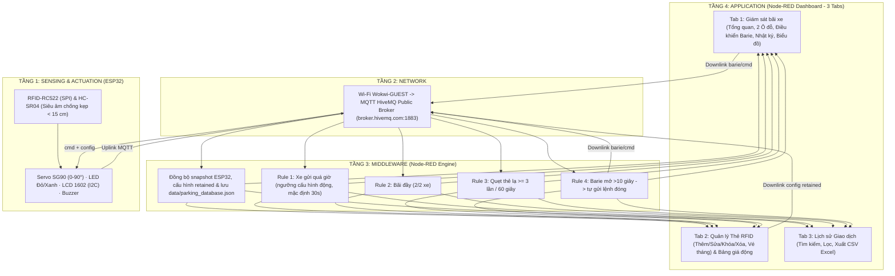

# HỆ THỐNG BÃI GIỮ XE MÁY TỰ QUẢN SỬ DỤNG RFID

Đồ án **Internet of Things (IoT)** — **Nhóm 4**.  
Mô phỏng hệ thống bãi giữ xe máy tự quản theo kiến trúc IoT 4 tầng: ESP32 xử lý quẹt thẻ và chống kẹp xe tại cổng trên Wokwi, truyền thông MQTT hai chiều qua HiveMQ public broker, Node-RED chạy 4 rule tự động và cung cấp Web Dashboard 3 tab (Giám sát thời gian thực, Quản lý Thẻ & Bảng giá động, Lịch sử Giao dịch & Xuất CSV).

---

## 1. Kiến trúc 4 tầng và luồng dữ liệu hai chiều



---

## 2. Sơ đồ đấu nối GPIO trên ESP32

| Linh kiện | Chân linh kiện | Chân ESP32 | Điện áp | Chức năng |
| :--- | :--- | :--- | :---: | :--- |
| **RFID-RC522** | SDA / SCK / MOSI / MISO / RST | GPIO 5 / 18 / 23 / 19 / 4 | 3.3V | Đọc UID thẻ RFID 13.56 MHz (SPI) |
| **HC-SR04** | TRIG / ECHO | GPIO 27 / GPIO 32 | 5.0V | Đo khoảng cách chống kẹp xe (< 15 cm hoãn đóng) |
| **Servo SG90** | PWM | GPIO 13 | 5.0V | Nâng/hạ thanh chắn barie ($0^\circ - 90^\circ$) |
| **LED Đỏ** | Anode (+) | GPIO 25 | 3.3V | Báo cổng đóng / bãi đầy / thẻ lạ / thẻ khóa |
| **LED Xanh** | Anode (+) | GPIO 26 | 3.3V | Báo cổng mở, mời xe qua |
| **Active Buzzer** | Signal | GPIO 14 | 3.3V | Còi báo không chặn vòng lặp (kênh LEDC 15) |
| **LCD 1602 I2C** | SDA / SCL | GPIO 21 / GPIO 22 | 5.0V | Hiển thị chỗ trống, biển số, UID lạ, vé tháng, cước phí |

---

## 3. Danh mục Topics MQTT

* **Broker:** `broker.hivemq.com` | **Port:** `1883` | **Tiền tố:** `parking_n4/`

| Topic | Chiều | Retained | Nội dung |
| :--- | :---: | :---: | :--- |
| `parking_n4/rfid/scan` | Uplink | Không | Lượt xe `check_in` / `check_out`, biển số, loại vé (`monthly`), ô đỗ (`1..2`), phí |
| `parking_n4/barie/status` | Uplink | Có | Trạng thái barie (`open`/`closed`), góc servo, chế độ (`auto`/`hold`), nguồn |
| `parking_n4/alert` | Uplink | Không | Cảnh báo `INVALID_CARD`, `LOCKED_CARD`, `LOT_FULL`, `ANTI_PINCH` |
| `parking_n4/status` | Uplink | Có + LWT | Snapshot toàn bộ bãi xe (online/offline, danh sách xe đang gửi trong 2 ô) |
| `parking_n4/barie/cmd` | Downlink | Không | Lệnh điều khiển `open`, `close`, `sync` từ Dashboard hoặc Rule 4 |
| `parking_n4/config` | Downlink | Có | Danh sách tối đa 16 thẻ RFID (loại vé, khóa/mở) & bảng giá động đồng bộ xuống ESP32 |

---

## 4. Tính năng nổi bật

* **Quản lý Thẻ RFID động tại Web Dashboard (không cần nạp lại code):** Thêm thẻ mới (hỗ trợ nút **Lấy UID này** ngay sau khi quẹt thẻ lạ), sửa biển số/chủ xe, chuyển **Vé lượt / Vé tháng (0đ)**, **Khóa / Mở khóa** tức thì và **Xóa thẻ** (tự khóa xóa nếu xe đang nằm trong bãi).
* **Bảng giá động & Chế độ miễn phí:** Tùy chỉnh ngưỡng giây, đơn giá 3 mức, ngưỡng Rule 1 quá giờ hoặc chuyển sang **Miễn phí (0 đ)**; mọi thay đổi lưu vào `data/parking_database.json` và đẩy `retained` xuống ESP32 qua `parking_n4/config`.
* **Đối soát giao dịch & Xuất Excel CSV:** Ghép cặp giờ vào/giờ ra từng lượt gửi xe, tìm kiếm theo biển số/UID/chủ xe, lọc trạng thái và tải trực tiếp file `.csv`.

---

## 5. Hướng dẫn chạy hệ thống

### 5.1. Khởi chạy Node-RED & Dashboard (Docker)
```bash
docker compose up -d --build
# Hoặc nhấp đúp: start_docker.bat
```
* **Web Dashboard:** [http://localhost:1880/ui](http://localhost:1880/ui)
* **Node-RED Flow Editor:** [http://localhost:1880](http://localhost:1880)

### 5.2. Biên dịch firmware và chạy mô phỏng Wokwi
1. Biên dịch firmware bằng PlatformIO: `pio run` (tạo `.pio/build/esp32dev/firmware.bin`).
2. Mở dự án bằng **Wokwi Simulator** trong VS Code, mở [diagram.json](diagram.json) và bấm **Play**.
3. Lệnh Serial kiểm thử nhanh trên Wokwi: `1` (Blue), `2` (Green), `3` (Yellow), `4` (Red), `scan <uid>`, `open`, `close`, `sonar`, `cards`, `price`, `status`.
