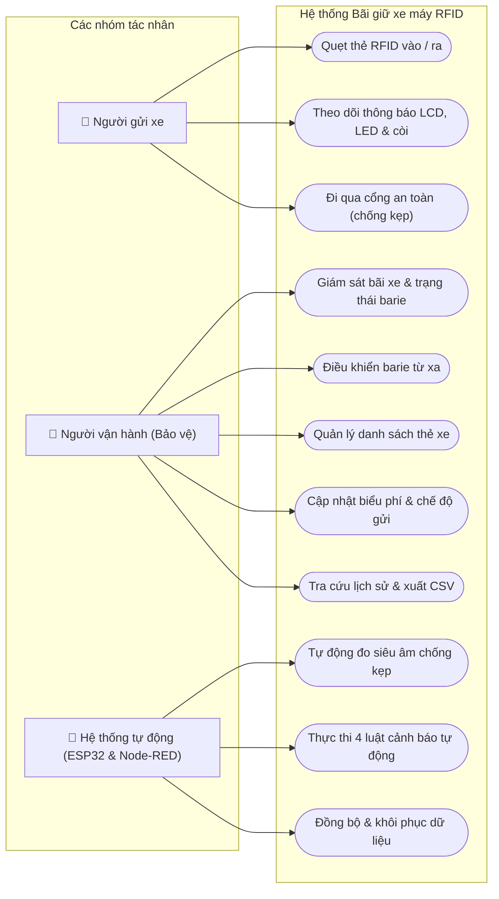
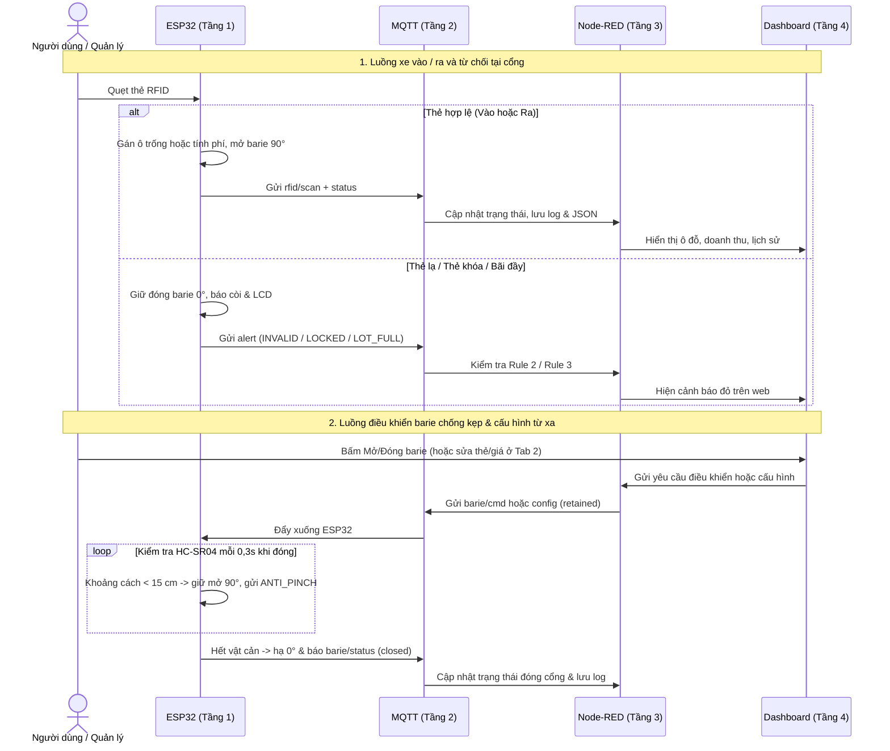
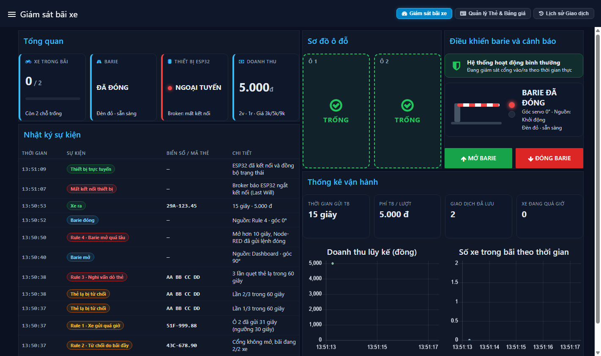

# BÁO CÁO TIỂU LUẬN HỌC PHẦN INTERNET OF THINGS (IOT)

**ĐỀ TÀI: HỆ THỐNG BÃI GIỮ XE MÁY TỰ QUẢN SỬ DỤNG RFID**

---

## PHẦN ĐẦU

### TRANG BÌA

* **Trường:** Trường Đại học Công Thương Thành phố Hồ Chí Minh (HUIT)
* **Khoa:** Khoa Công nghệ Thông tin
* **Học phần:** Internet of Things (IoT)
* **Đề tài:** Hệ thống bãi giữ xe máy tự quản sử dụng RFID (Mô phỏng 4 tầng IoT)
* **Nhóm thực hiện:** Nhóm 4

| STT | Họ và tên thành viên | Mã số sinh viên |
| :---: | :--- | :--- |
| 1 | Nguyễn Lê Duy Cương | 2001230069 |
| 2 | Đinh Tấn Thành | 2001230894 |
| 3 | Bùi Tấn Thông | 2001230938 |

* **Giảng viên hướng dẫn:** Võ Hoàng Hải
* **Địa điểm, thời gian:** TP. Hồ Chí Minh, tháng 11 năm 2026

---

### MỤC LỤC *(Trong bản Word `.docx` được cấu hình tự động cập nhật số trang)*

* Phần đầu: Danh mục hình, Danh mục bảng, Danh mục từ viết tắt, Tóm tắt
* Chương 1: Giới thiệu đề tài
* Chương 2: Cơ sở lý thuyết
* Chương 3: Phân tích và thiết kế hệ thống
* Chương 4: Triển khai
* Chương 5: Kiểm thử và đánh giá
* Chương 6: Kết luận và hướng phát triển
* Tài liệu tham khảo
* Phụ lục A – F

---

### DANH MỤC HÌNH

* **Hình 3.1:** Sơ đồ Use Case tổng quát của hệ thống bãi giữ xe RFID (`fig_3_1_usecase.png`)
* **Hình 3.2:** Sơ đồ kiến trúc tổng thể 4 tầng hệ thống bãi giữ xe IoT (`fig_3_1_arch_4layer.png`)
* **Hình 3.3:** Sơ đồ luồng dữ liệu hai chiều và tuần tự xuyên 4 tầng (`fig_slide_sequence.png`)
* **Hình 3.4:** Sơ đồ kết nối các linh kiện phần cứng với ESP32 trên Wokwi (`minh_chung_anti_pinch_wokwi.png`)
* **Hình 3.5:** Lưu đồ xử lý thẻ RFID và kiểm tra chống kẹp tại cổng (`fig_3_2_flow_rfid.png`)
* **Hình 3.6:** Sơ đồ trạng thái hoạt động của barie (`fig_3_4_flow_antipinch_fsm.png`)
* **Hình 3.7:** Sơ đồ xử lý dữ liệu và điều phối chức năng trong Node-RED (`fig_3_3_flow_nodered.png`)
* **Hình 3.8:** Giao diện Web Dashboard Tab 1 giám sát bãi xe và điều khiển barie (`dashboard_demo.png`)
* **Hình 4.1:** Mạch mô phỏng Wokwi khi xe ra bãi và chức năng chống kẹp được kích hoạt (`minh_chung_anti_pinch_wokwi.png`)
* **Hình 4.2:** Luồng xử lý Node-RED được tổ chức theo các nhóm chức năng (`nodered_flow.png`)
* **Hình 4.3:** Giao diện Web Dashboard Tab 1 giám sát bãi xe và điều khiển barie (`dashboard_demo.png`)
* **Hình 4.4:** Giao diện đăng nhập Node-RED Editor (`nodered_admin_login.png`)
* **Hình 4.5:** Giao diện quản lý thẻ RFID và bảng giá (`dashboard_cards_pricing.png`)
* **Hình 4.6:** Giao diện tra cứu lịch sử giao dịch và xuất CSV (`dashboard_history.png`)
* **Hình 5.1:** Kết quả kiểm thử mất kết nối đột ngột kích hoạt LWT trên Dashboard (`test_ch5_lwt_offline.png`)
* **Hình 5.2:** Kết quả kiểm thử kích hoạt đồng thời Rule 1, Rule 2 và Rule 3 trên Dashboard (`test_ch5_rules_alerts.png`)
* **Hình 5.3:** Dashboard sau khi khởi động lại container Docker khôi phục doanh thu và giao dịch (`test_ch5_restart_recovery.png`)

---

### DANH MỤC BẢNG

* **Bảng 1.1:** Kế hoạch thực hiện đề tài trong 10 tuần và các mốc rubric
* **Bảng 2.1:** So sánh ngắn giữa chuẩn RFID 13,56 MHz (MFRC522) và NFC
* **Bảng 2.2:** So sánh giao thức MQTT với HTTP và AMQP trong bối cảnh đề tài
* **Bảng 3.1:** Bảng tổng hợp yêu cầu chức năng của hệ thống (FR1 – FR8)
* **Bảng 3.2:** Danh mục linh kiện phần cứng sử dụng tại Tầng 1
* **Bảng 3.3:** Sơ đồ đấu nối chân linh kiện phần cứng trên ESP32
* **Bảng 3.4:** Biểu phí gửi xe mô phỏng trên môi trường Wokwi
* **Bảng 3.5:** Các trạng thái hoạt động của thanh chắn barie
* **Bảng 3.6:** Danh mục 6 topic MQTT trao đổi giữa ESP32 và Node-RED
* **Bảng 3.7:** Đặc tả các trường dữ liệu trong mô hình trạng thái bãi xe
* **Bảng 3.8:** Bảng định nghĩa 4 quy tắc tự động hóa trên Node-RED
* **Bảng 4.1:** Môi trường và công cụ triển khai hệ thống
* **Bảng 5.1:** Bộ dữ liệu 4 thẻ RFID mẫu sử dụng trong kiểm thử
* **Bảng 5.2:** Kết quả kiểm thử Tầng 1 (Firmware và mạch mô phỏng Wokwi)
* **Bảng 5.3:** Kết quả kiểm thử Tầng 2 (Truyền thông MQTT hai chiều, LWT và xác thực)
* **Bảng 5.4:** Kết quả kiểm thử Tầng 3 (4 rule tự động và lưu trữ bền vững)
* **Bảng 5.5:** Kết quả kiểm thử đầu-cuối (End-to-End) theo 9 phân cảnh demo
* **Bảng 5.6:** Bảng đối chiếu kết quả với các mốc yêu cầu học phần (M1–M4 và điều kiện Pass)
* **Bảng 5.7:** Số liệu đo kiểm tài nguyên Firmware ESP32 và thời gian phản hồi quan sát
* **Bảng C.1:** Danh sách thẻ RFID mẫu sử dụng trong mô phỏng Wokwi

---

### DANH MỤC TỪ VIẾT TẮT

| Từ viết tắt | Tên đầy đủ tiếng Anh | Nghĩa tiếng Việt |
| :--- | :--- | :--- |
| **IoT** | Internet of Things | Mạng lưới vạn vật kết nối |
| **RFID** | Radio Frequency Identification | Nhận dạng qua tần số vô tuyến |
| **UID** | Unique Identifier | Mã định danh duy nhất của thẻ từ |
| **MQTT** | Message Queuing Telemetry Transport | Giao thức truyền thông điệp nhẹ publish/subscribe |
| **QoS** | Quality of Service | Mức chất lượng dịch vụ truyền tin MQTT |
| **JSON** | JavaScript Object Notation | Định dạng dữ liệu văn bản có cấu trúc cặp khóa–giá trị |
| **SPI** | Serial Peripheral Interface | Giao tiếp nối tiếp đồng bộ 4 dây cho ngoại vi tốc độ cao |
| **I2C** | Inter-Integrated Circuit | Giao tiếp nối tiếp đồng bộ 2 dây (`SDA`, `SCL`) |
| **PWM** | Pulse Width Modulation | Điều chế độ rộng xung điều khiển động cơ servo và âm thanh |
| **LWT** | Last Will and Testament | Thông điệp di chúc thông báo mất kết nối đột ngột trong MQTT |

---

### TÓM TẮT

Quản lý bãi giữ xe máy theo cách ghi vé giấy dễ gây ùn tắc giờ cao điểm, barie đóng cố định tiềm ẩn va chạm xe và thiếu dữ liệu giám sát từ xa. Đề tài mô phỏng hệ thống bãi giữ xe máy tự quản theo kiến trúc IoT 4 tầng. Tầng 1 dùng ESP32 trên Wokwi kết nối đầu đọc RFID-RC522, cảm biến HC-SR04 chống kẹp dưới 15 cm, servo SG90, LED Đỏ/Xanh, LCD 1602 I2C và buzzer; mọi quyết định vào/ra xử lý tại cổng kể cả khi mất mạng. Tầng 2 truyền dữ liệu hai chiều qua Wi-Fi và MQTT (`broker.hivemq.com:1883`, tiền tố `parking_n4/`). Tầng 3 chạy Node-RED đồng bộ trạng thái, thực thi bốn rule tự động và lưu tệp `parking_log.txt`, `parking_database.json`. Tầng 4 cung cấp Web Dashboard có xác thực đăng nhập (`httpNodeAuth`), điều khiển barie cùng phần mở rộng quản lý thẻ, bảng giá động và xuất CSV. Firmware tiêu thụ 62,7% Flash, 14,3% RAM; kiểm thử qua MQTT và Chrome xác nhận bốn rule và đồng bộ hai chiều hoạt động ổn định.

---

## CHƯƠNG 1. GIỚI THIỆU ĐỀ TÀI

### 1.1. Đặt vấn đề
Tại nhiều bãi giữ xe máy quy mô vừa và nhỏ như ký túc xá, trường học hoặc tòa nhà văn phòng, việc soát vé giấy thủ công bộc lộ ba hạn chế rõ rệt trong quá trình vận hành:
1. **Ùn tắc tại cổng vào/ra:** Bảo vệ phải ghi vé, kiểm tra biển số bằng tay và thu tiền trực tiếp, làm kéo dài thời gian xử lý mỗi lượt xe vào giờ cao điểm.
2. **Rủi ro va chạm thanh chắn barie:** Các cổng tự động đóng cứng sau một khoảng thời gian cố định không nhận biết được phương tiện hay người đi bộ vẫn đang ở bên dưới, dễ gây va chạm.
3. **Khó giám sát và thiếu dữ liệu truy vết:** Người quản lý không biết được bãi còn bao nhiêu chỗ trống theo thời gian thực, không phát hiện được xe gửi quá hạn hay hành vi thử thẻ lạ liên tiếp, và thiếu nhật ký chi tiết khi cần đối soát sự cố.

### 1.2. Mục tiêu

#### 1.2.1. Mục tiêu tổng quát
Xây dựng hoàn chỉnh hệ thống mô phỏng bãi giữ xe máy tự quản theo kiến trúc IoT 4 tầng, bảo đảm truyền thông hai chiều ổn định giữa thiết bị cổng và ứng dụng giám sát.

#### 1.2.2. Mục tiêu cụ thể
1. Thiết kế mạch mô phỏng Tầng 1 trên Wokwi với ESP32, đầu đọc RFID-RC522, cảm biến siêu âm HC-SR04, servo SG90, đèn LED Đỏ/Xanh, màn hình LCD 1602 I2C và còi báo.
2. Xây dựng firmware xử lý quẹt thẻ vào/ra, chống đọc trùng thẻ (debounce), tính thời gian gửi và cước phí ngay tại cổng không phụ thuộc kết nối mạng.
3. Cài đặt cơ chế an toàn chống kẹp xe: tự động hoãn hạ thanh chắn khi phát hiện vật cản dưới 15 cm và kiểm tra lại mỗi 0,3 giây đến khi thông thoáng.
4. Triển khai truyền thông MQTT hai chiều (Uplink dữ liệu cảm biến/trạng thái và Downlink lệnh điều khiển/cấu hình) có tự kết nối lại sau 5 giây và Last Will thông báo mất kết nối.
5. Xây dựng 4 quy tắc tự động hóa trên Node-RED và lưu trữ lịch sử, trạng thái bền vững qua khởi động lại.
6. Thiết kế Web Dashboard có xác thực đăng nhập, hiển thị số xe, trạng thái từng ô, nhật ký sự kiện, nút điều khiển barie từ xa và các công cụ quản trị mở rộng.

### 1.3. Phạm vi và giới hạn

#### 1.3.1. Phạm vi mô phỏng và hạ tầng
* **Mô phỏng phần cứng:** Toàn bộ Tầng 1 chạy trên nền tảng mô phỏng Wokwi kết hợp biên dịch firmware bằng PlatformIO, chưa lắp ráp trên mạch vật lý thật.
* **Hạ tầng mạng:** Sử dụng Wi-Fi giả lập `Wokwi-GUEST` kết nối tới HiveMQ public broker (`broker.hivemq.com:1883`), sử dụng tiền tố topic riêng (`parking_n4/`) để tránh lẫn dữ liệu với người dùng khác.

#### 1.3.2. Giới hạn quy mô thực nghiệm
* Bãi xe mô phỏng có sức chứa 2 ô đỗ (`PARKING_CAPACITY = 2`); các ngưỡng thời gian kiểm tra (giữ mở barie 3 giây, quá giờ 30 giây, barie mở quá lâu 10 giây) được thu ngắn để thuận tiện trình bày và kiểm thử trong thời lượng demo.

### 1.4. Phương pháp thực hiện
Nhóm áp dụng phương pháp thiết kế theo mô hình IoT 4 tầng từ dưới lên, tách biệt từng lớp phần cứng mô phỏng, truyền thông mạng, xử lý trung gian và giao diện ứng dụng:
* **Tầng thiết bị:** Viết firmware C++ theo hướng mô-đun trên VS Code + PlatformIO, mô phỏng trên Wokwi.
* **Tầng mạng và trung gian:** Sử dụng HiveMQ public broker (`broker.hivemq.com:1883`) và Node-RED (`v5.0.10` đóng gói trong Docker Compose cùng `eclipse-mosquitto:2.0` và `nodered/node-red:latest`).
* **Kiểm thử:** Kết hợp kiểm thử tương tác Tầng 1 trên Wokwi Simulator với bộ kịch bản Node.js giả lập bản tin ESP32 qua MQTT, kiểm tra HTTP Auth và kiểm tra giao diện trên Chrome headless.
* **Phân chia tiến độ:** Chia khối lượng công việc thành 10 tuần gắn với 4 mốc nghiệm thu M1–M4 của học phần.

### 1.5. Kế hoạch 10 tuần

| Tuần | Nội dung công việc thực hiện (đối chiếu báo cáo tuần) | Mốc Rubric |
| :---: | :--- | :---: |
| **1** | Phân tích bài toán, xác định use case, thiết kế kiến trúc 4 tầng, phân công thành viên | |
| **2** | Dựng mô phỏng Tầng 1 bản đầu trên Wokwi gồm ESP32, RFID-RC522, Servo SG90 và Buzzer (chưa triển khai Wi-Fi/MQTT) | |
| **3** | Ổn định firmware: tái cấu trúc theo State Machine 4 trạng thái (`IDLE` → `SCANNING` → `OPENING` → `CLOSING`), phân biệt vào/ra theo UID, lọc đọc trùng (debounce) và kiểm thử nhiều UID | **M1** |
| **4** | Tích hợp kết nối Wi-Fi và giao thức MQTT hai chiều (`publish` sự kiện Uplink, `subscribe` lệnh barie Downlink, cơ chế tự kết nối lại) | **M2** |
| **5** | Xây dựng flow Node-RED trung gian (`Check Card`), ghi nhật ký sự kiện ra tệp và gửi lệnh điều khiển barie | |
| **6** | Xây dựng Web Dashboard (`/ui`) hiển thị số xe, trạng thái barie, 8 sự kiện, biên nhận, cảnh báo, nút Mở/Đóng và bật xác thực đăng nhập (`httpNodeAuth` trong `settings.js`) | **M3** |
| **7** | Hoàn thiện 4 quy tắc tự động hóa trên Node-RED và xử lý các kịch bản bất thường | |
| **8** | Tích hợp đầu-cuối (End-to-End); bổ sung cảm biến siêu âm HC-SR04 chống kẹp xe, màn hình LCD 1602 I2C (dời chân `RST` RFID sang GPIO 4), cụm LED Đỏ/Xanh, khai báo LWT và snapshot `retained` | **M4** |
| **9** | Đóng gói Docker Compose, triển khai các tính năng mở rộng (quản lý 16 thẻ động, bảng giá động, lịch sử ghép cặp & xuất CSV), chạy kịch bản kiểm thử tự động MQTT/Chrome và hoàn thiện báo cáo, slide | |
| **10** | Thực hiện chạy liên hoàn 9 bước trên Wokwi thật kết hợp Dashboard, quay video minh chứng và nghiệm thu cuối kỳ | |

*Bảng 1.1: Kế hoạch thực hiện đề tài trong 10 tuần và các mốc rubric.*

### 1.6. Bố cục tiểu luận
Báo cáo gồm 6 chương và phần phụ lục:
* **Chương 1 (Giới thiệu đề tài):** Trình bày bài toán thực tế, mục tiêu, phạm vi mô phỏng, phương pháp và kế hoạch 10 tuần.
* **Chương 2 (Cơ sở lý thuyết):** Tóm tắt các công nghệ thực tế sử dụng trong dự án gồm kiến trúc IoT 4 tầng, RFID 13,56 MHz, ngoại vi ESP32, giao thức MQTT, Node-RED và mô phỏng Wokwi.
* **Chương 3 (Phân tích và thiết kế hệ thống):** Trình bày đặc tả yêu cầu, sơ đồ Use Case, kiến trúc 4 tầng, thiết kế phần cứng, thuật toán và nguyên lý xử lý từng tầng, cây topic MQTT, 4 rule tự động, giao diện Dashboard và mô hình lưu trữ.
* **Chương 4 (Triển khai):** Trình bày môi trường phiên bản, tổ chức mô-đun mã nguồn, cấu hình cụ thể, trích đoạn xử lý tiêu biểu, ảnh chụp vận hành thực tế và các tính năng mở rộng.
* **Chương 5 (Kiểm thử và đánh giá):** Trình bày kết quả kiểm thử từng tầng, kiểm thử đầu-cuối 9 phân cảnh, đối chiếu rubric và số đo tài nguyên thật.
* **Chương 6 (Kết luận và hướng phát triển):** Tổng kết kết quả đạt được, các hạn chế hiện có và định hướng nâng cấp.

---

## CHƯƠNG 2. CƠ SỞ LÝ THUYẾT

### 2.1. IoT và kiến trúc phân tầng
Hệ thống Internet of Things (IoT) là tập hợp các thiết bị vật lý được gắn cảm biến, bộ xử lý và khả năng kết nối mạng để thu thập, trao đổi dữ liệu và tác động trở lại môi trường tự động. Để dễ bảo trì và mở rộng, dự án tổ chức theo kiến trúc phân tầng gồm 4 lớp:
1. **Tầng Cảm biến và Chấp hành (Sensing & Actuation):** Đọc thông tin đầu vào từ môi trường và thực thi tác động cơ học hoặc tín hiệu hiển thị tại chỗ.
2. **Tầng Mạng (Network):** Đảm bảo kết nối không dây và định tuyến thông điệp giữa thiết bị biên với máy chủ thông qua giao thức chuẩn.
3. **Tầng Xử lý trung gian (Middleware):** Tiếp nhận luồng dữ liệu, lưu trữ trạng thái, đánh giá điều kiện nghiệp vụ theo quy tắc tự động và phát cảnh báo.
4. **Tầng Ứng dụng (Application):** Cung cấp giao diện trực quan cho người vận hành giám sát số liệu và gửi lệnh điều khiển.

Trong kiến trúc này, dữ liệu đi theo hai chiều: **luồng Uplink** (từ Tầng 1 qua Tầng 2, Tầng 3 lên Tầng 4 để cập nhật trạng thái) và **luồng Downlink** (từ Tầng 4 hoặc Tầng 3 truyền ngược xuống Tầng 1 để thay đổi trạng thái chấp hành hoặc cấu hình).

### 2.2. RFID
Công nghệ RFID (Radio Frequency Identification) nhận dạng đối tượng không tiếp xúc bằng sóng vô tuyến giữa đầu đọc (Reader) và thẻ từ (Tag). Trong đề tài, nhóm sử dụng thẻ thụ động MIFARE Classic hoạt động ở băng tần cao **HF 13,56 MHz** theo chuẩn **ISO/IEC 14443A**:
* Khi thẻ đi vào vùng từ trường của cuộn anten trên module **MFRC522**, năng lượng cảm ứng cấp nguồn cho vi mạch trong thẻ phản hồi lại chuỗi định danh duy nhất **UID** (4 byte, viết dưới dạng 4 cặp số thập lục phân như `01 02 03 04`).
* Module MFRC522 truyền dữ liệu UID vừa đọc về vi điều khiển ESP32 thông qua giao tiếp **SPI** ở mức điện áp logic 3,3V.

| Tiêu chí | RFID HF 13,56 MHz (MFRC522) | NFC (Near Field Communication) |
| :--- | :--- | :--- |
| Tần số hoạt động | 13,56 MHz | 13,56 MHz (tương thích chuẩn ISO 14443) |
| Chế độ giao tiếp | Một chiều đọc/ghi từ đầu đọc xuống thẻ | Hai chiều (ngang hàng P2P, giả lập thẻ, đọc/ghi) |
| Khoảng cách đọc | Tối đa khoảng 3–5 cm (với anten RC522) | Thường dưới 4 cm |
| Ứng dụng điển hình | Thẻ giữ xe, thẻ nhân viên, kiểm soát ra vào | Thanh toán di động, ghép nối nhanh trên điện thoại |

*Bảng 2.1: So sánh ngắn giữa chuẩn RFID 13,56 MHz (MFRC522) và NFC.*

### 2.3. ESP32 và thiết bị ngoại vi
Vi điều khiển **ESP32 DevKit V1** (nhân Xtensa dual-core 32-bit, tích hợp sẵn Wi-Fi 802.11 b/g/n) làm bộ điều khiển trung tâm tại cổng với ba nhóm giao tiếp chính:

#### 2.3.1. Giao tiếp SPI và I2C
* **Giao tiếp SPI (Serial Peripheral Interface):** Chuẩn nối tiếp đồng bộ 4 dây (`SCK` xung nhịp, `MOSI` truyền đi, `MISO` nhận về, `SDA/SS` chọn chip) dùng để ESP32 đọc dữ liệu từ module RFID-RC522 ở tốc độ cao.
* **Giao tiếp I2C (Inter-Integrated Circuit):** Chuẩn 2 dây gồm đường dữ liệu `SDA` và đường xung nhịp `SCL`, dùng để điều khiển màn hình ký tự **LCD 1602** (2 dòng x 16 cột) qua mạch mở rộng PCF8574 tại địa chỉ `0x27`.

#### 2.3.2. Điều chế độ rộng xung PWM cho Servo và Buzzer
Bộ định thời LEDC trong ESP32 xuất xung tần số **50 Hz** (chu kỳ 20 ms, độ rộng xung 500–2400 $\mu$s) để điều khiển góc quay $0^\circ$ đến $90^\circ$ cho động cơ **Servo SG90** thông qua thư viện `ESP32Servo`. Để còi **Active Buzzer** phát âm thanh ở tần số 2000 Hz mà không xung đột bộ định thời với servo, dự án cấp riêng cho buzzer kênh LEDC số 15.

#### 2.3.3. Nguyên lý đo khoảng cách của cảm biến siêu âm HC-SR04
ESP32 kích một xung mức cao tối thiểu 10 $\mu$s vào chân `TRIG`, cảm biến phát chùm sóng siêu âm 40 kHz và kéo chân `ECHO` lên mức cao trong thời gian $t$ ($\mu$s) bằng tổng thời gian sóng đi và phản xạ về. Khoảng cách $d$ (cm) tính theo tốc độ âm thanh trong không khí ($343\text{ m/s} = 0{,}0343\text{ cm/}\mu\text{s}$):
$$d = \frac{t \times 0{,}0343}{2}$$

### 2.4. Giao thức MQTT

#### 2.4.1. Mô hình Publish/Subscribe và cây Topic
MQTT (Message Queuing Telemetry Transport) là giao thức truyền thông điệp nhẹ hoạt động trên nền TCP/IP theo mô hình **Publish / Subscribe** thông qua một máy chủ trung gian (**Broker**). Thiết bị phát (Publisher) và thiết bị nhận (Subscriber) không kết nối trực tiếp với nhau mà phân loại dữ liệu theo cấu trúc cây **Topic** (ví dụ `parking_n4/rfid/scan`).

#### 2.4.2. Chất lượng dịch vụ (QoS) sử dụng thực tế trong đề tài
Chuẩn MQTT quy định ba mức chất lượng truyền tin: `QoS 0` (*At most once* — gửi một lần không xác nhận), `QoS 1` (*At least once* — gửi ít nhất một lần có gói `PUBACK` xác nhận) và `QoS 2` (*Exactly once* — bắt tay bốn bước đảm bảo nhận đúng một lần, ít dùng trên vi điều khiển do tốn tài nguyên). Trong mã nguồn dự án:
* **Chiều Uplink (ESP32 $\rightarrow$ Broker):** Thư viện `PubSubClient 2.8.0` chỉ hỗ trợ hàm `publish()` ở **`QoS 0`**, do đó mọi bản tin quẹt thẻ, barie, cảnh báo và snapshot từ ESP32 đều phát ở `QoS 0`. Riêng bản tin di chúc **LWT** do Broker tự phát khi ESP32 đứt kết nối được khai báo mức `willQos = 1`.
* **Chiều Broker $\rightarrow$ Node-RED:** Bốn node `mqtt in` đăng ký nhận ở `QoS 1` (theo đặc tả MQTT, Broker chuyển phát theo giá trị nhỏ hơn giữa QoS lúc gửi và QoS đăng ký, nên bản tin Uplink từ ESP32 tới Node-RED chạy ở `QoS 0`, còn LWT từ Broker chạy ở `QoS 1`).
* **Chiều Downlink (Node-RED $\rightarrow$ Broker $\rightarrow$ ESP32):** Hai node `mqtt out` trên Node-RED (`barie/cmd` và `config`) phát lên Broker ở **`QoS 1`**; ở đầu thiết bị, hàm `_mqttClient.subscribe(topic)` của `PubSubClient` đăng ký nhận theo mặc định **`QoS 0`**.

#### 2.4.3. Cơ chế Retained, LWT và so sánh với HTTP, AMQP
* **Retained Message:** Broker lưu giữ bản tin cuối cùng có cờ `retain = true` của một topic để bất kỳ client nào vừa `subscribe` sau đó đều nhận ngay trạng thái mới nhất (dùng cho trạng thái barie, snapshot và cấu hình thẻ).
* **LWT (Last Will and Testament):** Khi kết nối tới broker, ESP32 khai báo trước một thông điệp di chúc (`{"online":false}` trên `parking_n4/status`). Nếu thiết bị mất nguồn hoặc đứt mạng đột ngột quá thời gian `keepAlive`, broker tự động phát thông điệp này báo ngoại tuyến lên Dashboard.

| Tiêu chí | MQTT | HTTP | AMQP |
| :--- | :--- | :--- | :--- |
| Mô hình giao tiếp | Publish / Subscribe qua Broker | Request / Response (Client – Server) | Publish / Subscribe & Queue phức tạp |
| Kích thước phần đầu | Nhỏ gọn (tối thiểu 2 bytes) | Lớn (header dạng văn bản ASCII) | Trung bình đến lớn |
| Đẩy lệnh Downlink | Tức thời qua kết nối TCP duy trì sẵn | Phải polling định kỳ hoặc thêm WebSocket | Tức thời qua broker |
| Phù hợp cho ESP32 | Rất phù hợp cho vi điều khiển tài nguyên hạn chế | Tốn tài nguyên phân tích header và mở lại kết nối | Nặng hơn, phù hợp hạ tầng máy chủ doanh nghiệp |

*Bảng 2.2: So sánh giao thức MQTT với HTTP và AMQP trong bối cảnh đề tài.*

### 2.5. Node-RED và Dashboard
**Node-RED** là công cụ lập trình trực quan theo luồng (Flow-Based Programming) chạy trên nền Node.js:
* **Node `function`:** Cho phép viết mã JavaScript xử lý dữ liệu JSON từ thông điệp `msg.payload` và lưu giữ trạng thái dùng chung trong luồng thông qua biến ngữ cảnh `flow` (`flow.get()`, `flow.set()`) hoặc nội bộ node (`context`).
* **Node-RED Dashboard (`node-red-dashboard`):** Gói mở rộng tự động dựng giao diện web tại đường dẫn `/ui` dựa trên AngularJS 1.x và Socket.IO, cung cấp các thành phần dựng sẵn như nút bấm (`ui_button`), biểu đồ (`ui_chart`), thông báo nổi (`ui_toast`) và khung mẫu tùy biến (`ui_template`).

### 2.6. Nền tảng Wokwi
**Wokwi** là trình mô phỏng phần cứng nhúng trực tuyến và tích hợp sẵn trong VS Code. Nền tảng hỗ trợ giả lập vi điều khiển ESP32, thực thi trực tiếp tệp nhị phân `.bin` biên dịch từ PlatformIO, mô phỏng tương tác các linh kiện như đầu đọc thẻ MFRC522 (chọn thẻ mẫu có sẵn hoặc tùy chỉnh UID), thanh trượt khoảng cách HC-SR04, góc quay Servo SG90, màn hình LCD I2C và cung cấp mạng Wi-Fi ảo `Wokwi-GUEST` cho phép kết nối tới MQTT broker công cộng ngoài Internet.

*Giới hạn:* Vì chạy trên môi trường ảo hóa đám mây của Wokwi nên độ trễ truyền gói tin qua mạng Internet tới public broker phụ thuộc băng thông thực tế tại thời điểm chạy, tốc độ mô phỏng CPU có thể chậm hơn nhẹ so với phần cứng thực khi tải cao, và không mô phỏng được nhiễu điện từ hay sai số cơ học ngoài đời thực.

---

## CHƯƠNG 3. PHÂN TÍCH VÀ THIẾT KẾ HỆ THỐNG

### 3.1. Phân tích yêu cầu hệ thống

#### 3.1.1. Bài toán cần giải quyết
Các bãi giữ xe truyền thống thường sử dụng vé giấy hoặc thẻ từ kết hợp với sự điều phối của nhân viên bảo vệ. Phương thức này có thể phát sinh tình trạng ùn tắc vào giờ cao điểm, khó theo dõi chính xác số lượng xe và chưa đảm bảo an toàn khi thanh chắn barie đóng xuống.

Đối với hệ thống giữ xe tự động, việc phụ thuộc hoàn toàn vào máy chủ trung tâm cũng có thể khiến hoạt động tại cổng bị gián đoạn khi mất kết nối mạng.

Từ những vấn đề trên, đề tài xây dựng hệ thống bãi giữ xe máy tự quản sử dụng công nghệ RFID để nhận diện phương tiện, ESP32 để xử lý nghiệp vụ tại cổng, cảm biến siêu âm để hỗ trợ chống kẹp và MQTT để trao đổi dữ liệu với hệ thống quản lý. Node-RED được sử dụng để xử lý dữ liệu, giám sát và cung cấp giao diện quản trị.

Hệ thống hướng đến khả năng tự xử lý tại cổng khi mạng gián đoạn, đồng thời hỗ trợ người vận hành theo dõi trạng thái bãi xe và quản lý thông tin phương tiện.

#### 3.1.2. Các nhóm tác nhân
Hệ thống phục vụ ba nhóm tác nhân chính:
* **Người gửi xe:** Quẹt thẻ RFID tại cổng, theo dõi thông báo trên màn hình LCD, đèn LED và còi báo để biết kết quả xử lý, di chuyển qua cổng an toàn.
* **Người vận hành (Bảo vệ):** Theo dõi trạng thái bãi xe trên Web Dashboard, quản lý thẻ, cập nhật biểu phí, điều khiển barie từ xa và tra cứu lịch sử giao dịch.
* **Hệ thống tự động:** ESP32 xử lý thẻ và điều khiển thiết bị tại cổng; Node-RED tiếp nhận dữ liệu, cập nhật trạng thái và thực hiện các luật cảnh báo tự động.




*Hình 3.1: Sơ đồ Use Case tổng quát của hệ thống bãi giữ xe RFID.*

#### 3.1.3. Yêu cầu chức năng
Các yêu cầu chức năng của hệ thống được tổng hợp tại Bảng 3.1:

| Mã | Nhóm chức năng | Mô tả yêu cầu chi tiết |
| :---: | :--- | :--- |
| **FR1** | Nhận diện thẻ | Đọc và chuẩn hóa UID RFID, kiểm tra thẻ hợp lệ, xác định lượt vào hoặc ra và cấp ô đỗ phù hợp. |
| **FR2** | Quản lý vị trí đỗ | Quản lý trạng thái hai ô đỗ, từ chối xe khi bãi đầy và giải phóng ô khi xe ra. |
| **FR3** | Tính cước phí | Tính thời gian gửi và phí gửi xe theo biểu phí cấu hình; hỗ trợ vé tháng hoặc chế độ miễn phí. |
| **FR4** | Chấp hành tại cổng | Điều khiển barie tự động, hiển thị trạng thái trên LCD, đèn LED và còi báo. |
| **FR5** | An toàn chống kẹp | Sử dụng cảm biến HC-SR04 để phát hiện vật cản và trì hoãn đóng barie khi cần thiết. |
| **FR6** | Truyền thông MQTT | Trao đổi dữ liệu hai chiều giữa ESP32 và Node-RED thông qua MQTT. |
| **FR7** | Quản trị Dashboard | Cung cấp Dashboard để giám sát, quản lý thẻ, cập nhật biểu phí, điều khiển barie và tra cứu lịch sử. |
| **FR8** | Tự động hóa & Lưu trữ | Thực hiện các luật cảnh báo tự động và lưu trữ dữ liệu giao dịch. |

*Bảng 3.1: Bảng tổng hợp yêu cầu chức năng của hệ thống.*

#### 3.1.4. Yêu cầu phi chức năng
* **Tính tự chủ:** ESP32 tiếp tục xử lý nghiệp vụ tại cổng khi mất kết nối Wi-Fi hoặc MQTT.
* **Tính an toàn:** Barie chỉ được mở khi giao dịch hợp lệ; thao tác đóng phải kiểm tra vật cản.
* **Tính ổn định:** Chương trình xử lý theo cơ chế không chặn để duy trì hoạt động của các thiết bị và kết nối mạng.
* **Tính dễ sử dụng:** Dashboard hiển thị thông tin rõ ràng, hỗ trợ thao tác quản lý và theo dõi trạng thái bãi xe.
* **Khả năng lưu trữ:** Dữ liệu cấu hình và giao dịch được lưu lại để phục vụ tra cứu và khôi phục trạng thái ứng dụng.

#### 3.1.5. Phạm vi hệ thống
Hệ thống được xây dựng và kiểm thử dưới dạng mô hình mô phỏng trên Wokwi, với quy mô:
* Một cổng vào/ra sử dụng ESP32 và động cơ servo.
* Hai ô đỗ xe, tối đa hai phương tiện cùng lúc.
* Tối đa 16 thẻ RFID được quản lý.
* Một hệ thống giám sát và quản trị sử dụng Node-RED.
* Biểu phí và thời gian gửi xe được rút gọn để phục vụ kiểm thử.

Phạm vi đề tài tập trung vào việc mô phỏng quy trình nhận diện thẻ, quản lý vị trí đỗ, điều khiển barie và giám sát từ xa; chưa hướng đến triển khai tại bãi xe thương mại.

---

### 3.2. Thiết kế kiến trúc tổng thể

#### 3.2.1. Kiến trúc hệ thống
Hệ thống được thiết kế theo kiến trúc IoT bốn tầng, trong đó mỗi tầng đảm nhiệm một nhóm chức năng riêng biệt:
* **Tầng 1 – Cảm nhận và chấp hành:** Sử dụng ESP32 kết nối với đầu đọc RFID, cảm biến siêu âm, servo, LCD, LED và còi. Tầng này thực hiện việc đọc thẻ, xử lý nghiệp vụ và điều khiển barie tại cổng.
* **Tầng 2 – Kết nối và truyền thông:** Sử dụng Wi-Fi và giao thức MQTT để truyền dữ liệu giữa ESP32 và Node-RED thông qua MQTT Broker.
* **Tầng 3 – Xử lý trung gian:** Sử dụng Node-RED để tiếp nhận dữ liệu, cập nhật trạng thái bãi xe, thực hiện các luật tự động và lưu trữ thông tin.
* **Tầng 4 – Ứng dụng:** Cung cấp Dashboard trên nền web để người vận hành theo dõi tình trạng bãi xe, quản lý thẻ, điều chỉnh biểu phí và tra cứu giao dịch.


*Hình 3.2: Sơ đồ kiến trúc tổng thể 4 tầng hệ thống bãi giữ xe IoT.*

#### 3.2.2. Nguyên lý xử lý tại biên
ESP32 được thiết kế để xử lý các nghiệp vụ quan trọng ngay tại cổng, không phụ thuộc vào phản hồi tức thời từ Node-RED.

Khi người dùng quẹt thẻ, ESP32 kiểm tra UID, xác định lượt vào hoặc ra, cập nhật trạng thái ô đỗ và quyết định cho phép mở barie. Sau khi xử lý, thiết bị gửi thông tin giao dịch lên hệ thống quản lý thông qua MQTT.

Khi kết nối mạng gián đoạn, các chức năng xử lý thẻ và điều khiển barie tại cổng vẫn có thể hoạt động dựa trên dữ liệu đang có trong ESP32. Tuy nhiên, Dashboard chưa thể nhận được dữ liệu mới trong thời gian mất kết nối.

Khi kết nối được khôi phục, ESP32 gửi lại trạng thái hiện tại để Node-RED cập nhật tình hình bãi xe. Việc này giúp đồng bộ trạng thái hiện tại, nhưng không đồng nghĩa với việc tự động khôi phục toàn bộ các sự kiện đã phát sinh trong thời gian mất mạng.

#### 3.2.3. Luồng dữ liệu hệ thống
Hệ thống có hai luồng dữ liệu chính:
* **Luồng dữ liệu đi lên:** ESP32 gửi sự kiện quẹt thẻ, trạng thái barie, thông tin bãi xe và cảnh báo lên MQTT Broker. Node-RED tiếp nhận các bản tin, xử lý dữ liệu và cập nhật Dashboard.
* **Luồng dữ liệu đi xuống:** Người vận hành hoặc các luật tự động trên Node-RED gửi lệnh điều khiển barie và cấu hình thẻ, biểu phí xuống ESP32 thông qua MQTT.

Cách tổ chức này giúp tách biệt việc điều khiển thiết bị tại cổng với chức năng giám sát và quản lý. Trình tự tương tác giữa các thành phần được mô hình hóa bằng sơ đồ tuần tự chuẩn UML (Hình 3.3):




*Hình 3.3: Sơ đồ tuần tự chuẩn UML biểu diễn luồng dữ liệu hai chiều giữa các tầng.*

---

### 3.3. Thiết kế Tầng 1 – Thiết bị phần cứng

#### 3.3.1. Lựa chọn linh kiện
Các linh kiện được lựa chọn dựa trên chức năng cần thực hiện và khả năng mô phỏng trên Wokwi (Bảng 3.2).

| Linh kiện | Chức năng chi tiết trong hệ thống |
| :--- | :--- |
| **ESP32 DevKit V1** | Bộ điều khiển trung tâm, xử lý dữ liệu tại cổng và kết nối Wi-Fi |
| **RFID-RC522** | Đọc UID thẻ RFID tần số 13,56 MHz để nhận diện phương tiện |
| **HC-SR04** | Đo khoảng cách bằng sóng siêu âm và phát hiện vật cản dưới thanh chắn barie |
| **Servo SG90** | Động cơ điều khiển nâng (90°) và hạ (0°) thanh chắn barie |
| **LCD 1602 I2C** | Hiển thị thông tin xe, trạng thái bãi và kết quả giao dịch tại cổng |
| **LED Đỏ / Xanh** | Báo hiệu dừng lại (Đỏ) hoặc cho phép phương tiện đi qua cổng (Xanh) |
| **Active Buzzer** | Còi phát âm thanh phản hồi quẹt thẻ và cảnh báo sự cố |

*Bảng 3.2: Danh mục linh kiện phần cứng sử dụng tại Tầng 1.*

#### 3.3.2. Sơ đồ kết nối phần cứng
ESP32 kết nối với các linh kiện ngoại vi theo sơ đồ chân tại Bảng 3.3:

| Linh kiện | Chân linh kiện | Chân ESP32 (GPIO) | Chuẩn giao tiếp | Nguồn cấp |
| :--- | :--- | :---: | :---: | :---: |
| **RC522** | `SDA(SS)`, `SCK`, `MOSI`, `MISO`, `RST` | `5`, `18`, `23`, `19`, `4` | SPI | 3,3V |
| **HC-SR04** | `TRIG`, `ECHO` | `27`, `32` | Digital I/O | 5V |
| **Servo SG90** | `PWM` | `13` | PWM (50 Hz) | 5V |
| **LED Đỏ / Xanh** | `Anode (+)` | `25`, `26` | Digital Output | 3,3V |
| **Còi báo** | `Signal` | `14` | LEDC (Kênh 15) | 3,3V |
| **LCD 1602 I2C** | `SDA`, `SCL` | `21`, `22` | I2C (`0x27`) | 5V |

*Bảng 3.3: Sơ đồ đấu nối chân linh kiện phần cứng trên ESP32.*

RC522 sử dụng giao tiếp SPI để đọc UID thẻ. LCD sử dụng I2C nhằm giảm số chân kết nối. Servo được điều khiển bằng tín hiệu PWM, trong khi cảm biến siêu âm sử dụng tín hiệu số để đo khoảng cách.

Quy ước hoạt động của barie là góc 0° khi đóng và 90° khi mở. LED đỏ báo dừng, LED xanh báo cho phép đi qua.


*Hình 3.4: Sơ đồ kết nối các linh kiện phần cứng với ESP32 trên mô phỏng Wokwi.*

#### 3.3.3. Nguyên lý hoạt động tại cổng
Khi người dùng đưa thẻ RFID đến đầu đọc, ESP32 nhận UID và kiểm tra thông tin thẻ.

Nếu thẻ hợp lệ, hệ thống xác định xe đang vào hay ra dựa trên trạng thái gửi xe hiện tại. Khi xe vào, ESP32 cấp ô trống đầu tiên; khi xe ra, hệ thống giải phóng ô và tính phí gửi xe.

Sau khi giao dịch được xác nhận, servo mở barie, đèn LED chuyển sang xanh và LCD hiển thị thông tin tương ứng. Nếu giao dịch không hợp lệ, barie giữ trạng thái đóng và hệ thống phát thông báo từ chối.

Cảm biến HC-SR04 được sử dụng để kiểm tra vật cản trong quá trình đóng barie. Khi phát hiện vật cản trong phạm vi dưới 15 cm, hệ thống trì hoãn thao tác đóng cho đến khi vùng kiểm tra an toàn.

---

### 3.4. Thiết kế firmware ESP32

#### 3.4.1. Tổ chức chương trình
Firmware được tổ chức thành các thành phần chính nhằm phân chia trách nhiệm và thuận tiện cho việc kiểm tra, bảo trì:
* **`ParkingSystem`:** Quản lý danh sách thẻ, trạng thái ô đỗ và nghiệp vụ vào/ra.
* **`GateController`:** Điều khiển servo, quản lý trạng thái barie và kiểm tra chống kẹp.
* **`MqttService`:** Quản lý kết nối Wi-Fi, MQTT và trao đổi dữ liệu với Node-RED.
* **`main.cpp`:** Điều phối hoạt động của các thành phần, cập nhật thiết bị và xử lý dữ liệu trong vòng lặp chính.

Trong đó, `ParkingSystem` xử lý nghiệp vụ; `GateController` thực hiện điều khiển barie; `MqttService` đảm nhiệm truyền thông. Cách tổ chức này giúp các chức năng được tách biệt và dễ mở rộng.

#### 3.4.2. Thuật toán xử lý thẻ RFID
Quy trình xử lý thẻ gồm các bước chính:
1. Đọc UID từ đầu đọc RC522 và chuẩn hóa dữ liệu thành các cặp ký tự lục phân viết hoa.
2. Kiểm tra thẻ có trong danh sách đăng ký và đang hoạt động hay không.
3. Xác định lượt vào hoặc ra dựa trên trạng thái gửi xe của thẻ.
4. Nếu là lượt vào, tìm ô trống đầu tiên và kiểm tra sức chứa bãi xe.
5. Nếu là lượt ra, giải phóng ô đỗ, tính thời gian gửi và phí.
6. Cập nhật trạng thái hệ thống, điều khiển barie và gửi thông tin giao dịch lên MQTT.

Hệ thống bỏ qua các lần quét lặp cùng UID trong khoảng 1.500 ms nhằm hạn chế việc đọc thẻ nhiều lần khi người dùng giữ thẻ trước đầu đọc.

Các trường hợp thẻ chưa đăng ký, thẻ bị khóa hoặc bãi đầy sẽ bị từ chối. Barie không mở và hệ thống hiển thị thông báo tương ứng.


*Hình 3.5: Lưu đồ xử lý thẻ RFID và kiểm tra chống kẹp tại cổng.*

#### 3.4.3. Quản lý vị trí đỗ và tính phí
Bãi xe có hai ô đỗ, được đánh số 1 và 2. Khi xe vào, hệ thống ưu tiên cấp ô số 1 nếu còn trống, sau đó mới đến ô số 2.

Trạng thái gửi xe được xác định dựa trên ô đỗ đang gán cho thẻ. Nếu thẻ chưa có ô đỗ, hệ thống xác định đây là lượt vào; nếu thẻ đang có ô đỗ, hệ thống xác định đây là lượt ra.

Khi xe ra, hệ thống tính thời gian gửi dựa trên thời điểm vào và thời điểm ra. Biểu phí mô phỏng gồm ba mức (Bảng 3.4):

| Thời gian gửi (mô phỏng) | Mức phí vé lượt | Vé tháng | Ghi chú |
| :--- | :---: | :---: | :--- |
| **Dưới 10 giây** | 3.000 đồng | 0 đồng | Mức khởi điểm |
| **Từ 10 đến 30 giây** | 5.000 đồng | 0 đồng | Mức trung bình |
| **Trên 30 giây** | 9.000 đồng | 0 đồng | Mức đỗ dài (kích hoạt Rule 1 quá giờ) |

*Bảng 3.4: Biểu phí gửi xe mô phỏng trên môi trường Wokwi.*

Vé tháng có mức phí 0 đồng. Người vận hành có thể cập nhật biểu phí hoặc chuyển sang chế độ miễn phí thông qua Dashboard.

Các mức thời gian trên được rút gọn để phục vụ kiểm thử và trình diễn, không phải biểu phí áp dụng cho bãi giữ xe thực tế.

#### 3.4.4. Thiết kế máy trạng thái barie
Hoạt động của barie được tổ chức thành ba trạng thái (Bảng 3.5):

| Trạng thái | Góc Servo | Đèn LED | Mô tả chi tiết |
| :--- | :---: | :---: | :--- |
| **`GATE_CLOSED`** | 0° | Đỏ | Barie đóng, servo ở góc 0°, đèn đỏ bật. Sẵn sàng tiếp nhận quẹt thẻ hoặc lệnh mở. |
| **`GATE_OPEN_TIMED`** | 90° | Xanh | Barie mở trong khoảng 3 giây sau giao dịch hợp lệ, sau đó kiểm tra điều kiện đóng. |
| **`GATE_OPEN_HOLD`** | 90° | Xanh | Barie được giữ mở theo lệnh của người vận hành cho đến khi nhận lệnh đóng. |

*Bảng 3.5: Các trạng thái hoạt động của thanh chắn barie.*

Khi có yêu cầu đóng barie, ESP32 kiểm tra khoảng cách bằng cảm biến HC-SR04. Nếu phát hiện vật cản dưới 15 cm, hệ thống tiếp tục giữ barie mở và kiểm tra lại sau khoảng 300 ms.

Cơ chế này được áp dụng cho cả thao tác đóng tự động và lệnh đóng từ Dashboard nhằm hạn chế nguy cơ thanh chắn va chạm với phương tiện hoặc người đi qua.


*Hình 3.6: Sơ đồ trạng thái hoạt động của thanh chắn barie.*

---

### 3.5. Thiết kế Tầng 2 – Kết nối và truyền thông MQTT

#### 3.5.1. Lựa chọn giao thức MQTT
MQTT được lựa chọn làm giao thức trao đổi dữ liệu giữa ESP32 và Node-RED vì phù hợp với các hệ thống IoT có tài nguyên thiết bị hạn chế.

Giao thức sử dụng mô hình Publish/Subscribe, cho phép thiết bị gửi và nhận dữ liệu thông qua MQTT Broker mà không cần kết nối trực tiếp với từng thành phần khác.

MQTT hỗ trợ truyền thông hai chiều, phù hợp với nhu cầu gửi trạng thái bãi xe lên Dashboard và nhận lệnh điều khiển từ xa.

Trong mô hình hiện tại, hệ thống sử dụng Wi-Fi và MQTT Broker công cộng HiveMQ tại địa chỉ `broker.hivemq.com`, cổng 1883.

#### 3.5.2. Thiết kế các topic MQTT
Các topic được tổ chức dưới tiền tố `parking_n4/` nhằm phân biệt dữ liệu của hệ thống (Bảng 3.6):

| Topic MQTT | Hướng truyền | Chế độ bản tin | Chức năng nghiệp vụ |
| :--- | :---: | :---: | :--- |
| `parking_n4/rfid/scan` | ESP32 → Node-RED | QoS 0, Không Retained | Gửi thông tin giao dịch vào/ra, biển số, cước phí. |
| `parking_n4/barie/status` | ESP32 → Node-RED | QoS 0, Retained | Cập nhật trạng thái đóng/mở và góc mở của barie. |
| `parking_n4/alert` | ESP32 → Node-RED | QoS 0, Không Retained | Gửi cảnh báo thẻ lạ, thẻ khóa, bãi đầy và vật cản. |
| `parking_n4/status` | ESP32 → Node-RED | QoS 0, Retained + LWT | Gửi trạng thái kết nối và snapshot 2 ô đỗ của bãi xe. |
| `parking_n4/barie/cmd` | Node-RED → ESP32 | QoS 1, Không Retained | Truyền lệnh điều khiển mở, đóng hoặc giữ mở barie. |
| `parking_n4/config` | Node-RED → ESP32 | QoS 1, Retained | Cập nhật danh sách 16 thẻ và bảng giá mới nhất. |

*Bảng 3.6: Danh mục 6 topic MQTT trao đổi giữa ESP32 và Node-RED.*

Các bản tin được truyền dưới dạng JSON để thuận tiện cho việc xử lý và trao đổi dữ liệu.

Các topic trạng thái và cấu hình sử dụng cơ chế retained để lưu lại bản tin mới nhất. Các topic giao dịch, cảnh báo và lệnh điều khiển không sử dụng retained nhằm tránh phát lại các hành động cũ khi thiết bị kết nối lại.

#### 3.5.3. Đồng bộ trạng thái khi kết nối lại
ESP32 đăng ký nhận lệnh điều khiển và cấu hình từ Node-RED. Khi kết nối MQTT được thiết lập, thiết bị gửi trạng thái hiện tại để hệ thống quản lý cập nhật.

Nếu ESP32 mất kết nối đột ngột, MQTT Broker có thể gửi bản tin Last Will thông báo thiết bị ngoại tuyến. Khi kết nối phục hồi, ESP32 gửi lại snapshot bãi xe và nhận cấu hình mới nhất từ Node-RED.

Cơ chế này giúp Dashboard cập nhật trạng thái thiết bị và cấu hình hệ thống sau khi kết nối được khôi phục.

Trong phạm vi mô hình, việc đồng bộ tập trung vào trạng thái hiện tại của bãi xe. Các sự kiện giao dịch phát sinh khi mất mạng chưa được bảo đảm truyền lại đầy đủ.

---

### 3.6. Thiết kế Tầng 3 – Xử lý trung gian bằng Node-RED

#### 3.6.1. Vai trò của Node-RED
Node-RED đảm nhiệm việc tiếp nhận và xử lý dữ liệu từ ESP32, duy trì trạng thái bãi xe, thực hiện các luật tự động và cung cấp dữ liệu cho Dashboard.

Node-RED không trực tiếp quyết định phương tiện được vào hay ra. Các quyết định nghiệp vụ tại cổng vẫn do ESP32 thực hiện nhằm đảm bảo hoạt động khi kết nối mạng bị gián đoạn.

Các luồng xử lý được tổ chức theo nhóm chức năng:
1. Tiếp nhận dữ liệu MQTT từ ESP32.
2. Cập nhật trạng thái bãi xe và giao dịch.
3. Xử lý các luật cảnh báo tự động.
4. Tiếp nhận lệnh từ Dashboard và gửi xuống ESP32.
5. Lưu trữ dữ liệu và khôi phục trạng thái ứng dụng.


*Hình 3.7: Sơ đồ xử lý dữ liệu và điều phối chức năng trong Node-RED.*

#### 3.6.2. Mô hình dữ liệu trạng thái
Node-RED duy trì một mô hình trạng thái chung của bãi xe để các thành phần trên Dashboard sử dụng thống nhất (Bảng 3.7).

| Nhóm dữ liệu | Thuộc tính | Kiểu dữ liệu | Nội dung và mục đích sử dụng |
| :--- | :--- | :---: | :--- |
| **Trạng thái kết nối** | `online` | Boolean | Ghi nhận trạng thái online/offline của ESP32 tại cổng |
| **Thông tin bãi xe** | `capacity`, `total`, `slots` | Số nguyên, Bản ghi | Sức chứa (2 ô), số xe đang gửi và thông tin biển số, chủ xe từng ô |
| **Trạng thái barie** | `gate` | Bản ghi | Trạng thái đóng/mở (`state`), góc quay (0°–90°) và mốc thời gian |
| **Danh sách thẻ** | `cards` | Danh sách | Quản lý tối đa 16 thẻ (UID, biển số, chủ xe, loại vé, cờ khóa) |
| **Biểu phí** | `pricing` | Cấu hình | 3 khung thời gian, các mức giá và chế độ miễn phí |
| **Lịch sử giao dịch** | `history` | Danh sách | 100 giao dịch ghép cặp vào–ra gần nhất phục vụ tra cứu và xuất CSV |
| **Nhật ký** | `log` | Văn bản | Lưu vết các sự kiện, cảnh báo và thay đổi trạng thái phát sinh |

*Bảng 3.7: Đặc tả các trường dữ liệu trong mô hình trạng thái bãi xe.*

Các thành phần giao diện đọc dữ liệu từ mô hình trạng thái chung, hạn chế việc mỗi tab tự duy trì dữ liệu riêng gây sai lệch thông tin.

#### 3.6.3. Thiết kế các luật tự động
Node-RED thực hiện bốn luật tự động để hỗ trợ người vận hành theo dõi tình trạng bãi xe (Bảng 3.8):

| Luật | Điều kiện kích hoạt | Ngưỡng kiểm thử | Hành động xử lý của hệ thống |
| :--- | :--- | :---: | :--- |
| **Rule 1** | Xe gửi trong ô vượt quá thời gian quy định | > 30 giây trong mô hình | Hiển thị cảnh báo xe gửi quá giờ (nhấp nháy viền ô đỗ) |
| **Rule 2** | Cả hai ô đỗ đều đã có xe | 2/2 ô đầy | Cảnh báo bãi đầy trên Dashboard; việc chặn xe do ESP32 tự làm |
| **Rule 3** | Quẹt thẻ không hợp lệ nhiều lần liên tiếp | $\ge$ 3 lần / 60 giây | Phát cảnh báo nghi vấn dò thẻ trên banner an ninh |
| **Rule 4** | Barie mở quá 10 giây khi ESP32 trực tuyến | > 10 giây | Gửi lệnh yêu cầu đóng barie (vẫn kiểm tra siêu âm chống kẹp) |

*Bảng 3.8: Bảng định nghĩa 4 quy tắc tự động hóa trên Node-RED.*

Các ngưỡng thời gian trên được sử dụng để kiểm thử chức năng. Riêng Rule 4, lệnh đóng từ Node-RED vẫn phải đi qua cơ chế kiểm tra vật cản tại ESP32 trước khi barie hạ xuống.

---

### 3.7. Thiết kế Tầng 4 – Giao diện Web Dashboard

#### 3.7.1. Bố cục giao diện
Dashboard được xây dựng trên Node-RED Dashboard, cung cấp giao diện quản lý và giám sát hệ thống thông qua trình duyệt web.

Giao diện được chia thành ba tab chính:
* **Tab 1 – Giám sát bãi xe:** Hiển thị số lượng xe đang gửi, sức chứa, trạng thái kết nối, trạng thái barie và thông tin từng ô đỗ. Người vận hành có thể theo dõi cảnh báo, nhật ký sự kiện và thực hiện thao tác mở hoặc đóng barie từ xa.
* **Tab 2 – Quản lý thẻ và biểu phí:** Cho phép thêm, sửa, khóa hoặc mở khóa thẻ; cập nhật biển số, chủ xe và loại vé. Người vận hành có thể điều chỉnh các mức phí, lựa chọn chế độ miễn phí và cập nhật cấu hình xuống ESP32.
* **Tab 3 – Lịch sử giao dịch:** Hiển thị thông tin giao dịch vào/ra, thời gian gửi, phí và trạng thái hoàn tất. Người vận hành có thể tìm kiếm theo biển số hoặc UID, lọc giao dịch và xuất dữ liệu ra tệp CSV để phục vụ đối soát.


*Hình 3.8: Giao diện Web Dashboard Tab 1 giám sát bãi xe và điều khiển barie.*

#### 3.7.2. Nguyên lý cập nhật dữ liệu
Dashboard nhận dữ liệu từ mô hình trạng thái chung trong Node-RED. Khi có giao dịch mới, thay đổi cấu hình hoặc cảnh báo, các thành phần giao diện được cập nhật theo dữ liệu tương ứng.

Các thao tác quản lý thẻ và biểu phí được chuyển thành bản tin cấu hình gửi xuống ESP32 thông qua MQTT. Các lệnh mở hoặc đóng barie cũng được gửi qua MQTT để thiết bị tại cổng thực hiện.

Cách thiết kế này giúp giao diện quản lý không phải trực tiếp điều khiển phần cứng, đồng thời duy trì sự phân chia chức năng giữa các tầng.

---

### 3.8. Thiết kế lưu trữ dữ liệu

#### 3.8.1. Cấu trúc dữ liệu lưu trữ
Dữ liệu hệ thống được lưu trữ bằng các tệp JSON và TXT trong môi trường Node-RED:
* **Tệp `parking_database.json`:** Lưu thông tin cấu hình, danh sách thẻ, biểu phí, trạng thái bãi xe và lịch sử giao dịch gần nhất.
* **Tệp `parking_log.txt`:** Ghi lại các sự kiện phát sinh trong quá trình vận hành như xe vào, xe ra, cảnh báo và các thay đổi trạng thái.

Giải pháp lưu trữ dạng tệp phù hợp với quy mô mô phỏng nhỏ, giúp giảm độ phức tạp trong quá trình cài đặt và triển khai.

#### 3.8.2. Khôi phục dữ liệu
Dữ liệu được lưu trong thư mục của dự án và ánh xạ vào container Node-RED thông qua cấu hình Docker (thư mục `data/` máy chủ liên kết vào `/data/storage` trong container).

Khi Node-RED khởi động lại, hệ thống đọc dữ liệu từ tệp JSON để khôi phục danh sách thẻ, biểu phí và lịch sử giao dịch đã lưu.

Sau khi kết nối lại MQTT Broker, Node-RED tiếp nhận snapshot từ ESP32 để cập nhật trạng thái bãi xe hiện tại.

Cơ chế này hỗ trợ khôi phục dữ liệu quản lý và trạng thái ứng dụng sau khi Node-RED khởi động lại. Tuy nhiên, trạng thái vật lý tại cổng vẫn được xác định theo dữ liệu thực tế do ESP32 gửi lên.


---

## CHƯƠNG 4. TRIỂN KHAI

### 4.1. Môi trường triển khai
Hệ thống được phát triển, biên dịch và kiểm thử trên Windows. Firmware ESP32 được xây dựng bằng PlatformIO, phần cứng được mô phỏng trên Wokwi, còn Node-RED được triển khai bằng Docker. Các thành phần giao tiếp thông qua MQTT Broker HiveMQ Public.

| Thành phần | Công cụ / Phiên bản | Vai trò |
|---|---|---|
| **Biên dịch firmware** | PlatformIO Core 6.2.0; platform espressif32 7.1.3 | Biên dịch chương trình cho ESP32 |
| **Framework và toolchain** | Arduino-ESP32 2.0.17; GCC Xtensa 8.4.0; esptool.py 4.11.0 | Biên dịch và tạo firmware nhị phân |
| **Thư viện ESP32** | MFRC522 1.4.12; ESP32Servo 3.2.1; LiquidCrystal_I2C 1.1.4; PubSubClient 2.8.0; ArduinoJson 7.4.3 | Điều khiển ngoại vi, xử lý JSON và truyền thông MQTT |
| **Mô phỏng phần cứng** | Wokwi VS Code Extension 4.1.0 | Mô phỏng mạch ESP32 và các linh kiện ngoại vi |
| **Middleware và giao diện** | Node-RED 5.0.10; Node.js 24.22.3; node-red-dashboard 3.6.6 | Xử lý luồng, tự động hóa và hiển thị giao diện |
| **Đóng gói và chạy dịch vụ** | Docker 29.5.3; Docker Compose | Triển khai Node-RED và các dịch vụ liên quan |
| **MQTT Broker** | HiveMQ Public Broker, `broker.hivemq.com:1883` | Trung chuyển dữ liệu giữa ESP32 và Node-RED |

*Bảng 4.1: Môi trường và công cụ triển khai hệ thống.*

Quy trình khởi chạy gồm: khởi động dịch vụ bằng `docker compose up -d --build`, biên dịch firmware bằng `pio run`, chạy mô phỏng Wokwi và truy cập giao diện tại `http://localhost:1880/ui`. Node-RED Editor được truy cập tại cổng 1880 và yêu cầu đăng nhập theo cấu hình hệ thống.

### 4.2. Triển khai Tầng 1 – Thiết bị

#### 4.2.1. Mô phỏng phần cứng
Mạch được khai báo trong tệp `diagram.json` và mô phỏng bằng Wokwi với board ESP32 DevKitC. Các linh kiện được đấu nối theo thiết kế tại Chương 3, trong đó màn hình LCD I2C sử dụng địa chỉ `0x27`.

Firmware điều khiển còi bằng kênh LEDC riêng nhằm hạn chế xung đột bộ định thời PWM với động cơ Servo SG90. Âm thanh được phát theo cơ chế không chặn vòng lặp chính, giúp ESP32 tiếp tục xử lý thẻ RFID và cảm biến.

Trong tình huống xe ra bãi, hệ thống đọc thẻ, tính thời gian gửi và phí, sau đó hiển thị kết quả trên LCD. Nếu cảm biến siêu âm phát hiện vật cản trong phạm vi chống kẹp, barie được giữ mở và hệ thống ghi nhận cảnh báo.


*Hình 4.1: Mạch mô phỏng Wokwi khi xe ra bãi và chức năng chống kẹp được kích hoạt.*

#### 4.2.2. Tổ chức firmware
Firmware được chia thành các mô-đun theo chức năng:
* **`Config.h`:** Khai báo chân GPIO, thời gian điều khiển, ngưỡng chống kẹp, biểu phí mặc định và các topic MQTT.
* **`ParkingSystem`:** Quản lý danh sách tối đa 16 thẻ, chuẩn hóa UID, phân bổ hai ô đỗ, tính phí và cập nhật cấu hình.
* **`GateController`:** Quản lý trạng thái barie, điều khiển Servo SG90 và đèn LED.
* **`MqttService` và `main.cpp`:** Quản lý kết nối Wi-Fi/MQTT, tiếp nhận lệnh và vận hành vòng lặp chính.

Khi barie chuẩn bị đóng, `GateController` kiểm tra khoảng cách bằng cảm biến siêu âm theo chu kỳ 300 ms. Nếu khoảng cách nhỏ hơn ngưỡng 15 cm, hệ thống tạm dừng thao tác đóng barie; chỉ tiếp tục khi điều kiện chống kẹp được bảo đảm.

### 4.3. Triển khai Tầng 2 – Truyền thông MQTT

#### 4.3.1. Cấu hình kết nối
Mô-đun `MqttService` tạo Client ID từ mã eFuse của ESP32 và quản lý kết nối Wi-Fi ở chế độ station. Firmware sử dụng thư viện PubSubClient với bộ đệm 2560 byte, thời gian keep-alive 15 giây và socket timeout 4 giây.

Thiết bị kết nối đến `broker.hivemq.com:1883` và khai báo bản tin Last Will and Testament (LWT) trên topic `parking_n4/status`. Khi thiết bị mất kết nối bất thường, broker có thể phát trạng thái ngoại tuyến để Node-RED cập nhật tình trạng hệ thống.

ESP32 sử dụng QoS 0 cho các bản tin gửi lên. Các lệnh điều khiển và cấu hình từ Node-RED xuống thiết bị sử dụng QoS 1.

#### 4.3.2. Kết nối lại và đồng bộ trạng thái
Khi mất mạng, firmware tiếp tục xử lý các chức năng tại thiết bị và thử kết nối MQTT lại theo chu kỳ 5 giây. Sau khi kết nối thành công, ESP32 đăng ký các topic nhận lệnh và cấu hình, sau đó gửi lại trạng thái barie cùng dữ liệu tổng quan như sức chứa, xe đang gửi, thời gian hoạt động và cường độ tín hiệu Wi-Fi.

Cơ chế này giúp Node-RED cập nhật trạng thái hiện tại sau khi kết nối được khôi phục. Các sự kiện xảy ra trong thời gian mất mạng không được xem là đã tự động phát lại nếu chưa có cơ chế lưu và gửi bù riêng.

### 4.4. Triển khai Tầng 3 – Xử lý và tự động hóa

#### 4.4.1. Tổ chức luồng Node-RED
Luồng Node-RED được lưu trong tệp `nodered_flow.json`, gồm các node xử lý, cấu hình và giao diện. Các node được bố trí theo nhóm chức năng: Uplink, Middleware, Application, Downlink và Khởi động.

Dữ liệu từ ESP32 được tiếp nhận, chuẩn hóa và cập nhật vào đối tượng trạng thái trung tâm. Node-RED lưu các nhật ký gần nhất và chuyển dữ liệu cần thiết đến giao diện giám sát.


*Hình 4.2: Luồng xử lý Node-RED được tổ chức theo các nhóm chức năng.*

#### 4.4.2. Bộ điều phối và các quy tắc tự động
Các nhánh dữ liệu được đưa về node điều phối `DISPATCH`. Node này cập nhật trạng thái bãi xe, lưu tối đa 12 sự kiện gần nhất và chuyển dữ liệu sang node `RENDER` để cập nhật giao diện khi nội dung hiển thị thay đổi.

Hệ thống triển khai bốn quy tắc tự động:
1. **Quá thời gian gửi:** Kiểm tra thời gian gửi xe tại từng ô và cảnh báo khi vượt ngưỡng cấu hình (mặc định 30 giây trong mô hình).
2. **Bãi đầy:** Theo dõi tình trạng hai ô đỗ và cảnh báo khi không còn chỗ trống (2/2 xe).
3. **Thẻ không hợp lệ:** Đếm số lần quẹt thẻ không hợp lệ trong cửa sổ 60 giây và nâng mức cảnh báo từ lần thứ ba.
4. **Barie mở quá lâu:** Nếu barie mở quá 10 giây và ESP32 đang trực tuyến, Node-RED gửi lệnh đóng barie tự động.

Các quy tắc được xử lý định kỳ, đồng thời cập nhật trạng thái và cảnh báo trên giao diện giám sát.

### 4.5. Triển khai Tầng 4 – Web Dashboard và xác thực

#### 4.5.1. Giao diện giám sát
Dashboard được xây dựng bằng Node-RED Dashboard và chia thành ba tab. Tab 1 là giao diện giám sát chính, gồm các thẻ thông tin tổng quan, nhật ký sự kiện, sơ đồ hai ô đỗ, khu vực điều khiển barie và các biểu đồ theo dõi hoạt động.

Giao diện hỗ trợ người vận hành quan sát tình trạng bãi xe và gửi lệnh mở hoặc đóng barie. Khi ESP32 ngoại tuyến, hệ thống hiển thị cảnh báo để người dùng biết lệnh điều khiển có thể không được thực thi.


*Hình 4.3: Giao diện Web Dashboard Tab 1 giám sát bãi xe và điều khiển barie.*

#### 4.5.2. Xác thực truy cập
Tệp `settings.js` cấu hình xác thực cho Node-RED Editor và Dashboard. `adminAuth` bảo vệ trang quản trị, trong khi `httpNodeAuth` yêu cầu xác thực khi truy cập giao diện `/ui`.

Thông tin mật khẩu được lưu dưới dạng chuỗi băm bcrypt hoặc nạp thông qua biến môi trường, không lưu trực tiếp mật khẩu dạng văn bản thuần trong mã nguồn.


*Hình 4.4: Giao diện đăng nhập Node-RED Editor.*

### 4.6. Các chức năng mở rộng

#### 4.6.1. Quản lý thẻ RFID và bảng giá
Tab 2 cho phép thêm, sửa, khóa, mở khóa và xóa thẻ RFID. Người quản trị có thể cập nhật thông tin chủ xe, biển số, loại vé và bảng giá. Chức năng xóa thẻ bị vô hiệu khi xe tương ứng vẫn đang ở trong bãi.

Khi phát hiện thẻ lạ, giao diện hỗ trợ lấy UID vừa quét để thêm vào danh sách. Các thay đổi về thẻ và cấu hình tính phí được lưu vào cơ sở dữ liệu JSON và gửi xuống ESP32 để áp dụng mà không cần biên dịch lại firmware.


*Hình 4.5: Giao diện quản lý thẻ RFID và bảng giá.*

#### 4.6.2. Tra cứu giao dịch và xuất CSV
Tab 3 hỗ trợ tra cứu lịch sử gửi xe, tìm kiếm và lọc theo trạng thái. Các sự kiện xe vào và xe ra được ghép thành giao dịch, gồm thông tin xe, thời điểm vào/ra, thời lượng gửi, ô đỗ và phí.

Người dùng có thể xuất lịch sử thành tệp CSV. Tệp được bổ sung UTF-8 BOM để hỗ trợ hiển thị tiếng Việt khi mở bằng Excel.


*Hình 4.6: Giao diện tra cứu lịch sử giao dịch và xuất CSV.*

#### 4.6.3. Lưu trữ và đóng gói triển khai
Dữ liệu vận hành được lưu trong thư mục `data/`, gồm:
* `parking_log.txt`: Ghi nối tiếp các sự kiện theo thời gian.
* `parking_database.json`: Lưu cấu hình, danh sách thẻ, xe đang gửi, thống kê, nhật ký gần nhất và các giao dịch.

Docker Compose được sử dụng để đóng gói Node-RED và các dịch vụ liên quan. Thư mục dữ liệu được gắn vào container thông qua volume, giúp dữ liệu được duy trì khi dịch vụ khởi động lại. Tệp cấu hình và script khởi chạy hỗ trợ dựng lại hệ thống trên máy khác.

### 4.7. Kết luận chương
Chương này đã trình bày quá trình triển khai hệ thống bãi giữ xe máy tự quản sử dụng RFID trên môi trường mô phỏng. Firmware ESP32 đảm nhiệm việc đọc thẻ, điều khiển barie và xử lý chống kẹp; MQTT truyền dữ liệu giữa thiết bị và Node-RED; Node-RED thực hiện xử lý, tự động hóa và cập nhật Dashboard. Các chức năng mở rộng hỗ trợ quản lý thẻ, cấu hình bảng giá, tra cứu giao dịch và lưu trữ dữ liệu. Hệ thống được đóng gói bằng Docker Compose nhằm thuận tiện cho việc khởi chạy và triển khai lại.


---

## CHƯƠNG 5. KIỂM THỬ VÀ ĐÁNH GIÁ

### 5.1. Phương pháp kiểm thử

#### 5.1.1. Môi trường kiểm thử và bộ dữ liệu thẻ mẫu
Kiểm thử được thực hiện trên Windows, sử dụng Wokwi Simulator để mô phỏng phần cứng ESP32 và Docker để triển khai Node-RED `v5.0.10`. Hệ thống truyền thông qua HiveMQ Public Broker tại `broker.hivemq.com:1883`. Thông tin phiên bản công cụ và sơ đồ chân kết nối đã được trình bày tại Chương 3, Chương 4 và Phụ lục. Bộ dữ liệu đầu vào gồm 4 thẻ RFID mẫu trong Bảng 5.1.

| STT | Ký hiệu / phím Wokwi | Mã UID | Biển số | Chủ xe | Trạng thái ban đầu |
| :---: | :--- | :--- | :--- | :--- | :--- |
| 1 | Thẻ 1 (Blue / `1`) | `01 02 03 04` | `29A-123.45` | Nguyễn Văn A | Đã đăng ký, vé lượt |
| 2 | Thẻ 2 (Green / `2`) | `11 22 33 44` | `51F-999.88` | Trần Thị B | Đã đăng ký, vé lượt |
| 3 | Thẻ 3 (Yellow / `3`) | `55 66 77 88` | `43C-678.90` | Lê Văn C | Đã đăng ký, vé lượt |
| 4 | Thẻ 4 (Red / `4`) | `AA BB CC DD` | *(Chưa gán)* | *(Chưa gán)* | Chưa đăng ký |

*Bảng 5.1: Bộ dữ liệu thẻ RFID mẫu sử dụng trong kiểm thử.*

#### 5.1.2. Cách thức kiểm thử
Nhóm thực hiện kiểm thử theo ba nhóm thao tác:
1. **Kiểm thử firmware trên Wokwi:** Quẹt thẻ mẫu, thay đổi khoảng cách cảm biến siêu âm và đối chiếu phản hồi của Servo, LED, Buzzer, LCD và Serial Monitor.
2. **Kiểm thử MQTT, HTTP Auth và Dashboard:** Sử dụng kịch bản Node.js giả lập bản tin Uplink của ESP32, theo dõi bản tin Downlink và kiểm tra truy cập Dashboard với thông tin xác thực khác nhau.
3. **Kiểm tra Node-RED và dữ liệu lưu trữ:** Kiểm tra cấu hình luồng, giao diện ba tab trên trình duyệt tự động (chi tiết trình bày tại Phụ lục D) và đối chiếu dữ liệu trong thư mục `data/`.

#### 5.1.3. Quy trình ghi nhận kết quả
Một ca kiểm thử được đánh dấu **Đạt** khi kết quả quan sát khớp với yêu cầu và dữ liệu tương ứng được cập nhật đúng. Các ca sử dụng script Node.js giả lập ESP32 được ghi rõ **Đạt (script)** để phân biệt với các ca thao tác trực tiếp trên Wokwi.

### 5.2. Kiểm thử Tầng 1 – Thiết bị
Các ca kiểm thử Tầng 1 tập trung vào nghiệp vụ vào/ra, xử lý bãi đầy, thẻ chưa đăng ký, chống đọc trùng và chống kẹp xe với sức chứa mô phỏng `2` xe, thời gian giữ mở barie `3 giây` và khoảng chống đọc trùng `1,5 giây`. Ca `T1-03` kiểm tra cảm biến siêu âm khi barie chuẩn bị đóng: nếu khoảng cách dưới `15 cm`, thanh chắn giữ mở `90°` và chỉ hạ xuống `0°` khi thông thoáng (kết quả trên Wokwi đã được minh chứng tại Hình 4.1 ở Chương 4).

| Mã | Trường hợp kiểm thử | Phương thức và đầu vào | Kết quả quan sát | Trạng thái |
| :--- | :--- | :--- | :--- | :---: |
| **T1-01** | Xe vào hợp lệ | Wokwi; quẹt thẻ Blue khi bãi `0/2` | Barie mở `90°`, LED xanh, còi 1 tiếng; LCD hiển thị biển số và ô đỗ. Serial ghi nhận UID và ô được cấp | Đạt |
| **T1-02** | Xe ra và tính cước | Wokwi; quẹt lại thẻ Blue sau `35 giây` | Barie mở `90°`, còi 2 tiếng; LCD hiển thị `T:35s` và phí `9000d` (Hình 4.1) | Đạt |
| **T1-03** | Chống kẹp xe | Wokwi; đặt cảm biến ở `10,0 cm` lúc hết giờ giữ mở | Barie tiếp tục mở, LCD báo tạm hoãn đóng; khi khoảng cách `> 15 cm`, barie hạ xuống `0°` (Hình 4.1) | Đạt |
| **T1-04** | Bãi đầy | Wokwi; bãi đã có 2 xe, quẹt thẻ Yellow | ESP32 từ chối xe vào, barie giữ đóng, LED đỏ và LCD báo `BAI XE DA DAY!` | Đạt |
| **T1-05** | Thẻ chưa đăng ký | Wokwi; quẹt thẻ Red (`AA BB CC DD`) | Cổng từ chối, còi 3 tiếng và LCD hiển thị thẻ chưa đăng ký cùng UID | Đạt |
| **T1-06** | Chống đọc trùng | Wokwi; quẹt lặp cùng thẻ trong `< 1,5 giây` | Lần đọc lặp bị bỏ qua, không ghi nhận nhầm thành lượt ra | Đạt |

*Bảng 5.2: Kết quả kiểm thử Tầng 1 trên Wokwi.*

### 5.3. Kiểm thử Tầng 2 – Truyền thông
Các ca kiểm thử Tầng 2 đánh giá truyền thông MQTT hai chiều, đồng bộ cấu hình `retained`, cơ chế LWT và xác thực truy cập Dashboard (Bảng 5.3).

| Mã | Trường hợp kiểm thử | Phương thức và kịch bản | Kết quả quan sát | Trạng thái |
| :--- | :--- | :--- | :--- | :---: |
| **T2-01** | Uplink sự kiện và trạng thái | Script MQTT giả lập ESP32 gửi sự kiện vào/ra, trạng thái barie và cảnh báo | Node-RED nhận đủ bản tin trên các topic Uplink; trạng thái Dashboard khớp kịch bản | Đạt *(script)* |
| **T2-02** | Downlink điều khiển | Nhấn nút mở và đóng barie trên Dashboard | Broker nhận lệnh `open` và `close` trên topic `parking_n4/barie/cmd` | Đạt *(script)* |
| **T2-03** | Downlink cấu hình `retained` | Thay đổi bảng giá và thêm thẻ trên Tab 2 | Bản tin cấu hình JSON được gửi lên `parking_n4/config` với cờ `retain = true` | Đạt *(script)* |
| **T2-04** | Ngắt kết nối và LWT | Ngắt đột ngột kết nối TCP của client mô phỏng mà không gửi gói thoát | Broker phát LWT `{"online":false}`; Dashboard chuyển `NGOẠI TUYẾN` và ghi nhật ký (Hình 5.1) | Đạt *(script)* |
| **T2-05** | Xác thực Dashboard | Gửi yêu cầu `GET /ui/` bằng `curl` khi thiếu, sai và đúng thông tin Basic Auth | Kết quả đo thực tế: `NO_AUTH=401`, `BAD_AUTH=401`, `VALID_AUTH=200` | Đạt |

*Bảng 5.3: Kết quả kiểm thử MQTT, LWT và xác thực truy cập.*

Hình 5.1 ghi nhận kết quả thực nghiệm ca `T2-04` trên Dashboard đang chạy Docker khi client mô phỏng bị ngắt kết nối TCP đột ngột: Broker tự phát thông điệp Last Will `{"online":false}`, thẻ `THIẾT BỊ ESP32` chuyển sang cảnh báo đỏ `NGOẠI TUYẾN` kèm thông báo nổi và dòng log `Mất kết nối thiết bị` lúc `13:51:07` (đồng thời nhật ký sự kiện cũng ghi nhận ca `Rule 4` tự đóng barie trước đó lúc `13:50:50`–`13:50:52` và xe ra `5.000 đ`).


*Hình 5.1: Kết quả kiểm thử mất kết nối đột ngột kích hoạt LWT trên Dashboard (`T2-04`), kèm nhật ký `Rule 4` và xe ra thu phí.*

### 5.4. Kiểm thử Tầng 3 – Xử lý và tự động hóa
Các ca kiểm thử Tầng 3 đánh giá bốn quy tắc tự động và khả năng khôi phục dữ liệu sau khi Node-RED khởi động lại. Ngưỡng demo gồm `30 giây` quá giờ, `10 giây` barie mở lâu, sức chứa `2` xe và `3 lần` quẹt thẻ không hợp lệ trong `60 giây` (Bảng 5.4).

| Mã | Trường hợp kiểm thử | Điều kiện kiểm thử | Kết quả quan sát | Trạng thái |
| :--- | :--- | :--- | :--- | :---: |
| **T3-01** | Rule 1 – Xe quá giờ | Giữ trạng thái xe gửi quá `30 giây` | Ở giây `31`, Node-RED phát cảnh báo quá giờ, gắn nhãn `QUÁ GIỜ` trên ô đỗ và ghi log (Hình 5.2) | Đạt *(script)* |
| **T3-02** | Rule 2 – Bãi đầy | Gửi `2` lượt check-in (`2/2`) và thêm sự kiện từ chối xe thứ 3 | Tổng quan chuyển cảnh báo đỏ `Bãi đã đầy`; log ghi cảnh báo và sự kiện từ chối (Hình 5.2) | Đạt *(script)* |
| **T3-03** | Rule 3 – Dò thẻ lạ | Gửi `3` sự kiện thẻ không hợp lệ trong cửa sổ `60 giây` (`< 3 giây`) | Lần thứ 3 kích hoạt banner và toast đỏ `Rule 3 · Nghi vấn dò thẻ` (Hình 5.2) | Đạt *(script)* |
| **T3-04** | Rule 4 – Barie mở lâu | Gửi trạng thái barie mở chế độ `hold` và chờ `11,5 giây` | Sau ngưỡng `10 giây`, Node-RED gửi lệnh `{"cmd":"close","src":"rule4"}` và ghi log (Hình 5.1) | Đạt *(script)* |
| **T3-05** | Khởi động lại Node-RED | Chạy `docker restart iot_parking_middleware` khi có doanh thu `5.000đ` và `2` giao dịch | Dashboard nạp lại nguyên `5.000đ`, `2` giao dịch và `12` nhật ký từ `parking_database.json` (Hình 5.3) | Đạt |

*Bảng 5.4: Kết quả kiểm thử các quy tắc tự động và lưu trữ dữ liệu.*

Hình 5.2 minh họa đồng thời kết quả các ca `T3-01`, `T3-02` và `T3-03` trên giao diện Web Dashboard: hai ô đỗ đồng loạt bật viền vàng `QUÁ GIỜ` (`34 giây` và `33 giây`), thẻ Tổng quan chuyển cảnh báo đỏ `2 / 2 · Bãi đã đầy`, và khu vực điều khiển bật banner đỏ `Rule 3 · Nghi vấn dò thẻ` cùng hộp thoại thông báo nổi.


*Hình 5.2: Kết quả kiểm thử kích hoạt đồng thời `Rule 1` (Quá giờ), `Rule 2` (Bãi đầy `2/2`) và `Rule 3` (Dò thẻ lạ) trên Dashboard.*

Hình 5.3 ghi nhận giao diện ngay sau khi thực thi lệnh `docker restart iot_parking_middleware`: toàn bộ số liệu `DOANH THU: 5.000đ`, `THỜI GIAN GỬI TB: 15 giây`, `PHÍ TB / LƯỢT: 5.000 đ`, `GIAO DỊCH ĐÃ LƯU: 2` và bảng 12 sự kiện được khôi phục từ `parking_database.json` (tại thời điểm chụp `13:51:17`, container vừa khởi động lại nên thẻ trạng thái hiển thị đang chờ kết nối lại tới broker). Ngoài ra, kiểm tra tự động toàn luồng sau khi bật xác thực xác nhận `69` phần tử luồng hợp lệ và cả `3` tab hiển thị đúng ở `1440 × 1080`, không có lỗi JavaScript hay tràn khung ngang (chi tiết tại Phụ lục D).


*Hình 5.3: Giao diện sau `docker restart iot_parking_middleware` (`T3-05`) khôi phục doanh thu `5.000đ`, `2` giao dịch và `12` sự kiện.*

### 5.5. Kiểm thử đầu-cuối

#### 5.5.1. Kịch bản kiểm thử qua bốn tầng
Kịch bản đầu-cuối gồm chín bước, từ đăng nhập Dashboard, thao tác tại cổng, phát sinh cảnh báo đến kiểm tra lịch sử giao dịch (Bảng 5.5). Cột kết quả bằng script thể hiện quá trình kiểm chứng bằng kịch bản MQTT kết hợp Node-RED thực tế; cột Wokwi ghi nhận tiến độ chạy trực tiếp và quay video.

| Bước | Thao tác | Kết quả kiểm chứng bằng script và Node-RED | Chạy trực tiếp Wokwi |
| :---: | :--- | :--- | :---: |
| 1 | Đăng nhập Dashboard và mở Wokwi | Đạt *(script + HTTP `401/200`)* | Chưa quay E2E |
| 2 | Quẹt thẻ xe 1 (`29A-123.45`) | Đạt *(script)*; đã kiểm chứng riêng ở `T1-01` | Đã kiểm thử riêng; chưa quay E2E |
| 3 | Mô phỏng vật cản dưới `15 cm` | Đạt *(script)*; có ảnh minh chứng tại Hình 4.1 | Đã kiểm thử riêng; chưa quay E2E |
| 4 | Để xe quá `30 giây` | Đạt *(script)* (Hình 5.2) | Chưa chạy và quay E2E |
| 5 | Đưa xe thứ 2 vào và thử xe thứ 3 | Đạt *(script)* (Hình 5.2) | Chưa chạy và quay E2E |
| 6 | Quẹt thẻ chưa đăng ký `3` lần | Đạt *(script)* (Hình 5.2) | Chưa chạy và quay E2E |
| 7 | Thêm thẻ, khóa thẻ và đổi giá trên Tab 2 | Đạt *(script)* | Chưa chạy và quay E2E |
| 8 | Mở barie quá `10 giây` | Đạt *(script)* (Hình 5.1) | Chưa chạy và quay E2E |
| 9 | Cho xe ra và kiểm tra Tab 3, tệp log | Đạt *(script)* (Hình 5.1, Hình 5.3) | Chưa chạy và quay E2E |

*Bảng 5.5: Tiến độ kiểm thử đầu-cuối theo chín bước.*

Như vậy, toàn bộ chín bước đã được kiểm chứng bằng script MQTT kết hợp Node-RED thực tế. Việc chạy liên hoàn trực tiếp trên Wokwi và quay video minh chứng vẫn cần hoàn tất trước khi nghiệm thu.

### 5.6. Đối chiếu yêu cầu học phần

| Yêu cầu | Minh chứng | Vị trí tham chiếu |
| :--- | :--- | :--- |
| **Có mô phỏng hoạt động** | Wokwi mô phỏng ESP32, RFID, HC-SR04, Servo, LCD, LED và Buzzer | Mục 4.2, Hình 4.1, Bảng 5.2 |
| **Đủ kiến trúc IoT 4 tầng** | Thiết bị, MQTT, Node-RED và Dashboard | Mục 3.2, Hình 3.2 |
| **Có Uplink và Downlink** | Sự kiện gửi lên; lệnh điều khiển và cấu hình gửi xuống | Mục 5.3, Bảng 5.3, Hình 5.1 |
| **M1 – Device Prototype** | Thuật toán vào/ra, chống đọc trùng và chống kẹp `< 15 cm` | Mục 3.4, Bảng 5.2 |
| **M2 – Connected Device** | MQTT, tự kết nối lại, LWT và `retained` | Mục 4.3, Bảng 5.3, Hình 5.1 |
| **M3 – Full 4-Layer IoT** | Dashboard, điều khiển từ xa và xác thực truy cập (`401`/`200`) | Mục 4.5, Hình 4.3, 4.4, `T2-05` |
| **M4 – End-to-End** | Chín bước kiểm chứng bằng script và Node-RED; E2E trực tiếp Wokwi đang hoàn thiện | Mục 5.5, Bảng 5.5, Phụ lục E |
| **Tự động hóa và bất thường** | Bốn rule tự động, xử lý bãi đầy và thẻ không hợp lệ | Mục 3.6, Bảng 5.4, Hình 5.2, 5.3 |

*Bảng 5.6: Đối chiếu kết quả với các yêu cầu và mốc học phần.*

### 5.7. Số liệu đo và đánh giá
Các số liệu trong Bảng 5.7 được ghi nhận từ kết quả biên dịch PlatformIO thực tế (`[SUCCESS] 13,19 giây`) và các phép đo trong môi trường thử nghiệm. Độ trễ MQTT là phép đo vòng mạng từ Node.js đến Broker, không đại diện cho độ trễ toàn tuyến từ Wokwi đến Dashboard.

| Đại lượng | Giá trị ghi nhận | Công cụ và phương pháp |
| :--- | :--- | :--- |
| **Flash sử dụng** | `821.629 / 1.310.720 bytes` (**62,7%**) | Kết quả biên dịch PlatformIO (`pio run`) |
| **RAM tĩnh (DRAM)** | `46.764 / 327.680 bytes` (**14,3%**) | Kết quả biên dịch PlatformIO (`pio run`) |
| **Chu kỳ kiểm tra Rule** | `1 giây` | Chu kỳ inject kiểm tra trong Node-RED |
| **Chu kỳ kiểm tra chống kẹp** | `300 ms` | Chu kỳ đo lại cảm biến HC-SR04 |
| **Độ trễ vòng MQTT đến Broker** | `167–172 ms` (qua 5 mẫu đo) | Node.js gửi/nhận echo QoS 0 qua HiveMQ |
| **Độ phân giải nhật ký** | `1 giây` (`HH:MM:SS`) | Tệp `data/parking_log.txt` |

*Bảng 5.7: Số liệu tài nguyên firmware và thời gian phản hồi quan sát.*

Kết quả kiểm thử cho thấy các chức năng chính đã được kiểm chứng trong môi trường mô phỏng và qua script kết hợp Node-RED. Tuy nhiên, độ trễ toàn tuyến, độ ổn định của phần cứng thật và khả năng vận hành trong điều kiện bãi xe thực tế chưa được đánh giá đầy đủ.

---

## CHƯƠNG 6. KẾT LUẬN VÀ HƯỚNG PHÁT TRIỂN

### 6.1. Kết quả đạt được

#### 6.1.1. Hoàn thiện mô hình IoT bốn tầng
Nhóm đã xây dựng mô hình bãi giữ xe máy tự quản sử dụng RFID theo kiến trúc IoT bốn tầng. Mô hình gồm ESP32 và các thiết bị ngoại vi được mô phỏng trên Wokwi, truyền thông MQTT qua HiveMQ, xử lý trung gian bằng Node-RED và giao diện Web Dashboard. Firmware thực hiện các nghiệp vụ nhận diện thẻ, xử lý xe vào/ra, phân ô đỗ, điều khiển barie và chống kẹp; Node-RED đảm nhiệm đồng bộ trạng thái, lưu trữ dữ liệu và thực hiện bốn quy tắc tự động.

#### 6.1.2. Hoàn thiện truyền thông và giao diện quản lý
Hệ thống hỗ trợ truyền thông MQTT hai chiều, sử dụng `retained message` để đồng bộ trạng thái và cấu hình, đồng thời áp dụng LWT để cập nhật tình trạng ngoại tuyến. Dashboard cung cấp chức năng giám sát, điều khiển barie, quản lý thẻ, điều chỉnh bảng giá, tra cứu giao dịch và xuất CSV. Giao diện Dashboard (`/ui`) và Node-RED Editor (`/`) được cấu hình xác thực bằng mật khẩu lưu dưới dạng mã băm `bcrypt`.

#### 6.1.3. Bổ sung chức năng mở rộng và lưu trữ
Hệ thống hỗ trợ quản lý tối đa 16 thẻ RFID, vé tháng, khóa thẻ, bảng giá động và lịch sử giao dịch. Dữ liệu được lưu trong `parking_database.json` và `parking_log.txt`; kết quả kiểm thử ghi nhận doanh thu và giao dịch được khôi phục sau khi container Node-RED khởi động lại.

### 6.2. Hạn chế

#### 6.2.1. Giới hạn của môi trường mô phỏng
Hệ thống hiện được kiểm thử chủ yếu trên Wokwi, chưa được đánh giá đầy đủ với phần cứng thực tế. Do đó, độ chính xác của cảm biến, độ ổn định cơ khí của barie và ảnh hưởng của môi trường bên ngoài vẫn cần được kiểm tra thêm.

#### 6.2.2. Bảo mật và phụ thuộc dịch vụ
Hệ thống sử dụng HiveMQ Public Broker qua cổng `1883` và chưa triển khai TLS. Dashboard hiện sử dụng Basic Auth trên HTTP cục bộ; nếu triển khai qua Internet cần bổ sung HTTPS, cơ chế phân quyền và Broker có xác thực.

#### 6.2.3. Quy mô và tiến độ kiểm thử
Mô hình hiện giới hạn ở hai ô đỗ và sử dụng các ngưỡng thời gian rút gọn để phục vụ demo. Chín bước kiểm thử đầu-cuối đã được kiểm chứng bằng script MQTT kết hợp Node-RED; việc chạy liên hoàn trực tiếp trên Wokwi và quay video minh chứng vẫn cần hoàn tất.

### 6.3. Hướng phát triển

#### 6.3.1. Tích hợp camera nhận diện biển số
Bổ sung camera nhận diện biển số để đối chiếu với UID RFID, tăng độ chính xác trong quản lý phương tiện và hạn chế nguy cơ sử dụng hoặc tráo thẻ không đúng chủ.

#### 6.3.2. Tích hợp thanh toán điện tử
Tích hợp VietQR hoặc phương thức thanh toán điện tử phù hợp, cho phép hệ thống tạo mã thanh toán theo cước phí và cập nhật trạng thái giao dịch trước khi mở barie cho xe ra.

#### 6.3.3. Bổ sung cảm biến tại từng ô đỗ
Lắp cảm biến phát hiện phương tiện tại mỗi vị trí đỗ để xác định tình trạng chiếm chỗ thực tế, thay vì chỉ suy luận trạng thái ô đỗ từ sự kiện quẹt thẻ tại cổng.

#### 6.3.4. Mở rộng cảnh báo và lưu trữ
Bổ sung kênh thông báo từ xa như Telegram khi phát sinh cảnh báo hoặc thiết bị mất kết nối. Đồng thời, có thể chuyển dữ liệu từ tệp JSON sang hệ quản trị cơ sở dữ liệu và triển khai MQTT Broker riêng có xác thực, mã hóa khi mở rộng quy mô.

### 6.4. Lời kết và cảm ơn
Sau 10 tuần tìm hiểu và triển khai đồ án học phần Internet of Things, Nhóm 4 đã xây dựng mô hình mô phỏng hệ thống bãi giữ xe máy tự quản sử dụng RFID theo kiến trúc IoT bốn tầng. Đề tài giúp nhóm củng cố kiến thức về hệ thống nhúng, giao thức MQTT, tự động hóa và phát triển ứng dụng IoT; đồng thời rèn luyện kỹ năng lập trình, kiểm thử, quản lý mã nguồn và làm việc nhóm.

Mặc dù hệ thống còn hạn chế về kiểm thử phần cứng thực tế và bảo mật truyền thông, kết quả đạt được là nền tảng để nhóm tiếp tục hoàn thiện và mở rộng trong tương lai.

Nhóm 4 xin chân thành cảm ơn **Thầy Võ Hoàng Hải** đã tận tình hướng dẫn, góp ý và hỗ trợ nhóm trong suốt quá trình thực hiện đồ án. Nhóm cũng xin cảm ơn quý **Thầy Cô Khoa Công nghệ Thông tin – Trường Đại học Công Thương TP. Hồ Chí Minh** đã trang bị kiến thức và tạo điều kiện để nhóm hoàn thành đề tài.

---

## TÀI LIỆU THAM KHẢO

1. OASIS Standard, *MQTT Version 3.1.1 & Version 5.0 Protocol Specification*, https://docs.oasis-open.org/mqtt/mqtt/
2. OpenJS Foundation, *Node-RED Documentation & Function/Context Guides*, https://nodered.org/docs/
3. Node-RED FlowForge / Dashboard Project, *node-red-dashboard Documentation*, https://github.com/node-red/node-red-dashboard
4. Wokwi Ltd., *Wokwi Simulator Documentation (ESP32, MFRC522, HC-SR04, WiFi)*, https://docs.wokwi.com/
5. NXP Semiconductors, *MFRC522 Standard performance MIFARE and NTAG frontend Datasheet*, Rev. 3.9.
6. Espressif Systems, *ESP32 Series Datasheet & ESP-IDF Technical Reference Manual*, https://www.espressif.com/
7. ElecFreaks, *Ultrasonic Ranging Module HC-SR04 User Guide & Timing Diagram*.
8. Nick O'Leary, *PubSubClient — Arduino Client for MQTT*, https://pubsubclient.knolleary.net/
9. Benoit Blanchon, *ArduinoJson v7 Documentation*, https://arduinojson.org/
10. PlatformIO Labs, *PlatformIO Core & Espressif 32 Platform Documentation*, https://docs.platformio.org/
11. Bộ môn Internet of Things, *Slide bài giảng và Rubric đánh giá đồ án môn học IoT (M1–M4)*.

---

## PHỤ LỤC

### Phụ lục A. Mã nguồn Firmware ESP32
* **Kho mã nguồn (GitHub công khai):** https://github.com/Tthoong129/IOT_Nhom4.git (nhánh `main`, commit mã nguồn vận hành: `c7b4b0b`; đã rà soát toàn bộ tệp theo dõi không chứa token hay mật khẩu thô).
* **Cấu trúc tệp mã nguồn:**
  * `include/Config.h` (53 dòng): Khai báo chân GPIO, thông số thời gian/phí mặc định và 6 topic MQTT.
  * `include/GateController.h`, `src/GateController.cpp` (95 dòng): Điều khiển barie và chống kẹp HC-SR04.
  * `include/ParkingSystem.h`, `src/ParkingSystem.cpp` (265 dòng): Danh sách tới 16 thẻ, vé tháng, bảng giá động, LCD 1602, buzzer LEDC.
  * `include/MqttService.h`, `src/MqttService.cpp` (104 dòng): Wi-Fi, MQTT, LWT, nhận lệnh và config `retained`.
  * `src/main.cpp` (276 dòng): Điều phối vòng lặp chính và Serial console.

### Phụ lục B. Tệp Flow Node-RED (JSON)
* Tệp đầy đủ lưu tại `nodered_flow.json` và `docker/nodered/flows.json` (đã kiểm tra không chứa token, mật khẩu hay thông tin nhạy cảm); tệp cấu hình xác thực lưu tại `docker/nodered/settings.js` chỉ lưu chuỗi băm `bcrypt`.
* Để duy trì khả năng lặp lại chính xác cấu hình 69 phần tử (50 node xử lý/UI, 13 config node, 1 tab và 5 khung nhóm), tệp JSON này được import trực tiếp vào Node-RED Editor (`Ctrl + I`) hoặc gắn qua Docker Compose.

### Phụ lục C. Bảng chân GPIO đầy đủ và danh sách thẻ mẫu

* Bảng chân GPIO đầy đủ đã liệt kê ở **Bảng 3.3 (Mục 3.3)**.
* Danh sách thẻ mẫu mặc định nạp sẵn trên ESP32 và Node-RED (Bảng C.1):

| Phím Serial Wokwi | Thẻ mẫu Wokwi MFRC522 | Mã UID | Biển số mặc định | Chủ xe | Trạng thái mặc định |
| :---: | :--- | :--- | :--- | :--- | :--- |
| `1` | Blue Card | `01 02 03 04` | `29A-123.45` | Nguyễn Văn A | Đã đăng ký (Vé lượt) |
| `2` | Green Card | `11 22 33 44` | `51F-999.88` | Trần Thị B | Đã đăng ký (Vé lượt) |
| `3` | Yellow Card | `55 66 77 88` | `43C-678.90` | Lê Văn C | Đã đăng ký (Vé lượt) |
| `4` | Red Card | `AA BB CC DD` | *(Chưa gán)* | *(Chưa gán)* | Chưa đăng ký (dùng thử Rule 3 hoặc thêm ở Tab 2) |

*Bảng C.1: Danh sách thẻ RFID mẫu sử dụng trong mô phỏng Wokwi.*

### Phụ lục D. Nhật ký mẫu và bộ ảnh minh chứng bổ sung
* **Trích đoạn log hệ thống thực tế (`data/parking_log.txt`) thu từ phiên kiểm thử:**
  ```text
  23/11/2026 18:11:40 | Thiết bị trực tuyến          | -            | ESP32 đã kết nối và đồng bộ trạng thái
  23/11/2026 18:11:41 | Xe vào                       | 29A-123.45   | Ô 1 · Nguyễn Văn A
  23/11/2026 18:11:42 | Chống kẹp xe                 | -            | Vật cản 10.2 cm dưới barie, tạm hoãn đóng
  23/11/2026 18:11:44 | Thẻ lạ bị từ chối            | AA BB CC DD  | Lần 1/3 trong 60 giây
  23/11/2026 18:11:44 | Thẻ lạ bị từ chối            | AA BB CC DD  | Lần 2/3 trong 60 giây
  23/11/2026 18:11:45 | Rule 3 · Nghi vấn dò thẻ     | AA BB CC DD  | 3 lần quẹt thẻ lạ trong 60 giây
  23/11/2026 18:11:46 | Xe vào                       | 51F-999.88   | Ô 2 · Trần Thị B
  23/11/2026 18:11:46 | Rule 2 · Bãi đã đầy          | -            | Đạt 2/2 xe, cổng sẽ từ chối xe tiếp theo
  23/11/2026 18:11:47 | Rule 2 · Từ chối do bãi đầy  | 43C-678.90   | Cổng không mở, bãi đang 2/2 xe
  23/11/2026 18:11:58 | Rule 4 · Barie mở quá lâu    | -            | Mở hơn 10 giây, Node-RED đã gửi lệnh đóng
  23/11/2026 18:12:00 | Barie đóng                   | -            | Nguồn: Rule 4 · góc 0°
  23/11/2026 18:12:01 | Xe ra                        | 29A-123.45   | 15 giây · 5.000 đ
  23/11/2026 18:12:17 | Rule 1 · Xe gửi quá giờ      | 51F-999.88   | Ô 2 đã gửi 31 giây (ngưỡng 30 giây)
  ```
* **Phương pháp kiểm tra tự động luồng và giao diện (Chrome Headless CDP):** Kết nối trình duyệt tới `http://127.0.0.1:1880/` (đã bật `adminAuth`) kiểm tra `RED.nodes.eachNode(n => !n.valid)` ghi nhận mảng rỗng (`0` node lỗi trên 69 phần tử); truy cập 3 tab tại `http://127.0.0.1:1880/ui/` (qua `httpNodeAuth` Basic Auth, độ phân giải `1440x1080`) lắng nghe `Runtime.exceptionThrown` (`0` ngoại lệ JS) và kiểm tra `scrollWidth <= window.innerWidth` (`[false, false, false]`).
* **Bộ ảnh minh chứng đi kèm (`docs/`):** `minh_chung_anti_pinch_wokwi.png`, `nodered_flow.png`, `dashboard_demo.png`, `nodered_admin_login.png`, `dashboard_cards_pricing.png`, `dashboard_history.png` (Chương 4) và `test_ch5_lwt_offline.png`, `test_ch5_rules_alerts.png`, `test_ch5_restart_recovery.png` (Chương 5); 5 sơ đồ thiết kế (`Hình 3.1`–`3.5`) hiển thị trực tiếp bằng Mermaid trong tệp Markdown (bản ảnh PNG xuất sẵn lưu cục bộ tại `docs/figures/`).

### Phụ lục E. Liên kết video demo
* **Video demo chính thức (đủ 9 phân cảnh Wokwi thật + Dashboard):** `[Chưa quay — gắn link Google Drive / YouTube sau khi chạy quay 9 bước trực tiếp với Wokwi thật]`
* **Video dự phòng:** `[Gắn link dự phòng nếu có]`

### Phụ lục F. Hướng dẫn chạy lại hệ thống từ đầu
1. Tải mã nguồn về máy:
   ```bash
   git clone https://github.com/Tthoong129/IOT_Nhom4.git
   cd IOT_Nhom4
   ```
2. Khởi chạy Node-RED & Mosquitto bằng Docker Compose:
   ```bash
   docker compose up -d --build
   ```
   Kiểm tra giao diện mở tại `http://localhost:1880/ui` và Flow Editor tại `http://localhost:1880`.
3. Biên dịch firmware ESP32 bằng PlatformIO:
   ```bash
   pio run
   ```
4. Mở dự án trong VS Code có cài tiện ích **Wokwi Simulator**, mở tệp `diagram.json` và nhấn nút **Play**.
5. Khi thấy thẻ `THIẾT BỊ ESP32` trên Dashboard chuyển màu xanh `TRỰC TUYẾN`, nhập các phím `1`, `2`, `3`, `4` trên Serial Monitor của Wokwi hoặc thao tác trực tiếp trên 3 tab Web Dashboard để kiểm chứng toàn bộ quy trình.
