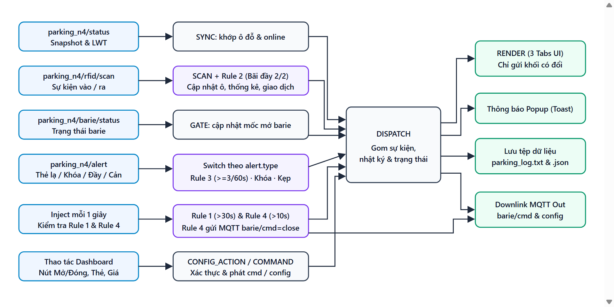
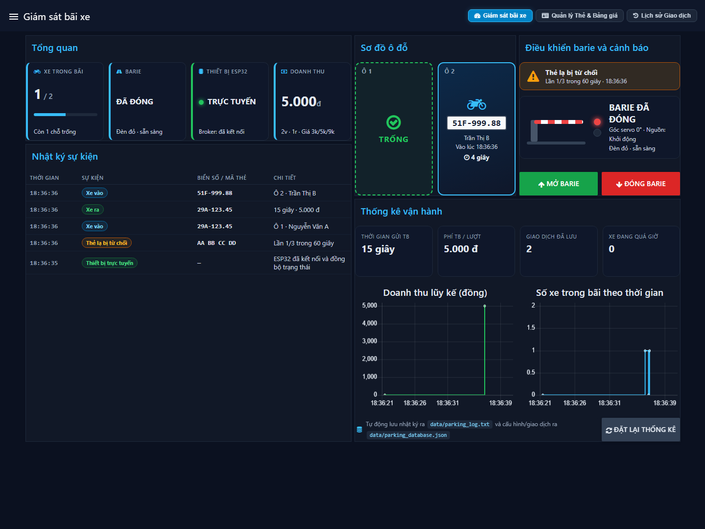

# BÁO CÁO TIỂU LUẬN HỌC PHẦN INTERNET OF THINGS (IOT)

**ĐỀ TÀI: HỆ THỐNG BÃI GIỮ XE MÁY TỰ QUẢN SỬ DỤNG RFID**

---

## PHẦN ĐẦU

### TRANG BÌA

* **Trường:** Trường Đại học Công Thương Thành phố Hồ Chí Minh (HUIT)
* **Khoa:** Khoa Công nghệ Thông tin
* **Học phần:** Internet of Things (IoT)
* **Đề tài:** Hệ thống bãi giữ xe máy tự quản sử dụng RFID (Mô phỏng 4 tầng IoT)
* **Nhóm thực hiện:** Nhóm 4

| STT | Họ và tên thành viên | Mã số sinh viên |
| :---: | :--- | :--- |
| 1 | Nguyễn Lê Duy Cương | 2001230069 |
| 2 | Đinh Tấn Thành | 2001230894 |
| 3 | Bùi Tấn Thông | 2001230938 |

* **Giảng viên hướng dẫn:** Võ Hoàng Hải
* **Địa điểm, thời gian:** TP. Hồ Chí Minh, tháng 11 năm 2026

---

### MỤC LỤC *(Trong bản Word `.docx` được cấu hình tự động cập nhật số trang)*

* Phần đầu: Danh mục hình, Danh mục bảng, Danh mục từ viết tắt, Tóm tắt
* Chương 1: Giới thiệu đề tài
* Chương 2: Cơ sở lý thuyết
* Chương 3: Phân tích và thiết kế hệ thống
* Chương 4: Triển khai
* Chương 5: Kiểm thử và đánh giá
* Chương 6: Kết luận và hướng phát triển
* Tài liệu tham khảo
* Phụ lục A – G

---

### DANH MỤC HÌNH

* **Hình 3.1:** Sơ đồ Use Case tổng quát của hệ thống bãi giữ xe RFID (`fig_3_1_usecase.png`)
* **Hình 3.2:** Sơ đồ kiến trúc 4 tầng IoT và luồng dữ liệu hai chiều (`fig_3_2_arch_4layer.png`)
* **Hình 3.3:** Lưu đồ thuật toán xử lý quẹt thẻ RFID tại cổng ESP32 (`fig_3_3_flow_rfid.png`)
* **Hình 3.4:** Lưu đồ chống kẹp xe (HC-SR04) và máy trạng thái Barie (`fig_3_4_flow_antipinch_fsm.png`)
* **Hình 3.5:** Lưu đồ xử lý sự kiện, đồng bộ và 4 rule trên Node-RED (`fig_3_5_flow_checkcard_nodered.png`)
* **Hình 4.1:** Mạch mô phỏng Wokwi khi xe ra tính phí và kích hoạt chống kẹp xe (`minh_chung_anti_pinch_wokwi.png`)
* **Hình 4.2:** Giao diện luồng xử lý Node-RED thực tế chia theo 4 cụm và cụm khởi động (`nodered_flow.png`)
* **Hình 4.3:** Giao diện Web Dashboard Tab 1 giám sát bãi xe và điều khiển barie (`dashboard_demo.png`)
* **Hình 4.4:** Giao diện đăng nhập xác thực quản trị Node-RED và cơ chế `httpNodeAuth` (`nodered_admin_login.png`)
* **Hình 4.5:** Giao diện mở rộng Tab 2 quản lý thẻ RFID và bảng giá động (`dashboard_cards_pricing.png`)
* **Hình 4.6:** Giao diện mở rộng Tab 3 tra cứu lịch sử giao dịch và xuất CSV (`dashboard_history.png`)

---

### DANH MỤC BẢNG

* **Bảng 1.1:** Kế hoạch thực hiện đề tài trong 10 tuần và các mốc rubric
* **Bảng 2.1:** So sánh ngắn giữa chuẩn RFID 13,56 MHz (MFRC522) và NFC
* **Bảng 2.2:** So sánh giao thức MQTT với HTTP và AMQP trong bối cảnh đề tài
* **Bảng 3.1:** Bảng đặc tả yêu cầu chức năng và phi chức năng
* **Bảng 3.2:** Sơ đồ đấu nối chân linh kiện phần cứng trên ESP32
* **Bảng 3.3:** Danh mục 6 topic MQTT nghiệp vụ và cấu trúc thông điệp
* **Bảng 3.4:** Bộ 4 quy tắc tự động hóa trên Node-RED (ngưỡng demo và ngưỡng thực tế)
* **Bảng 3.5:** Bố cục các thành phần hiển thị trên Web Dashboard
* **Bảng 4.1:** Môi trường công cụ và phiên bản sử dụng khi triển khai
* **Bảng 5.1:** Kết quả kiểm thử Tầng 1 (Firmware và mạch mô phỏng Wokwi)
* **Bảng 5.2:** Kết quả kiểm thử Tầng 2 (Truyền thông MQTT hai chiều và tự kết nối lại)
* **Bảng 5.3:** Kết quả kiểm thử Tầng 3 (4 rule tự động và lưu trữ bền vững)
* **Bảng 5.4:** Kết quả kiểm thử đầu-cuối (End-to-End) theo 9 phân cảnh demo
* **Bảng 5.5:** Bảng đối chiếu kết quả với các mốc yêu cầu học phần (M1–M4 và điều kiện Pass)
* **Bảng 5.6:** Số liệu đo kiểm tài nguyên Firmware ESP32 và thời gian phản hồi quan sát
* **Bảng A.1:** Bảng phân công nhiệm vụ các thành viên trong Nhóm 4
* **Bảng D.1:** Danh sách thẻ RFID mẫu sử dụng trong mô phỏng Wokwi

---

### DANH MỤC TỪ VIẾT TẮT

| Từ viết tắt | Tên đầy đủ tiếng Anh | Nghĩa tiếng Việt |
| :--- | :--- | :--- |
| **IoT** | Internet of Things | Mạng lưới vạn vật kết nối |
| **RFID** | Radio Frequency Identification | Nhận dạng qua tần số vô tuyến |
| **UID** | Unique Identifier | Mã định danh duy nhất của thẻ từ |
| **MQTT** | Message Queuing Telemetry Transport | Giao thức truyền thông điệp nhẹ publish/subscribe |
| **QoS** | Quality of Service | Mức chất lượng dịch vụ truyền tin MQTT |
| **JSON** | JavaScript Object Notation | Định dạng dữ liệu văn bản có cấu trúc cặp khóa–giá trị |
| **SPI** | Serial Peripheral Interface | Giao tiếp nối tiếp đồng bộ 4 dây cho ngoại vi tốc độ cao |
| **I2C** | Inter-Integrated Circuit | Giao tiếp nối tiếp đồng bộ 2 dây (`SDA`, `SCL`) |
| **PWM** | Pulse Width Modulation | Điều chế độ rộng xung điều khiển động cơ servo và âm thanh |
| **LWT** | Last Will and Testament | Thông điệp di chúc thông báo mất kết nối đột ngột trong MQTT |

---

### TÓM TẮT

Quản lý bãi giữ xe máy theo cách ghi vé giấy dễ gây ùn tắc giờ cao điểm, barie đóng cố định tiềm ẩn va chạm xe và thiếu dữ liệu giám sát từ xa. Đề tài mô phỏng hệ thống bãi giữ xe máy tự quản theo kiến trúc IoT 4 tầng. Tầng 1 dùng ESP32 trên Wokwi kết nối đầu đọc RFID-RC522, cảm biến HC-SR04 chống kẹp dưới 15 cm, servo SG90, LED Đỏ/Xanh, LCD 1602 I2C và buzzer; mọi quyết định vào/ra xử lý tại cổng kể cả khi mất mạng. Tầng 2 truyền dữ liệu hai chiều qua Wi-Fi và MQTT (`broker.hivemq.com:1883`, tiền tố `parking_n4/`). Tầng 3 chạy Node-RED đồng bộ trạng thái, thực thi bốn rule tự động và lưu tệp `parking_log.txt`, `parking_database.json`. Tầng 4 cung cấp Web Dashboard có xác thực đăng nhập (`httpNodeAuth`), điều khiển barie cùng phần mở rộng quản lý thẻ, bảng giá động và xuất CSV. Firmware tiêu thụ 62,7% Flash, 14,3% RAM; kiểm thử qua MQTT và Chrome xác nhận bốn rule và đồng bộ hai chiều hoạt động ổn định.

---

## CHƯƠNG 1. GIỚI THIỆU ĐỀ TÀI

### 1.1. Đặt vấn đề
Tại nhiều bãi giữ xe máy quy mô vừa và nhỏ như ký túc xá, trường học hoặc tòa nhà văn phòng, việc soát vé giấy thủ công bộc lộ ba hạn chế rõ rệt trong quá trình vận hành:
1. **Ùn tắc tại cổng vào/ra:** Bảo vệ phải ghi vé, kiểm tra biển số bằng tay và thu tiền trực tiếp, làm kéo dài thời gian xử lý mỗi lượt xe vào giờ cao điểm.
2. **Rủi ro va chạm thanh chắn barie:** Các cổng tự động đóng cứng sau một khoảng thời gian cố định không nhận biết được phương tiện hay người đi bộ vẫn đang ở bên dưới, dễ gây va chạm.
3. **Khó giám sát và thiếu dữ liệu truy vết:** Người quản lý không biết được bãi còn bao nhiêu chỗ trống theo thời gian thực, không phát hiện được xe gửi quá hạn hay hành vi thử thẻ lạ liên tiếp, và thiếu nhật ký chi tiết khi cần đối soát sự cố.

### 1.2. Mục tiêu

#### 1.2.1. Mục tiêu tổng quát
Xây dựng hoàn chỉnh hệ thống mô phỏng bãi giữ xe máy tự quản theo kiến trúc IoT 4 tầng, bảo đảm truyền thông hai chiều ổn định giữa thiết bị cổng và ứng dụng giám sát.

#### 1.2.2. Mục tiêu cụ thể
1. Thiết kế mạch mô phỏng Tầng 1 trên Wokwi với ESP32, đầu đọc RFID-RC522, cảm biến siêu âm HC-SR04, servo SG90, đèn LED Đỏ/Xanh, màn hình LCD 1602 I2C và còi báo.
2. Xây dựng firmware xử lý quẹt thẻ vào/ra, chống đọc trùng thẻ (debounce), tính thời gian gửi và cước phí ngay tại cổng không phụ thuộc kết nối mạng.
3. Cài đặt cơ chế an toàn chống kẹp xe: tự động hoãn hạ thanh chắn khi phát hiện vật cản dưới 15 cm và kiểm tra lại mỗi 0,3 giây đến khi thông thoáng.
4. Triển khai truyền thông MQTT hai chiều (Uplink dữ liệu cảm biến/trạng thái và Downlink lệnh điều khiển/cấu hình) có tự kết nối lại sau 5 giây và Last Will thông báo mất kết nối.
5. Xây dựng 4 quy tắc tự động hóa trên Node-RED và lưu trữ lịch sử, trạng thái bền vững qua khởi động lại.
6. Thiết kế Web Dashboard có xác thực đăng nhập, hiển thị số xe, trạng thái từng ô, nhật ký sự kiện, nút điều khiển barie từ xa và các công cụ quản trị mở rộng.

### 1.3. Phạm vi và giới hạn

#### 1.3.1. Phạm vi mô phỏng và hạ tầng
* **Mô phỏng phần cứng:** Toàn bộ Tầng 1 chạy trên nền tảng mô phỏng Wokwi kết hợp biên dịch firmware bằng PlatformIO, chưa lắp ráp trên mạch vật lý thật.
* **Hạ tầng mạng:** Sử dụng Wi-Fi giả lập `Wokwi-GUEST` kết nối tới HiveMQ public broker (`broker.hivemq.com:1883`), sử dụng tiền tố topic riêng (`parking_n4/`) để tránh lẫn dữ liệu với người dùng khác.

#### 1.3.2. Giới hạn quy mô thực nghiệm
* Bãi xe mô phỏng có sức chứa 2 ô đỗ (`PARKING_CAPACITY = 2`); các ngưỡng thời gian kiểm tra (giữ mở barie 3 giây, quá giờ 30 giây, barie mở quá lâu 10 giây) được thu ngắn để thuận tiện trình bày và kiểm thử trong thời lượng demo.

### 1.4. Phương pháp thực hiện
Nhóm áp dụng phương pháp thiết kế theo mô hình IoT 4 tầng từ dưới lên, tách biệt từng lớp phần cứng mô phỏng, truyền thông mạng, xử lý trung gian và giao diện ứng dụng:
* **Tầng thiết bị:** Viết firmware C++ theo hướng mô-đun trên VS Code + PlatformIO, mô phỏng trên Wokwi.
* **Tầng mạng và trung gian:** Sử dụng HiveMQ public broker (`broker.hivemq.com:1883`) và Node-RED (`v5.0.10` đóng gói trong Docker Compose cùng `eclipse-mosquitto:2.0` và `nodered/node-red:latest`).
* **Kiểm thử:** Kết hợp kiểm thử tương tác Tầng 1 trên Wokwi Simulator với bộ kịch bản Node.js giả lập bản tin ESP32 qua MQTT, kiểm tra HTTP Auth và kiểm tra giao diện trên Chrome headless.
* **Phân chia tiến độ:** Chia khối lượng công việc thành 10 tuần gắn với 4 mốc nghiệm thu M1–M4 của học phần.

### 1.5. Kế hoạch 10 tuần

| Tuần | Nội dung công việc thực hiện (đối chiếu báo cáo tuần) | Mốc Rubric |
| :---: | :--- | :---: |
| **1** | Phân tích bài toán, xác định use case, thiết kế kiến trúc 4 tầng, phân công thành viên | |
| **2** | Dựng mô phỏng Tầng 1 bản đầu trên Wokwi gồm ESP32, RFID-RC522, Servo SG90 và Buzzer (chưa triển khai Wi-Fi/MQTT) | |
| **3** | Ổn định firmware: tái cấu trúc theo State Machine 4 trạng thái (`IDLE` → `SCANNING` → `OPENING` → `CLOSING`), phân biệt vào/ra theo UID, lọc đọc trùng (debounce) và kiểm thử nhiều UID | **M1** |
| **4** | Tích hợp kết nối Wi-Fi và giao thức MQTT hai chiều (`publish` sự kiện Uplink, `subscribe` lệnh barie Downlink, cơ chế tự kết nối lại) | **M2** |
| **5** | Xây dựng flow Node-RED trung gian (`Check Card`), ghi nhật ký sự kiện ra tệp và gửi lệnh điều khiển barie | |
| **6** | Xây dựng Web Dashboard (`/ui`) hiển thị số xe, trạng thái barie, 8 sự kiện, biên nhận, cảnh báo, nút Mở/Đóng và bật xác thực đăng nhập (`httpNodeAuth` trong `settings.js`) | **M3** |
| **7** | Hoàn thiện 4 quy tắc tự động hóa trên Node-RED và xử lý các kịch bản bất thường | |
| **8** | Tích hợp đầu-cuối (End-to-End); bổ sung cảm biến siêu âm HC-SR04 chống kẹp xe, màn hình LCD 1602 I2C (dời chân `RST` RFID sang GPIO 4), cụm LED Đỏ/Xanh, khai báo LWT và snapshot `retained` | **M4** |
| **9** | Đóng gói Docker Compose, triển khai các tính năng mở rộng (quản lý 16 thẻ động, bảng giá động, lịch sử ghép cặp & xuất CSV), chạy kịch bản kiểm thử tự động MQTT/Chrome và hoàn thiện báo cáo, slide | |
| **10** | Thực hiện chạy liên hoàn 9 bước trên Wokwi thật kết hợp Dashboard, quay video minh chứng và nghiệm thu cuối kỳ | |

*Bảng 1.1: Kế hoạch thực hiện đề tài trong 10 tuần và các mốc rubric.*

### 1.6. Bố cục tiểu luận
Báo cáo gồm 6 chương và phần phụ lục:
* **Chương 1 (Giới thiệu đề tài):** Trình bày bài toán thực tế, mục tiêu, phạm vi mô phỏng, phương pháp và kế hoạch 10 tuần.
* **Chương 2 (Cơ sở lý thuyết):** Tóm tắt các công nghệ thực tế sử dụng trong dự án gồm kiến trúc IoT 4 tầng, RFID 13,56 MHz, ngoại vi ESP32, giao thức MQTT, Node-RED và mô phỏng Wokwi.
* **Chương 3 (Phân tích và thiết kế hệ thống):** Đặc tả yêu cầu, sơ đồ Use Case, thiết kế chi tiết 4 tầng, lưu đồ firmware, danh mục topic MQTT, 4 rule tự động, giao diện Dashboard và giải pháp lưu trữ JSON.
* **Chương 4 (Triển khai):** Trình bày môi trường cài đặt, ảnh minh chứng, quy trình triển khai từng tầng kèm các trích đoạn xử lý trọng tâm và mục riêng cho các tính năng mở rộng.
* **Chương 5 (Kiểm thử và đánh giá):** Trình bày kết quả kiểm thử từng tầng, kiểm thử đầu-cuối 9 phân cảnh, đối chiếu rubric và số đo tài nguyên thật.
* **Chương 6 (Kết luận và hướng phát triển):** Tổng kết kết quả đạt được, các hạn chế hiện có và định hướng nâng cấp.

---

## CHƯƠNG 2. CƠ SỞ LÝ THUYẾT

### 2.1. IoT và kiến trúc phân tầng
Hệ thống Internet of Things (IoT) là tập hợp các thiết bị vật lý được gắn cảm biến, bộ xử lý và khả năng kết nối mạng để thu thập, trao đổi dữ liệu và tác động trở lại môi trường tự động. Để dễ bảo trì và mở rộng, dự án tổ chức theo kiến trúc phân tầng gồm 4 lớp:
1. **Tầng Cảm biến và Chấp hành (Sensing & Actuation):** Đọc thông tin đầu vào từ môi trường và thực thi tác động cơ học hoặc tín hiệu hiển thị tại chỗ.
2. **Tầng Mạng (Network):** Đảm bảo kết nối không dây và định tuyến thông điệp giữa thiết bị biên với máy chủ thông qua giao thức chuẩn.
3. **Tầng Xử lý trung gian (Middleware):** Tiếp nhận luồng dữ liệu, lưu trữ trạng thái, đánh giá điều kiện nghiệp vụ theo quy tắc tự động và phát cảnh báo.
4. **Tầng Ứng dụng (Application):** Cung cấp giao diện trực quan cho người vận hành giám sát số liệu và gửi lệnh điều khiển.

Trong kiến trúc này, dữ liệu đi theo hai chiều: **luồng Uplink** (từ Tầng 1 qua Tầng 2, Tầng 3 lên Tầng 4 để cập nhật trạng thái) và **luồng Downlink** (từ Tầng 4 hoặc Tầng 3 truyền ngược xuống Tầng 1 để thay đổi trạng thái chấp hành hoặc cấu hình).

### 2.2. RFID
Công nghệ RFID (Radio Frequency Identification) nhận dạng đối tượng không tiếp xúc bằng sóng vô tuyến giữa đầu đọc (Reader) và thẻ từ (Tag). Trong đề tài, nhóm sử dụng thẻ thụ động MIFARE Classic hoạt động ở băng tần cao **HF 13,56 MHz** theo chuẩn **ISO/IEC 14443A**:
* Khi thẻ đi vào vùng từ trường của cuộn anten trên module **MFRC522**, năng lượng cảm ứng cấp nguồn cho vi mạch trong thẻ phản hồi lại chuỗi định danh duy nhất **UID** (4 byte, viết dưới dạng 4 cặp số thập lục phân như `01 02 03 04`).
* Module MFRC522 truyền dữ liệu UID vừa đọc về vi điều khiển ESP32 thông qua giao tiếp **SPI** ở mức điện áp logic 3,3V.

| Tiêu chí | RFID HF 13,56 MHz (MFRC522) | NFC (Near Field Communication) |
| :--- | :--- | :--- |
| Tần số hoạt động | 13,56 MHz | 13,56 MHz (tương thích chuẩn ISO 14443) |
| Chế độ giao tiếp | Một chiều đọc/ghi từ đầu đọc xuống thẻ | Hai chiều (ngang hàng P2P, giả lập thẻ, đọc/ghi) |
| Khoảng cách đọc | Tối đa khoảng 3–5 cm (với anten RC522) | Thường dưới 4 cm |
| Ứng dụng điển hình | Thẻ giữ xe, thẻ nhân viên, kiểm soát ra vào | Thanh toán di động, ghép nối nhanh trên điện thoại |

*Bảng 2.1: So sánh ngắn giữa chuẩn RFID 13,56 MHz (MFRC522) và NFC.*

### 2.3. ESP32 và thiết bị ngoại vi
Vi điều khiển **ESP32 DevKit V1** (nhân Xtensa dual-core 32-bit, tích hợp sẵn Wi-Fi 802.11 b/g/n) làm bộ điều khiển trung tâm tại cổng với ba nhóm giao tiếp chính:

#### 2.3.1. Giao tiếp SPI và I2C
* **Giao tiếp SPI (Serial Peripheral Interface):** Chuẩn nối tiếp đồng bộ 4 dây (`SCK` xung nhịp, `MOSI` truyền đi, `MISO` nhận về, `SDA/SS` chọn chip) dùng để ESP32 đọc dữ liệu từ module RFID-RC522 ở tốc độ cao.
* **Giao tiếp I2C (Inter-Integrated Circuit):** Chuẩn 2 dây gồm đường dữ liệu `SDA` và đường xung nhịp `SCL`, dùng để điều khiển màn hình ký tự **LCD 1602** (2 dòng x 16 cột) qua mạch mở rộng PCF8574 tại địa chỉ `0x27`.

#### 2.3.2. Điều chế độ rộng xung PWM cho Servo và Buzzer
Bộ định thời LEDC trong ESP32 xuất xung tần số **50 Hz** (chu kỳ 20 ms, độ rộng xung 500–2400 $\mu$s) để điều khiển góc quay $0^\circ$ đến $90^\circ$ cho động cơ **Servo SG90** thông qua thư viện `ESP32Servo`. Để còi **Active Buzzer** phát âm thanh ở tần số 2000 Hz mà không xung đột bộ định thời với servo, dự án cấp riêng cho buzzer kênh LEDC số 15.

#### 2.3.3. Nguyên lý đo khoảng cách của cảm biến siêu âm HC-SR04
ESP32 kích một xung mức cao tối thiểu 10 $\mu$s vào chân `TRIG`, cảm biến phát chùm sóng siêu âm 40 kHz và kéo chân `ECHO` lên mức cao trong thời gian $t$ ($\mu$s) bằng tổng thời gian sóng đi và phản xạ về. Khoảng cách $d$ (cm) tính theo tốc độ âm thanh trong không khí ($343\text{ m/s} = 0{,}0343\text{ cm/}\mu\text{s}$):
$$d = \frac{t \times 0{,}0343}{2}$$

### 2.4. Giao thức MQTT

#### 2.4.1. Mô hình Publish/Subscribe và cây Topic
MQTT (Message Queuing Telemetry Transport) là giao thức truyền thông điệp nhẹ hoạt động trên nền TCP/IP theo mô hình **Publish / Subscribe** thông qua một máy chủ trung gian (**Broker**). Thiết bị phát (Publisher) và thiết bị nhận (Subscriber) không kết nối trực tiếp với nhau mà phân loại dữ liệu theo cấu trúc cây **Topic** (ví dụ `parking_n4/rfid/scan`).

#### 2.4.2. Chất lượng dịch vụ (QoS) sử dụng thực tế trong đề tài
Chuẩn MQTT quy định ba mức chất lượng truyền tin: `QoS 0` (*At most once* — gửi một lần không xác nhận), `QoS 1` (*At least once* — gửi ít nhất một lần có gói `PUBACK` xác nhận) và `QoS 2` (*Exactly once* — bắt tay bốn bước đảm bảo nhận đúng một lần, ít dùng trên vi điều khiển do tốn tài nguyên). Trong mã nguồn dự án:
* **Chiều Uplink (ESP32 $\rightarrow$ Broker):** Thư viện `PubSubClient 2.8.0` chỉ hỗ trợ hàm `publish()` ở **`QoS 0`**, do đó mọi bản tin quẹt thẻ, barie, cảnh báo và snapshot từ ESP32 đều phát ở `QoS 0`. Riêng bản tin di chúc **LWT** do Broker tự phát khi ESP32 đứt kết nối được khai báo mức `willQos = 1`.
* **Chiều Broker $\rightarrow$ Node-RED:** Bốn node `mqtt in` đăng ký nhận ở `QoS 1` (theo đặc tả MQTT, Broker chuyển phát theo giá trị nhỏ hơn giữa QoS lúc gửi và QoS đăng ký, nên bản tin Uplink từ ESP32 tới Node-RED chạy ở `QoS 0`, còn LWT từ Broker chạy ở `QoS 1`).
* **Chiều Downlink (Node-RED $\rightarrow$ Broker $\rightarrow$ ESP32):** Hai node `mqtt out` trên Node-RED (`barie/cmd` và `config`) phát lên Broker ở **`QoS 1`**; ở đầu thiết bị, hàm `_mqttClient.subscribe(topic)` của `PubSubClient` đăng ký nhận theo mặc định **`QoS 0`**.

#### 2.4.3. Cơ chế Retained, LWT và so sánh với HTTP, AMQP
* **Retained Message:** Broker lưu giữ bản tin cuối cùng có cờ `retain = true` của một topic để bất kỳ client nào vừa `subscribe` sau đó đều nhận ngay trạng thái mới nhất (dùng cho trạng thái barie, snapshot và cấu hình thẻ).
* **LWT (Last Will and Testament):** Khi kết nối tới broker, ESP32 khai báo trước một thông điệp di chúc (`{"online":false}` trên `parking_n4/status`). Nếu thiết bị mất nguồn hoặc đứt mạng đột ngột quá thời gian `keepAlive`, broker tự động phát thông điệp này báo ngoại tuyến lên Dashboard.

| Tiêu chí | MQTT | HTTP | AMQP |
| :--- | :--- | :--- | :--- |
| Mô hình giao tiếp | Publish / Subscribe qua Broker | Request / Response (Client – Server) | Publish / Subscribe & Queue phức tạp |
| Kích thước phần đầu | Nhỏ gọn (tối thiểu 2 bytes) | Lớn (header dạng văn bản ASCII) | Trung bình đến lớn |
| Đẩy lệnh Downlink | Tức thời qua kết nối TCP duy trì sẵn | Phải polling định kỳ hoặc thêm WebSocket | Tức thời qua broker |
| Phù hợp cho ESP32 | Rất phù hợp cho vi điều khiển tài nguyên hạn chế | Tốn tài nguyên phân tích header và mở lại kết nối | Nặng hơn, phù hợp hạ tầng máy chủ doanh nghiệp |

*Bảng 2.2: So sánh giao thức MQTT với HTTP và AMQP trong bối cảnh đề tài.*

### 2.5. Node-RED và Dashboard
**Node-RED** là công cụ lập trình trực quan theo luồng (Flow-Based Programming) chạy trên nền Node.js:
* **Node `function`:** Cho phép viết mã JavaScript xử lý dữ liệu JSON từ thông điệp `msg.payload` và lưu giữ trạng thái dùng chung trong luồng thông qua biến ngữ cảnh `flow` (`flow.get()`, `flow.set()`) hoặc nội bộ node (`context`).
* **Node-RED Dashboard (`node-red-dashboard`):** Gói mở rộng tự động dựng giao diện web tại đường dẫn `/ui` dựa trên AngularJS 1.x và Socket.IO, cung cấp các thành phần dựng sẵn như nút bấm (`ui_button`), biểu đồ (`ui_chart`), thông báo nổi (`ui_toast`) và khung mẫu tùy biến (`ui_template`).

### 2.6. Nền tảng Wokwi
**Wokwi** là trình mô phỏng phần cứng nhúng trực tuyến và tích hợp sẵn trong VS Code. Nền tảng hỗ trợ giả lập vi điều khiển ESP32, thực thi trực tiếp tệp nhị phân `.bin` biên dịch từ PlatformIO, mô phỏng tương tác các linh kiện như đầu đọc thẻ MFRC522 (chọn thẻ mẫu có sẵn hoặc tùy chỉnh UID), thanh trượt khoảng cách HC-SR04, góc quay Servo SG90, màn hình LCD I2C và cung cấp mạng Wi-Fi ảo `Wokwi-GUEST` cho phép kết nối tới MQTT broker công cộng ngoài Internet.

*Giới hạn:* Vì chạy trên môi trường ảo hóa đám mây của Wokwi nên độ trễ truyền gói tin qua mạng Internet tới public broker phụ thuộc băng thông thực tế tại thời điểm chạy, tốc độ mô phỏng CPU có thể chậm hơn nhẹ so với phần cứng thực khi tải cao, và không mô phỏng được nhiễu điện từ hay sai số cơ học ngoài đời thực.

---

## CHƯƠNG 3. PHÂN TÍCH VÀ THIẾT KẾ HỆ THỐNG

### 3.1. Phân tích yêu cầu

#### 3.1.1. Tác nhân tương tác và sơ đồ Use Case
Hệ thống gồm ba nhóm tác nhân tương tác chính:
1. **Người gửi xe:** Quẹt thẻ RFID khi vào/ra cổng, quan sát màn hình LCD và đèn báo LED Đỏ/Xanh để di chuyển xe qua barie an toàn.
2. **Người quản lý:** Đăng nhập Dashboard giám sát số chỗ trống, trạng thái các ô đỗ, cảnh báo an ninh, điều khiển đóng/mở barie từ xa; sử dụng thêm các công cụ mở rộng như quản lý thẻ, chỉnh bảng giá và tra cứu giao dịch.
3. **Tác nhân tự động (ESP32 Timer / Node-RED Timer):** Tự động kiểm tra cảm biến chống kẹp xe dưới barie mỗi 0,3 giây khi có yêu cầu đóng, tự động quét 4 rule trên Node-RED mỗi 1 giây và ghi nhận lịch sử ra tệp.


*Hình 3.1: Sơ đồ Use Case tổng quát của hệ thống bãi giữ xe RFID.*

#### 3.1.2. Đặc tả yêu cầu chức năng và phi chức năng

| Nhóm | Mã | Yêu cầu chi tiết |
| :--- | :--- | :--- |
| **Chức năng cốt lõi** | FR1 | Đọc UID thẻ RFID 13,56 MHz, phân biệt lượt vào/ra, tự gán ô trống (1 hoặc 2) và từ chối khi bãi đầy (`2/2`) hoặc thẻ không hợp lệ |
| | FR2 | Tính thời gian đỗ xe và cước phí khi xe ra, hiển thị biển số và cước phí lên LCD 1602, phát còi phản hồi và điều khiển Servo/LED |
| | FR3 | Hoãn đóng barie khi HC-SR04 đo khoảng cách vật cản dưới $15\text{ cm}$ (áp dụng cho cả tự đóng và lệnh đóng từ xa) |
| | FR4 | Truyền dữ liệu Uplink lên MQTT, hiển thị trên Dashboard (có xác thực `httpNodeAuth`) và gửi lệnh Downlink Mở/Đóng barie từ xa |
| | FR5 | Thực thi 4 rule tự động trên Node-RED (quá giờ $>30\text{s}$, bãi đầy $2/2$, dò thẻ lạ $\ge 3$ lần/60s, barie mở $>10\text{s}$) và lưu file log/JSON |
| **Chức năng mở rộng** | ER1 | Quản lý danh sách thẻ động (tối đa 16 thẻ: thêm, sửa, khóa/mở, xóa, vé tháng) và bảng giá động đồng bộ qua MQTT `retained` |
| | ER2 | Tra cứu danh sách giao dịch ghép cặp vào–ra và tải xuống tệp CSV phục vụ đối soát trên Excel |
| **Phi chức năng** | NFR1 | Cổng vào/ra vẫn vận hành độc lập tại ESP32 khi mất kết nối Wi-Fi/MQTT và tự kết nối lại mỗi 5 giây khi có mạng |
| | NFR2 | Không dùng vòng lặp chặn (`delay` kéo dài) trong `loop()` làm chậm khả năng quét RFID hoặc nhận lệnh từ MQTT |

*Bảng 3.1: Bảng đặc tả yêu cầu chức năng và phi chức năng.*

### 3.2. Kiến trúc tổng thể
Hệ thống liên kết chặt chẽ qua 4 tầng từ thiết bị phần cứng mô phỏng đến giao diện web như minh họa ở Hình 3.2. Trong thiết kế đồng bộ này, ESP32 đóng vai trò nguồn dữ liệu gốc (source of truth) về trạng thái hai ô đỗ và thanh chắn barie tại cổng; mỗi lần kết nối MQTT, thiết bị gửi bản tin snapshot `retained` để Node-RED cập nhật giao diện khớp nhất quán với hiện trạng tại cổng.


*Hình 3.2: Sơ đồ kiến trúc 4 tầng IoT và luồng dữ liệu hai chiều.*

### 3.3. Thiết kế Tầng 1
Mạch mô phỏng Tầng 1 được khai báo trong tệp `diagram.json` gồm 7 thành phần chính đấu nối tới vi điều khiển `board-esp32-devkit-c-v4` theo Bảng 3.2 (hình ảnh mạch thực tế sau khi nạp firmware xem ở Hình 4.1 tại Chương 4).

| Thiết bị ngoại vi | Chân linh kiện | Chân ESP32 (GPIO) | Nguồn cấp | Vai trò trong mạch |
| :--- | :--- | :--- | :---: | :--- |
| **RFID-RC522 (`rfid1`)** | `SDA`, `SCK`, `MOSI`, `MISO`, `RST` | `5`, `18`, `23`, `19`, `4` | 3,3V | Đọc UID thẻ xe qua bus SPI |
| **HC-SR04 (`us1`)** | `TRIG`, `ECHO` | `27`, `32` | 5V | Đo khoảng cách vật cản dưới barie |
| **Servo SG90 (`servo1`)** | `PWM` | `13` | 5V | Nâng/hạ cần chắn ($0^\circ$ đóng, $90^\circ$ mở) |
| **LED Đỏ (`led_red`)** | `Anode (+)` | `25` | 3,3V | Báo trạng thái STOP (đóng / lỗi) |
| **LED Xanh (`led_green`)** | `Anode (+)` | `26` | 3,3V | Báo trạng thái GO (mở, mời đi qua) |
| **Buzzer (`bz1`)** | `Signal` | `14` | 3,3V | Còi báo phản hồi theo từng tình huống |
| **LCD 1602 I2C (`lcd1`)** | `SDA`, `SCL` | `21`, `22` | 5V | Hiển thị thông tin tại cổng (`0x27`) |

*Bảng 3.2: Sơ đồ đấu nối chân linh kiện phần cứng trên ESP32.*

### 3.4. Thiết kế firmware

#### 3.4.1. Tổ chức bốn mô-đun phần mềm nhúng
Mã nguồn firmware phân tách thành bốn mô-đun theo trách nhiệm trong `include/` và `src/`:
* **`Config.h`:** Khai báo hằng số chân GPIO, thông số thời gian mặc định (`GATE_HOLD_MS = 3000`, `CARD_DEBOUNCE_MS = 1500`, `ANTI_PINCH_DIST_CM = 15.0`, `ANTI_PINCH_RECHECK = 300`), biểu phí mặc định và danh sách 6 topic MQTT.
* **`ParkingSystem`:** Quản lý mảng tối đa 16 thẻ (`_cards`), tìm kiếm UID, cấp phát ô trống `1..2`, tính phí gửi xe (hỗ trợ vé tháng và biểu phí động qua `applyConfig()`), điều khiển LCD 16x2 tự quay về màn hình chính sau 2 giây và phát còi bằng kênh LEDC 15 không chặn vòng quét.
* **`GateController`:** Điều khiển servo SG90 và cặp đèn LED theo máy trạng thái 3 trạng thái (`GATE_CLOSED`, `GATE_OPEN_TIMED`, `GATE_OPEN_HOLD`). Khi có yêu cầu đóng, cờ `_closePending = true` kích hoạt chu kỳ đo cảm biến HC-SR04 mỗi `300 ms`.
* **`MqttService` & `main.cpp`:** `MqttService` quản lý kết nối Wi-Fi (`setAutoReconnect(true)`), `PubSubClient` (`keepAlive = 15s`, `socketTimeout = 4s`, bộ đệm `2560 bytes`, LWT và reconnect mỗi 5 giây); vòng lặp `loop()` trong `main.cpp` gọi tuần tự các dịch vụ và tiếp nhận lệnh kiểm thử Serial (`1`–`4`, `scan`, `open`, `close`, `sonar`, `cards`, `price`, `status`).

#### 3.4.2. Lưu đồ quẹt thẻ và máy trạng thái chống kẹp xe
Lưu đồ thuật toán quẹt thẻ RFID thể hiện tại Hình 3.3, còn cơ chế chống kẹp xe kết hợp máy trạng thái barie thể hiện tại Hình 3.4.


*Hình 3.3: Lưu đồ thuật toán xử lý quẹt thẻ RFID tại cổng ESP32.*


*Hình 3.4: Lưu đồ chống kẹp xe (HC-SR04) và máy trạng thái Barie (`GateController`).*

### 3.5. Thiết kế Tầng 2
Hệ thống sử dụng **HiveMQ Public Broker** tại địa chỉ `broker.hivemq.com`, cổng `1883`, phân tách không gian tên bằng tiền tố `parking_n4/`. Bảng 3.3 liệt kê 6 topic được sử dụng (gồm 4 topic Uplink và 2 topic Downlink). Để duy trì hoạt động khi mất mạng tạm thời, vòng lặp chính không chờ kết nối MQTT mới chạy; khi kết nối phục hồi sau chu kỳ thử lại 5 giây, hàm `onMqttConnected()` tự động gửi lại trạng thái barie và snapshot 2 ô đỗ, đồng thời broker đẩy lại bản tin cấu hình `retained` mới nhất từ topic `parking_n4/config` xuống thiết bị.

| Topic | Chiều | Retained / LWT | Payload JSON mẫu | Mục đích |
| :--- | :---: | :---: | :--- | :--- |
| `parking_n4/rfid/scan` | Uplink | Không | `{"action":"check_in","uid":"01 02 03 04","licensePlate":"29A-123.45","slot":1,"fee":0,"parkedCount":1,"totalSlots":2}` | Báo sự kiện xe vào/ra hợp lệ, ô đỗ và cước phí |
| `parking_n4/barie/status` | Uplink | Retained | `{"state":"open","mode":"auto","source":"card","angle":90}` | Báo góc mở và nguồn tác động của barie |
| `parking_n4/alert` | Uplink | Không | `{"type":"INVALID_CARD","uid":"AA BB CC DD"}` hoặc `{"type":"ANTI_PINCH","distanceCm":10.2}` | Báo thẻ lạ, thẻ khóa, từ chối do đầy bãi và vật cản |
| `parking_n4/status` | Uplink | Retained + LWT | `{"online":true,"gate":"closed","occupied":1,"capacity":2,"slots":[...]}` | Snapshot đồng bộ toàn bộ bãi xe; LWT phát `{"online":false}` khi mất kết nối |
| `parking_n4/barie/cmd` | Downlink | Không | `{"cmd":"open","src":"dashboard"}` hoặc `{"cmd":"close","src":"rule4"}` | Điều khiển mở/đóng/đồng bộ barie từ Dashboard hoặc Rule 4 |
| `parking_n4/config` *(Mở rộng)* | Downlink | Retained | `{"v":2,"p":{"en":true,"t1s":10,"t1f":3000,...},"c":[{"u":"01 02 03 04",...}]}` | Đồng bộ danh sách thẻ (tối đa 16) và bảng giá động xuống ESP32 |

*Bảng 3.3: Danh mục 6 topic MQTT nghiệp vụ và cấu trúc thông điệp.*

### 3.6. Thiết kế Tầng 3

#### 3.6.1. Cấu trúc đối tượng trạng thái tập trung trên Node-RED
Toàn bộ trạng thái trên Node-RED được quản lý tập trung trong một đối tượng `flow.get('park')` nhằm tránh lệch số liệu giữa các widget (Hình 3.5). Luồng vào gồm 4 node `mqtt in`, node `inject` chu kỳ 1 giây kiểm tra thời gian lưu bãi và thời gian mở barie, node `status` giám sát kết nối broker. Các nhánh hội tụ về hàm `DISPATCH` để cập nhật tối đa 12 sự kiện gần nhất, phát thông báo popup (`ui_toast`), ghi tệp lưu trữ và chuyển qua hàm `RENDER` (chỉ phát bản tin cho từng widget nếu chuỗi JSON đầu ra thay đổi).


*Hình 3.5: Lưu đồ xử lý sự kiện, đồng bộ và 4 rule trên Node-RED.*

#### 3.6.2. Bộ 4 quy tắc tự động hóa (ngưỡng demo và thực tế)

| Quy tắc | Điều kiện kích hoạt | Ngưỡng demo | Ngưỡng thực tế đề xuất | Hành động của hệ thống |
| :--- | :--- | :--- | :--- | :--- |
| **Rule 1: Xe gửi quá giờ** | Thời gian xe lưu trong ô đỗ vượt ngưỡng (`now - since`) | $30\text{ giây}$ (chỉnh được trên UI) | $4\text{–}12\text{ giờ}$ tùy ca gửi | Gắn nhãn `QUÁ GIỜ` trên ô đỗ, đổi màu viền vàng, hiện banner cảnh báo và toast |
| **Rule 2: Bãi đầy** | Xe vào đạt sức chứa hoặc nhận alert `LOT_FULL` từ cổng | $2/2\text{ xe}$ | $50\text{–}500\text{ xe}$ tùy bãi | Chuyển thẻ Tổng quan sang đỏ (`Bãi đã đầy`); từ chối thực tế do ESP32 thực hiện ngay tại cổng |
| **Rule 3: Dò thẻ lạ liên tiếp** | Số lần nhận `INVALID_CARD` trong cửa sổ thời gian đạt mức | $\ge 3\text{ lần}$ trong $60\text{ giây}$ | $\ge 5\text{ lần}$ trong $120\text{ giây}$ | Chuyển cảnh báo từ mức `warn` sang mức `danger` (`Rule 3 · Nghi vấn dò thẻ`) |
| **Rule 4: Barie mở quá lâu** | Trạng thái barie giữ mở liên tục vượt quá giới hạn | $10\text{ giây}$ | $30\text{–}60\text{ giây}$ | Tự động gửi lệnh Downlink `{"cmd":"close","src":"rule4"}` xuống ESP32 (vẫn qua HC-SR04 chống kẹp) |

*Bảng 3.4: Bộ 4 quy tắc tự động hóa trên Node-RED (ngưỡng demo và ngưỡng thực tế).*

### 3.7. Thiết kế Tầng 4

#### 3.7.1. Bố cục giao diện Web Dashboard 3 tab
Giao diện Web Dashboard (`http://localhost:1880/ui`) sử dụng nền tối thống nhất, gồm 3 tab có thanh chuyển nhanh gắn trực tiếp trên thanh tiêu đề trên cùng (`#nr-dashboard-toolbar`): Tab 1 phục vụ vận hành cốt lõi vừa gọn trong một màn hình máy tính để bàn (`1440 px`), còn Tab 2 và Tab 3 tách riêng cho phần mở rộng quản trị và đối soát (Bảng 3.5).

#### 3.7.2. Cơ chế xác thực truy cập (`httpNodeAuth` và `adminAuth`)
Khớp với báo cáo Tuần 6, hệ thống cấu hình xác thực truy cập trong tệp `docker/nodered/settings.js` (nạp vào container qua `docker-compose.yml` và áp dụng đồng bộ trên bản chạy cục bộ): Web Dashboard (`/ui`) được bảo vệ bởi **HTTP Basic Auth (`httpNodeAuth`)**, còn giao diện soạn thảo luồng (`/`) được bảo vệ bởi **`adminAuth`**. Mật khẩu quản trị lưu hoàn toàn dưới dạng chuỗi băm `bcrypt` (`$2b$08$...`) hoặc truyền qua biến môi trường (`NODERED_UI_PASS_HASH`, `NODERED_ADMIN_PASS_HASH`), không lưu mật khẩu thô trong mã nguồn. Khi người dùng chưa đăng nhập hoặc nhập sai mật khẩu truy cập `/ui`, máy chủ trả mã `401 Unauthorized` kèm header `WWW-Authenticate: Basic realm="Authorization Required"` để chặn thao tác mở cổng trái phép.

| Tab | Khối giao diện (`ui_group`) | Nguồn dữ liệu từ `RENDER` | Chức năng chính |
| :--- | :--- | :--- | :--- |
| **1. Giám sát bãi xe** *(Cốt lõi)* | Tổng quan (4 thẻ KPI) | `overview` | Hiện số xe/2, thanh lấp đầy, trạng thái barie, online/offline ESP32, doanh thu |
| | Sơ đồ ô đỗ (Ô 1 & Ô 2) | `slots` | Hiện trạng thái trống hoặc biển số, chủ xe, giờ vào, bộ đếm giây và nhãn quá giờ/vé tháng |
| | Điều khiển barie & cảnh báo | `control` + `btn_open`/`close` | Banner cảnh báo an ninh, hình động thanh chắn barie + đèn Đỏ/Xanh và 2 nút `MỞ BARIE`, `ĐÓNG BARIE` |
| | Nhật ký sự kiện | `park.events` | Bảng 12 sự kiện mới nhất kèm thời gian, badge màu và biển số/UID |
| | Thống kê vận hành | `stats`, `rev`, `occ` + `btn_reset` | Thời gian gửi TB, phí TB, tổng giao dịch, số xe quá giờ, 2 biểu đồ step và nút `Đặt lại thống kê` |
| **2. Quản lý Thẻ & Bảng giá** *(Mở rộng)* | Bảng giá & Đăng ký thẻ RFID | `pricing`, `cardForm` | Đổi chế độ Thu phí / Miễn phí, chỉnh 3 mức giá, chỉnh ngưỡng Rule 1, nút `Lấy UID này` khi quẹt thẻ lạ |
| | Danh sách thẻ đã đăng ký | `cardList` | Bảng tối đa 16 thẻ với nút `Sửa`, `Khóa/Mở`, `Xóa` (vô hiệu nút xóa khi xe đang trong bãi) |
| **3. Lịch sử Giao dịch** *(Mở rộng)* | Đối soát vào/ra & Xuất CSV | `history` | Tìm kiếm theo biển số/UID/chủ xe, lọc trạng thái và tải trực tiếp tệp `lich_su_bai_xe.csv` |

*Bảng 3.5: Bố cục các thành phần hiển thị trên Web Dashboard.*

### 3.8. Thiết kế lưu trữ

#### 3.8.1. Tệp nhật ký văn bản và cấu trúc tệp JSON
Hệ thống lưu trữ dữ liệu bền vững vào hai tệp đặt trong thư mục `data/` (gắn volume `/data/storage` trong Docker):
1. **Tệp nhật ký nối tiếp (`data/parking_log.txt`):** Mỗi sự kiện ghi thêm một dòng theo định dạng `Ngày Giờ | Loại sự kiện | Biển số/UID | Chi tiết`, ví dụ:
   ```text
   23/11/2026 18:11:41 | Xe vào | 29A-123.45 | Ô 1 · Nguyễn Văn A
   ```
2. **Tệp cơ sở dữ liệu cấu trúc (`data/parking_database.json`):** Ghi đè mỗi khi có thay đổi để khôi phục trạng thái qua khởi động lại, gồm các trường chính: `updated_at` (mốc cập nhật ISO), `capacity` (`2`), `pricing` (trạng thái thu phí, 3 khung giá, ngưỡng quá giờ), `cards` (mảng thẻ gồm UID, biển số, chủ xe, `active`, `monthly`), `vehicles_inside` (xe đang đỗ), `stats` (doanh thu, số lượt vào/ra, tổng thời lượng), `events` (12 sự kiện gần nhất) và `transactions` (tối đa 100 giao dịch ghép cặp vào–ra).

#### 3.8.2. Lý do dùng tệp JSON có cấu trúc thay cho hệ quản trị CSDL rời
Với quy mô bài toán điều khiển nhúng chạy trên container Node-RED, lưu trực tiếp dưới dạng tệp JSON phẳng kết hợp tệp log văn bản giúp loại bỏ nhu cầu cài đặt dịch vụ cơ sở dữ liệu thứ ba (như MongoDB hay MySQL) hoặc biên dịch thư viện native (như SQLite C++ trên ảnh Alpine Linux), giảm dung lượng RAM tiêu thụ và rút ngắn thời gian khởi động Docker. Cấu trúc này vẫn hỗ trợ đầy đủ thao tác thêm/sửa/xóa danh sách thẻ, cập nhật bảng giá, truy vấn ghép cặp tới 100 giao dịch gần nhất và khôi phục trạng thái thống kê ngay khi Node-RED khởi động lại.

---

## CHƯƠNG 4. TRIỂN KHAI

### 4.1. Môi trường
Hệ thống được phát triển, biên dịch và kiểm thử trên hệ điều hành Windows; Node-RED Runtime chạy trực tiếp bằng Node.js trên máy kiểm thử và kèm cấu hình đóng gói một lệnh qua Docker Compose. Bảng 4.1 tổng hợp các công cụ và phiên bản chính xác trích từ lệnh hệ thống và nhật ký biên dịch.

| Thành phần | Công cụ / Thư viện | Phiên bản thực tế | Vai trò |
| :--- | :--- | :--- | :--- |
| Biên dịch nhúng | PlatformIO Core / Platform | Core `6.2.0` (`pio --version`) / `espressif32 (7.1.3)` | Biên dịch firmware cho board `esp32dev` |
| Framework & Toolchain | Arduino-ESP32 / GCC / esptool | `framework-arduinoespressif32 @ 4.20017.260907+sha.dcc1105b` (nhánh 2.0.17), `toolchain-xtensa-esp32 @ 8.4.0+2021r2-patch5`, `esptool.py v4.11.0` | Lõi Arduino-ESP32, trình biên dịch và đóng gói `.bin` |
| Thư viện ESP32 | `MFRC522`, `ESP32Servo`, `LiquidCrystal_I2C`, `PubSubClient`, `ArduinoJson` | `1.4.12`, `3.2.1`, `1.1.4`, `2.8.0`, `7.4.3` | Giao tiếp ngoại vi, JSON và MQTT |
| Mô phỏng phần cứng | Wokwi Simulator (VS Code ext.) | `wokwi-vscode 4.1.0` (nạp `firmware.bin`) | Mô phỏng mạch ESP32 và cảm biến |
| Middleware & UI (Docker) | Node-RED / Node.js / Dashboard | `Node-RED v5.0.10` / `Node.js v24.22.3` / `node-red-dashboard 3.6.6` (`docker logs`) | Xử lý luồng, 4 rule, xác thực và giao diện web |
| Hạ tầng container & Host | Docker Engine / Node.js Host | `Docker 29.5.3` (`docker --version`) / `Node.js v24.22.0` (`node -v`) | Đóng gói `nodered/node-red:latest`, `eclipse-mosquitto:2.0` và chạy script kiểm thử |
| MQTT Broker | HiveMQ Public Broker | `broker.hivemq.com:1883` | Trung chuyển gói tin giữa Wokwi và Node-RED |

*Bảng 4.1: Môi trường công cụ và phiên bản sử dụng khi triển khai.*

**Các bước khởi chạy lại hệ thống:** (1) Chạy `node-red` cục bộ (nạp `nodered_flow.json` và `settings.js`) hoặc chạy `docker compose up -d --build` (nhấp đúp `start_docker.bat`) để khởi động Node-RED tại cổng `1880`; (2) Chạy `pio run` để tạo `.pio/build/esp32dev/firmware.bin`; (3) Mở tệp `diagram.json` trên VS Code Wokwi và bấm **Play**; (4) Mở trình duyệt tại `http://localhost:1880/ui` và đăng nhập bằng tài khoản cấu hình trong `settings.js`.

### 4.2. Tầng 1

#### 4.2.1. Đấu nối ngoại vi và vận hành trên Wokwi
Mạch Wokwi (Hình 4.1) kết nối đầy đủ 7 ngoại vi theo đúng Bảng 3.2; ảnh chụp ghi nhận màn hình thực tế khi xe `29A-123.45` ra bãi tính cước phí đồng thời cảm biến siêu âm HC-SR04 phát hiện vật cản ở cự ly 10,0 cm nên hệ thống giữ mở thanh chắn để chống kẹp xe.


*Hình 4.1: Mạch mô phỏng Wokwi khi xe ra tính phí và kích hoạt chống kẹp xe.*

#### 4.2.2. Triển khai đọc thẻ, điều khiển barie và chống kẹp xe
Luồng xử lý tại cổng trong `src/main.cpp` (`handleCardScan()`) và `src/ParkingSystem.cpp` thực hiện hoàn toàn không chặn theo trình tự:
1. Kiểm tra nếu barie đang mở hoặc cùng một UID vừa quẹt dưới `1,5 giây` (`CARD_DEBOUNCE_MS = 1500`) thì bỏ qua để chống đọc lặp.
2. Gọi `parking.processCard(uid)` phân nhánh ngay tại ESP32:
   * **Xe vào hợp lệ (`CARD_CHECK_IN`):** gán ô trống đầu tiên (`1` hoặc `2`), hiển thị biển số/loại vé lên LCD, kêu còi 1 tiếng qua kênh LEDC 15, quay Servo SG90 mở `90°`, bật LED xanh và phát bản tin `check_in`, trạng thái barie, snapshot lên MQTT.
   * **Xe ra (`CARD_CHECK_OUT`):** tính thời gian đỗ và cước phí (miễn phí `0đ` nếu là vé tháng), hiển thị lên LCD trong 2 giây rồi quay lại màn hình chờ, kêu còi 2 tiếng, mở barie 3 giây và cập nhật MQTT.
   * **Từ chối tại chỗ:** giữ thanh chắn ở `0°`, bật LED đỏ, phát còi 2–3 tiếng và gửi cảnh báo tương ứng (`LOT_FULL`, `LOCKED_CARD`, `INVALID_CARD`).

Khi hết thời gian giữ mở `3 giây` (`GATE_HOLD_MS = 3000`) hoặc nhận lệnh đóng từ xa, hàm `GateController::update()` trong `src/GateController.cpp` đặt cờ `_closePending = true` và đo khoảng cách siêu âm mỗi `300 ms` theo đoạn xử lý trọng tâm sau (mã đầy đủ xem ở Phụ lục B):

```cpp
if (!_closePending) return EVT_NONE;
if (_lastCheck != 0 && now - _lastCheck < ANTI_PINCH_RECHECK) return EVT_NONE;
_lastCheck = now;
if (readDistanceCm() < ANTI_PINCH_DIST_CM) {
    if (!_blocked) { _blocked = true; return EVT_OBSTACLE; }
    return EVT_NONE;
}
doClose();
return EVT_CLOSED;
```

### 4.3. Tầng 2

#### 4.3.1. Kết nối Wi-Fi và khởi tạo MQTT kèm LWT
Lớp `MqttService` (`src/MqttService.cpp`) thiết lập kết nối Wi-Fi ở chế độ trạm `WIFI_STA` với `setAutoReconnect(true)` (nếu quá 10 giây khi khởi động chưa có Wi-Fi, cổng vẫn vận hành cục bộ). Khi khởi tạo `PubSubClient`, hệ thống đặt bộ đệm `2560 bytes` (đủ chứa cấu hình tới 16 thẻ và bảng giá), `keepAlive = 15s` và `socketTimeout = 4s` để không làm treo vòng lặp chính. Trong lệnh `connect()`, ESP32 khai báo sẵn gói LWT `{"online":false}` trên `parking_n4/status` với `willQos = 1`, `willRetain = true`.

#### 4.3.2. Cơ chế tự kết nối lại và đồng bộ khi phục hồi mạng
Trong vòng lặp `loop()`, hàm `mqtt.update()` kiểm tra trạng thái kết nối không chặn; khi mất mạng, `connectMqtt()` tự thử kết nối lại định kỳ mỗi `5 giây` (`MQTT_RETRY_MS = 5000`). Ngay khi kết nối lại thành công, thiết bị tự động đăng ký 2 topic Downlink (`parking_n4/barie/cmd` và `parking_n4/config`) và gọi `onMqttConnected()` để phát lại trạng thái barie cùng snapshot 2 ô đỗ, đồng thời nhận lại bản tin cấu hình `retained` mới nhất từ broker. Toàn bộ gói tin trao đổi được theo dõi qua Serial Monitor và biểu thị trạng thái `connected` màu xanh trên Node-RED Editor (Hình 4.2).

### 4.4. Tầng 3

#### 4.4.1. Tổng quan luồng xử lý Node-RED
Thành phần cốt lõi của Tầng 3 là dịch vụ **Node-RED Middleware** thực thi tệp luồng `nodered_flow.json` gồm **69 phần tử JSON** (trong đó có `50` node xử lý và hiển thị UI hoạt động chính, `13` node cấu hình dùng chung gồm `broker_hivemq`, `cfg_ui_base`, 3 tab, 8 group UI, kèm `1` tab flow và `5` khung nhóm trực quan trên Editor). Luồng xử lý bố trí từ trái sang phải theo 4 cụm Uplink, Middleware, Application, Downlink và cụm Khởi động ở phía dưới (Hình 4.2).


*Hình 4.2: Giao diện luồng xử lý Node-RED thực tế chia theo 4 cụm và cụm khởi động.*

#### 4.4.2. Triển khai bộ điều phối trung tâm và 4 quy tắc tự động
Thay vì để từng widget xử lý rời rạc, các node sự kiện MQTT đi qua nút chuẩn hóa rồi hội tụ về `DISPATCH` để cập nhật đối tượng trạng thái chung `flow.get('park')`, lưu tối đa 12 nhật ký, ghi đồng bộ ra tệp và chuyển sang `RENDER` (chỉ phát dữ liệu cập nhật cho những widget có thay đổi).

Các quy tắc tự động hóa vận hành trên xung quét `1 giây`: `RULE1` kiểm tra thời gian lưu bãi của từng ô đỗ so với ngưỡng `overstaySec` động; `RULE2` theo dõi đủ `2/2` xe và cờ từ chối `LOT_FULL`; `RULE3` đếm số lần nhận `INVALID_CARD` trong cửa sổ 60 giây và nâng mức báo động từ lần thứ 3; `RULE4` kiểm tra barie giữ mở quá 10 giây theo đoạn điều kiện lõi dưới đây để phát lệnh đóng tự động (toàn bộ mã JavaScript của luồng đặt tại Phụ lục C):

```javascript
if (g.state === 'open' && now - g.since > 10000 && park.online) {
    if (!park.rule4.sentAt || now - park.rule4.sentAt > 10000) {
        park.rule4.sentAt = now;
        cmd = { payload: { cmd: 'close', src: 'rule4' } };
        flow.set('park', park);
    }
}
```

### 4.5. Tầng 4

#### 4.5.1. Giao diện giám sát chính Tab 1
Tab 1 (`Giám sát bãi xe`, Hình 4.3) sắp xếp thành hai cột cao bằng nhau (`y = 901 px` ở độ phân giải 1440x1080) giúp người trực bãi theo dõi toàn bộ thông tin trên một màn hình mà không phải cuộn trang: bên trái là 4 thẻ KPI tổng quan và bảng 12 nhật ký sự kiện; bên phải là sơ đồ 2 ô đỗ (Ô 1 trống viền nét đứt xanh, Ô 2 đang đỗ `51F-999.88`), khu vực điều khiển barie kèm hình mô phỏng thanh chắn và hai nút bấm `MỞ BARIE` / `ĐÓNG BARIE`, phía dưới là 4 chỉ số vận hành và 2 biểu đồ step theo thời gian thực.


*Hình 4.3: Giao diện Web Dashboard Tab 1 giám sát bãi xe và điều khiển barie.*

#### 4.5.2. Giao diện đăng nhập và xác thực truy cập
Về bảo vệ truy cập, tệp cấu hình `docker/nodered/settings.js` bật đồng thời xác thực `httpNodeAuth` (HTTP Basic Auth cho đường dẫn `/ui`, trả mã `401 Unauthorized` kèm yêu cầu xác thực trình duyệt trước khi mở Dashboard) và `adminAuth` (hộp thoại đăng nhập tài khoản quản trị cho đường dẫn `/`, mật khẩu băm `bcrypt`, Hình 4.4).


*Hình 4.4: Giao diện hộp thoại đăng nhập xác thực quản trị Node-RED (`adminAuth`), đồng thời `/ui` áp dụng `httpNodeAuth` kiểm tra mã `401`/`200`.*

### 4.6. Tính năng mở rộng
Ngoài 4 tầng IoT và 4 rule cốt lõi của học phần, dự án triển khai bốn phần mở rộng sau (đều đã chạy thử nghiệm trên hệ thống):

#### 4.6.1. Quản lý danh sách tối đa 16 thẻ RFID từ xa
Trên Tab 2 (Hình 4.5), người quản lý có thể thêm thẻ mới, sửa biển số/tên chủ xe, chuyển đổi loại vé (`Vé lượt` hoặc `Vé tháng` miễn phí 0đ), `Khóa/Mở khóa` thẻ (`LOCKED_CARD`) và xóa thẻ. Khi vừa quẹt một thẻ lạ trên Wokwi, biểu mẫu hiển thị thanh gợi ý kèm nút `Lấy UID này` giúp điền nhanh UID mới; nút xóa tự động khóa lại khi xe của thẻ đó đang gửi trong bãi.

#### 4.6.2. Bảng giá động và ngưỡng quá giờ cấu hình trên web
Giao diện Tab 2 (Hình 4.5) cho phép chuyển giữa chế độ `Thu phí tự động` và `Miễn phí (0 đ)`, tùy chỉnh 3 khung giá cùng ngưỡng quá giờ của Rule 1. Mọi thay đổi được lưu vào `parking_database.json` và đóng gói gửi qua topic `parking_n4/config` với cờ `retain = true`; hàm `applyConfig()` trên ESP32 tự đồng bộ lại bảng thẻ/giá mà vẫn bảo toàn `slot` và `entryTime` của các xe đang đỗ bên trong.


*Hình 4.5: Giao diện mở rộng Tab 2 quản lý thẻ RFID và bảng giá động.*

#### 4.6.3. Đối soát lịch sử giao dịch ghép cặp và xuất tệp CSV
Tab 3 (Hình 4.6) ghép từng lượt `check_in` và `check_out` thành một dòng giao dịch hoàn chỉnh (`Mã GD`, `Biển số`, `Chủ xe`, `UID`, `Loại vé`, `Ô`, `Giờ vào`, `Giờ ra`, `Thời lượng`, `Cước phí`, `Trạng thái`), hỗ trợ ô tìm kiếm, lọc trạng thái và nút `Xuất CSV (Excel)` xuất tệp mã hóa UTF-8 có BOM tải thẳng về trình duyệt.


*Hình 4.6: Giao diện mở rộng Tab 3 tra cứu lịch sử giao dịch và xuất CSV.*

#### 4.6.4. Đóng gói triển khai một lệnh bằng Docker Compose
Nếu phần cốt lõi của Tầng 3 là chạy Node-RED Middleware để thực thi luồng xử lý và Dashboard, thì phần mở rộng hạ tầng nằm ở `docker-compose.yml`, `docker/nodered/Dockerfile` và `docker/nodered/settings.js`: tự động đóng gói sẵn `node-red-dashboard@^3.6.6`, nạp tệp cấu hình xác thực, gắn thư mục `./data` vào `/data/storage` thông qua biến `PARKING_DATA_DIR` và kèm sẵn broker Mosquitto cục bộ để dựng lại toàn bộ hệ thống trên máy mới chỉ bằng một lệnh `docker compose up -d --build`.

---

## CHƯƠNG 5. KIỂM THỬ VÀ ĐÁNH GIÁ

### 5.1. Phương pháp

#### 5.1.1. Môi trường kiểm thử và bộ dữ liệu thẻ mẫu
Hoạt động kiểm thử được thực hiện trên hệ điều hành Windows sử dụng tệp nhị phân `.pio/build/esp32dev/firmware.bin` nạp lên sơ đồ `diagram.json` trong Wokwi Simulator, kết nối qua mạng `Wokwi-GUEST` tới HiveMQ public broker (`broker.hivemq.com:1883`) và máy chủ Node-RED `v5.0.10` (container Docker `iot_parking_middleware` chạy `Node.js v24.22.3` và `node-red-dashboard 3.6.6`).

Bộ dữ liệu đầu vào gồm 4 thẻ RFID mẫu khớp với đầu đọc MFRC522 trên Wokwi (chi tiết ở Bảng D.1):
* **Thẻ 1 (Blue Card — phím `1`):** UID `01 02 03 04`, biển số `29A-123.45`, chủ xe `Nguyễn Văn A`, loại `Vé lượt`.
* **Thẻ 2 (Green Card — phím `2`):** UID `11 22 33 44`, biển số `51F-999.88`, chủ xe `Trần Thị B`, loại `Vé lượt`.
* **Thẻ 3 (Yellow Card — phím `3`):** UID `55 66 77 88`, biển số `43C-678.90`, chủ xe `Lê Văn C`, loại `Vé lượt`.
* **Thẻ 4 (Red Card — phím `4`):** UID `AA BB CC DD`, mặc định chưa đăng ký trong danh sách ban đầu để kiểm thử kịch bản thẻ lạ và tính năng thêm thẻ động trên Dashboard.

#### 5.1.2. Cách thức kiểm thử theo hai cấp độ độc lập
Nhằm tách bạch giữa phần chạy trực tiếp trên Wokwi và phần kiểm thử tự động giao tiếp mạng/giao diện, nhóm sử dụng hai phương thức kiểm tra song song:
1. **Kiểm thử tương tác trên Wokwi Simulator và Serial Monitor (Tầng 1):** Người kiểm thử kích hoạt các thẻ `1`–`4` qua Serial Terminal của Wokwi (`115200 bps`), kéo thanh trượt khoảng cách HC-SR04 dưới và trên ngưỡng `ANTI_PINCH_DIST_CM = 15.0` cm, sau đó quan sát góc quay Servo SG90 (`0°`/`90°`), đèn LED Đỏ/Xanh, số tiếng còi buzzer, hai dòng LCD 1602 và thông báo Serial.
2. **Kiểm thử kịch bản tự động bằng script Node.js, HTTP và Chrome Headless CDP (Tầng 2, 3, 4):**
   * Dùng client `mqtt` trong Node.js kết nối `broker.hivemq.com:1883` để **giả lập** các gói tin Uplink đúng cấu trúc firmware (`status`, `rfid/scan`, `barie/status`, `alert`), đồng thời lắng nghe lệnh Downlink trên `barie/cmd` và cấu hình trên `config`.
   * Kiểm tra lớp bảo vệ `httpNodeAuth` bằng ba nhóm yêu cầu HTTP tới `/ui/`: không kèm xác thực, sai mật khẩu và đúng tài khoản Basic Auth.
   * Điều khiển Chrome headless qua Chrome DevTools Protocol (CDP): đăng nhập Node-RED Editor (`adminAuth`) tại `http://127.0.0.1:1880/` và chạy `RED.nodes.eachNode(n => !n.valid)` để kiểm tra thuộc tính hợp lệ của toàn bộ 69 phần tử; truy cập 3 tab Dashboard (`/ui/`) ở độ phân giải `1440x1080` để ghi nhận `Runtime.exceptionThrown`, kiểm tra `scrollWidth <= window.innerWidth` và đối chiếu trực tiếp dữ liệu lưu tại `data/parking_database.json`, `data/parking_log.txt`.

#### 5.1.3. Quy trình ghi nhận và đối soát kết quả
Kết quả kiểm thử chỉ được đánh dấu `Đạt` khi đồng thời thỏa mãn hai điều kiện: phản hồi ngoại vi/giao diện đúng với kỳ vọng kịch bản và dữ liệu JSON/nhật ký tương ứng được ghi nhận nhất quán (tính hợp lệ của cấu trúc JSON, đếm số xe, doanh thu và dấu vết sự kiện trong `data/`). Những ca chạy bằng kịch bản Node.js giả lập ESP32 được chú thích rõ `Đạt (script)` để phân biệt với thao tác trực tiếp trên mạch Wokwi thật.

### 5.2. Kiểm thử Tầng 1

#### 5.2.1. Kiểm thử nghiệp vụ vào/ra, bãi đầy, thẻ lạ và chống đọc trùng
Các ca kiểm thử `T1-01`, `T1-02`, `T1-04`, `T1-05` và `T1-06` xác minh khả năng xử lý độc lập tại cổng của `ParkingSystem` và `main.cpp` dựa trên cấu hình mặc định trong `Config.h`: sức chứa `PARKING_CAPACITY = 2`, giữ mở `GATE_HOLD_MS = 3000` (3 giây), chống đọc lặp `CARD_DEBOUNCE_MS = 1500` (1,5 giây) và biểu phí mặc định (`< 10s`: `3.000đ`, `10–30s`: `5.000đ`, `> 30s`: `9.000đ`).

#### 5.2.2. Kiểm thử an toàn chống kẹp xe (HC-SR04) và tổng hợp kết quả
Ca `T1-03` kiểm tra nhánh `GateController::update()` khi hết 3 giây giữ mở: cứ mỗi chu kỳ `ANTI_PINCH_RECHECK = 300` ms, ESP32 đo khoảng cách siêu âm dưới cần chắn. Khi kéo thanh trượt về `10,0 cm` (`< 15,0 cm`), thanh chắn giữ nguyên góc `90°`, LCD hiển thị cảnh báo tạm hoãn đóng và chỉ hạ về `0°` khi kéo thanh trượt vượt ngưỡng `15,0 cm`. Kết quả toàn bộ 6 ca của Tầng 1 trình bày tại Bảng 5.1.

| Ca kiểm thử | Phương thức | Đầu vào mô phỏng | Kết quả kỳ vọng | Kết quả quan sát thực tế | Trạng thái |
| :--- | :---: | :--- | :--- | :--- | :---: |
| **T1-01:** Xe vào hợp lệ | Wokwi thật | Quẹt thẻ Blue (`1`) khi bãi `0/2` | Barie $90^\circ$, LED Xanh, còi 1 tiếng, LCD hiện `VAO: 29A-123.45` / `O so 1`, tự đóng sau 3s | Đúng kỳ vọng; Serial in `[IN ] 29A-123.45 \| 01 02 03 04 \| slot 1 \| GUEST` | Đạt |
| **T1-02:** Xe ra & tính cước | Wokwi thật | Quẹt lại thẻ Blue sau 35s | Barie $90^\circ$, còi 2 tiếng, LCD hiện `RA: 29A-123.45` / `T:35s 9000d` | Đúng kỳ vọng (ảnh minh chứng Hình 4.1) | Đạt |
| **T1-03:** Chống kẹp xe | Wokwi thật | Thanh trượt HC-SR04 ở `10,0 cm` lúc hết giờ giữ mở | Barie giữ $90^\circ$, LCD hiện `TAM HOAN DONG` / `Vat can 10cm`; kéo >15 cm barie hạ xuống `0°` | Đúng kỳ vọng (Hình 4.1, Serial in `[GATE] Anti-pinch triggered (dist=10.0cm). Holding barrier open.`) | Đạt |
| **T1-04:** Bãi đầy (2/2) | Wokwi thật | 2 xe đang trong bãi, quẹt tiếp thẻ Yellow (`3`) | Cổng từ chối, Servo giữ $0^\circ$, LED Đỏ sáng, còi 2 tiếng, LCD báo `BAI XE DA DAY!` | Đúng kỳ vọng, từ chối ngay tại ESP32 | Đạt |
| **T1-05:** Thẻ lạ | Wokwi thật | Quẹt thẻ Red (`4` / `AA BB CC DD`) chưa đăng ký | Cổng đóng, còi 3 tiếng, LCD hiện `THE CHUA DANG KY` / `UID:AA BB CC DD` | Đúng kỳ vọng | Đạt |
| **T1-06:** Chống đọc trùng | Wokwi thật | Quẹt lặp cùng thẻ trong `< 1,5 giây` | Bỏ qua lần đọc lặp, không tính nhầm thành lượt ra | Đúng kỳ vọng theo khóa `CARD_DEBOUNCE_MS = 1500` | Đạt |

*Bảng 5.1: Kết quả kiểm thử Tầng 1 (Firmware và mạch mô phỏng Wokwi).*

**Nhận xét Tầng 1:** Toàn bộ 6 kịch bản hoạt động tại cổng đều xử lý ngay trong vi điều khiển ESP32 mà không bị chặn bởi kết nối mạng hay chu kỳ phát còi (`ParkingSystem::beep()` chạy qua kênh LEDC 15 độc lập với `ESP32Servo`).

### 5.3. Kiểm thử Tầng 2

#### 5.3.1. Kiểm thử truyền thông Uplink, Downlink và cấu hình `retained`
Các ca `T2-01` đến `T2-03` dùng script Node.js giả lập bản tin ESP32 kết hợp thao tác giao diện qua Chrome CDP trên Docker Node-RED `v5.0.10` qua broker `broker.hivemq.com:1883`. Kết quả xác nhận chuỗi JSON truyền đi giữa client mô phỏng và Node-RED khớp đầy đủ tên trường dữ liệu của 6 topic, riêng bản tin cấu hình `parking_n4/config` giữ được cờ `retain = true` trên broker.

#### 5.3.2. Kiểm thử mất kết nối LWT và xác thực truy cập `httpNodeAuth`
Ca `T2-04` ngắt kết nối TCP đột ngột của client mô phỏng đã khai báo di chúc (`willQos = 1`, `willRetain = true`), xác nhận HiveMQ tự phát `{"online":false}` trên `parking_n4/status` giúp Dashboard chuyển trạng thái thiết bị sang `NGOẠI TUYẾN`. Ca `T2-05` kiểm tra trực tiếp lớp bảo vệ `httpNodeAuth` bật trong `docker/nodered/settings.js` trên container Docker Node-RED (Bảng 5.2).

| Ca kiểm thử | Phương thức | Kịch bản thực hiện | Kết quả quan sát được | Trạng thái |
| :--- | :---: | :--- | :--- | :---: |
| **T2-01:** Uplink sự kiện & snapshot | Script MQTT giả lập ESP32 + Node-RED thật | Gửi sự kiện vào/ra, barie, alert qua `broker.hivemq.com:1883` | Node-RED nhận đủ thông điệp trên 4 topic Uplink; số xe trên Dashboard khớp theo kịch bản | Đạt *(script)* |
| **T2-02:** Downlink điều khiển | Script MQTT + Chrome CDP trên Node-RED thật | Nhấn nút `MỞ BARIE` rồi `ĐÓNG BARIE` trên Dashboard | Broker nhận `{"cmd":"open","src":"dashboard"}` và `{"cmd":"close","src":"dashboard"}` trên `parking_n4/barie/cmd` | Đạt *(script)* |
| **T2-03:** Downlink cấu hình `retained` | Script MQTT + Chrome CDP trên Node-RED thật | Thay đổi bảng giá & thêm thẻ trên Tab 2 | Gói tin JSON cập nhật xuất hiện ngay trên `parking_n4/config` với cờ `retain = true` | Đạt *(script)* |
| **T2-04:** Ngắt kết nối & LWT | Script MQTT giả lập ESP32 + Node-RED thật | Ngắt kết nối client mô phỏng đột ngột không gửi logout | Broker phát LWT `{"online":false}` trên `parking_n4/status`; Dashboard chuyển sang `NGOẠI TUYẾN` và ghi log | Đạt *(script)* |
| **T2-05:** Xác thực Dashboard (`httpNodeAuth`) | Kiểm thử HTTP thực tế tới Docker Node-RED (`v5.0.10`) | Gửi `GET /ui/` không xác thực, sai mật khẩu và đúng tài khoản Basic Auth | Trả `401 Unauthorized` (`WWW-Authenticate: Basic realm="Authorization Required"`) khi thiếu hoặc sai mật khẩu; trả `200 OK` khi đúng | Đạt |

*Bảng 5.2: Kết quả kiểm thử Tầng 2 (Truyền thông MQTT hai chiều, LWT và xác thực truy cập).*

### 5.4. Kiểm thử Tầng 3

#### 5.4.1. Kiểm thử 4 quy tắc tự động với timeout, threshold và kịch bản bất thường
Các ca `T3-01` đến `T3-04` kiểm tra luồng xử lý Node-RED dưới hai nhóm điều kiện: vượt ngưỡng thời gian (Rule 1 quá `30 giây`, Rule 4 mở barie quá `10 giây`) và tình huống bất thường (Rule 2 đạt `2/2` xe kèm `LOT_FULL`, Rule 3 nhận `INVALID_CARD` `3 lần` trong cửa sổ `60 giây`).

#### 5.4.2. Kiểm thử khôi phục dữ liệu, log vận hành và tính hợp lệ của luồng
Ca `T3-05` thực hiện khởi động lại dịch vụ Node-RED khi đã phát sinh giao dịch và doanh thu để đối chiếu khả năng đọc lại từ `data/parking_database.json`, kết hợp đối chiếu nhật ký ghi nối tiếp `data/parking_log.txt` (mẫu thực tế đưa tại Phụ lục E). Kết quả kiểm thử Tầng 3 trình bày trong Bảng 5.3.

| Ca kiểm thử | Phương thức | Điều kiện kiểm thử | Kết quả ghi nhận trong `data/` và UI | Trạng thái |
| :--- | :---: | :--- | :--- | :---: |
| **T3-01:** Rule 1 quá giờ | Script MQTT giả lập ESP32 + Node-RED thật | Gửi check-in `51F-999.88` và giữ trạng thái quá 30 giây | Ở giây 31, Node-RED phát cảnh báo `Rule 1 · Xe gửi quá giờ`, gắn nhãn `QUÁ GIỜ` trên Ô 2 và ghi vào `parking_log.txt` | Đạt *(script)* |
| **T3-02:** Rule 2 bãi đầy | Script MQTT giả lập ESP32 + Node-RED thật | Gửi 2 lượt check-in (`2/2`) và gửi thêm `LOT_FULL` cho xe `43C-678.90` | Thẻ Tổng quan chuyển đỏ, log ghi `Rule 2 · Bãi đã đầy` và `Rule 2 · Từ chối do bãi đầy` | Đạt *(script)* |
| **T3-03:** Rule 3 dò thẻ lạ | Script MQTT giả lập ESP32 + Node-RED thật | Gửi cảnh báo `INVALID_CARD` 3 lần trong `< 3 giây` | Lần 1–2 ghi `Thẻ lạ bị từ chối`, lần 3 kích hoạt `Rule 3 · Nghi vấn dò thẻ` và lưu UID `AA BB CC DD` sang Tab 2 | Đạt *(script)* |
| **T3-04:** Rule 4 barie mở lâu | Script MQTT giả lập ESP32 + Node-RED thật | Gửi `barie/status` mở ở chế độ `hold` và chờ 11,5 giây | Sau mốc 10 giây, Node-RED tự gửi lệnh `{"cmd":"close","src":"rule4"}` xuống topic `parking_n4/barie/cmd` và ghi log | Đạt *(script)* |
| **T3-05:** Khởi động lại Node-RED | Thực tế trên Node-RED + `parking_database.json` | Khởi động lại runtime khi đang có doanh thu 5.000đ và 3 giao dịch | Dashboard nạp lại nguyên `5.000đ` và `3` giao dịch từ `parking_database.json` | Đạt |

*Bảng 5.3: Kết quả kiểm thử Tầng 3 (4 rule tự động và lưu trữ bền vững).*

**Kiểm tra cấu trúc luồng và giao diện sau khi bật `httpNodeAuth`:** Khi truy vấn Node-RED Editor (`adminAuth`) và Web Dashboard (`Basic Auth`) trên container Docker `iot_parking_middleware` bằng Chrome headless CDP, kiểm tra `RED.nodes.eachNode(n => !n.valid)` ghi nhận mảng rỗng (`0` node lỗi cấu hình trong 69 phần tử JSON); cả 3 tab Dashboard mở ổn định, lắng nghe `Runtime.exceptionThrown` ghi nhận `0` ngoại lệ JavaScript và `scrollWidth <= window.innerWidth` ở độ phân giải `1440x1080` (`overflows: [false, false, false]`).

### 5.5. Kiểm thử end-to-end

#### 5.5.1. Kịch bản 9 phân cảnh liên thông hai chiều qua 4 tầng
Chuỗi kiểm thử đầu-cuối gồm 9 bước đi từ khâu xác thực và khởi động hệ thống, quẹt xe vào (Uplink), kích hoạt chống kẹp HC-SR04, kích hoạt lần lượt 4 rule tự động, thử nghiệm tính năng mở rộng đồng bộ cấu hình thẻ/bảng giá (`config` Downlink) đến cho xe ra, tính phí và đối soát `data/parking_log.txt` cùng xuất CSV.

#### 5.5.2. Tách bạch kết quả giữa script giả lập MQTT và Wokwi thật kèm video
Tại thời điểm hoàn thiện báo cáo, toàn bộ luồng nghiệp vụ 9 bước giữa MQTT – Node-RED – Dashboard 3 tab đã được xác nhận thông qua hai script tự động (`test_e2e_mqtt.js`, `test_v3_full.js`) và kiểm tra HTTP Auth. Đối với phiên chạy liên hoàn đủ 9 bước trực tiếp trên mạch Wokwi thật kết hợp quay video nghiệm thu (Phụ lục F), hai bước Tầng 1 đã có log/ảnh minh chứng riêng lẻ, còn toàn chuỗi 9 bước liên hoàn đang được nhóm hoàn tất quay video trước khi nghiệm thu (Bảng 5.4).

| Bước | Thao tác | Luồng qua 4 tầng | Qua script MQTT + Node-RED thật | Chạy Wokwi thật + quay video |
| :---: | :--- | :--- | :---: | :---: |
| 1 | Đăng nhập `/ui` (`httpNodeAuth`), mở Dashboard và Wokwi | Tầng 3/4 $\leftrightarrow$ Tầng 2 $\leftrightarrow$ Tầng 1 | Đạt *(script + HTTP)* | Chờ chạy & quay video |
| 2 | Quẹt thẻ xe 1 (`29A-123.45`) | Tầng 1 $\rightarrow$ 2 $\rightarrow$ 3 $\rightarrow$ 4 (Uplink) | Đạt *(script)* | Đã có log `T1-01`; chờ quay E2E |
| 3 | Mô phỏng vật cản dưới 15 cm dưới barie | Tầng 1 (HC-SR04) $\rightarrow$ 2 $\rightarrow$ 3 $\rightarrow$ 4 | Đạt *(script)* | Đã có ảnh Hình 4.1; chờ quay E2E |
| 4 | Để xe quá 30 giây | Tầng 3 (Rule 1) $\rightarrow$ Tầng 4 | Đạt *(script)* | Chờ chạy & quay video |
| 5 | Đưa xe 2 vào (2/2), thử quẹt xe 3 | Tầng 1 từ chối + Tầng 3 (Rule 2) $\rightarrow$ Tầng 4 | Đạt *(script)* | Chờ chạy & quay video |
| 6 | Quẹt thẻ chưa đăng ký 3 lần | Tầng 1 $\rightarrow$ 2 $\rightarrow$ 3 (Rule 3) $\rightarrow$ 4 | Đạt *(script)* | Chờ chạy & quay video |
| 7 | Tab 2 thêm thẻ mới (Vé tháng), khóa 1 thẻ, đổi giá | Tầng 4 $\rightarrow$ 3 $\rightarrow$ 2 (`config`) $\rightarrow$ 1 | Đạt *(script)* | Chờ chạy & quay video |
| 8 | Bấm `MỞ BARIE` giữ mở >10 giây | Tầng 4/3 (Rule 4) $\rightarrow$ 2 $\rightarrow$ 1 (Downlink) | Đạt *(script)* | Chờ chạy & quay video |
| 9 | Cho xe ra, kiểm tra Tab 3 và tệp `parking_log.txt` | Tầng 1 $\rightarrow$ 2 $\rightarrow$ 3 (`file` + `history`) $\rightarrow$ 4 | Đạt *(script)* | Chờ chạy & quay video |

*Bảng 5.4: Kết quả kiểm thử đầu-cuối (End-to-End) theo 9 phân cảnh demo.*

### 5.6. Đối chiếu yêu cầu

#### 5.6.1. Bảng đối chiếu các mốc M1–M4 và điều kiện Pass
Toàn bộ tiêu chí đánh giá học phần từ M1 đến M4, điều kiện có mô phỏng hoạt động, đủ 4 tầng, có truyền thông hai chiều Uplink/Downlink và yêu cầu Automation được đối chiếu trực tiếp tại Bảng 5.5.

| Yêu cầu môn học | Minh chứng đã thực hiện | Vị trí tham chiếu |
| :--- | :--- | :--- |
| **Có mô phỏng hoạt động (Simulation)** | Mạch Wokwi đọc thẻ RFID, kiểm tra vật cản HC-SR04, điều khiển Servo/LCD/LED/Buzzer | Mục 4.2, Hình 4.1, Bảng 5.1 |
| **Đủ 4 tầng IoT** | Tầng 1 (ESP32 Wokwi), Tầng 2 (MQTT), Tầng 3 (Node-RED), Tầng 4 (Dashboard + Auth) | Mục 3.2, Hình 3.2 |
| **Có Uplink và Downlink** | Quẹt thẻ/cảnh báo gửi lên Dashboard; nút Mở/Đóng, Rule 4 và `config` gửi xuống Broker | Mục 5.3 (`T2-01`..`T2-03`), Hình 4.2, 4.3 |
| **Mốc M1: Device Prototype** | Firmware State Machine, chống đọc trùng 1,5s, phân biệt vào/ra, mở rộng chống kẹp `< 15 cm` | Mục 3.4, Bảng 5.1 |
| **Mốc M2: Connected Device** | MQTT `publish`/`subscribe` qua `broker.hivemq.com`, tự kết nối lại 5s, bổ sung LWT & `retained` | Mục 4.3, Bảng 5.2 |
| **Mốc M3: Full 4-Layer IoT** | Web Dashboard điều khiển từ xa, biểu đồ thời gian thực và bật đăng nhập `httpNodeAuth` (`401`/`200`) | Mục 4.5, Hình 4.3, 4.4, `T2-05` |
| **Mốc M4: End-to-End** | Đã kiểm chứng toàn bộ luồng logic 9 bước qua script MQTT + Node-RED thật; **đang hoàn tất quay video 9 bước trực tiếp trên Wokwi thật** | Mục 5.5, Bảng 5.4, Phụ lục F |
| **Automation ($\ge 2$ rule, $\ge 1$ bất thường)** | Đủ 4 rule (quá giờ, bãi đầy, dò thẻ lạ liên tiếp, barie mở quá lâu) và chống kẹp/thẻ khóa | Mục 3.6, Bảng 5.3 |

*Bảng 5.5: Bảng đối chiếu kết quả với các mốc yêu cầu học phần (M1–M4 và điều kiện Pass).*

#### 5.6.2. Đánh giá chung mức độ hoàn thành
Hệ thống đáp ứng đầy đủ các tiêu chí kỹ thuật về mô phỏng, cấu trúc 4 tầng, truyền thông hai chiều Uplink/Downlink, xác thực truy cập `httpNodeAuth` và 4 quy tắc tự động hóa; hạng mục còn lại cần hoàn tất trước thời điểm nộp cuối cùng là chạy lại trọn vẹn 9 phân cảnh giữa Wokwi thật với Dashboard để xuất video minh chứng gắn vào Phụ lục F và cập nhật cột cuối Bảng 5.4.

### 5.7. Số đo

#### 5.7.1. Tài nguyên bộ nhớ của Firmware ESP32
Sau khi biên dịch sạch (`pio run -t clean` và `pio run`) trên PlatformIO Core 6.2.0 cho board `esp32dev`, mức tiêu thụ bộ nhớ ghi nhận là **Flash 62,7%** (`821.629 / 1.310.720 bytes`) và **RAM tĩnh 14,3%** (`46.764 / 327.680 bytes`). Dung lượng còn dư cho phép bộ đệm `PubSubClient` cấp `2560 bytes` để tiếp nhận cấu hình danh sách tối đa `16` thẻ và bảng giá động mà không gây thiếu bộ nhớ tĩnh.

#### 5.7.2. Chu kỳ xử lý và phân tích độ trễ truyền thông MQTT
Bảng 5.6 trình bày chi tiết các thông số chu kỳ lấy mẫu, độ trễ vòng mạng MQTT (RTT) đo bằng script Node.js tới broker và giới hạn độ phân giải của nhật ký hệ thống: vì `data/parking_log.txt` chỉ lưu mốc thời gian đến đơn vị **giây (`HH:MM:SS`)**, nhóm không suy đoán độ trễ mili giây cho chặng Wokwi–Dashboard khi chưa gắn đồng hồ `millis()` đồng bộ hai đầu.

| Đại lượng đo | Giá trị đo thực tế | Công cụ và cách đo |
| :--- | :--- | :--- |
| **Bộ nhớ Flash tiêu thụ** | `821.629 / 1.310.720 bytes` (**62,7%**) | Đo trực tiếp từ kết quả liên kết của PlatformIO Core 6.2.0 (`pio run -t clean; pio run`) |
| **Bộ nhớ RAM tĩnh (DRAM)** | `46.764 / 327.680 bytes` (**14,3%**) | Đo trực tiếp từ kết quả biên dịch PlatformIO (`pio run`) |
| **Chu kỳ kiểm tra Rule & Chống kẹp** | Rule Node-RED: **1 giây**; HC-SR04 recheck: **0,3 giây** | Giá trị thiết lập trong timer `tick_1s` và hằng số `ANTI_PINCH_RECHECK = 300` (`Config.h`) |
| **Độ trễ vòng mạng MQTT tới Broker** | `167–172 ms` (5 mẫu đo liên tiếp) | Đo từ Node.js (`Date.now()`) gửi/nhận echo QoS 0 qua `broker.hivemq.com:1883` (RTT mạng máy chủ–broker, chưa bao gồm Wokwi) |
| **Độ phân giải log Wokwi–Dashboard** | Độ phân giải **1 giây** (`HH:MM:SS`) | Log trong `parking_log.txt` chỉ ghi chính xác tới giây, nên chưa gắn mốc `millis()` đồng bộ hai đầu để đo độ trễ mili giây từ Wokwi |

*Bảng 5.6: Số liệu đo kiểm tài nguyên Firmware ESP32 và thời gian phản hồi quan sát.*

---

## CHƯƠNG 6. KẾT LUẬN VÀ HƯỚNG PHÁT TRIỂN

### 6.1. Kết quả đạt được

#### 6.1.1. Hoàn chỉnh hệ thống mô phỏng 4 tầng IoT
Nhóm đã hoàn thiện mô phỏng bãi giữ xe máy tự quản đủ 4 tầng gồm mạch Wokwi (ESP32, RC522, HC-SR04, Servo SG90, LED Đỏ/Xanh, LCD 1602 I2C, Buzzer), truyền thông MQTT hai chiều qua `broker.hivemq.com`, Node-RED xử lý 4 rule tự động (`69` phần tử JSON với `50` node xử lý/UI) và Web Dashboard điều hành.

#### 6.1.2. Xử lý độc lập tại cổng, đồng bộ hai chiều và xác thực truy cập
Cổng ESP32 tự quyết định vào/ra/từ chối và duy trì cơ chế chống kẹp xe `< 15 cm` khi mất kết nối mạng, đồng thời đồng bộ lại trạng thái và cấu hình thông qua hai bản tin `retained` (`parking_n4/status` và `parking_n4/config`) cùng LWT (`willQos = 1`). Phía ứng dụng web và trình soạn thảo luồng đã bật xác thực mật khẩu băm `bcrypt` thông qua `httpNodeAuth` (`/ui`) và `adminAuth` (`/`) trong `docker/nodered/settings.js`.

#### 6.1.3. Tính năng mở rộng và khả năng duy trì dữ liệu bền vững
Các phần mở rộng đã chạy kiểm thử gồm quản lý tối đa 16 thẻ động (hỗ trợ vé tháng `0đ`, khóa thẻ và lấy nhanh UID vừa quẹt), bảng giá động 3 mức, đối soát lịch sử giao dịch xuất CSV và đóng gói chạy một lệnh qua Docker Compose. Khi kiểm thử khởi động lại dịch vụ Node-RED, số xe, doanh thu và các giao dịch lưu trong `data/parking_database.json` được nạp lại nguyên vẹn.

### 6.2. Hạn chế

#### 6.2.1. Giới hạn của môi trường mô phỏng Wokwi
Hệ thống mới dừng ở mô phỏng phần cứng trên Wokwi Simulator, chưa lắp mạch vật lý thật để đánh giá độ ổn định cơ khí cần chắn barie, nguồn cấp servo hay nhiễu sóng của đầu đọc RFID và cảm biến siêu âm ngoài trời.

#### 6.2.2. Phụ thuộc public broker và chưa cấu hình HTTPS/TLS
Kênh truyền tin sử dụng `broker.hivemq.com:1883` dùng chung nên phụ thuộc đường truyền Internet và chưa bật mã hóa TLS cho MQTT. Tương tự, xác thực `httpNodeAuth` trên Dashboard hiện phục vụ qua HTTP cục bộ (`http://localhost:1880/ui`), cần bổ sung reverse proxy HTTPS nếu triển khai qua mạng công cộng.

#### 6.2.3. Quy mô bãi xe, ngưỡng demo và tiến độ quay video
Sức chứa mô phỏng giới hạn ở 2 ô đỗ (`PARKING_CAPACITY = 2`) và các ngưỡng thời gian rút gọn phục vụ kiểm thử nhanh (giữ mở 3 giây, quá giờ 30 giây, mở lâu 10 giây). Bên cạnh đó, chuỗi 9 phân cảnh liên hoàn mới được kiểm thử tự động bằng script Node.js giả lập MQTT trên Docker Node-RED; nhóm cần hoàn thành quay video 9 bước chạy trực tiếp trên Wokwi thật trước khi nộp.

### 6.3. Hướng phát triển

#### 6.3.1. Tích hợp camera nhận diện biển số (ANPR)
Bổ sung camera tại làn vào/ra kết hợp nhận diện ký tự biển số để đối chiếu hai lớp với UID thẻ RFID hoặc tự động gán biển số vào thẻ trắng cho khách vãng lai, khắc phục nguy cơ tráo thẻ.

#### 6.3.2. Tích hợp thanh toán không chạm qua VietQR
Sinh mã QR động theo đúng số tiền cước phí khi xe quẹt thẻ ra bãi và đồng bộ trạng thái chuyển khoản để tự động mở barie.

#### 6.3.3. Gắn cảm biến phát hiện xe tại từng ô đỗ vật lý
Lắp cảm biến từ trường hoặc hồng ngoại/siêu âm tại từng vị trí đỗ (`Ô 1`, `Ô 2`, ...) nhằm phát hiện xe đỗ sai ô quy định thay vì chỉ suy luận vị trí ô từ sự kiện quẹt thẻ ở cổng.

#### 6.3.4. Kết nối kênh cảnh báo ngoài và cơ sở dữ liệu đám mây
Mở rộng Node-RED gửi thông báo sự cố (Rule 3 dò thẻ lạ, thiết bị mất kết nối LWT) qua kênh di động như Telegram Bot, đồng thời chuyển lưu trữ từ tệp JSON cục bộ sang CSDL đám mây (PostgreSQL hoặc MongoDB) kèm MQTT Broker có xác thực TLS khi mở rộng nhiều bãi xe song song.

---

## TÀI LIỆU THAM KHẢO

1. OASIS Standard, *MQTT Version 3.1.1 & Version 5.0 Protocol Specification*, https://docs.oasis-open.org/mqtt/mqtt/
2. OpenJS Foundation, *Node-RED Documentation & Function/Context Guides*, https://nodered.org/docs/
3. Node-RED FlowForge / Dashboard Project, *node-red-dashboard Documentation*, https://github.com/node-red/node-red-dashboard
4. Wokwi Ltd., *Wokwi Simulator Documentation (ESP32, MFRC522, HC-SR04, WiFi)*, https://docs.wokwi.com/
5. NXP Semiconductors, *MFRC522 Standard performance MIFARE and NTAG frontend Datasheet*, Rev. 3.9.
6. Espressif Systems, *ESP32 Series Datasheet & ESP-IDF Technical Reference Manual*, https://www.espressif.com/
7. ElecFreaks, *Ultrasonic Ranging Module HC-SR04 User Guide & Timing Diagram*.
8. Nick O'Leary, *PubSubClient — Arduino Client for MQTT*, https://pubsubclient.knolleary.net/
9. Benoit Blanchon, *ArduinoJson v7 Documentation*, https://arduinojson.org/
10. PlatformIO Labs, *PlatformIO Core & Espressif 32 Platform Documentation*, https://docs.platformio.org/
11. Bộ môn Internet of Things, *Slide bài giảng và Rubric đánh giá đồ án môn học IoT (M1–M4)*.

---

## PHỤ LỤC

### Phụ lục A. Bảng phân công và đóng góp từng thành viên

| STT | Thành viên (MSSV) | Nhiệm vụ chính đảm nhận *(Nhóm xác nhận lại phân công chi tiết trước khi nộp)* | Sản phẩm bàn giao |
| :---: | :--- | :--- | :--- |
| 1 | Nguyễn Lê Duy Cương (`2001230069`) | Thiết kế mạch Wokwi, firmware Tầng 1 (`GateController`, `ParkingSystem`, chống kẹp) | `diagram.json`, `src/GateController.cpp`, `src/ParkingSystem.cpp` |
| 2 | Đinh Tấn Thành (`2001230894`) | Truyền thông Tầng 2 (`MqttService`, LWT, reconnect, topic `config`), Docker Compose & `settings.js` | `src/MqttService.cpp`, `src/main.cpp`, `docker-compose.yml` |
| 3 | Bùi Tấn Thông (`2001230938`) | Luồng Node-RED Tầng 3 (4 rule, lưu file JSON/log), Dashboard Tầng 4, kiểm thử & tài liệu | `nodered_flow.json`, `README.md`, báo cáo, slide, video |

*Bảng A.1: Bảng phân công nhiệm vụ các thành viên trong Nhóm 4.*

### Phụ lục B. Mã nguồn Firmware ESP32
* **Kho mã nguồn (GitHub công khai):** https://github.com/Tthoong129/IOT_Nhom4.git (nhánh `main`, commit mã nguồn vận hành: `c7b4b0b`; đã rà soát toàn bộ tệp theo dõi không chứa token hay mật khẩu thô).
* **Cấu trúc tệp mã nguồn:**
  * `include/Config.h` (53 dòng): Khai báo chân GPIO, thông số thời gian/phí mặc định và 6 topic MQTT.
  * `include/GateController.h`, `src/GateController.cpp` (95 dòng): Điều khiển barie và chống kẹp HC-SR04.
  * `include/ParkingSystem.h`, `src/ParkingSystem.cpp` (265 dòng): Danh sách tới 16 thẻ, vé tháng, bảng giá động, LCD 1602, buzzer LEDC.
  * `include/MqttService.h`, `src/MqttService.cpp` (104 dòng): Wi-Fi, MQTT, LWT, nhận lệnh và config `retained`.
  * `src/main.cpp` (276 dòng): Điều phối vòng lặp chính và Serial console.

### Phụ lục C. Tệp Flow Node-RED (JSON)
* Tệp đầy đủ lưu tại `nodered_flow.json` và `docker/nodered/flows.json` (đã kiểm tra không chứa token, mật khẩu hay thông tin nhạy cảm); tệp cấu hình xác thực lưu tại `docker/nodered/settings.js` chỉ lưu chuỗi băm `bcrypt`.
* Để duy trì khả năng lặp lại chính xác cấu hình 69 phần tử (50 node xử lý/UI, 13 config node, 1 tab và 5 khung nhóm), tệp JSON này được import trực tiếp vào Node-RED Editor (`Ctrl + I`) hoặc gắn qua Docker Compose.

### Phụ lục D. Bảng chân GPIO đầy đủ và danh sách thẻ mẫu

* Bảng chân GPIO đầy đủ đã liệt kê ở **Bảng 3.2 (Mục 3.3)**.
* Danh sách thẻ mẫu mặc định nạp sẵn trên ESP32 và Node-RED (Bảng D.1):

| Phím Serial Wokwi | Thẻ mẫu Wokwi MFRC522 | Mã UID | Biển số mặc định | Chủ xe | Trạng thái mặc định |
| :---: | :--- | :--- | :--- | :--- | :--- |
| `1` | Blue Card | `01 02 03 04` | `29A-123.45` | Nguyễn Văn A | Đã đăng ký (Vé lượt) |
| `2` | Green Card | `11 22 33 44` | `51F-999.88` | Trần Thị B | Đã đăng ký (Vé lượt) |
| `3` | Yellow Card | `55 66 77 88` | `43C-678.90` | Lê Văn C | Đã đăng ký (Vé lượt) |
| `4` | Red Card | `AA BB CC DD` | *(Chưa gán)* | *(Chưa gán)* | Chưa đăng ký (dùng thử Rule 3 hoặc thêm ở Tab 2) |

*Bảng D.1: Danh sách thẻ RFID mẫu sử dụng trong mô phỏng Wokwi.*

### Phụ lục E. Nhật ký mẫu và bộ ảnh minh chứng bổ sung
* **Trích đoạn log hệ thống thực tế (`data/parking_log.txt`) thu từ phiên kiểm thử:**
  ```text
  23/11/2026 18:11:40 | Thiết bị trực tuyến          | -            | ESP32 đã kết nối và đồng bộ trạng thái
  23/11/2026 18:11:41 | Xe vào                       | 29A-123.45   | Ô 1 · Nguyễn Văn A
  23/11/2026 18:11:42 | Chống kẹp xe                 | -            | Vật cản 10.2 cm dưới barie, tạm hoãn đóng
  23/11/2026 18:11:44 | Thẻ lạ bị từ chối            | AA BB CC DD  | Lần 1/3 trong 60 giây
  23/11/2026 18:11:44 | Thẻ lạ bị từ chối            | AA BB CC DD  | Lần 2/3 trong 60 giây
  23/11/2026 18:11:45 | Rule 3 · Nghi vấn dò thẻ     | AA BB CC DD  | 3 lần quẹt thẻ lạ trong 60 giây
  23/11/2026 18:11:46 | Xe vào                       | 51F-999.88   | Ô 2 · Trần Thị B
  23/11/2026 18:11:46 | Rule 2 · Bãi đã đầy          | -            | Đạt 2/2 xe, cổng sẽ từ chối xe tiếp theo
  23/11/2026 18:11:47 | Rule 2 · Từ chối do bãi đầy  | 43C-678.90   | Cổng không mở, bãi đang 2/2 xe
  23/11/2026 18:11:58 | Rule 4 · Barie mở quá lâu    | -            | Mở hơn 10 giây, Node-RED đã gửi lệnh đóng
  23/11/2026 18:12:00 | Barie đóng                   | -            | Nguồn: Rule 4 · góc 0°
  23/11/2026 18:12:01 | Xe ra                        | 29A-123.45   | 15 giây · 5.000 đ
  23/11/2026 18:12:17 | Rule 1 · Xe gửi quá giờ      | 51F-999.88   | Ô 2 đã gửi 31 giây (ngưỡng 30 giây)
  ```
* **Bộ ảnh minh chứng đi kèm (`docs/`):** `minh_chung_anti_pinch_wokwi.png`, `nodered_flow.png`, `dashboard_demo.png`, `nodered_admin_login.png`, `dashboard_cards_pricing.png`, `dashboard_history.png` và 5 sơ đồ thiết kế tại `docs/figures/`.

### Phụ lục F. Liên kết video demo
* **Video demo chính thức (đủ 9 phân cảnh Wokwi thật + Dashboard):** `[Chưa quay — gắn link Google Drive / YouTube sau khi chạy quay 9 bước trực tiếp với Wokwi thật]`
* **Video dự phòng:** `[Gắn link dự phòng nếu có]`

### Phụ lục G. Hướng dẫn chạy lại hệ thống từ đầu
1. Tải mã nguồn về máy:
   ```bash
   git clone https://github.com/Tthoong129/IOT_Nhom4.git
   cd IOT_Nhom4
   ```
2. Khởi chạy Node-RED & Mosquitto bằng Docker Compose:
   ```bash
   docker compose up -d --build
   ```
   Kiểm tra giao diện mở tại `http://localhost:1880/ui` và Flow Editor tại `http://localhost:1880`.
3. Biên dịch firmware ESP32 bằng PlatformIO:
   ```bash
   pio run
   ```
4. Mở dự án trong VS Code có cài tiện ích **Wokwi Simulator**, mở tệp `diagram.json` và nhấn nút **Play**.
5. Khi thấy thẻ `THIẾT BỊ ESP32` trên Dashboard chuyển màu xanh `TRỰC TUYẾN`, nhập các phím `1`, `2`, `3`, `4` trên Serial Monitor của Wokwi hoặc thao tác trực tiếp trên 3 tab Web Dashboard để kiểm chứng toàn bộ quy trình.
