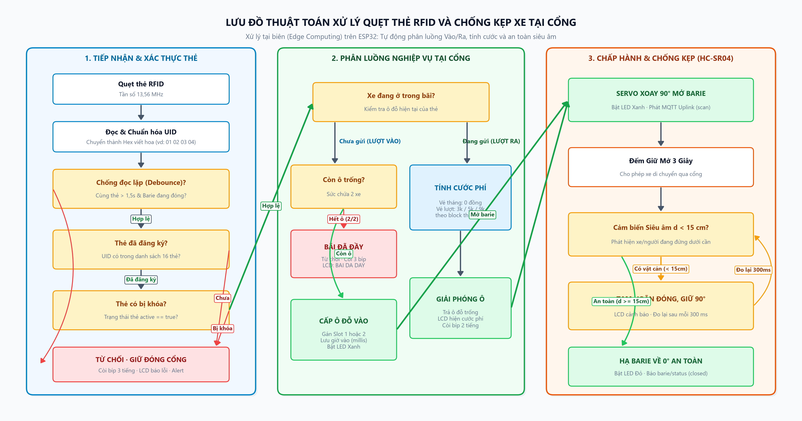
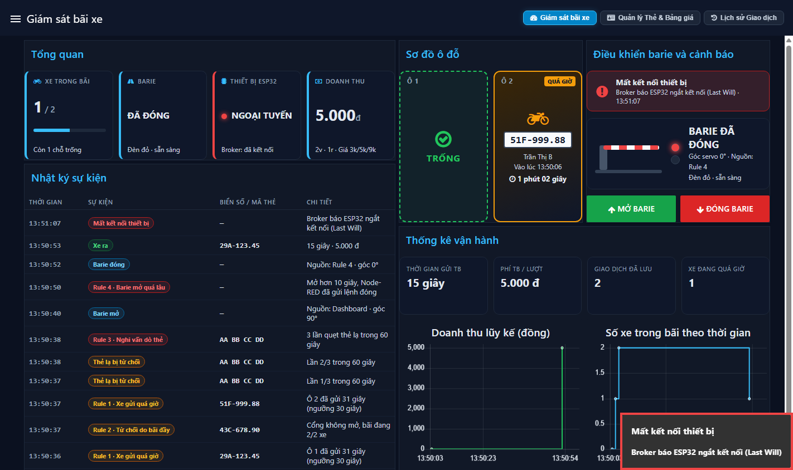

# BÁO CÁO TIỂU LUẬN HỌC PHẦN INTERNET OF THINGS (IOT)

**ĐỀ TÀI: HỆ THỐNG BÃI GIỮ XE MÁY TỰ QUẢN SỬ DỤNG RFID**

---

## PHẦN ĐẦU

### TRANG BÌA

* **Trường:** Trường Đại học Công Thương Thành phố Hồ Chí Minh (HUIT)
* **Khoa:** Khoa Công nghệ Thông tin
* **Học phần:** Internet of Things (IoT)
* **Đề tài:** Hệ thống bãi giữ xe máy tự quản sử dụng RFID (Mô phỏng 4 tầng IoT)
* **Nhóm thực hiện:** Nhóm 4

| STT | Họ và tên thành viên | Mã số sinh viên |
| :---: | :--- | :--- |
| 1 | Nguyễn Lê Duy Cương | 2001230069 |
| 2 | Đinh Tấn Thành | 2001230894 |
| 3 | Bùi Tấn Thông | 2001230938 |

* **Giảng viên hướng dẫn:** Võ Hoàng Hải
* **Địa điểm, thời gian:** TP. Hồ Chí Minh, tháng 11 năm 2026

---

### MỤC LỤC *(Trong bản Word `.docx` được cấu hình tự động cập nhật số trang)*

* Phần đầu: Danh mục hình, Danh mục bảng, Danh mục từ viết tắt, Tóm tắt
* Chương 1: Giới thiệu đề tài
* Chương 2: Cơ sở lý thuyết
* Chương 3: Phân tích và thiết kế hệ thống
* Chương 4: Triển khai
* Chương 5: Kiểm thử và đánh giá
* Chương 6: Kết luận và hướng phát triển
* Tài liệu tham khảo
* Phụ lục A – F

---

### DANH MỤC HÌNH

* **Hình 3.1:** Sơ đồ Use Case tổng quát của hệ thống bãi giữ xe RFID *(Sơ đồ Mermaid)*
* **Hình 3.2:** Sơ đồ kiến trúc 4 tầng IoT và luồng dữ liệu hai chiều *(Sơ đồ Mermaid)*
* **Hình 3.3:** Lưu đồ thuật toán xử lý quẹt thẻ RFID tại cổng ESP32 *(Sơ đồ Mermaid)*
* **Hình 3.4:** Lưu đồ chống kẹp xe (HC-SR04) và máy trạng thái Barie *(Sơ đồ Mermaid)*
* **Hình 3.5:** Lưu đồ xử lý sự kiện, đồng bộ và 4 rule trên Node-RED *(Sơ đồ Mermaid)*
* **Hình 4.1:** Mạch mô phỏng Wokwi khi xe ra tính phí và kích hoạt chống kẹp xe (`minh_chung_anti_pinch_wokwi.png`)
* **Hình 4.2:** Giao diện luồng xử lý Node-RED thực tế chia theo 4 cụm và cụm khởi động (`nodered_flow.png`)
* **Hình 4.3:** Giao diện Web Dashboard Tab 1 giám sát bãi xe và điều khiển barie (`dashboard_demo.png`)
* **Hình 4.4:** Giao diện đăng nhập xác thực quản trị Node-RED và cơ chế `httpNodeAuth` (`nodered_admin_login.png`)
* **Hình 4.5:** Giao diện mở rộng Tab 2 quản lý thẻ RFID và bảng giá động (`dashboard_cards_pricing.png`)
* **Hình 4.6:** Giao diện mở rộng Tab 3 tra cứu lịch sử giao dịch và xuất CSV (`dashboard_history.png`)
* **Hình 5.1:** Kết quả kiểm thử mất kết nối đột ngột kích hoạt LWT trên Dashboard (`test_ch5_lwt_offline.png`)
* **Hình 5.2:** Kết quả kiểm thử kích hoạt đồng thời Rule 1, Rule 2 và Rule 3 trên Dashboard (`test_ch5_rules_alerts.png`)
* **Hình 5.3:** Dashboard sau khi khởi động lại container Docker khôi phục doanh thu và giao dịch (`test_ch5_restart_recovery.png`)

---

### DANH MỤC BẢNG

* **Bảng 1.1:** Kế hoạch thực hiện đề tài trong 10 tuần và các mốc rubric
* **Bảng 2.1:** So sánh ngắn giữa chuẩn RFID 13,56 MHz (MFRC522) và NFC
* **Bảng 2.2:** So sánh giao thức MQTT với HTTP và AMQP trong bối cảnh đề tài
* **Bảng 3.1:** Bảng đặc tả yêu cầu chức năng và phi chức năng
* **Bảng 3.2:** Sơ đồ đấu nối chân linh kiện phần cứng trên ESP32
* **Bảng 3.3:** Danh mục 6 topic MQTT nghiệp vụ và cấu trúc thông điệp
* **Bảng 3.4:** Bộ 4 quy tắc tự động hóa trên Node-RED (ngưỡng demo và ngưỡng thực tế)
* **Bảng 3.5:** Bố cục các thành phần hiển thị trên Web Dashboard
* **Bảng 4.1:** Môi trường công cụ và phiên bản sử dụng khi triển khai
* **Bảng 5.1:** Bộ dữ liệu 4 thẻ RFID mẫu sử dụng trong kiểm thử
* **Bảng 5.2:** Kết quả kiểm thử Tầng 1 (Firmware và mạch mô phỏng Wokwi)
* **Bảng 5.3:** Kết quả kiểm thử Tầng 2 (Truyền thông MQTT hai chiều, LWT và xác thực)
* **Bảng 5.4:** Kết quả kiểm thử Tầng 3 (4 rule tự động và lưu trữ bền vững)
* **Bảng 5.5:** Kết quả kiểm thử đầu-cuối (End-to-End) theo 9 phân cảnh demo
* **Bảng 5.6:** Bảng đối chiếu kết quả với các mốc yêu cầu học phần (M1–M4 và điều kiện Pass)
* **Bảng 5.7:** Số liệu đo kiểm tài nguyên Firmware ESP32 và thời gian phản hồi quan sát
* **Bảng C.1:** Danh sách thẻ RFID mẫu sử dụng trong mô phỏng Wokwi

---

### DANH MỤC TỪ VIẾT TẮT

| Từ viết tắt | Tên đầy đủ tiếng Anh | Nghĩa tiếng Việt |
| :--- | :--- | :--- |
| **IoT** | Internet of Things | Mạng lưới vạn vật kết nối |
| **RFID** | Radio Frequency Identification | Nhận dạng qua tần số vô tuyến |
| **UID** | Unique Identifier | Mã định danh duy nhất của thẻ từ |
| **MQTT** | Message Queuing Telemetry Transport | Giao thức truyền thông điệp nhẹ publish/subscribe |
| **QoS** | Quality of Service | Mức chất lượng dịch vụ truyền tin MQTT |
| **JSON** | JavaScript Object Notation | Định dạng dữ liệu văn bản có cấu trúc cặp khóa–giá trị |
| **SPI** | Serial Peripheral Interface | Giao tiếp nối tiếp đồng bộ 4 dây cho ngoại vi tốc độ cao |
| **I2C** | Inter-Integrated Circuit | Giao tiếp nối tiếp đồng bộ 2 dây (`SDA`, `SCL`) |
| **PWM** | Pulse Width Modulation | Điều chế độ rộng xung điều khiển động cơ servo và âm thanh |
| **LWT** | Last Will and Testament | Thông điệp di chúc thông báo mất kết nối đột ngột trong MQTT |

---

### TÓM TẮT

Quản lý bãi giữ xe máy theo cách ghi vé giấy dễ gây ùn tắc giờ cao điểm, barie đóng cố định tiềm ẩn va chạm xe và thiếu dữ liệu giám sát từ xa. Đề tài mô phỏng hệ thống bãi giữ xe máy tự quản theo kiến trúc IoT 4 tầng. Tầng 1 dùng ESP32 trên Wokwi kết nối đầu đọc RFID-RC522, cảm biến HC-SR04 chống kẹp dưới 15 cm, servo SG90, LED Đỏ/Xanh, LCD 1602 I2C và buzzer; mọi quyết định vào/ra xử lý tại cổng kể cả khi mất mạng. Tầng 2 truyền dữ liệu hai chiều qua Wi-Fi và MQTT (`broker.hivemq.com:1883`, tiền tố `parking_n4/`). Tầng 3 chạy Node-RED đồng bộ trạng thái, thực thi bốn rule tự động và lưu tệp `parking_log.txt`, `parking_database.json`. Tầng 4 cung cấp Web Dashboard có xác thực đăng nhập (`httpNodeAuth`), điều khiển barie cùng phần mở rộng quản lý thẻ, bảng giá động và xuất CSV. Firmware tiêu thụ 62,7% Flash, 14,3% RAM; kiểm thử qua MQTT và Chrome xác nhận bốn rule và đồng bộ hai chiều hoạt động ổn định.

---

## CHƯƠNG 1. GIỚI THIỆU ĐỀ TÀI

### 1.1. Đặt vấn đề
Tại nhiều bãi giữ xe máy quy mô vừa và nhỏ như ký túc xá, trường học hoặc tòa nhà văn phòng, việc soát vé giấy thủ công bộc lộ ba hạn chế rõ rệt trong quá trình vận hành:
1. **Ùn tắc tại cổng vào/ra:** Bảo vệ phải ghi vé, kiểm tra biển số bằng tay và thu tiền trực tiếp, làm kéo dài thời gian xử lý mỗi lượt xe vào giờ cao điểm.
2. **Rủi ro va chạm thanh chắn barie:** Các cổng tự động đóng cứng sau một khoảng thời gian cố định không nhận biết được phương tiện hay người đi bộ vẫn đang ở bên dưới, dễ gây va chạm.
3. **Khó giám sát và thiếu dữ liệu truy vết:** Người quản lý không biết được bãi còn bao nhiêu chỗ trống theo thời gian thực, không phát hiện được xe gửi quá hạn hay hành vi thử thẻ lạ liên tiếp, và thiếu nhật ký chi tiết khi cần đối soát sự cố.

### 1.2. Mục tiêu

#### 1.2.1. Mục tiêu tổng quát
Xây dựng hoàn chỉnh hệ thống mô phỏng bãi giữ xe máy tự quản theo kiến trúc IoT 4 tầng, bảo đảm truyền thông hai chiều ổn định giữa thiết bị cổng và ứng dụng giám sát.

#### 1.2.2. Mục tiêu cụ thể
1. Thiết kế mạch mô phỏng Tầng 1 trên Wokwi với ESP32, đầu đọc RFID-RC522, cảm biến siêu âm HC-SR04, servo SG90, đèn LED Đỏ/Xanh, màn hình LCD 1602 I2C và còi báo.
2. Xây dựng firmware xử lý quẹt thẻ vào/ra, chống đọc trùng thẻ (debounce), tính thời gian gửi và cước phí ngay tại cổng không phụ thuộc kết nối mạng.
3. Cài đặt cơ chế an toàn chống kẹp xe: tự động hoãn hạ thanh chắn khi phát hiện vật cản dưới 15 cm và kiểm tra lại mỗi 0,3 giây đến khi thông thoáng.
4. Triển khai truyền thông MQTT hai chiều (Uplink dữ liệu cảm biến/trạng thái và Downlink lệnh điều khiển/cấu hình) có tự kết nối lại sau 5 giây và Last Will thông báo mất kết nối.
5. Xây dựng 4 quy tắc tự động hóa trên Node-RED và lưu trữ lịch sử, trạng thái bền vững qua khởi động lại.
6. Thiết kế Web Dashboard có xác thực đăng nhập, hiển thị số xe, trạng thái từng ô, nhật ký sự kiện, nút điều khiển barie từ xa và các công cụ quản trị mở rộng.

### 1.3. Phạm vi và giới hạn

#### 1.3.1. Phạm vi mô phỏng và hạ tầng
* **Mô phỏng phần cứng:** Toàn bộ Tầng 1 chạy trên nền tảng mô phỏng Wokwi kết hợp biên dịch firmware bằng PlatformIO, chưa lắp ráp trên mạch vật lý thật.
* **Hạ tầng mạng:** Sử dụng Wi-Fi giả lập `Wokwi-GUEST` kết nối tới HiveMQ public broker (`broker.hivemq.com:1883`), sử dụng tiền tố topic riêng (`parking_n4/`) để tránh lẫn dữ liệu với người dùng khác.

#### 1.3.2. Giới hạn quy mô thực nghiệm
* Bãi xe mô phỏng có sức chứa 2 ô đỗ (`PARKING_CAPACITY = 2`); các ngưỡng thời gian kiểm tra (giữ mở barie 3 giây, quá giờ 30 giây, barie mở quá lâu 10 giây) được thu ngắn để thuận tiện trình bày và kiểm thử trong thời lượng demo.

### 1.4. Phương pháp thực hiện
Nhóm áp dụng phương pháp thiết kế theo mô hình IoT 4 tầng từ dưới lên, tách biệt từng lớp phần cứng mô phỏng, truyền thông mạng, xử lý trung gian và giao diện ứng dụng:
* **Tầng thiết bị:** Viết firmware C++ theo hướng mô-đun trên VS Code + PlatformIO, mô phỏng trên Wokwi.
* **Tầng mạng và trung gian:** Sử dụng HiveMQ public broker (`broker.hivemq.com:1883`) và Node-RED (`v5.0.10` đóng gói trong Docker Compose cùng `eclipse-mosquitto:2.0` và `nodered/node-red:latest`).
* **Kiểm thử:** Kết hợp kiểm thử tương tác Tầng 1 trên Wokwi Simulator với bộ kịch bản Node.js giả lập bản tin ESP32 qua MQTT, kiểm tra HTTP Auth và kiểm tra giao diện trên Chrome headless.
* **Phân chia tiến độ:** Chia khối lượng công việc thành 10 tuần gắn với 4 mốc nghiệm thu M1–M4 của học phần.

### 1.5. Kế hoạch 10 tuần

| Tuần | Nội dung công việc thực hiện (đối chiếu báo cáo tuần) | Mốc Rubric |
| :---: | :--- | :---: |
| **1** | Phân tích bài toán, xác định use case, thiết kế kiến trúc 4 tầng, phân công thành viên | |
| **2** | Dựng mô phỏng Tầng 1 bản đầu trên Wokwi gồm ESP32, RFID-RC522, Servo SG90 và Buzzer (chưa triển khai Wi-Fi/MQTT) | |
| **3** | Ổn định firmware: tái cấu trúc theo State Machine 4 trạng thái (`IDLE` → `SCANNING` → `OPENING` → `CLOSING`), phân biệt vào/ra theo UID, lọc đọc trùng (debounce) và kiểm thử nhiều UID | **M1** |
| **4** | Tích hợp kết nối Wi-Fi và giao thức MQTT hai chiều (`publish` sự kiện Uplink, `subscribe` lệnh barie Downlink, cơ chế tự kết nối lại) | **M2** |
| **5** | Xây dựng flow Node-RED trung gian (`Check Card`), ghi nhật ký sự kiện ra tệp và gửi lệnh điều khiển barie | |
| **6** | Xây dựng Web Dashboard (`/ui`) hiển thị số xe, trạng thái barie, 8 sự kiện, biên nhận, cảnh báo, nút Mở/Đóng và bật xác thực đăng nhập (`httpNodeAuth` trong `settings.js`) | **M3** |
| **7** | Hoàn thiện 4 quy tắc tự động hóa trên Node-RED và xử lý các kịch bản bất thường | |
| **8** | Tích hợp đầu-cuối (End-to-End); bổ sung cảm biến siêu âm HC-SR04 chống kẹp xe, màn hình LCD 1602 I2C (dời chân `RST` RFID sang GPIO 4), cụm LED Đỏ/Xanh, khai báo LWT và snapshot `retained` | **M4** |
| **9** | Đóng gói Docker Compose, triển khai các tính năng mở rộng (quản lý 16 thẻ động, bảng giá động, lịch sử ghép cặp & xuất CSV), chạy kịch bản kiểm thử tự động MQTT/Chrome và hoàn thiện báo cáo, slide | |
| **10** | Thực hiện chạy liên hoàn 9 bước trên Wokwi thật kết hợp Dashboard, quay video minh chứng và nghiệm thu cuối kỳ | |

*Bảng 1.1: Kế hoạch thực hiện đề tài trong 10 tuần và các mốc rubric.*

### 1.6. Bố cục tiểu luận
Báo cáo gồm 6 chương và phần phụ lục:
* **Chương 1 (Giới thiệu đề tài):** Trình bày bài toán thực tế, mục tiêu, phạm vi mô phỏng, phương pháp và kế hoạch 10 tuần.
* **Chương 2 (Cơ sở lý thuyết):** Tóm tắt các công nghệ thực tế sử dụng trong dự án gồm kiến trúc IoT 4 tầng, RFID 13,56 MHz, ngoại vi ESP32, giao thức MQTT, Node-RED và mô phỏng Wokwi.
* **Chương 3 (Phân tích và thiết kế hệ thống):** Trình bày đặc tả yêu cầu, sơ đồ Use Case, kiến trúc 4 tầng, thiết kế phần cứng, thuật toán và nguyên lý xử lý từng tầng, cây topic MQTT, 4 rule tự động, giao diện Dashboard và mô hình lưu trữ.
* **Chương 4 (Triển khai):** Trình bày môi trường phiên bản, tổ chức mô-đun mã nguồn, cấu hình cụ thể, trích đoạn xử lý tiêu biểu, ảnh chụp vận hành thực tế và các tính năng mở rộng.
* **Chương 5 (Kiểm thử và đánh giá):** Trình bày kết quả kiểm thử từng tầng, kiểm thử đầu-cuối 9 phân cảnh, đối chiếu rubric và số đo tài nguyên thật.
* **Chương 6 (Kết luận và hướng phát triển):** Tổng kết kết quả đạt được, các hạn chế hiện có và định hướng nâng cấp.

---

## CHƯƠNG 2. CƠ SỞ LÝ THUYẾT

### 2.1. IoT và kiến trúc phân tầng
Hệ thống Internet of Things (IoT) là tập hợp các thiết bị vật lý được gắn cảm biến, bộ xử lý và khả năng kết nối mạng để thu thập, trao đổi dữ liệu và tác động trở lại môi trường tự động. Để dễ bảo trì và mở rộng, dự án tổ chức theo kiến trúc phân tầng gồm 4 lớp:
1. **Tầng Cảm biến và Chấp hành (Sensing & Actuation):** Đọc thông tin đầu vào từ môi trường và thực thi tác động cơ học hoặc tín hiệu hiển thị tại chỗ.
2. **Tầng Mạng (Network):** Đảm bảo kết nối không dây và định tuyến thông điệp giữa thiết bị biên với máy chủ thông qua giao thức chuẩn.
3. **Tầng Xử lý trung gian (Middleware):** Tiếp nhận luồng dữ liệu, lưu trữ trạng thái, đánh giá điều kiện nghiệp vụ theo quy tắc tự động và phát cảnh báo.
4. **Tầng Ứng dụng (Application):** Cung cấp giao diện trực quan cho người vận hành giám sát số liệu và gửi lệnh điều khiển.

Trong kiến trúc này, dữ liệu đi theo hai chiều: **luồng Uplink** (từ Tầng 1 qua Tầng 2, Tầng 3 lên Tầng 4 để cập nhật trạng thái) và **luồng Downlink** (từ Tầng 4 hoặc Tầng 3 truyền ngược xuống Tầng 1 để thay đổi trạng thái chấp hành hoặc cấu hình).

### 2.2. RFID
Công nghệ RFID (Radio Frequency Identification) nhận dạng đối tượng không tiếp xúc bằng sóng vô tuyến giữa đầu đọc (Reader) và thẻ từ (Tag). Trong đề tài, nhóm sử dụng thẻ thụ động MIFARE Classic hoạt động ở băng tần cao **HF 13,56 MHz** theo chuẩn **ISO/IEC 14443A**:
* Khi thẻ đi vào vùng từ trường của cuộn anten trên module **MFRC522**, năng lượng cảm ứng cấp nguồn cho vi mạch trong thẻ phản hồi lại chuỗi định danh duy nhất **UID** (4 byte, viết dưới dạng 4 cặp số thập lục phân như `01 02 03 04`).
* Module MFRC522 truyền dữ liệu UID vừa đọc về vi điều khiển ESP32 thông qua giao tiếp **SPI** ở mức điện áp logic 3,3V.

| Tiêu chí | RFID HF 13,56 MHz (MFRC522) | NFC (Near Field Communication) |
| :--- | :--- | :--- |
| Tần số hoạt động | 13,56 MHz | 13,56 MHz (tương thích chuẩn ISO 14443) |
| Chế độ giao tiếp | Một chiều đọc/ghi từ đầu đọc xuống thẻ | Hai chiều (ngang hàng P2P, giả lập thẻ, đọc/ghi) |
| Khoảng cách đọc | Tối đa khoảng 3–5 cm (với anten RC522) | Thường dưới 4 cm |
| Ứng dụng điển hình | Thẻ giữ xe, thẻ nhân viên, kiểm soát ra vào | Thanh toán di động, ghép nối nhanh trên điện thoại |

*Bảng 2.1: So sánh ngắn giữa chuẩn RFID 13,56 MHz (MFRC522) và NFC.*

### 2.3. ESP32 và thiết bị ngoại vi
Vi điều khiển **ESP32 DevKit V1** (nhân Xtensa dual-core 32-bit, tích hợp sẵn Wi-Fi 802.11 b/g/n) làm bộ điều khiển trung tâm tại cổng với ba nhóm giao tiếp chính:

#### 2.3.1. Giao tiếp SPI và I2C
* **Giao tiếp SPI (Serial Peripheral Interface):** Chuẩn nối tiếp đồng bộ 4 dây (`SCK` xung nhịp, `MOSI` truyền đi, `MISO` nhận về, `SDA/SS` chọn chip) dùng để ESP32 đọc dữ liệu từ module RFID-RC522 ở tốc độ cao.
* **Giao tiếp I2C (Inter-Integrated Circuit):** Chuẩn 2 dây gồm đường dữ liệu `SDA` và đường xung nhịp `SCL`, dùng để điều khiển màn hình ký tự **LCD 1602** (2 dòng x 16 cột) qua mạch mở rộng PCF8574 tại địa chỉ `0x27`.

#### 2.3.2. Điều chế độ rộng xung PWM cho Servo và Buzzer
Bộ định thời LEDC trong ESP32 xuất xung tần số **50 Hz** (chu kỳ 20 ms, độ rộng xung 500–2400 $\mu$s) để điều khiển góc quay $0^\circ$ đến $90^\circ$ cho động cơ **Servo SG90** thông qua thư viện `ESP32Servo`. Để còi **Active Buzzer** phát âm thanh ở tần số 2000 Hz mà không xung đột bộ định thời với servo, dự án cấp riêng cho buzzer kênh LEDC số 15.

#### 2.3.3. Nguyên lý đo khoảng cách của cảm biến siêu âm HC-SR04
ESP32 kích một xung mức cao tối thiểu 10 $\mu$s vào chân `TRIG`, cảm biến phát chùm sóng siêu âm 40 kHz và kéo chân `ECHO` lên mức cao trong thời gian $t$ ($\mu$s) bằng tổng thời gian sóng đi và phản xạ về. Khoảng cách $d$ (cm) tính theo tốc độ âm thanh trong không khí ($343\text{ m/s} = 0{,}0343\text{ cm/}\mu\text{s}$):
$$d = \frac{t \times 0{,}0343}{2}$$

### 2.4. Giao thức MQTT

#### 2.4.1. Mô hình Publish/Subscribe và cây Topic
MQTT (Message Queuing Telemetry Transport) là giao thức truyền thông điệp nhẹ hoạt động trên nền TCP/IP theo mô hình **Publish / Subscribe** thông qua một máy chủ trung gian (**Broker**). Thiết bị phát (Publisher) và thiết bị nhận (Subscriber) không kết nối trực tiếp với nhau mà phân loại dữ liệu theo cấu trúc cây **Topic** (ví dụ `parking_n4/rfid/scan`).

#### 2.4.2. Chất lượng dịch vụ (QoS) sử dụng thực tế trong đề tài
Chuẩn MQTT quy định ba mức chất lượng truyền tin: `QoS 0` (*At most once* — gửi một lần không xác nhận), `QoS 1` (*At least once* — gửi ít nhất một lần có gói `PUBACK` xác nhận) và `QoS 2` (*Exactly once* — bắt tay bốn bước đảm bảo nhận đúng một lần, ít dùng trên vi điều khiển do tốn tài nguyên). Trong mã nguồn dự án:
* **Chiều Uplink (ESP32 $\rightarrow$ Broker):** Thư viện `PubSubClient 2.8.0` chỉ hỗ trợ hàm `publish()` ở **`QoS 0`**, do đó mọi bản tin quẹt thẻ, barie, cảnh báo và snapshot từ ESP32 đều phát ở `QoS 0`. Riêng bản tin di chúc **LWT** do Broker tự phát khi ESP32 đứt kết nối được khai báo mức `willQos = 1`.
* **Chiều Broker $\rightarrow$ Node-RED:** Bốn node `mqtt in` đăng ký nhận ở `QoS 1` (theo đặc tả MQTT, Broker chuyển phát theo giá trị nhỏ hơn giữa QoS lúc gửi và QoS đăng ký, nên bản tin Uplink từ ESP32 tới Node-RED chạy ở `QoS 0`, còn LWT từ Broker chạy ở `QoS 1`).
* **Chiều Downlink (Node-RED $\rightarrow$ Broker $\rightarrow$ ESP32):** Hai node `mqtt out` trên Node-RED (`barie/cmd` và `config`) phát lên Broker ở **`QoS 1`**; ở đầu thiết bị, hàm `_mqttClient.subscribe(topic)` của `PubSubClient` đăng ký nhận theo mặc định **`QoS 0`**.

#### 2.4.3. Cơ chế Retained, LWT và so sánh với HTTP, AMQP
* **Retained Message:** Broker lưu giữ bản tin cuối cùng có cờ `retain = true` của một topic để bất kỳ client nào vừa `subscribe` sau đó đều nhận ngay trạng thái mới nhất (dùng cho trạng thái barie, snapshot và cấu hình thẻ).
* **LWT (Last Will and Testament):** Khi kết nối tới broker, ESP32 khai báo trước một thông điệp di chúc (`{"online":false}` trên `parking_n4/status`). Nếu thiết bị mất nguồn hoặc đứt mạng đột ngột quá thời gian `keepAlive`, broker tự động phát thông điệp này báo ngoại tuyến lên Dashboard.

| Tiêu chí | MQTT | HTTP | AMQP |
| :--- | :--- | :--- | :--- |
| Mô hình giao tiếp | Publish / Subscribe qua Broker | Request / Response (Client – Server) | Publish / Subscribe & Queue phức tạp |
| Kích thước phần đầu | Nhỏ gọn (tối thiểu 2 bytes) | Lớn (header dạng văn bản ASCII) | Trung bình đến lớn |
| Đẩy lệnh Downlink | Tức thời qua kết nối TCP duy trì sẵn | Phải polling định kỳ hoặc thêm WebSocket | Tức thời qua broker |
| Phù hợp cho ESP32 | Rất phù hợp cho vi điều khiển tài nguyên hạn chế | Tốn tài nguyên phân tích header và mở lại kết nối | Nặng hơn, phù hợp hạ tầng máy chủ doanh nghiệp |

*Bảng 2.2: So sánh giao thức MQTT với HTTP và AMQP trong bối cảnh đề tài.*

### 2.5. Node-RED và Dashboard
**Node-RED** là công cụ lập trình trực quan theo luồng (Flow-Based Programming) chạy trên nền Node.js:
* **Node `function`:** Cho phép viết mã JavaScript xử lý dữ liệu JSON từ thông điệp `msg.payload` và lưu giữ trạng thái dùng chung trong luồng thông qua biến ngữ cảnh `flow` (`flow.get()`, `flow.set()`) hoặc nội bộ node (`context`).
* **Node-RED Dashboard (`node-red-dashboard`):** Gói mở rộng tự động dựng giao diện web tại đường dẫn `/ui` dựa trên AngularJS 1.x và Socket.IO, cung cấp các thành phần dựng sẵn như nút bấm (`ui_button`), biểu đồ (`ui_chart`), thông báo nổi (`ui_toast`) và khung mẫu tùy biến (`ui_template`).

### 2.6. Nền tảng Wokwi
**Wokwi** là trình mô phỏng phần cứng nhúng trực tuyến và tích hợp sẵn trong VS Code. Nền tảng hỗ trợ giả lập vi điều khiển ESP32, thực thi trực tiếp tệp nhị phân `.bin` biên dịch từ PlatformIO, mô phỏng tương tác các linh kiện như đầu đọc thẻ MFRC522 (chọn thẻ mẫu có sẵn hoặc tùy chỉnh UID), thanh trượt khoảng cách HC-SR04, góc quay Servo SG90, màn hình LCD I2C và cung cấp mạng Wi-Fi ảo `Wokwi-GUEST` cho phép kết nối tới MQTT broker công cộng ngoài Internet.

*Giới hạn:* Vì chạy trên môi trường ảo hóa đám mây của Wokwi nên độ trễ truyền gói tin qua mạng Internet tới public broker phụ thuộc băng thông thực tế tại thời điểm chạy, tốc độ mô phỏng CPU có thể chậm hơn nhẹ so với phần cứng thực khi tải cao, và không mô phỏng được nhiễu điện từ hay sai số cơ học ngoài đời thực.

---

## CHƯƠNG 3. PHÂN TÍCH VÀ THIẾT KẾ HỆ THỐNG

### 3.1. Phân tích yêu cầu

## CHƯƠNG 3. PHÂN TÍCH VÀ THIẾT KẾ HỆ THỐNG

### 3.1. Phân tích yêu cầu

Về chức năng tại cổng, hệ thống phải đọc và chuẩn hóa UID thẻ RFID; kiểm tra thẻ đã đăng ký, còn hoạt động và xác định xe đang ở trong bãi hay chưa để quyết định cho vào hay cho ra. Khi xe vào, ESP32 tự cấp ô trống đầu tiên trong sức chứa 2 xe và từ chối nếu bãi đã đầy. Khi xe ra, hệ thống tự trả ô, tính thời gian gửi và áp dụng biểu phí cấu hình (vé tháng hoặc chế độ miễn phí tính 0 đồng). Thanh chắn barie chỉ mở sau khi quẹt thẻ hợp lệ, giữ mở khoảng 3 giây và tự động hoãn đóng khi cảm biến siêu âm HC-SR04 phát hiện có vật cản dưới 15 cm. Phía người vận hành cần theo dõi trạng thái thiết bị, quản lý danh sách thẻ, chỉnh bảng giá, tra cứu lịch sử gửi xe và nhận các cảnh báo bất thường.

Yêu cầu phi chức năng gồm khả năng vận hành độc lập tại cổng khi mạng Wi-Fi/MQTT bị gián đoạn, tự động đồng bộ lại trạng thái sau khi kết nối phục hồi, lưu cấu hình và dữ liệu giao dịch bền vững, đồng thời cung cấp giao diện dashboard trực quan, dễ theo dõi.

Phạm vi mô phỏng của đồ án gồm: bãi xe 2 ô đỗ, quản lý tối đa 16 thẻ RFID và 1 cổng barie điều khiển bằng động cơ Servo.

| Nhóm | Mã | Yêu cầu chi tiết |
| :--- | :---: | :--- |
| **Chức năng tại cổng** | FR1 | Đọc và chuẩn hóa UID thẻ RFID 13,56 MHz; phân biệt lượt vào/ra; tự cấp ô trống (1 hoặc 2) và từ chối khi bãi đầy (2/2) hoặc thẻ lỗi |
| | FR2 | Tính thời gian đỗ và cước phí khi xe ra, hiển thị thông tin lên LCD 1602, phát âm còi báo và điều khiển Servo, LED |
| | FR3 | Hoãn đóng barie khi cảm biến siêu âm HC-SR04 phát hiện vật cản dưới 15 cm (áp dụng cho cả tự đóng và lệnh từ xa) |
| **Chức năng quản trị** | FR4 | Truyền dữ liệu lên MQTT, hiển thị lên Dashboard có mật khẩu bảo vệ và gửi lệnh đóng/mở barie từ xa |
| | FR5 | Chạy 4 luật tự động trên Node-RED (quá giờ > 30s, bãi đầy 2/2, dò thẻ lạ $\ge$ 3 lần/60s, kẹt barie mở > 10s) và ghi tệp nhật ký/JSON |
| **Chức năng mở rộng** | ER1 | Quản lý danh sách tối đa 16 thẻ động (thêm, sửa, khóa/mở, xóa, vé tháng) và chỉnh bảng giá từ xa |
| | ER2 | Tra cứu giao dịch ghép cặp vào–ra và xuất tệp CSV phục vụ đối soát trên Excel |
| **Phi chức năng** | NFR1 | Cổng vào/ra vẫn hoạt động độc lập tại chỗ khi mất mạng Wi-Fi/MQTT và tự động kết nối lại mỗi 5 giây |
| | NFR2 | Viết code không dùng hàm delay chặn vòng quét chính để không làm gián đoạn việc đọc thẻ, đo cảm biến và nhận lệnh |

*Bảng 3.1: Bảng tổng hợp yêu cầu chức năng và phi chức năng của hệ thống.*

### 3.2. Kiến trúc tổng thể

Hệ thống được chia thành bốn tầng liên kết hai chiều từ thiết bị mô phỏng tới giao diện web:
1. **Tầng 1 (Thiết bị):** Cảm nhận và chấp hành tại cổng do vi điều khiển ESP32 đảm nhận.
2. **Tầng 2 (Truyền thông):** Kết nối mạng Wi-Fi và giao thức MQTT qua broker trung gian.
3. **Tầng 3 (Xử lý trung gian):** Node-RED làm nhiệm vụ tổng hợp dữ liệu, chạy các luật tự động và lưu trữ tệp.
4. **Tầng 4 (Ứng dụng):** Giao diện Web Dashboard phục vụ người quản trị theo dõi và vận hành.

Trong kiến trúc này, việc điều khiển thời gian thực tại cổng được tách bạch hoàn toàn khỏi phần giám sát và quản lý: ESP32 tự quyết định cho phép hoặc từ chối xe ngay tại chỗ mà không cần phụ thuộc vào máy chủ, còn Node-RED làm nhiệm vụ thu thập sự kiện, cảnh báo và cung cấp công cụ quản trị từ xa.


*Hình 3.1: Sơ đồ kiến trúc tổng thể 4 tầng và luồng dữ liệu hai chiều.*

Luồng dữ liệu trao đổi giữa hai chiều:
* **Luồng đi lên (Uplink):** Bắt đầu khi đầu đọc RC522 quét được UID và ParkingSystem cập nhật trạng thái ô đỗ. ESP32 phát sự kiện qua MQTT (gồm sự kiện quẹt thẻ, snapshot hiện trạng bãi xe, trạng thái barie và các cảnh báo). Node-RED nhận thông điệp, cập nhật vào biến trạng thái dùng chung để hiển thị số xe, nhật ký và giao dịch.
* **Luồng đi xuống (Downlink):** Dùng để người vận hành gửi lệnh đóng/mở barie từ xa qua topic `barie/cmd` và cập nhật cấu hình thẻ/bảng giá qua topic `config` dạng retained. Nhờ cơ chế retained, thiết bị sau khi kết nối lại sẽ nhận ngay cấu hình mới nhất từ máy chủ mà không cần thao tác lại thủ công.

### 3.3. Thiết kế Tầng 1 – Thiết bị phần cứng

Bộ điều khiển trung tâm là ESP32 DevKit V1, đấu nối với 7 linh kiện ngoại vi qua các chân GPIO cụ thể:
* **Đầu đọc thẻ RFID-RC522:** Giao tiếp qua bus SPI tốc độ cao (chân SS: GPIO 5, SCK: GPIO 18, MOSI: GPIO 23, MISO: GPIO 19, RST: GPIO 4) dùng đọc mã thẻ 13,56 MHz.
* **Cảm biến siêu âm HC-SR04:** Theo dõi vùng di chuyển dưới barie (TRIG: GPIO 27, ECHO: GPIO 32). Nếu khoảng cách đo được nhỏ hơn 15 cm, firmware tạm hoãn đóng cần và kiểm tra lại sau mỗi 300 ms.
* **Động cơ Servo SG90:** Điều khiển nâng/hạ thanh chắn barie bằng xung PWM qua chân GPIO 13 (góc 0° khi đóng, 90° khi mở). Barie tự đóng sau khoảng 3 giây trừ khi đang ở chế độ giữ mở từ xa.
* **Đèn LED Đỏ / Xanh:** LED Đỏ (GPIO 25) báo dừng; LED Xanh (GPIO 26) báo cho phép đi qua khi barie mở.
* **Còi Buzzer:** Phát tín hiệu âm thanh phản hồi qua chân GPIO 14. Còi được cấu hình chạy trên kênh LEDC 15 riêng để không bị xung đột bộ định thời (timer) với Servo SG90.
* **Màn hình LCD 1602:** Hiển thị trạng thái bãi xe, số ô đỗ, biển số xe, cước phí và lý do từ chối. Giao tiếp qua bus I2C (SDA: GPIO 21, SCL: GPIO 22, địa chỉ `0x27`) giúp tiết kiệm tối đa số chân của ESP32.

| Linh kiện ngoại vi | Chân linh kiện | Chân ESP32 (GPIO) | Chuẩn giao tiếp | Nguồn cấp | Vai trò trong hệ thống |
| :--- | :--- | :---: | :---: | :---: | :--- |
| **RFID-RC522** | `SDA`, `SCK`, `MOSI`, `MISO`, `RST` | `5`, `18`, `23`, `19`, `4` | SPI | 3,3V | Đọc mã thẻ UID từ thẻ từ 13,56 MHz |
| **HC-SR04** | `TRIG`, `ECHO` | `27`, `32` | Digital I/O | 5V | Đo khoảng cách phát hiện vật cản dưới barie |
| **Servo SG90** | `PWM` | `13` | PWM (50 Hz) | 5V | Nâng/hạ thanh chắn barie (0° đóng, 90° mở) |
| **LED Đỏ / Xanh** | `Anode (+)` | `25` / `26` | Digital Output | 3,3V | Đèn tín hiệu giao thông (Đỏ dừng, Xanh đi) |
| **Active Buzzer** | `Signal` | `14` | LEDC Channel 15 | 3,3V | Phát âm thanh phản hồi quẹt thẻ và cảnh báo |
| **LCD 1602 I2C** | `SDA`, `SCL` | `21`, `22` | I2C (địa chỉ `0x27`) | 5V | Hiển thị thông tin biển số, ô đỗ và cước phí |

*Bảng 3.2: Sơ đồ đấu nối chân linh kiện phần cứng trên ESP32.*

*Lưu ý khi triển khai mạch thật:* Mạch hiện được mô phỏng và kiểm chứng trên Wokwi. Khi chuyển sang lắp ráp thực tế, cần lưu ý:
1. Nối chung đường mass (GND) giữa tất cả các linh kiện.
2. Cấp nguồn 5V ngoài riêng cho động cơ Servo SG90 (dòng tải khi xoay cần gạt có thể gây sụt áp làm ESP32 khởi động lại nếu lấy nguồn từ chân 5V của board).
3. Sử dụng cầu phân áp (ví dụ trở 1kΩ và 2kΩ) để hạ mức điện áp chân ECHO từ 5V xuống 3,3V an toàn cho chân GPIO của ESP32.

### 3.4. Thiết kế Firmware tại cổng

Firmware trên ESP32 được tổ chức thành các mô-đun riêng biệt theo đúng trách nhiệm:
* **`ParkingSystem`:** Quản lý danh sách tối đa 16 thẻ. Mỗi bản ghi gồm mã UID, biển số xe, chủ xe, trạng thái khóa, loại vé (vé lượt hoặc vé tháng), ô đang đỗ và thời điểm vào. Hàm `processCard()` tự động phân biệt lượt vào hay ra dựa vào trạng thái ô đỗ của thẻ, cấp ô trống hoặc trả ô, tính thời lượng gửi và cước phí. Các trường hợp thẻ lạ, thẻ khóa và bãi đầy được trả về mã kết quả riêng để hiển thị LCD, phát còi và phát cảnh báo phù hợp.
* **`GateController`:** Quản lý 3 trạng thái của thanh chắn (Đóng `0°`, Mở tự đóng sau 3 giây, và Giữ mở khi điều khiển từ xa). Khi có yêu cầu đóng, cảm biến HC-SR04 được kích hoạt đo lại mỗi 300 ms; nếu phát hiện khoảng cách dưới 15 cm thì barie tiếp tục giữ mở.
* **`MqttService`:** Phụ trách kết nối Wi-Fi, MQTT, đăng ký các topic nhận lệnh/cấu hình, phân tích chuỗi JSON và tự động thử kết nối lại theo chu kỳ 5 giây khi rớt mạng.
* **`main.cpp`:** Trong hàm `loop()`, hệ thống lần lượt cập nhật MQTT, LCD, còi báo, thanh chắn barie, đầu đọc RFID và cổng Serial mà không dùng lệnh `delay()` chặn vòng quét chính. Nhờ đó, nghiệp vụ tại cổng vẫn diễn ra thông suốt kể cả khi mạng bị gián đoạn.


*Hình 3.2: Lưu đồ xử lý thẻ RFID và kiểm tra chống kẹp barie tại cổng.*

*Nguyên tắc xử lý quẹt thẻ tại cổng:*
* **Chuẩn hóa UID:** Mã thẻ được chuẩn hóa thành các cặp ký tự hệ 16 viết hoa (ví dụ `01 02 03 04`) trước khi đối chiếu để tránh sai lệch định dạng.
* **Chống đọc lặp (Debounce 1.500 ms):** Nếu cùng một thẻ được quét lại trong vòng 1,5 giây, hệ thống sẽ bỏ qua để tránh trường hợp người dùng run tay hoặc giữ thẻ trước đầu đọc bị tính thành hai lượt quẹt liên tiếp.
* **Từ chối hợp lệ:** Thẻ chưa đăng ký, thẻ bị khóa hoặc quét khi bãi đã đủ 2 xe sẽ bị từ chối mở barie, kèm âm báo 3 tiếng còi và thông báo hiển thị trên LCD.
* **Tính cước khi xe ra:** Thời lượng gửi xe được đo bằng hàm `millis()`. Vé tháng có mức phí 0 đồng. Vé lượt áp dụng biểu phí mô phỏng: dưới 10 giây tính 3.000đ; từ 10 đến 30 giây tính 5.000đ; trên 30 giây tính 9.000đ. Đây là thang thời gian rút gọn phục vụ trình diễn và kiểm thử, người quản lý có thể cập nhật lại bảng giá này bất kỳ lúc nào từ giao diện web.

### 3.5. Thiết kế Tầng 2 – Truyền thông MQTT

ESP32 kết nối Wi-Fi (`Wokwi-GUEST`) và truyền thông MQTT tới địa chỉ `broker.hivemq.com` cổng 1883, sử dụng tiền tố chung là `parking_n4/`.

Hệ thống phân định rõ 6 topic trao đổi:
* `parking_n4/rfid/scan` (Uplink, không retained): Gửi sự kiện `check_in` hoặc `check_out` cùng mã UID, biển số xe, chủ xe, ô đỗ, thời lượng và cước phí.
* `parking_n4/barie/status` (Uplink, retained): Báo trạng thái barie (`open` hoặc `closed`), góc servo, chế độ mở và nguồn lệnh phát ra.
* `parking_n4/alert` (Uplink, không retained): Truyền tức thời các cảnh báo bất thường như thẻ lạ, thẻ bị khóa, bãi đầy và phát hiện vật cản chống kẹp xe.
* `parking_n4/status` (Uplink, retained + LWT): Báo snapshot tình trạng thiết bị gồm trạng thái `online`, số xe đang gửi, thông tin từng ô đỗ, thời gian uptime và RSSI. Topic này đồng thời đăng ký cơ chế di chúc Last Will and Testament (LWT) với nội dung `{"online":false}` có cờ retained, giúp máy chủ phát hiện ngay lập tức khi ESP32 bị mất nguồn hoặc đứt mạng đột ngột.
* `parking_n4/barie/cmd` (Downlink, không retained): Tiếp nhận các lệnh điều khiển barie (`open`, `open_hold`, `close`, `sync`) từ giao diện web hoặc từ luật tự động.
* `parking_n4/config` (Downlink, retained): Đồng bộ danh sách 16 thẻ và bảng giá từ web xuống ESP32 mà không cần nạp lại firmware.

| Topic MQTT | Chiều truyền | Cơ chế đặc thù | Dữ liệu trao đổi chính | Mục đích sử dụng |
| :--- | :---: | :---: | :--- | :--- |
| `parking_n4/rfid/scan` | Uplink | Không | `check_in` / `check_out`, UID, biển số, ô đỗ, cước phí | Ghi nhận sự kiện xe vào/ra thực tế tại cổng |
| `parking_n4/barie/status` | Uplink | Retained | Trạng thái (`open`/`closed`), góc servo, chế độ | Đồng bộ trạng thái cần barie lên giao diện |
| `parking_n4/alert` | Uplink | Không | Mã cảnh báo (`INVALID_CARD`, `LOT_FULL`, `ANTI_PINCH`...) | Báo động tức thời các sự cố tại cổng |
| `parking_n4/status` | Uplink | Retained + LWT | Trạng thái `online`, 2 ô đỗ, số xe, uptime, RSSI | Snapshot toàn bãi; báo ngoại tuyến khi mất mạng |
| `parking_n4/barie/cmd` | Downlink | Không | Lệnh (`open`, `open_hold`, `close`, `sync`) | Điều khiển đóng/mở barie từ xa |
| `parking_n4/config` | Downlink | Retained | Tham số bảng giá và danh sách tối đa 16 thẻ | Cập nhật cấu hình xuống cổng không cần nạp code |

*Bảng 3.3: Danh mục 6 topic MQTT nghiệp vụ và thông tin trao đổi.*

Sau khi kết nối mạng thành công, ESP32 tự động đăng ký 2 topic nhận lệnh (`barie/cmd` và `config`), sau đó gửi bản tin trạng thái barie cùng snapshot toàn bãi. Wi-Fi và MQTT đều có cơ chế tự động thử kết nối lại mỗi 5 giây. Nếu mạng bị mất, việc quẹt thẻ và đóng mở barie tại cổng vẫn diễn ra bình thường, chỉ có giao diện trên web là tạm thời chưa nhận được sự kiện mới trong lúc mất mạng.

*Về hạ tầng broker:* Trong mô hình thử nghiệm, cả ESP32 và Node-RED đều kết nối tới broker công cộng HiveMQ để tiện chạy mô phỏng từ nhiều máy khác nhau mà không cần cài đặt. Tệp `docker-compose.yml` của nhóm cũng đã cấu hình sẵn một broker Mosquitto chạy cục bộ trong container; khi chuyển sang triển khai thực tế chỉ cần trỏ địa chỉ về broker nội bộ này, kèm theo tài khoản xác thực và mã hóa TLS để đảm bảo an toàn đường truyền.

### 3.6. Thiết kế Tầng 3 – Xử lý trung gian trên Node-RED

Tầng xử lý trung gian trên Node-RED tiếp nhận 4 nhóm dữ liệu từ MQTT: snapshot, giao dịch quẹt thẻ, trạng thái barie và cảnh báo. Các hàm function node xử lý logic, đồng bộ trạng thái bãi xe, quản lý danh sách thẻ, biểu phí và chạy 4 luật tự động. Toàn bộ thông tin được gom về biến trạng thái dùng chung `flow.get('park')` để các thành phần trên Dashboard luôn hiển thị nhất quán với nhau.


*Hình 3.3: Luồng xử lý dữ liệu và 4 quy tắc tự động trong Node-RED.*

Bốn quy tắc tự động hóa được thiết kế gồm:
* **Rule 1 (Xe gửi quá giờ):** Cảnh báo khi thời gian xe đỗ trong ô vượt quá ngưỡng cho phép (mặc định thử nghiệm là 30 giây, thực tế từ 4 đến 12 giờ tùy ca gửi). Hệ thống gắn nhãn `QUÁ GIỜ`, đổi màu viền ô đỗ sang vàng và hiện thông báo trên giao diện.
* **Rule 2 (Bãi đầy):** Báo bãi đạt đủ sức chứa 2/2 xe. Lưu ý: việc từ chối xe vào là do chính ESP32 ngoài cổng tự quyết định, Node-RED chỉ nhận tín hiệu để đổi trạng thái tổng quan sang màu đỏ nhằm thông báo cho bảo vệ.
* **Rule 3 (Dò thẻ lạ liên tiếp):** Cảnh báo khi phát hiện từ 3 lần quẹt thẻ chưa đăng ký trong cùng khoảng thời gian 60 giây, giúp người quản lý phát hiện các dấu hiệu quét thử thẻ bất thường.
* **Rule 4 (Barie mở quá lâu):** Nếu barie bị giữ mở liên tục vượt quá 10 giây khi ESP32 vẫn trực tuyến, Node-RED tự động phát lệnh `close` xuống cổng qua topic `barie/cmd`. Lệnh đóng này khi xuống ESP32 vẫn phải qua kiểm tra cảm biến siêu âm chống kẹp xe trước khi hạ thanh chắn.

| Quy tắc | Điều kiện kích hoạt | Ngưỡng demo | Ngưỡng thực tế đề xuất | Hành động của hệ thống |
| :--- | :--- | :---: | :---: | :--- |
| **Rule 1: Xe gửi quá giờ** | Thời gian xe lưu trong ô đỗ vượt quá giới hạn | 30 giây | 4–12 giờ tùy ca | Gắn nhãn `QUÁ GIỜ` trên ô, đổi viền vàng, hiện cảnh báo |
| **Rule 2: Bãi đầy** | Số xe đạt sức chứa tối đa hoặc nhận cảnh báo từ cổng | 2/2 xe | 50–500 xe | Đổi trạng thái bãi sang màu đỏ; việc từ chối xe do ESP32 làm |
| **Rule 3: Dò thẻ lạ** | Quẹt thẻ không hợp lệ nhiều lần trong khoảng thời gian | $\ge$ 3 lần / 60 giây | $\ge$ 5 lần / 120 giây | Phát cảnh báo an ninh nghi vấn dò thẻ trên Dashboard |
| **Rule 4: Barie mở lâu** | Trạng thái barie giữ mở liên tục vượt quá giới hạn | 10 giây | 30–60 giây | Node-RED phát lệnh đóng tự động (ESP32 vẫn đo chống kẹp) |

*Bảng 3.4: Bộ 4 quy tắc tự động hóa trên Node-RED.*

### 3.7. Thiết kế Tầng 4 – Giao diện Web Dashboard và Bảo mật

Dashboard được xây dựng trên `node-red-dashboard` với giao diện nền tối, bố cục chia thành 3 tab chức năng:
* **Tab 1 – Giám sát trực tiếp:** Hiển thị 4 thẻ KPI tổng quan (số xe, sức chứa, trạng thái barie, trạng thái kết nối ESP32 và doanh thu), sơ đồ 2 ô đỗ, nút bấm điều khiển barie từ xa (Mở/Đóng), bảng 12 sự kiện gần nhất và biểu đồ thời gian gửi xe.
* **Tab 2 – Quản lý Thẻ và Bảng giá:** Cho phép khai báo mã UID, biển số, chủ xe, chọn vé lượt/vé tháng, khóa hoặc mở khóa thẻ. Có nút tiện ích `Lấy UID này` để tự điền nhanh mã thẻ lạ vừa quét vào biểu mẫu. Cho phép chỉnh 3 bậc giá và ngưỡng cảnh báo quá giờ. Mọi thay đổi ở tab này được phát qua MQTT `config` retained để ESP32 cập nhật ngay mà không cần nạp lại code.
* **Tab 3 – Lịch sử Giao dịch:** Ghép cặp lượt vào và lượt ra thành một giao dịch hoàn chỉnh, hỗ trợ tìm kiếm theo biển số, UID, chủ xe, lọc giao dịch đang gửi hoặc đã hoàn tất và hỗ trợ xuất tệp CSV để đối soát trên Excel.

*Cơ chế bảo mật:* Để tránh việc truy cập trái phép qua mạng nội bộ, hệ thống thiết lập xác thực mật khẩu:
* Xác thực Dashboard (`/ui`): Sử dụng phương thức HTTP Basic Auth (`httpNodeAuth`), mật khẩu được băm một chiều bằng thuật toán `bcrypt` (tài khoản `admin:Nhom4@2026`).
* Xác thực trình soạn thảo luồng (`/`): Cấu hình `adminAuth` mã hóa bcrypt để khóa giao diện lập trình Node-RED, ngăn chặn can thiệp vào luồng xử lý.

### 3.8. Thiết kế Lưu trữ dữ liệu

Node-RED nạp dữ liệu lúc khởi động từ tệp `parking_database.json` và lưu trữ bền vững vào thư mục `data/` của dự án (được ánh xạ vào container Docker qua đường dẫn `/data/storage` bằng biến `PARKING_DATA_DIR`):
* **Tệp nhật ký nối tiếp (`parking_log.txt`):** Ghi bổ sung từng dòng theo thời gian thực mọi sự kiện quan trọng (xe vào, xe ra, cảnh báo vật cản, thẻ lạ, bãi đầy, lệnh barie và kích hoạt 4 quy tắc).
* **Tệp cơ sở dữ liệu cấu trúc (`parking_database.json`):** Lưu trữ cấu hình bảng giá, danh sách tối đa 16 thẻ, thông tin xe đang gửi trong 2 ô, doanh thu và tối đa 100 giao dịch ghép cặp gần nhất.

*Lý do chọn lưu trữ dạng tệp thay vì hệ quản trị CSDL rời:* Với quy mô bãi xe mô phỏng chạy trên dịch vụ Node-RED, việc dùng tệp JSON phẳng kết hợp tệp log văn bản giúp hệ thống cực kỳ nhẹ nhàng, không cần tốn thêm tài nguyên RAM để chạy các máy chủ CSDL cồng kềnh như MySQL hay MongoDB, thời gian khởi động container rất nhanh. Khi Node-RED khởi động lại (`docker restart`), hệ thống tự động đọc lại tệp JSON và kết hợp cùng bản tin snapshot (retained) từ ESP32 để khôi phục chính xác 100% hiện trạng bãi xe mà không làm mất mát dữ liệu.

---

## CHƯƠNG 4. TRIỂN KHAI

### 4.1. Môi trường triển khai
Hệ thống được phát triển, biên dịch và kiểm thử trên hệ điều hành Windows; Node-RED Runtime có thể chạy trực tiếp bằng Node.js hoặc đóng gói một lệnh qua Docker Compose. Bảng 4.1 tổng hợp các công cụ và phiên bản thực tế trích từ nhật ký biên dịch và hạ tầng kiểm thử.

| Thành phần | Công cụ / Thư viện | Phiên bản thực tế | Vai trò |
| :--- | :--- | :--- | :--- |
| Biên dịch nhúng | PlatformIO Core / Platform | Core `6.2.0` (`pio --version`) / `espressif32 (7.1.3)` | Biên dịch firmware cho board `esp32dev` |
| Framework & Toolchain | Arduino-ESP32 / GCC / esptool | `framework-arduinoespressif32 @ 4.20017.260907+sha.dcc1105b` (nhánh 2.0.17), `toolchain-xtensa-esp32 @ 8.4.0+2021r2-patch5`, `esptool.py v4.11.0` | Lõi Arduino-ESP32, trình biên dịch và đóng gói `.bin` |
| Thư viện ESP32 | `MFRC522`, `ESP32Servo`, `LiquidCrystal_I2C`, `PubSubClient`, `ArduinoJson` | `1.4.12`, `3.2.1`, `1.1.4`, `2.8.0`, `7.4.3` | Giao tiếp ngoại vi, JSON và MQTT |
| Mô phỏng phần cứng | Wokwi Simulator (VS Code ext.) | `wokwi-vscode 4.1.0` (nạp `firmware.bin`) | Mô phỏng mạch ESP32 và cảm biến |
| Middleware & UI (Docker) | Node-RED / Node.js / Dashboard | `Node-RED v5.0.10` / `Node.js v24.22.3` / `node-red-dashboard 3.6.6` (`docker logs`) | Xử lý luồng, 4 rule, xác thực và giao diện web |
| Hạ tầng container & Host | Docker Engine / Node.js Host | `Docker 29.5.3` (`docker --version`) / `Node.js v24.22.0` (`node -v`) | Đóng gói `nodered/node-red:latest`, `eclipse-mosquitto:2.0` và chạy script kiểm thử |
| MQTT Broker | HiveMQ Public Broker | `broker.hivemq.com:1883` | Trung chuyển gói tin giữa Wokwi và Node-RED |

*Bảng 4.1: Môi trường công cụ và phiên bản sử dụng khi triển khai.*

**Quy trình khởi chạy lại hệ thống:** (1) Chạy `docker compose up -d --build` (hoặc nhấp đúp `start_docker.bat`) để khởi động Node-RED tại cổng `1880` (tệp `docker-compose.yml` cũng khai báo sẵn dịch vụ `eclipse-mosquitto:2.0` dự phòng, còn luồng hiện tại trỏ thẳng tới `broker.hivemq.com:1883`); (2) Chạy `pio run` để biên dịch `.pio/build/esp32dev/firmware.bin`; (3) Mở `diagram.json` trên VS Code Wokwi và bấm **Play**; (4) Truy cập `http://localhost:1880/ui` và đăng nhập theo cấu hình `settings.js`.

### 4.2. Triển khai Tầng 1 – Thiết bị

#### 4.2.1. Đấu nối mô phỏng trên Wokwi và xử lý xung đột phần cứng
Mạch mô phỏng Tầng 1 khai báo trong `diagram.json` với vi điều khiển `board-esp32-devkit-c-v4` và 7 linh kiện đấu nối theo đúng Bảng 3.2, sử dụng màn hình LCD I2C tại địa chỉ `0x27`. Để còi báo không xung đột bộ định thời PWM với động cơ Servo SG90 trên ESP32, firmware cấp riêng cho còi **kênh LEDC 15** và điều khiển âm thanh hoàn toàn không chặn vòng quét chính.

Ảnh chụp thực tế ở Hình 4.1 ghi nhận tình huống xe `29A-123.45` quẹt thẻ ra bãi (LCD hiển thị `RA: 29A-123.45` / `T:35s 9000d`), đồng thời cảm biến siêu âm HC-SR04 ở cự ly `10,0 cm` nên hệ thống tạm hoãn hạ barie và in log `[GATE] Anti-pinch triggered (dist=10.0cm). Holding barrier open.` trên cửa sổ Terminal.


*Hình 4.1: Mạch mô phỏng Wokwi khi xe ra tính phí và kích hoạt chống kẹp xe.*

#### 4.2.2. Tổ chức 4 mô-đun mã nguồn và trích đoạn chống kẹp xe
Mã nguồn firmware phân chia thành 4 mô-đun theo trách nhiệm trong `include/` và `src/`:
* **`Config.h`:** Khai báo chân GPIO, hằng số thời gian (`GATE_HOLD_MS = 3000`, `CARD_DEBOUNCE_MS = 1500`, `ANTI_PINCH_DIST_CM = 15.0`, `ANTI_PINCH_RECHECK = 300`), biểu phí mặc định và 6 topic MQTT.
* **`ParkingSystem`:** Quản lý mảng `_cards` (tối đa 16 thẻ), chuẩn hóa UID dạng thập lục phân viết hoa, cấp phát ô `1..2`, tính cước phí và cập nhật bảng giá/thẻ động thông qua hàm `applyConfig()` (bảo toàn thông tin `slot` và `entryTime` của xe đang gửi trong bãi kể cả khi cấu hình từ web chỉnh sửa hoặc xóa thẻ).
* **`GateController`:** Triển khai máy trạng thái barie (`GATE_CLOSED`, `GATE_OPEN_TIMED`, `GATE_OPEN_HOLD`) và điều khiển Servo SG90 cùng đèn LED Đỏ/Xanh.
* **`MqttService` & `main.cpp`:** Quản lý kết nối Wi-Fi/MQTT và vòng lặp không chặn `loop()` (kèm các lệnh kiểm thử qua Serial như `1`–`4`, `scan`, `open`, `close`, `sonar`, `cards`, `price`, `status`).

Khi barie chuẩn bị đóng, cờ `_closePending = true` kích hoạt chu kỳ đo siêu âm mỗi `300 ms` trong `GateController::update()` (`src/GateController.cpp`, chi tiết đầy đủ tại Phụ lục A):

```cpp
if (!_closePending) return EVT_NONE;
if (_lastCheck != 0 && now - _lastCheck < ANTI_PINCH_RECHECK) return EVT_NONE;
_lastCheck = now;
if (readDistanceCm() < ANTI_PINCH_DIST_CM) {
    if (!_blocked) { _blocked = true; return EVT_OBSTACLE; }
    return EVT_NONE;
}
doClose();
return EVT_CLOSED;
```

### 4.3. Triển khai Tầng 2 – Truyền thông MQTT

#### 4.3.1. Cấu hình kết nối, bộ đệm và LWT
Lớp `MqttService` (`src/MqttService.cpp`) tạo Client ID duy nhất từ mã eFuse của ESP32, thiết lập Wi-Fi `WIFI_STA` với `setAutoReconnect(true)` (chỉ chờ tối đa 10 giây lúc khởi động để không chặn cổng nếu chưa có Wi-Fi). Thư viện `PubSubClient` cấu hình bộ đệm `2560 bytes` (đủ truyền tải trọn gói cấu hình JSON chứa tối đa 16 thẻ), `keepAlive = 15s` và `socketTimeout = 4s`. Khi kết nối tới `broker.hivemq.com:1883`, ESP32 khai báo sẵn gói LWT `{"online":false}` trên topic `parking_n4/status` với `willQos = 1`, `willRetain = true`. Ở phía phát bản tin, ESP32 dùng `QoS 0` cho 4 topic Uplink, còn các node `mqtt out` trên Node-RED phát lệnh và cấu hình Downlink ở `QoS 1`.

#### 4.3.2. Tự kết nối lại và đồng bộ cấu hình
Khi mất mạng, hàm `mqtt.update()` không chặn vòng lặp xử lý tại cổng và gọi `connectMqtt()` thử lại mỗi `5 giây` (`MQTT_RETRY_MS = 5000`). Ngay sau khi phục hồi kết nối, thiết bị đăng ký 2 topic Downlink (`parking_n4/barie/cmd` nhận `open`, `open_hold`, `close`, `sync` và `parking_n4/config` nhận payload cấu hình `{"v":2,"p":{...},"c":[...]}`), đồng thời gọi `onMqttConnected()` phát lại trạng thái barie và bản tin snapshot gồm sức chứa, xe đang gửi trong 2 ô, `uptime` và `RSSI`.

### 4.4. Triển khai Tầng 3 – Xử lý và tự động hóa

#### 4.4.1. Tổ chức luồng Node-RED và trạng thái tập trung
Node-RED thực thi tệp `nodered_flow.json` gồm **69 phần tử JSON** (`50` node xử lý và hiển thị UI, `13` node cấu hình dùng chung gồm `broker_hivemq`, `cfg_ui_base`, 3 tab và 8 group UI, kèm `1` tab flow và `5` khung nhóm trực quan trên Editor). Luồng xử lý bố trí từ trái sang phải theo 4 cụm Uplink, Middleware, Application, Downlink và cụm Khởi động ở phía dưới (Hình 4.2).


*Hình 4.2: Giao diện luồng xử lý Node-RED thực tế chia theo 4 cụm và cụm khởi động.*

#### 4.4.2. Bộ điều phối trung tâm và mã xử lý 4 quy tắc
Mọi nhánh đầu vào hội tụ về nút `DISPATCH` để cập nhật đối tượng ngữ cảnh `flow.get('park')`, lưu tối đa 12 nhật ký gần nhất, ghi đồng bộ ra tệp và chuyển qua nút `RENDER` (chỉ phát bản tin cho từng widget UI khi chuỗi JSON đầu ra thay đổi).

Trên xung quét `1 giây`: `RULE1` đối chiếu thời gian lưu bãi của từng ô với ngưỡng `overstaySec` động; `RULE2` theo dõi đủ `2/2` xe và cờ từ chối `LOT_FULL`; `RULE3` đếm `INVALID_CARD` trong cửa sổ 60 giây và nâng mức cảnh báo từ lần thứ 3; `RULE4` kiểm tra barie mở giữ quá 10 giây theo trích đoạn JavaScript cốt lõi dưới đây trước khi phát lệnh đóng tự động xuống ESP32 (mã đầy đủ của luồng đặt tại Phụ lục B):

```javascript
if (g.state === 'open' && now - g.since > 10000 && park.online) {
    if (!park.rule4.sentAt || now - park.rule4.sentAt > 10000) {
        park.rule4.sentAt = now;
        cmd = { payload: { cmd: 'close', src: 'rule4' } };
        flow.set('park', park);
    }
}
```

### 4.5. Triển khai Tầng 4 – Web Dashboard và xác thực

#### 4.5.1. Giao diện giám sát chính Tab 1
Tab 1 (`Giám sát bãi xe`, Hình 4.3) sắp xếp thành hai cột cân đối ở độ phân giải `1440x1080` để người trực theo dõi trọn vẹn trên một màn hình mà không phải cuộn trang: cột trái gồm 4 thẻ KPI tổng quan (`overview`) và bảng 12 nhật ký sự kiện (`park.events`); cột phải gồm sơ đồ 2 ô đỗ (`slots`), khu vực điều khiển barie (`control`) kèm 2 nút `MỞ BARIE` / `ĐÓNG BARIE` (có cảnh báo nếu gửi lệnh lúc ESP32 đang ngoại tuyến), phía dưới là 4 chỉ số vận hành và 2 biểu đồ step thời gian thực (`stats`, `rev`, `occ`).


*Hình 4.3: Giao diện Web Dashboard Tab 1 giám sát bãi xe và điều khiển barie.*

#### 4.5.2. Cấu hình xác thực truy cập (`httpNodeAuth` và `adminAuth`)
Tệp `docker/nodered/settings.js` bật đồng thời `httpNodeAuth` (HTTP Basic Auth cho `/ui`, trả mã `401 Unauthorized` kèm header `WWW-Authenticate` khi thiếu hoặc sai mật khẩu) và `adminAuth` (hộp thoại đăng nhập cho Node-RED Editor `/`, Hình 4.4). Mật khẩu được lưu hoàn toàn dưới dạng chuỗi băm `bcrypt` (`$2b$08$...`) hoặc nạp qua hai biến môi trường `NODERED_UI_PASS_HASH` và `NODERED_ADMIN_PASS_HASH`, không chứa mật khẩu dạng văn bản thuần trong mã nguồn.


*Hình 4.4: Giao diện hộp thoại đăng nhập xác thực quản trị Node-RED (`adminAuth`), đồng thời `/ui` áp dụng `httpNodeAuth` kiểm tra mã `401`/`200`.*

### 4.6. Tính năng mở rộng và đóng gói lưu trữ *(Mở rộng)*
Ngoài 4 tầng IoT và 4 quy tắc tự động cốt lõi của học phần, hệ thống triển khai thêm các phần mở rộng quản trị, đối soát và đóng gói hạ tầng sau:

#### 4.6.1. Quản lý danh sách thẻ động (16 thẻ) và bảng giá động *(Mở rộng)*
Tab 2 (Hình 4.5) cho phép thêm thẻ mới, chỉnh sửa biển số/chủ xe, chuyển `Vé lượt` / `Vé tháng` (`0đ`), `Khóa/Mở khóa` thẻ (`LOCKED_CARD`) và xóa thẻ (tự vô hiệu nút xóa nếu xe của thẻ đó đang gửi trong bãi). Khi vừa quẹt một thẻ lạ trên Wokwi, biểu mẫu tự hiện nút `Lấy UID này` để điền nhanh UID mới; các thay đổi chế độ thu phí, 3 khung giá và ngưỡng Rule 1 được lưu xuống `parking_database.json` và đẩy `retained` qua `parking_n4/config` để `applyConfig()` trên ESP32 cập nhật ngay không cần nạp lại firmware.


*Hình 4.5: Giao diện mở rộng Tab 2 quản lý thẻ RFID và bảng giá động.*

#### 4.6.2. Đối soát lịch sử giao dịch và xuất tệp CSV *(Mở rộng)*
Tab 3 (Hình 4.6) ghép cặp từng lượt `check_in` và `check_out` thành dòng giao dịch hoàn chỉnh (`Mã GD`, `Biển số`, `Chủ xe`, `UID`, `Loại vé`, `Ô`, `Giờ vào`, `Giờ ra`, `Thời lượng`, `Cước phí`, `Trạng thái`), hỗ trợ tìm kiếm, lọc trạng thái và nút `Xuất CSV (Excel)` xuất tệp `lich_su_bai_xe.csv` kèm chữ ký UTF-8 BOM giúp Excel hiển thị đúng tiếng Việt.


*Hình 4.6: Giao diện mở rộng Tab 3 tra cứu lịch sử giao dịch và xuất CSV.*

#### 4.6.3. Lưu trữ bền vững và đóng gói triển khai Docker Compose *(Mở rộng)*
Dữ liệu vận hành được Node-RED ghi đồng thời vào hai tệp trong thư mục `data/` (gắn qua biến `PARKING_DATA_DIR` vào `/data/storage` trong container Docker):
1. **`data/parking_log.txt`:** Ghi nối tiếp mỗi sự kiện một dòng theo định dạng `Ngày Giờ | Loại sự kiện | Biển số/UID | Chi tiết`, ví dụ:
   ```text
   23/11/2026 18:11:41 | Xe vào | 29A-123.45 | Ô 1 · Nguyễn Văn A
   ```
2. **`data/parking_database.json`:** Ghi đè cấu trúc gồm `updated_at`, `capacity`, `pricing`, `cards`, `vehicles_inside`, `stats`, `events` (12 sự kiện gần nhất) và `transactions` (tối đa 100 giao dịch) để nạp lại nguyên vẹn khi dịch vụ khởi động lại.

Cấu hình `docker-compose.yml`, `docker/nodered/Dockerfile` và script `start_docker.bat` tự động cài sẵn `node-red-dashboard@^3.6.6`, nạp `settings.js`, gắn volume dữ liệu và cho phép dựng lại toàn bộ hệ thống trên máy khác chỉ bằng một lệnh `docker compose up -d --build`.

---

## CHƯƠNG 5. KIỂM THỬ VÀ ĐÁNH GIÁ

### 5.1. Phương pháp kiểm thử

#### 5.1.1. Môi trường kiểm thử và bộ dữ liệu thẻ mẫu
Kiểm thử được thực hiện trên Windows, sử dụng Wokwi Simulator để mô phỏng phần cứng ESP32 và Docker để triển khai Node-RED `v5.0.10`. Hệ thống truyền thông qua HiveMQ Public Broker tại `broker.hivemq.com:1883`. Thông tin phiên bản công cụ và sơ đồ chân kết nối đã được trình bày tại Chương 3, Chương 4 và Phụ lục. Bộ dữ liệu đầu vào gồm 4 thẻ RFID mẫu trong Bảng 5.1.

| STT | Ký hiệu / phím Wokwi | Mã UID | Biển số | Chủ xe | Trạng thái ban đầu |
| :---: | :--- | :--- | :--- | :--- | :--- |
| 1 | Thẻ 1 (Blue / `1`) | `01 02 03 04` | `29A-123.45` | Nguyễn Văn A | Đã đăng ký, vé lượt |
| 2 | Thẻ 2 (Green / `2`) | `11 22 33 44` | `51F-999.88` | Trần Thị B | Đã đăng ký, vé lượt |
| 3 | Thẻ 3 (Yellow / `3`) | `55 66 77 88` | `43C-678.90` | Lê Văn C | Đã đăng ký, vé lượt |
| 4 | Thẻ 4 (Red / `4`) | `AA BB CC DD` | *(Chưa gán)* | *(Chưa gán)* | Chưa đăng ký |

*Bảng 5.1: Bộ dữ liệu thẻ RFID mẫu sử dụng trong kiểm thử.*

#### 5.1.2. Cách thức kiểm thử
Nhóm thực hiện kiểm thử theo ba nhóm thao tác:
1. **Kiểm thử firmware trên Wokwi:** Quẹt thẻ mẫu, thay đổi khoảng cách cảm biến siêu âm và đối chiếu phản hồi của Servo, LED, Buzzer, LCD và Serial Monitor.
2. **Kiểm thử MQTT, HTTP Auth và Dashboard:** Sử dụng kịch bản Node.js giả lập bản tin Uplink của ESP32, theo dõi bản tin Downlink và kiểm tra truy cập Dashboard với thông tin xác thực khác nhau.
3. **Kiểm tra Node-RED và dữ liệu lưu trữ:** Kiểm tra cấu hình luồng, giao diện ba tab trên trình duyệt tự động (chi tiết trình bày tại Phụ lục D) và đối chiếu dữ liệu trong thư mục `data/`.

#### 5.1.3. Quy trình ghi nhận kết quả
Một ca kiểm thử được đánh dấu **Đạt** khi kết quả quan sát khớp với yêu cầu và dữ liệu tương ứng được cập nhật đúng. Các ca sử dụng script Node.js giả lập ESP32 được ghi rõ **Đạt (script)** để phân biệt với các ca thao tác trực tiếp trên Wokwi.

### 5.2. Kiểm thử Tầng 1 – Thiết bị
Các ca kiểm thử Tầng 1 tập trung vào nghiệp vụ vào/ra, xử lý bãi đầy, thẻ chưa đăng ký, chống đọc trùng và chống kẹp xe với sức chứa mô phỏng `2` xe, thời gian giữ mở barie `3 giây` và khoảng chống đọc trùng `1,5 giây`. Ca `T1-03` kiểm tra cảm biến siêu âm khi barie chuẩn bị đóng: nếu khoảng cách dưới `15 cm`, thanh chắn giữ mở `90°` và chỉ hạ xuống `0°` khi thông thoáng (kết quả trên Wokwi đã được minh chứng tại Hình 4.1 ở Chương 4).

| Mã | Trường hợp kiểm thử | Phương thức và đầu vào | Kết quả quan sát | Trạng thái |
| :--- | :--- | :--- | :--- | :---: |
| **T1-01** | Xe vào hợp lệ | Wokwi; quẹt thẻ Blue khi bãi `0/2` | Barie mở `90°`, LED xanh, còi 1 tiếng; LCD hiển thị biển số và ô đỗ. Serial ghi nhận UID và ô được cấp | Đạt |
| **T1-02** | Xe ra và tính cước | Wokwi; quẹt lại thẻ Blue sau `35 giây` | Barie mở `90°`, còi 2 tiếng; LCD hiển thị `T:35s` và phí `9000d` (Hình 4.1) | Đạt |
| **T1-03** | Chống kẹp xe | Wokwi; đặt cảm biến ở `10,0 cm` lúc hết giờ giữ mở | Barie tiếp tục mở, LCD báo tạm hoãn đóng; khi khoảng cách `> 15 cm`, barie hạ xuống `0°` (Hình 4.1) | Đạt |
| **T1-04** | Bãi đầy | Wokwi; bãi đã có 2 xe, quẹt thẻ Yellow | ESP32 từ chối xe vào, barie giữ đóng, LED đỏ và LCD báo `BAI XE DA DAY!` | Đạt |
| **T1-05** | Thẻ chưa đăng ký | Wokwi; quẹt thẻ Red (`AA BB CC DD`) | Cổng từ chối, còi 3 tiếng và LCD hiển thị thẻ chưa đăng ký cùng UID | Đạt |
| **T1-06** | Chống đọc trùng | Wokwi; quẹt lặp cùng thẻ trong `< 1,5 giây` | Lần đọc lặp bị bỏ qua, không ghi nhận nhầm thành lượt ra | Đạt |

*Bảng 5.2: Kết quả kiểm thử Tầng 1 trên Wokwi.*

### 5.3. Kiểm thử Tầng 2 – Truyền thông
Các ca kiểm thử Tầng 2 đánh giá truyền thông MQTT hai chiều, đồng bộ cấu hình `retained`, cơ chế LWT và xác thực truy cập Dashboard (Bảng 5.3).

| Mã | Trường hợp kiểm thử | Phương thức và kịch bản | Kết quả quan sát | Trạng thái |
| :--- | :--- | :--- | :--- | :---: |
| **T2-01** | Uplink sự kiện và trạng thái | Script MQTT giả lập ESP32 gửi sự kiện vào/ra, trạng thái barie và cảnh báo | Node-RED nhận đủ bản tin trên các topic Uplink; trạng thái Dashboard khớp kịch bản | Đạt *(script)* |
| **T2-02** | Downlink điều khiển | Nhấn nút mở và đóng barie trên Dashboard | Broker nhận lệnh `open` và `close` trên topic `parking_n4/barie/cmd` | Đạt *(script)* |
| **T2-03** | Downlink cấu hình `retained` | Thay đổi bảng giá và thêm thẻ trên Tab 2 | Bản tin cấu hình JSON được gửi lên `parking_n4/config` với cờ `retain = true` | Đạt *(script)* |
| **T2-04** | Ngắt kết nối và LWT | Ngắt đột ngột kết nối TCP của client mô phỏng mà không gửi gói thoát | Broker phát LWT `{"online":false}`; Dashboard chuyển `NGOẠI TUYẾN` và ghi nhật ký (Hình 5.1) | Đạt *(script)* |
| **T2-05** | Xác thực Dashboard | Gửi yêu cầu `GET /ui/` bằng `curl` khi thiếu, sai và đúng thông tin Basic Auth | Kết quả đo thực tế: `NO_AUTH=401`, `BAD_AUTH=401`, `VALID_AUTH=200` | Đạt |

*Bảng 5.3: Kết quả kiểm thử MQTT, LWT và xác thực truy cập.*

Hình 5.1 ghi nhận kết quả thực nghiệm ca `T2-04` trên Dashboard đang chạy Docker khi client mô phỏng bị ngắt kết nối TCP đột ngột: Broker tự phát thông điệp Last Will `{"online":false}`, thẻ `THIẾT BỊ ESP32` chuyển sang cảnh báo đỏ `NGOẠI TUYẾN` kèm thông báo nổi và dòng log `Mất kết nối thiết bị` lúc `13:51:07` (đồng thời nhật ký sự kiện cũng ghi nhận ca `Rule 4` tự đóng barie trước đó lúc `13:50:50`–`13:50:52` và xe ra `5.000 đ`).


*Hình 5.1: Kết quả kiểm thử mất kết nối đột ngột kích hoạt LWT trên Dashboard (`T2-04`), kèm nhật ký `Rule 4` và xe ra thu phí.*

### 5.4. Kiểm thử Tầng 3 – Xử lý và tự động hóa
Các ca kiểm thử Tầng 3 đánh giá bốn quy tắc tự động và khả năng khôi phục dữ liệu sau khi Node-RED khởi động lại. Ngưỡng demo gồm `30 giây` quá giờ, `10 giây` barie mở lâu, sức chứa `2` xe và `3 lần` quẹt thẻ không hợp lệ trong `60 giây` (Bảng 5.4).

| Mã | Trường hợp kiểm thử | Điều kiện kiểm thử | Kết quả quan sát | Trạng thái |
| :--- | :--- | :--- | :--- | :---: |
| **T3-01** | Rule 1 – Xe quá giờ | Giữ trạng thái xe gửi quá `30 giây` | Ở giây `31`, Node-RED phát cảnh báo quá giờ, gắn nhãn `QUÁ GIỜ` trên ô đỗ và ghi log (Hình 5.2) | Đạt *(script)* |
| **T3-02** | Rule 2 – Bãi đầy | Gửi `2` lượt check-in (`2/2`) và thêm sự kiện từ chối xe thứ 3 | Tổng quan chuyển cảnh báo đỏ `Bãi đã đầy`; log ghi cảnh báo và sự kiện từ chối (Hình 5.2) | Đạt *(script)* |
| **T3-03** | Rule 3 – Dò thẻ lạ | Gửi `3` sự kiện thẻ không hợp lệ trong cửa sổ `60 giây` (`< 3 giây`) | Lần thứ 3 kích hoạt banner và toast đỏ `Rule 3 · Nghi vấn dò thẻ` (Hình 5.2) | Đạt *(script)* |
| **T3-04** | Rule 4 – Barie mở lâu | Gửi trạng thái barie mở chế độ `hold` và chờ `11,5 giây` | Sau ngưỡng `10 giây`, Node-RED gửi lệnh `{"cmd":"close","src":"rule4"}` và ghi log (Hình 5.1) | Đạt *(script)* |
| **T3-05** | Khởi động lại Node-RED | Chạy `docker restart iot_parking_middleware` khi có doanh thu `5.000đ` và `2` giao dịch | Dashboard nạp lại nguyên `5.000đ`, `2` giao dịch và `12` nhật ký từ `parking_database.json` (Hình 5.3) | Đạt |

*Bảng 5.4: Kết quả kiểm thử các quy tắc tự động và lưu trữ dữ liệu.*

Hình 5.2 minh họa đồng thời kết quả các ca `T3-01`, `T3-02` và `T3-03` trên giao diện Web Dashboard: hai ô đỗ đồng loạt bật viền vàng `QUÁ GIỜ` (`34 giây` và `33 giây`), thẻ Tổng quan chuyển cảnh báo đỏ `2 / 2 · Bãi đã đầy`, và khu vực điều khiển bật banner đỏ `Rule 3 · Nghi vấn dò thẻ` cùng hộp thoại thông báo nổi.


*Hình 5.2: Kết quả kiểm thử kích hoạt đồng thời `Rule 1` (Quá giờ), `Rule 2` (Bãi đầy `2/2`) và `Rule 3` (Dò thẻ lạ) trên Dashboard.*

Hình 5.3 ghi nhận giao diện ngay sau khi thực thi lệnh `docker restart iot_parking_middleware`: toàn bộ số liệu `DOANH THU: 5.000đ`, `THỜI GIAN GỬI TB: 15 giây`, `PHÍ TB / LƯỢT: 5.000 đ`, `GIAO DỊCH ĐÃ LƯU: 2` và bảng 12 sự kiện được khôi phục từ `parking_database.json` (tại thời điểm chụp `13:51:17`, container vừa khởi động lại nên thẻ trạng thái hiển thị đang chờ kết nối lại tới broker). Ngoài ra, kiểm tra tự động toàn luồng sau khi bật xác thực xác nhận `69` phần tử luồng hợp lệ và cả `3` tab hiển thị đúng ở `1440 × 1080`, không có lỗi JavaScript hay tràn khung ngang (chi tiết tại Phụ lục D).


*Hình 5.3: Giao diện sau `docker restart iot_parking_middleware` (`T3-05`) khôi phục doanh thu `5.000đ`, `2` giao dịch và `12` sự kiện.*

### 5.5. Kiểm thử đầu-cuối

#### 5.5.1. Kịch bản kiểm thử qua bốn tầng
Kịch bản đầu-cuối gồm chín bước, từ đăng nhập Dashboard, thao tác tại cổng, phát sinh cảnh báo đến kiểm tra lịch sử giao dịch (Bảng 5.5). Cột kết quả bằng script thể hiện quá trình kiểm chứng bằng kịch bản MQTT kết hợp Node-RED thực tế; cột Wokwi ghi nhận tiến độ chạy trực tiếp và quay video.

| Bước | Thao tác | Kết quả kiểm chứng bằng script và Node-RED | Chạy trực tiếp Wokwi |
| :---: | :--- | :--- | :---: |
| 1 | Đăng nhập Dashboard và mở Wokwi | Đạt *(script + HTTP `401/200`)* | Chưa quay E2E |
| 2 | Quẹt thẻ xe 1 (`29A-123.45`) | Đạt *(script)*; đã kiểm chứng riêng ở `T1-01` | Đã kiểm thử riêng; chưa quay E2E |
| 3 | Mô phỏng vật cản dưới `15 cm` | Đạt *(script)*; có ảnh minh chứng tại Hình 4.1 | Đã kiểm thử riêng; chưa quay E2E |
| 4 | Để xe quá `30 giây` | Đạt *(script)* (Hình 5.2) | Chưa chạy và quay E2E |
| 5 | Đưa xe thứ 2 vào và thử xe thứ 3 | Đạt *(script)* (Hình 5.2) | Chưa chạy và quay E2E |
| 6 | Quẹt thẻ chưa đăng ký `3` lần | Đạt *(script)* (Hình 5.2) | Chưa chạy và quay E2E |
| 7 | Thêm thẻ, khóa thẻ và đổi giá trên Tab 2 | Đạt *(script)* | Chưa chạy và quay E2E |
| 8 | Mở barie quá `10 giây` | Đạt *(script)* (Hình 5.1) | Chưa chạy và quay E2E |
| 9 | Cho xe ra và kiểm tra Tab 3, tệp log | Đạt *(script)* (Hình 5.1, Hình 5.3) | Chưa chạy và quay E2E |

*Bảng 5.5: Tiến độ kiểm thử đầu-cuối theo chín bước.*

Như vậy, toàn bộ chín bước đã được kiểm chứng bằng script MQTT kết hợp Node-RED thực tế. Việc chạy liên hoàn trực tiếp trên Wokwi và quay video minh chứng vẫn cần hoàn tất trước khi nghiệm thu.

### 5.6. Đối chiếu yêu cầu học phần

| Yêu cầu | Minh chứng | Vị trí tham chiếu |
| :--- | :--- | :--- |
| **Có mô phỏng hoạt động** | Wokwi mô phỏng ESP32, RFID, HC-SR04, Servo, LCD, LED và Buzzer | Mục 4.2, Hình 4.1, Bảng 5.2 |
| **Đủ kiến trúc IoT 4 tầng** | Thiết bị, MQTT, Node-RED và Dashboard | Mục 3.2, Hình 3.2 |
| **Có Uplink và Downlink** | Sự kiện gửi lên; lệnh điều khiển và cấu hình gửi xuống | Mục 5.3, Bảng 5.3, Hình 5.1 |
| **M1 – Device Prototype** | Thuật toán vào/ra, chống đọc trùng và chống kẹp `< 15 cm` | Mục 3.4, Bảng 5.2 |
| **M2 – Connected Device** | MQTT, tự kết nối lại, LWT và `retained` | Mục 4.3, Bảng 5.3, Hình 5.1 |
| **M3 – Full 4-Layer IoT** | Dashboard, điều khiển từ xa và xác thực truy cập (`401`/`200`) | Mục 4.5, Hình 4.3, 4.4, `T2-05` |
| **M4 – End-to-End** | Chín bước kiểm chứng bằng script và Node-RED; E2E trực tiếp Wokwi đang hoàn thiện | Mục 5.5, Bảng 5.5, Phụ lục E |
| **Tự động hóa và bất thường** | Bốn rule tự động, xử lý bãi đầy và thẻ không hợp lệ | Mục 3.6, Bảng 5.4, Hình 5.2, 5.3 |

*Bảng 5.6: Đối chiếu kết quả với các yêu cầu và mốc học phần.*

### 5.7. Số liệu đo và đánh giá
Các số liệu trong Bảng 5.7 được ghi nhận từ kết quả biên dịch PlatformIO thực tế (`[SUCCESS] 13,19 giây`) và các phép đo trong môi trường thử nghiệm. Độ trễ MQTT là phép đo vòng mạng từ Node.js đến Broker, không đại diện cho độ trễ toàn tuyến từ Wokwi đến Dashboard.

| Đại lượng | Giá trị ghi nhận | Công cụ và phương pháp |
| :--- | :--- | :--- |
| **Flash sử dụng** | `821.629 / 1.310.720 bytes` (**62,7%**) | Kết quả biên dịch PlatformIO (`pio run`) |
| **RAM tĩnh (DRAM)** | `46.764 / 327.680 bytes` (**14,3%**) | Kết quả biên dịch PlatformIO (`pio run`) |
| **Chu kỳ kiểm tra Rule** | `1 giây` | Chu kỳ inject kiểm tra trong Node-RED |
| **Chu kỳ kiểm tra chống kẹp** | `300 ms` | Chu kỳ đo lại cảm biến HC-SR04 |
| **Độ trễ vòng MQTT đến Broker** | `167–172 ms` (qua 5 mẫu đo) | Node.js gửi/nhận echo QoS 0 qua HiveMQ |
| **Độ phân giải nhật ký** | `1 giây` (`HH:MM:SS`) | Tệp `data/parking_log.txt` |

*Bảng 5.7: Số liệu tài nguyên firmware và thời gian phản hồi quan sát.*

Kết quả kiểm thử cho thấy các chức năng chính đã được kiểm chứng trong môi trường mô phỏng và qua script kết hợp Node-RED. Tuy nhiên, độ trễ toàn tuyến, độ ổn định của phần cứng thật và khả năng vận hành trong điều kiện bãi xe thực tế chưa được đánh giá đầy đủ.

---

## CHƯƠNG 6. KẾT LUẬN VÀ HƯỚNG PHÁT TRIỂN

### 6.1. Kết quả đạt được

#### 6.1.1. Hoàn thiện mô hình IoT bốn tầng
Nhóm đã xây dựng mô hình bãi giữ xe máy tự quản sử dụng RFID theo kiến trúc IoT bốn tầng. Mô hình gồm ESP32 và các thiết bị ngoại vi được mô phỏng trên Wokwi, truyền thông MQTT qua HiveMQ, xử lý trung gian bằng Node-RED và giao diện Web Dashboard. Firmware thực hiện các nghiệp vụ nhận diện thẻ, xử lý xe vào/ra, phân ô đỗ, điều khiển barie và chống kẹp; Node-RED đảm nhiệm đồng bộ trạng thái, lưu trữ dữ liệu và thực hiện bốn quy tắc tự động.

#### 6.1.2. Hoàn thiện truyền thông và giao diện quản lý
Hệ thống hỗ trợ truyền thông MQTT hai chiều, sử dụng `retained message` để đồng bộ trạng thái và cấu hình, đồng thời áp dụng LWT để cập nhật tình trạng ngoại tuyến. Dashboard cung cấp chức năng giám sát, điều khiển barie, quản lý thẻ, điều chỉnh bảng giá, tra cứu giao dịch và xuất CSV. Giao diện Dashboard (`/ui`) và Node-RED Editor (`/`) được cấu hình xác thực bằng mật khẩu lưu dưới dạng mã băm `bcrypt`.

#### 6.1.3. Bổ sung chức năng mở rộng và lưu trữ
Hệ thống hỗ trợ quản lý tối đa 16 thẻ RFID, vé tháng, khóa thẻ, bảng giá động và lịch sử giao dịch. Dữ liệu được lưu trong `parking_database.json` và `parking_log.txt`; kết quả kiểm thử ghi nhận doanh thu và giao dịch được khôi phục sau khi container Node-RED khởi động lại.

### 6.2. Hạn chế

#### 6.2.1. Giới hạn của môi trường mô phỏng
Hệ thống hiện được kiểm thử chủ yếu trên Wokwi, chưa được đánh giá đầy đủ với phần cứng thực tế. Do đó, độ chính xác của cảm biến, độ ổn định cơ khí của barie và ảnh hưởng của môi trường bên ngoài vẫn cần được kiểm tra thêm.

#### 6.2.2. Bảo mật và phụ thuộc dịch vụ
Hệ thống sử dụng HiveMQ Public Broker qua cổng `1883` và chưa triển khai TLS. Dashboard hiện sử dụng Basic Auth trên HTTP cục bộ; nếu triển khai qua Internet cần bổ sung HTTPS, cơ chế phân quyền và Broker có xác thực.

#### 6.2.3. Quy mô và tiến độ kiểm thử
Mô hình hiện giới hạn ở hai ô đỗ và sử dụng các ngưỡng thời gian rút gọn để phục vụ demo. Chín bước kiểm thử đầu-cuối đã được kiểm chứng bằng script MQTT kết hợp Node-RED; việc chạy liên hoàn trực tiếp trên Wokwi và quay video minh chứng vẫn cần hoàn tất.

### 6.3. Hướng phát triển

#### 6.3.1. Tích hợp camera nhận diện biển số
Bổ sung camera nhận diện biển số để đối chiếu với UID RFID, tăng độ chính xác trong quản lý phương tiện và hạn chế nguy cơ sử dụng hoặc tráo thẻ không đúng chủ.

#### 6.3.2. Tích hợp thanh toán điện tử
Tích hợp VietQR hoặc phương thức thanh toán điện tử phù hợp, cho phép hệ thống tạo mã thanh toán theo cước phí và cập nhật trạng thái giao dịch trước khi mở barie cho xe ra.

#### 6.3.3. Bổ sung cảm biến tại từng ô đỗ
Lắp cảm biến phát hiện phương tiện tại mỗi vị trí đỗ để xác định tình trạng chiếm chỗ thực tế, thay vì chỉ suy luận trạng thái ô đỗ từ sự kiện quẹt thẻ tại cổng.

#### 6.3.4. Mở rộng cảnh báo và lưu trữ
Bổ sung kênh thông báo từ xa như Telegram khi phát sinh cảnh báo hoặc thiết bị mất kết nối. Đồng thời, có thể chuyển dữ liệu từ tệp JSON sang hệ quản trị cơ sở dữ liệu và triển khai MQTT Broker riêng có xác thực, mã hóa khi mở rộng quy mô.

### 6.4. Lời kết và cảm ơn
Sau 10 tuần tìm hiểu và triển khai đồ án học phần Internet of Things, Nhóm 4 đã xây dựng mô hình mô phỏng hệ thống bãi giữ xe máy tự quản sử dụng RFID theo kiến trúc IoT bốn tầng. Đề tài giúp nhóm củng cố kiến thức về hệ thống nhúng, giao thức MQTT, tự động hóa và phát triển ứng dụng IoT; đồng thời rèn luyện kỹ năng lập trình, kiểm thử, quản lý mã nguồn và làm việc nhóm.

Mặc dù hệ thống còn hạn chế về kiểm thử phần cứng thực tế và bảo mật truyền thông, kết quả đạt được là nền tảng để nhóm tiếp tục hoàn thiện và mở rộng trong tương lai.

Nhóm 4 xin chân thành cảm ơn **Thầy Võ Hoàng Hải** đã tận tình hướng dẫn, góp ý và hỗ trợ nhóm trong suốt quá trình thực hiện đồ án. Nhóm cũng xin cảm ơn quý **Thầy Cô Khoa Công nghệ Thông tin – Trường Đại học Công Thương TP. Hồ Chí Minh** đã trang bị kiến thức và tạo điều kiện để nhóm hoàn thành đề tài.

---

## TÀI LIỆU THAM KHẢO

1. OASIS Standard, *MQTT Version 3.1.1 & Version 5.0 Protocol Specification*, https://docs.oasis-open.org/mqtt/mqtt/
2. OpenJS Foundation, *Node-RED Documentation & Function/Context Guides*, https://nodered.org/docs/
3. Node-RED FlowForge / Dashboard Project, *node-red-dashboard Documentation*, https://github.com/node-red/node-red-dashboard
4. Wokwi Ltd., *Wokwi Simulator Documentation (ESP32, MFRC522, HC-SR04, WiFi)*, https://docs.wokwi.com/
5. NXP Semiconductors, *MFRC522 Standard performance MIFARE and NTAG frontend Datasheet*, Rev. 3.9.
6. Espressif Systems, *ESP32 Series Datasheet & ESP-IDF Technical Reference Manual*, https://www.espressif.com/
7. ElecFreaks, *Ultrasonic Ranging Module HC-SR04 User Guide & Timing Diagram*.
8. Nick O'Leary, *PubSubClient — Arduino Client for MQTT*, https://pubsubclient.knolleary.net/
9. Benoit Blanchon, *ArduinoJson v7 Documentation*, https://arduinojson.org/
10. PlatformIO Labs, *PlatformIO Core & Espressif 32 Platform Documentation*, https://docs.platformio.org/
11. Bộ môn Internet of Things, *Slide bài giảng và Rubric đánh giá đồ án môn học IoT (M1–M4)*.

---

## PHỤ LỤC

### Phụ lục A. Mã nguồn Firmware ESP32
* **Kho mã nguồn (GitHub công khai):** https://github.com/Tthoong129/IOT_Nhom4.git (nhánh `main`, commit mã nguồn vận hành: `c7b4b0b`; đã rà soát toàn bộ tệp theo dõi không chứa token hay mật khẩu thô).
* **Cấu trúc tệp mã nguồn:**
  * `include/Config.h` (53 dòng): Khai báo chân GPIO, thông số thời gian/phí mặc định và 6 topic MQTT.
  * `include/GateController.h`, `src/GateController.cpp` (95 dòng): Điều khiển barie và chống kẹp HC-SR04.
  * `include/ParkingSystem.h`, `src/ParkingSystem.cpp` (265 dòng): Danh sách tới 16 thẻ, vé tháng, bảng giá động, LCD 1602, buzzer LEDC.
  * `include/MqttService.h`, `src/MqttService.cpp` (104 dòng): Wi-Fi, MQTT, LWT, nhận lệnh và config `retained`.
  * `src/main.cpp` (276 dòng): Điều phối vòng lặp chính và Serial console.

### Phụ lục B. Tệp Flow Node-RED (JSON)
* Tệp đầy đủ lưu tại `nodered_flow.json` và `docker/nodered/flows.json` (đã kiểm tra không chứa token, mật khẩu hay thông tin nhạy cảm); tệp cấu hình xác thực lưu tại `docker/nodered/settings.js` chỉ lưu chuỗi băm `bcrypt`.
* Để duy trì khả năng lặp lại chính xác cấu hình 69 phần tử (50 node xử lý/UI, 13 config node, 1 tab và 5 khung nhóm), tệp JSON này được import trực tiếp vào Node-RED Editor (`Ctrl + I`) hoặc gắn qua Docker Compose.

### Phụ lục C. Bảng chân GPIO đầy đủ và danh sách thẻ mẫu

* Bảng chân GPIO đầy đủ đã liệt kê ở **Bảng 3.2 (Mục 3.3)**.
* Danh sách thẻ mẫu mặc định nạp sẵn trên ESP32 và Node-RED (Bảng C.1):

| Phím Serial Wokwi | Thẻ mẫu Wokwi MFRC522 | Mã UID | Biển số mặc định | Chủ xe | Trạng thái mặc định |
| :---: | :--- | :--- | :--- | :--- | :--- |
| `1` | Blue Card | `01 02 03 04` | `29A-123.45` | Nguyễn Văn A | Đã đăng ký (Vé lượt) |
| `2` | Green Card | `11 22 33 44` | `51F-999.88` | Trần Thị B | Đã đăng ký (Vé lượt) |
| `3` | Yellow Card | `55 66 77 88` | `43C-678.90` | Lê Văn C | Đã đăng ký (Vé lượt) |
| `4` | Red Card | `AA BB CC DD` | *(Chưa gán)* | *(Chưa gán)* | Chưa đăng ký (dùng thử Rule 3 hoặc thêm ở Tab 2) |

*Bảng C.1: Danh sách thẻ RFID mẫu sử dụng trong mô phỏng Wokwi.*

### Phụ lục D. Nhật ký mẫu và bộ ảnh minh chứng bổ sung
* **Trích đoạn log hệ thống thực tế (`data/parking_log.txt`) thu từ phiên kiểm thử:**
  ```text
  23/11/2026 18:11:40 | Thiết bị trực tuyến          | -            | ESP32 đã kết nối và đồng bộ trạng thái
  23/11/2026 18:11:41 | Xe vào                       | 29A-123.45   | Ô 1 · Nguyễn Văn A
  23/11/2026 18:11:42 | Chống kẹp xe                 | -            | Vật cản 10.2 cm dưới barie, tạm hoãn đóng
  23/11/2026 18:11:44 | Thẻ lạ bị từ chối            | AA BB CC DD  | Lần 1/3 trong 60 giây
  23/11/2026 18:11:44 | Thẻ lạ bị từ chối            | AA BB CC DD  | Lần 2/3 trong 60 giây
  23/11/2026 18:11:45 | Rule 3 · Nghi vấn dò thẻ     | AA BB CC DD  | 3 lần quẹt thẻ lạ trong 60 giây
  23/11/2026 18:11:46 | Xe vào                       | 51F-999.88   | Ô 2 · Trần Thị B
  23/11/2026 18:11:46 | Rule 2 · Bãi đã đầy          | -            | Đạt 2/2 xe, cổng sẽ từ chối xe tiếp theo
  23/11/2026 18:11:47 | Rule 2 · Từ chối do bãi đầy  | 43C-678.90   | Cổng không mở, bãi đang 2/2 xe
  23/11/2026 18:11:58 | Rule 4 · Barie mở quá lâu    | -            | Mở hơn 10 giây, Node-RED đã gửi lệnh đóng
  23/11/2026 18:12:00 | Barie đóng                   | -            | Nguồn: Rule 4 · góc 0°
  23/11/2026 18:12:01 | Xe ra                        | 29A-123.45   | 15 giây · 5.000 đ
  23/11/2026 18:12:17 | Rule 1 · Xe gửi quá giờ      | 51F-999.88   | Ô 2 đã gửi 31 giây (ngưỡng 30 giây)
  ```
* **Phương pháp kiểm tra tự động luồng và giao diện (Chrome Headless CDP):** Kết nối trình duyệt tới `http://127.0.0.1:1880/` (đã bật `adminAuth`) kiểm tra `RED.nodes.eachNode(n => !n.valid)` ghi nhận mảng rỗng (`0` node lỗi trên 69 phần tử); truy cập 3 tab tại `http://127.0.0.1:1880/ui/` (qua `httpNodeAuth` Basic Auth, độ phân giải `1440x1080`) lắng nghe `Runtime.exceptionThrown` (`0` ngoại lệ JS) và kiểm tra `scrollWidth <= window.innerWidth` (`[false, false, false]`).
* **Bộ ảnh minh chứng đi kèm (`docs/`):** `minh_chung_anti_pinch_wokwi.png`, `nodered_flow.png`, `dashboard_demo.png`, `nodered_admin_login.png`, `dashboard_cards_pricing.png`, `dashboard_history.png` (Chương 4) và `test_ch5_lwt_offline.png`, `test_ch5_rules_alerts.png`, `test_ch5_restart_recovery.png` (Chương 5); 5 sơ đồ thiết kế (`Hình 3.1`–`3.5`) hiển thị trực tiếp bằng Mermaid trong tệp Markdown (bản ảnh PNG xuất sẵn lưu cục bộ tại `docs/figures/`).

### Phụ lục E. Liên kết video demo
* **Video demo chính thức (đủ 9 phân cảnh Wokwi thật + Dashboard):** `[Chưa quay — gắn link Google Drive / YouTube sau khi chạy quay 9 bước trực tiếp với Wokwi thật]`
* **Video dự phòng:** `[Gắn link dự phòng nếu có]`

### Phụ lục F. Hướng dẫn chạy lại hệ thống từ đầu
1. Tải mã nguồn về máy:
   ```bash
   git clone https://github.com/Tthoong129/IOT_Nhom4.git
   cd IOT_Nhom4
   ```
2. Khởi chạy Node-RED & Mosquitto bằng Docker Compose:
   ```bash
   docker compose up -d --build
   ```
   Kiểm tra giao diện mở tại `http://localhost:1880/ui` và Flow Editor tại `http://localhost:1880`.
3. Biên dịch firmware ESP32 bằng PlatformIO:
   ```bash
   pio run
   ```
4. Mở dự án trong VS Code có cài tiện ích **Wokwi Simulator**, mở tệp `diagram.json` và nhấn nút **Play**.
5. Khi thấy thẻ `THIẾT BỊ ESP32` trên Dashboard chuyển màu xanh `TRỰC TUYẾN`, nhập các phím `1`, `2`, `3`, `4` trên Serial Monitor của Wokwi hoặc thao tác trực tiếp trên 3 tab Web Dashboard để kiểm chứng toàn bộ quy trình.
