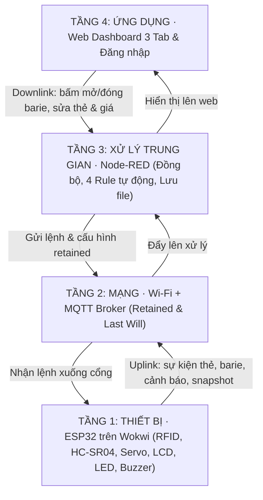
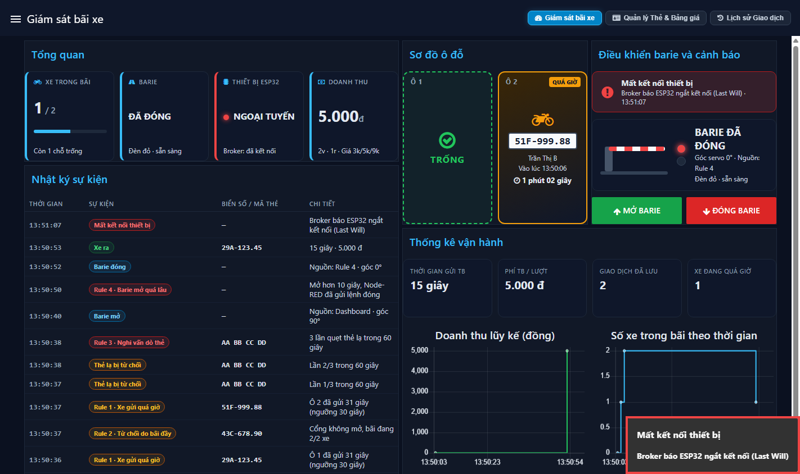
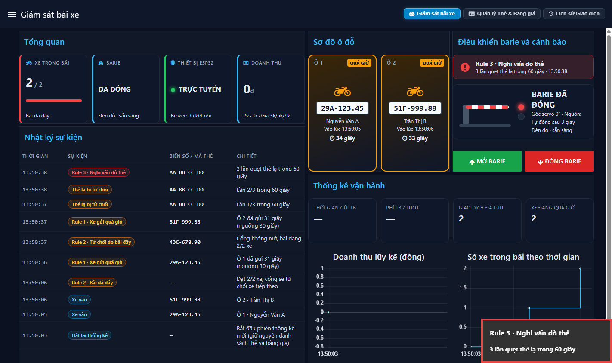
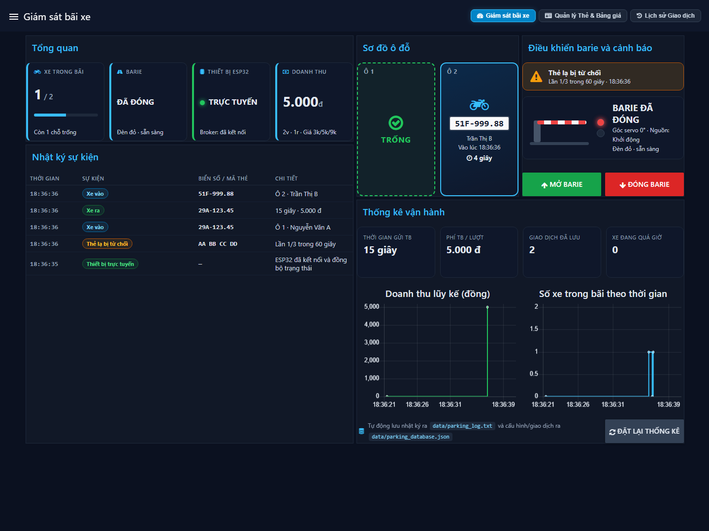
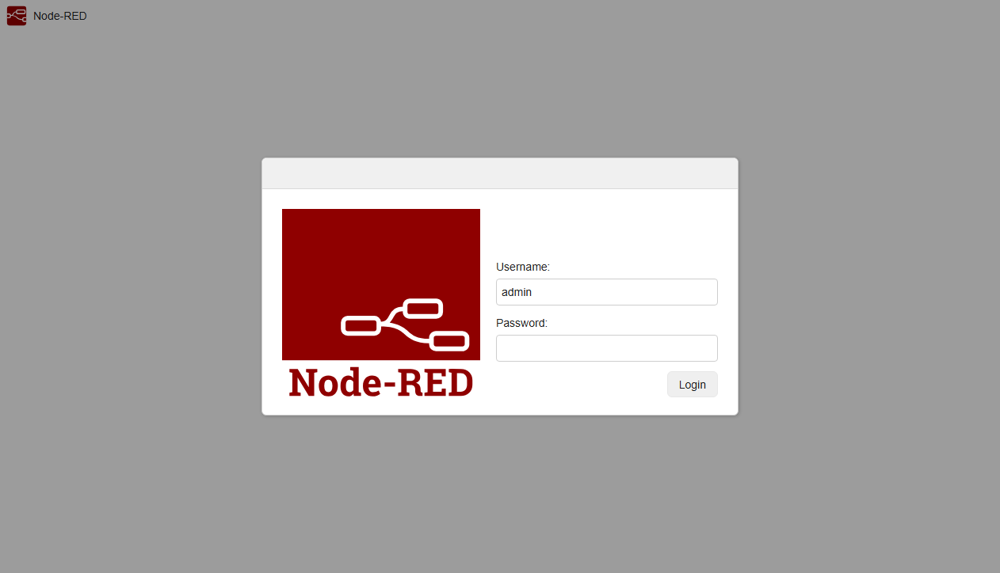
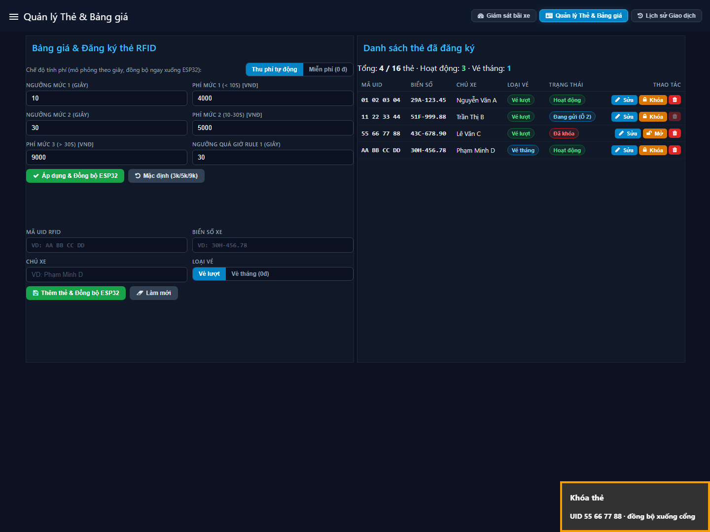
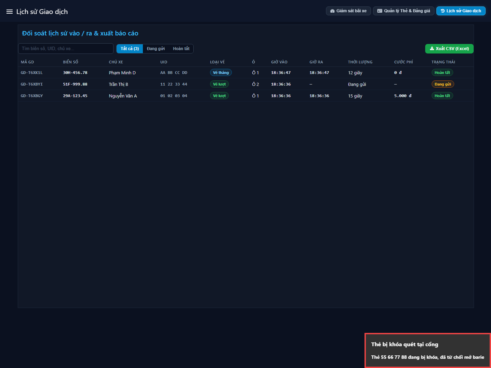
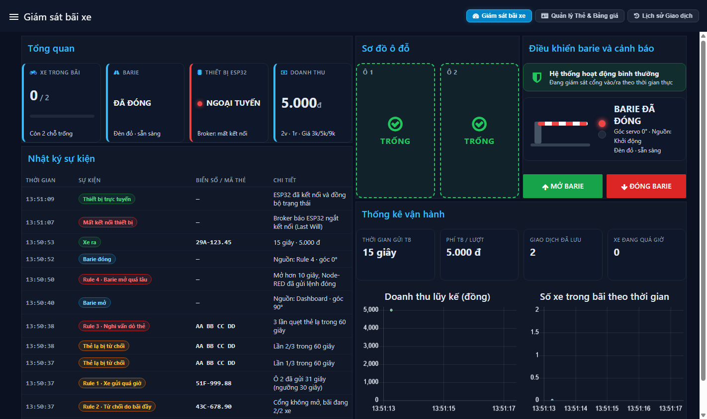

# KỊCH BẢN VÀ NỘI DUNG SLIDE THUYẾT TRÌNH (13 SLIDES)
**Đề tài: Hệ thống bãi giữ xe máy tự quản sử dụng RFID (Mô hình IoT 4 tầng)**  
*Thời lượng trình bày: khoảng 12 – 15 phút*

---

## SLIDE 1: TRANG MỞ ĐẦU
* **Tên đề tài**: HỆ THỐNG BÃI GIỮ XE MÁY TỰ QUẢN SỬ DỤNG RFID
* **Mô hình**: Kiến trúc IoT 4 tầng — Mô phỏng phần cứng trên Wokwi & Middleware bằng Node-RED / Docker
* **Trường / Khoa**: Trường Đại học Công Thương TP. Hồ Chí Minh (HUIT) — Khoa Công nghệ Thông tin
* **Học phần**: Internet of Things (IoT)
* **Giảng viên hướng dẫn**: Thầy Võ Hoàng Hải
* **Nhóm thực hiện**: Nhóm 4 — `2001230069` Nguyễn Lê Duy Cương · `2001230894` Đinh Tấn Thành · `2001230938` Bùi Tấn Thông

> **Lời nói gợi ý:**  
> Dạ em chào thầy Hải và các bạn. Hôm nay nhóm em — Nhóm 4 — xin trình bày đề tài **Hệ thống bãi giữ xe máy tự quản dùng thẻ RFID**. Trong bài nói hôm nay, tụi em sẽ đi gọn qua 4 ý chính: bài toán nhóm đặt ra là gì, tụi em dùng những thiết bị và công nghệ nào, hệ thống đã chạy được những gì kèm ảnh thực tế, và cuối cùng là những chỗ còn hạn chế để nâng cấp thêm sau này.

> **Chuyển ý:**  
> Trước hết mình đi vào lý do làm đề tài và mục tiêu tụi em hướng tới ạ.

---

## SLIDE 2: BÀI TOÁN ĐẶT RA & MỤC TIÊU (*Nhóm sẽ làm gì?*)

| Vấn đề ngoài bãi xe truyền thống | Giải pháp nhóm thực hiện |
| :--- | :--- |
| Ghi vé giấy, nhập tay $\rightarrow$ dễ ùn tắc giờ cao điểm | Quẹt thẻ RFID tự động nhận diện vào/ra và gán ô trống |
| Barie tự đóng theo thời gian cứng $\rightarrow$ dễ hạ trúng xe | Gắn siêu âm HC-SR04 đo `< 15 cm` để hoãn đóng chống kẹp |
| Khó theo dõi chỗ trống, mất nhật ký khi có sự cố | Đồng bộ 2 chiều lên Web Dashboard, cảnh báo tự động & lưu log |
| Dễ bị người ngoài vào bấm mở barie trên web | Bật đăng nhập xác thực trước khi vào trang điều khiển |

* **Gợi ý chèn thêm vào PowerPoint (nếu cần)**: Sơ đồ Use Case `docs/figures/fig_3_1_usecase.png`.

> **Lời nói gợi ý:**  
> Thầy với các bạn chắc cũng quen cảnh bãi giữ xe ghi vé tay giờ cao điểm kẹt rất lâu. Còn một số barie tự động chỉ canh đúng vài giây rồi hạ xuống thì rất dễ va trúng người hay xe đi chậm phía dưới. Vì vậy nhóm em làm mô hình này để giải quyết đúng mấy điểm đó: quẹt thẻ tự cho xe vào ra, có cảm biến chống kẹp dưới cần chắn, dữ liệu đẩy thẳng lên web để người quản lý theo dõi và khóa trang web bằng tài khoản đăng nhập.

> **Chuyển ý:**  
> Để làm được mấy chức năng này thì nhóm em chọn dùng những linh kiện và công cụ gì?

---

## SLIDE 3: CÔNG NGHỆ & THIẾT BỊ SỬ DỤNG (*Nhóm dùng những gì?*)

| Tầng trong hệ thống | Thiết bị / Công cụ nhóm sử dụng | Dùng để làm gì |
| :--- | :--- | :--- |
| **Tầng 1 — Thiết bị** | **ESP32 DevKit V1** (trên **Wokwi**, code bằng **PlatformIO**) | Xử lý đọc thẻ, đóng mở cổng, tính tiền tại chỗ |
| | **RFID-RC522**, **HC-SR04**, **Servo SG90**, **LCD 1602 I2C**, **LED Đỏ/Xanh**, **Buzzer** | Đọc UID thẻ, đo vật cản, nâng/hạ barie, báo đèn/loa/màn hình |
| **Tầng 2 — Truyền thông** | **Wi-Fi (`Wokwi-GUEST`)** + **MQTT (`broker.hivemq.com`)** | Truyền bản tin hai chiều giữa cổng và phần mềm |
| **Tầng 3 — Xử lý & Lưu** | **Node-RED**, **tệp JSON (`parking_database.json`)** & **`parking_log.txt`**, đóng gói **Docker Compose** | Đồng bộ số liệu, chạy 4 luật tự động, lưu lịch sử để khởi động lại không mất |
| **Tầng 4 — Giao diện** | **Web Dashboard 3 tab** + xác thực **Basic Auth (`bcrypt`)** | Theo dõi bãi xe, bấm mở/đóng barie, quản lý thẻ, bảng giá, xuất CSV |

> **Lời nói gợi ý:**  
> Về đồ nghề sử dụng: do làm mô phỏng nên Tầng 1 nhóm em dựng mạch trên Wokwi gồm ESP32, đầu đọc thẻ RFID, cảm biến siêu âm HC-SR04, servo làm thanh chắn, màn hình LCD, hai đèn xanh đỏ với còi báo. Dữ liệu từ mạch gửi qua MQTT trên HiveMQ về Node-RED để xử lý tự động, lưu ra file JSON với file log, rồi hiển thị lên Web Dashboard có đăng nhập. Toàn bộ phần Node-RED tụi em đóng gói sẵn bằng Docker Compose để mở lên máy nào chạy cũng giống nhau.

> **Chuyển ý:**  
> Quá trình làm từ lúc bắt đầu tới giờ được nhóm em chia theo lộ trình 10 tuần của môn học.

---

## SLIDE 4: LỘ TRÌNH THỰC HIỆN 10 TUẦN

| Tuần | Công việc chính nhóm thực hiện | Mốc |
| :---: | :--- | :---: |
| **1 – 2** | Phân tích bài toán, lên kiến trúc 4 tầng và lắp mạch đầu tiên trên Wokwi | |
| **3** | Làm hoàn chỉnh luồng quẹt thẻ vào/ra, chống đọc trùng và trạng thái barie | **M1** |
| **4** | Kết nối Wi-Fi và MQTT hai chiều, tự kết nối lại khi rớt mạng | **M2** |
| **5 – 6** | Dựng flow Node-RED, làm Web Dashboard và gắn bảo mật đăng nhập | **M3** |
| **7 – 8** | Cài 4 luật tự động, gắn thêm siêu âm chống kẹp `< 15 cm`, LCD, LED và LWT | **M4** |
| **9 – 10** | Đóng gói Docker, làm thêm quản lý 16 thẻ/giá động/CSV, chạy test và quay demo | |

> **Lời nói gợi ý:**  
> Đây là lộ trình 10 tuần của nhóm em bám sát từng mốc thầy giao trên lớp: tuần đầu dựng mạch và chạy được quẹt thẻ ở M1, tuần 4 nối MQTT hai chiều cho M2, tới tuần 6 lên Dashboard có đăng nhập đạt M3, rồi tuần 7–8 bổ sung siêu âm chống kẹp, màn hình LCD, LWT với 4 luật tự động cho M4, hai tuần cuối đóng gói Docker, làm thêm phần mở rộng và kiểm thử lại hết.

> **Chuyển ý:**  
> Bây giờ mình xem thử 4 tầng này nối với nhau và chạy dữ liệu qua lại ra sao ạ.

---

## SLIDE 5: KIẾN TRÚC 4 TẦNG & LUỒNG DỮ LIỆU HAI CHIỀU

* **Điểm hay của thiết kế**:
  * **Xử lý ngay tại cổng (ESP32)**: Quyết định cho vào/ra và chống kẹp làm trực tiếp trên ESP32 $\rightarrow$ **rớt mạng vẫn hoạt động bình thường**, không bị kẹt xe ngoài cổng.
  * **Gợi ý chèn vào PowerPoint**: `docs/figures/fig_3_2_arch_4layer.png`.

> **Lời nói gợi ý:**  
> Kiến trúc chia làm 4 tầng tách biệt. Chiều đi lên mang thông tin quẹt thẻ, tình trạng ô đỗ và cảnh báo từ cổng lên web. Chiều đi xuống mang lệnh đóng mở barie hoặc bảng giá, thẻ mới từ web gửi ngược về ESP32. Cái hay ở đây là toàn bộ phần đọc thẻ, phân ô và chống kẹp đều nằm trực tiếp trên ESP32, nên lỡ mất Wi-Fi thì cổng vẫn mở cho xe ra vào bình thường, khi nào có mạng lại nó tự gửi đồng bộ lên web sau.

> **Chuyển ý:**  
> Đi vào chi tiết phần đầu tiên nhóm đã làm được ở Tầng 1 tại cổng mô phỏng ạ.

---

## SLIDE 6: TẦNG 1 — XỬ LÝ TẠI CỔNG & CHỐNG KẸP XE (*Đã làm được gì?*)

* **Phần đọc thẻ & kiểm soát vào/ra**:
  * Đọc UID từ RC522, chặn quẹt trùng trong `1,5 giây` để tránh quẹt một lần mà tính nhầm hai lượt.
  * Tự cấp ô trống (`1` hoặc `2`) khi xe vào; tự tính thời gian gửi và cước phí khi xe ra (vé tháng `0đ`).
  * Từ chối tại chỗ kèm còi & dòng báo LCD nếu gặp **thẻ lạ**, **thẻ bị khóa** hoặc **bãi đã đầy (`2/2`)**.
* **Phần chống kẹp xe an toàn**:
  * Sau `3 giây` mở hoặc khi nhận lệnh đóng từ web, siêu âm HC-SR04 đo lại mỗi `0,3 giây`.
  * Còn vật cản `< 15 cm` $\rightarrow$ **hoãn đóng**, giữ barie `90°` (`TAM HOAN DONG`), thông thoáng mới hạ.
* **Gợi ý chèn thêm vào PowerPoint**: `docs/figures/fig_3_3_flow_rfid.png` và `docs/figures/fig_3_4_flow_antipinch_fsm.png`.

> **Lời nói gợi ý:**  
> Ở Tầng 1, nhóm em đã làm xong phần mạch mô phỏng với đầy đủ 7 linh kiện trên Wokwi. Khi quẹt thẻ, ESP32 tự biết xe này đang vào hay đang ra để gán ô trống hoặc tính tiền hiện lên màn hình LCD. Có sẵn luôn chống quẹt trùng trong 1,5 giây để người gửi giữ thẻ lâu chút không bị tính thành lượt ra luôn. Còn khi chuẩn bị hạ barie, cảm biến siêu âm đo liên tục bên dưới; như trên ảnh thầy thấy có vật cản ở mức 10 cm là màn hình hiện tạm hoãn đóng và thanh chắn vẫn giữ mở ở góc 90 độ cho an toàn.

> **Chuyển ý:**  
> Khi có sự kiện ở cổng, mạch sẽ đẩy tin nhắn ra ngoài qua Tầng 2 MQTT như thế nào?

---

## SLIDE 7: TẦNG 2 — TRUYỀN THÔNG MQTT HAI CHIỀU & BÁO MẤT KẾT NỐI

| Topic (`parking_n4/...`) | Chiều | Cơ chế | Dùng làm gì |
| :--- | :---: | :---: | :--- |
| `rfid/scan` | Lên | Thường | Báo lượt xe vào/ra, ô đỗ và cước phí |
| `barie/status` | Lên | Retained | Cập nhật trạng thái barie đang đóng hay mở |
| `alert` | Lên | Thường | Báo thẻ lạ, thẻ bị khóa, bãi đầy hoặc kẹt vật cản |
| `status` | Lên | Retained + LWT | Đồng bộ hiện trạng 2 ô; mất kết nối đột ngột tự báo ngoại tuyến |
| `barie/cmd` | Xuống | Thường | Nhận lệnh đóng/mở từ web hoặc luật tự đóng |
| `config` *(Mở rộng)* | Xuống | Retained | Gửi danh sách tối đa 16 thẻ và bảng giá mới xuống ESP32 |

* **Tự phục hồi & báo sự cố mạng**: Mất kết nối ESP32 tự thử nối lại mỗi `5 giây`; khi nối lại gửi snapshot đồng bộ web; nếu rút điện hay rớt mạng đột ngột, **Last Will (LWT)** tự báo đỏ **`NGOẠI TUYẾN`** ngay trên Dashboard.

> **Lời nói gợi ý:**  
> Ở Tầng 2, nhóm em dùng 6 topic MQTT tách hai chiều lên và xuống qua HiveMQ. Nhóm dùng hai tính năng rất tiện của MQTT là Retained với Last Will. Nhờ Retained mà hễ mạch hay trang web mới bật lên là có ngay trạng thái barie với bảng thẻ mới nhất. Còn như ảnh kiểm thử bên dưới, khi nhóm thử ngắt kết nối đột ngột thì Broker tự phát tin Last Will làm thẻ ESP32 trên web chuyển sang màu đỏ Ngoại tuyến để người trực biết ngay.

> **Chuyển ý:**  
> Toàn bộ 6 topic này sẽ đổ vào Tầng 3 Node-RED để xử lý và chạy cảnh báo tự động ạ.

---

## SLIDE 8: TẦNG 3 — NODE-RED & 4 QUY TẮC TỰ ĐỘNG HÓA

* **Điều phối gọn một mối**: Toàn bộ tin nhắn MQTT đổ vào một trạng thái chung trên Node-RED nên số liệu trên từng ô đỗ, bảng nhật ký và biểu đồ luôn trùng khớp.
* **4 quy tắc tự động hóa (phân tách rõ ngưỡng demo với thực tế)**:
  * **Rule 1 — Xe gửi quá giờ**: Vượt ngưỡng (demo `30 giây`, thực tế `4–12 giờ`) $\rightarrow$ Gắn nhãn vàng `QUÁ GIỜ`.
  * **Rule 2 — Bãi đầy**: Đủ `2/2` xe (thực tế `50–500` xe) hoặc nhận cảnh báo đầy $\rightarrow$ Thẻ Tổng quan chuyển đỏ.
  * **Rule 3 — Dò thẻ lạ liên tiếp**: Quẹt thẻ chưa đăng ký $\ge 3$ lần/`60 giây` (thực tế $\ge 5$ lần/`120 giây`) $\rightarrow$ Báo đỏ `Nghi vấn dò thẻ`.
  * **Rule 4 — Barie mở quá lâu**: Mở giữ `> 10 giây` (thực tế `30–60 giây`) $\rightarrow$ Tự gửi lệnh đóng xuống ESP32 (vẫn qua chống kẹp).

* **Gợi ý chèn thêm vào PowerPoint**: Lưu đồ xử lý `docs/figures/fig_3_5_flow_checkcard_nodered.png`.

> **Lời nói gợi ý:**  
> Lên tới Tầng 3 Node-RED, nhóm em gom hết dữ liệu vào một chỗ trước rồi mới chia ra các ô hiển thị nên không bị tình trạng chỗ này báo 1 xe chỗ kia báo 2 xe. Trên luồng này nhóm cài 4 luật tự động: nhắc xe quá giờ, báo đỏ bãi đầy, cảnh báo khi có người thử thẻ lạ liên tiếp và tự động đóng barie nếu mở quên quá 10 giây — tất nhiên lệnh đóng này xuống tới cổng vẫn phải qua cảm biến chống kẹp mới cho hạ. Hình dưới là lúc nhóm em test kích hoạt cả Rule 1, Rule 2 với Rule 3 cùng lúc trên Dashboard thật.

> **Chuyển ý:**  
> Tiếp theo là Tầng 4 Web Dashboard để người quản lý nhìn và thao tác hàng ngày.

---

## SLIDE 9: TẦNG 4 — WEB DASHBOARD & BẢO MẬT ĐĂNG NHẬP

* **Tab 1 — Giám sát bãi xe (nằm gọn trong 1 màn hình)**:
  * Xem nhanh 4 ô tổng quan (số xe, barie, trạng thái ESP32, doanh thu).
  * Theo dõi trực tiếp Ô 1 & Ô 2 (biển số, chủ xe, giờ vào, bộ đếm giây, nhãn quá giờ/vé tháng).
  * Bấm nút **`MỞ BARIE`** / **`ĐÓNG BARIE`** từ xa, xem 12 sự kiện gần nhất và 2 biểu đồ.
* **Khóa truy cập 2 lớp**:
  * Muốn vào trang Dashboard (`/ui`) hay trang soạn flow (`/`) đều bắt buộc đăng nhập; mật khẩu lưu dạng băm `bcrypt`, nhập sai bị chặn bằng mã `401 Unauthorized`.

> **Lời nói gợi ý:**  
> Ở Tầng 4, Tab 1 được nhóm em xếp gọn trong đúng một màn hình máy tính để người trực bãi nhìn một lượt là thấy hết: còn mấy chỗ trống, xe nào đang ở ô nào, barie đang đóng hay mở, bên dưới có nhật ký với biểu đồ luôn. Ngoài ra tụi em cũng khóa luôn cả trang web lẫn trang cấu hình Node-RED bằng tài khoản đăng nhập, mật khẩu đều băm bcrypt chứ không để trơn, nên chưa đăng nhập thì không ai tự ý bấm mở barie từ xa được.

> **Chuyển ý:**  
> Ngoài những phần cơ bản theo yêu cầu môn học, nhóm em còn làm thêm vài tính năng mở rộng và phần lưu trữ dữ liệu.

---

## SLIDE 10: TÍNH NĂNG MỞ RỘNG & LƯU TRỮ BỀN VỮNG *(Đã làm thêm gì?)*

* **Quản lý 16 thẻ & Bảng giá động (Tab 2 — Mở rộng)**:
  * Thêm, sửa, khóa/mở khóa và xóa thẻ ngay trên web (có nút **Lấy UID này** khi vừa quẹt thẻ lạ; hỗ trợ **Vé tháng `0đ`**; khóa xóa nếu xe đang nằm trong bãi).
  * Đổi chế độ miễn phí, sửa 3 mức giá và ngưỡng Rule 1 rồi đẩy thẳng xuống ESP32 mà không cần nạp lại code.
* **Tra cứu lịch sử & Xuất CSV (Tab 3 — Mở rộng)**:
  * Tự ghép cặp giờ vào–ra thành từng giao dịch hoàn chỉnh, lọc/tìm theo biển số hoặc chủ xe, bấm tải file `.csv` mở chuẩn tiếng Việt trên Excel.
* **Lưu trữ gọn nhẹ & Đóng gói Docker Compose**:
  * Lưu vào `parking_log.txt` và `parking_database.json` (nhẹ, không cần dựng thêm máy chủ SQL rời).
  * Thử khởi động lại container Docker: toàn bộ doanh thu (`5.000đ`), danh sách thẻ, bảng giá và lịch sử giao dịch đều được nạp lại đầy đủ.

> **Lời nói gợi ý:**  
> Phần mở rộng nhóm em làm thêm gồm hai tab quản lý: Tab 2 cho phép thêm sửa khóa thẻ, lấy nhanh UID lạ vừa quẹt, phân biệt vé tháng với vé lượt, và chỉnh bảng giá đồng bộ thẳng xuống ESP32 luôn khỏi phải sửa code nạp lại. Tab 3 ghép cặp giờ vào ra của từng xe để tìm kiếm và xuất file CSV mở Excel. Dữ liệu được lưu vào hai file JSON và text trong Docker; như hình kiểm chứng lúc khởi động lại container, tiền thu với lịch sử giao dịch vẫn còn nguyên không bị mất.

> **Chuyển ý:**  
> Để chắc chắn mọi thứ chạy đúng như thiết kế, nhóm đã kiểm thử và đối chiếu lại với từng mốc yêu cầu của môn học.

---

## SLIDE 11: KẾT QUẢ KIỂM THỬ & ĐỐI CHIẾU YÊU CẦU MÔN HỌC

| Yêu cầu môn học | Nhóm đã kiểm chứng bằng gì | Kết quả |
| :--- | :--- | :---: |
| **Mô phỏng đủ 4 tầng IoT** | Wokwi + MQTT HiveMQ + Node-RED + Dashboard trên Docker | Đạt |
| **M1 — Xử lý tại cổng** | Chạy trực tiếp trên Wokwi: vào/ra, bãi đầy `2/2`, thẻ lạ, chống lặp, chống kẹp `< 15 cm` | Đạt |
| **M2 — Kết nối MQTT 2 chiều** | Gửi nhận thật qua HiveMQ: Uplink sự kiện, Downlink barie, `config` retained & LWT | Đạt |
| **M3 — Web Dashboard & Bảo mật** | Điều khiển barie, biểu đồ; test HTTP báo `401` khi thiếu/sai mật khẩu và `200` khi đúng | Đạt |
| **Tự động hóa & Lưu trữ** | Kích hoạt thật đủ 4 rule trên Node-RED Docker, ghi log và khôi phục sau restart | Đạt |
| **M4 — Kịch bản liên hoàn 9 bước** | Logic 9 bước đã test qua script MQTT + Node-RED; **đang quay nốt video trên Wokwi thật** | Đang quay video |

> **Lời nói gợi ý:**  
> Về kiểm thử thì nhóm em tách rất rõ: các thao tác tại cổng như quẹt thẻ vào ra, bãi đầy, thẻ lạ hay chống kẹp 15 cm đều chạy test thẳng trên Wokwi; còn các phần mạng MQTT, rớt kết nối LWT, 4 quy tắc tự động, khóa đăng nhập web và khôi phục dữ liệu sau khi khởi động lại Docker thì nhóm đã chạy kiểm chứng trực tiếp trên container Node-RED thật. Hiện nhóm chỉ còn quay hoàn chỉnh video chạy nối liền 9 bước trên Wokwi thật để kẹp vô nộp bài.

> **Chuyển ý:**  
> Kịch bản 9 bước chạy nối liền từ đầu tới cuối đó tụi em sắp theo thứ tự này ạ.

---

## SLIDE 12: KỊCH BẢN DEMO TỔNG THỂ (9 PHÂN CẢNH)

| Bước | Làm gì | Quan sát được gì |
| :---: | :--- | :--- |
| **1** | Đăng nhập `/ui` và bật Wokwi | Vào được Dashboard, ESP32 báo `TRỰC TUYẾN`, bãi `0/2` |
| **2** | Quẹt thẻ xe 1 (`29A-123.45` / phím `1`) | Barie mở `90°`, LCD hiện Ô 1, web cập nhật `1/2` |
| **3** | Kéo cảm biến `< 15 cm`, rồi `> 15 cm` | Giữ mở an toàn (`TAM HOAN DONG`), hết cản tự hạ `0°` |
| **4** | Chờ xe 1 gửi qua ngưỡng `30 giây` | Ô 1 bật nhãn vàng `QUÁ GIỜ`, ghi log Rule 1 |
| **5** | Cho xe 2 vào (`2/2`), quẹt thêm xe 3 (`3`) | Tổng quan báo đỏ bãi đầy (Rule 2); cổng từ chối xe 3 |
| **6** | Quẹt thẻ lạ (`4`) `3` lần liên tiếp | Cổng báo còi; web bật cảnh báo đỏ Rule 3 và giữ lại UID |
| **7** | Tab 2: đăng ký thẻ vừa quẹt (`Vé tháng`), khóa thẻ, đổi giá | Đồng bộ xuống ESP32; vé tháng `0đ`, thẻ khóa bị chặn |
| **8** | Bấm `MỞ BARIE` giữ quá `10 giây`, thử `ĐÓNG BARIE` | Rule 4 tự gửi lệnh đóng xuống cổng (vẫn check vật cản) |
| **9** | Cho xe ra, xem Tab 3 & `parking_log.txt` | Hiện đúng tiền, ghép cặp vào–ra và tải được CSV |

> **Lời nói gợi ý:**  
> Nếu chạy demo trọn vẹn từ đầu tới cuối thì sẽ đi qua 9 bước như trên bảng: bắt đầu từ đăng nhập web, cho xe vào, thử kẹp barie, thử xe quá giờ, thử bãi đầy, quẹt thẻ lạ 3 lần, thêm thẻ mới với đổi giá ngay trên web cho đồng bộ xuống mạch, thử quên đóng barie quá 10 giây, rồi cuối cùng cho xe ra kiểm tra lịch sử và tải file CSV.

> **Chuyển ý:**  
> Cuối cùng, nhóm xin tóm tắt lại những gì đã làm được, hạn chế hiện tại và hướng phát triển sau này.

---

## SLIDE 13: TỔNG KẾT — LÀM ĐƯỢC GÌ, HẠN CHẾ & HƯỚNG PHÁT TRIỂN

* **Hệ thống đã làm được**:
  * Xây dựng trọn vẹn mô hình **IoT 4 tầng** cho bãi giữ xe RFID với luồng dữ liệu hai chiều.
  * Xử lý tại cổng độc lập với mạng (vào/ra, `2` ô, cước phí, chống quẹt trùng) kèm **chống kẹp `< 15 cm`**.
  * Chạy đủ **4 quy tắc tự động**, báo mất kết nối **LWT**, khóa **đăng nhập 2 lớp**, lưu trữ khôi phục sau khởi động lại và đóng gói **Docker Compose**.
  * Làm thêm **quản lý 16 thẻ**, **vé tháng**, **bảng giá động**, **đối soát lịch sử & xuất CSV**.
* **Hạn chế hiện tại**:
  * Mới chạy ở mức mô phỏng trên Wokwi (sức chứa `2` ô, các mốc thời gian thu ngắn để tiện demo), chưa lắp mạch vật lý thật để kiểm chứng độ bền cơ khí, nhiễu cảm biến hay điều kiện ngoài trời.
  * Đang dùng public broker và HTTP cục bộ, chưa bật mã hóa TLS/HTTPS.
* **Hướng phát triển tiếp theo**:
  * Lắp đặt thử nghiệm trên mạch thật (cấp nguồn riêng cho servo và nối mass chuẩn).
  * Gắn thêm **camera nhận diện biển số (ANPR)** đối chiếu với thẻ RFID, tích hợp **thanh toán VietQR**, **cảm biến từng ô đỗ** và đẩy cảnh báo sự cố qua **Telegram**.

> **Lời nói gợi ý:**  
> Tóm lại tới hiện tại, nhóm em đã làm hoàn chỉnh mô hình bãi giữ xe RFID 4 tầng trên Wokwi và Node-RED Docker: cổng tự xử lý được vào ra và chống kẹp dưới 15 cm, web có đăng nhập bảo mật, chạy đủ 4 luật cảnh báo, lưu lại dữ liệu không bị mất khi tắt mở lại, kèm phần mở rộng quản lý tới 16 thẻ, đổi bảng giá từ xa và xuất Excel CSV. Nhóm cũng nhìn nhận rõ hạn chế là bài mới dừng ở mô phỏng với quy mô 2 ô đỗ và broker công cộng chưa bật mã hóa TLS, chưa ra mạch thật để đánh giá môi trường bên ngoài. Nếu phát triển tiếp, nhóm muốn làm mạch thật có nguồn riêng cho servo, thêm camera đọc biển số để tránh tráo thẻ, quét mã VietQR thu phí và gửi cảnh báo qua Telegram. Phần trình bày của nhóm em tới đây là hết, cảm ơn thầy Hải và các bạn đã lắng nghe ạ!
