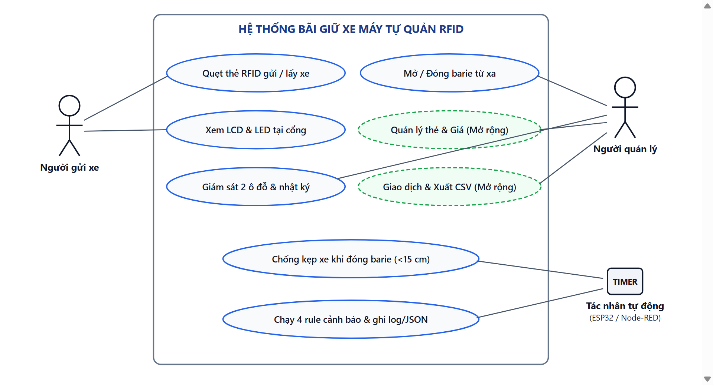
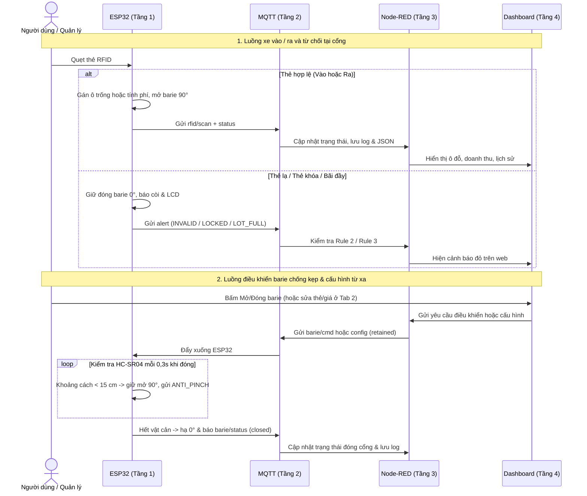
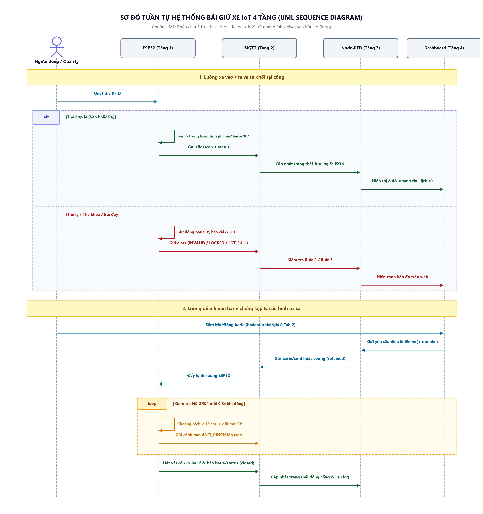
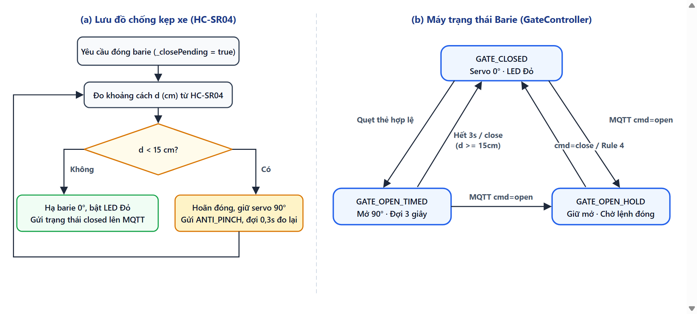
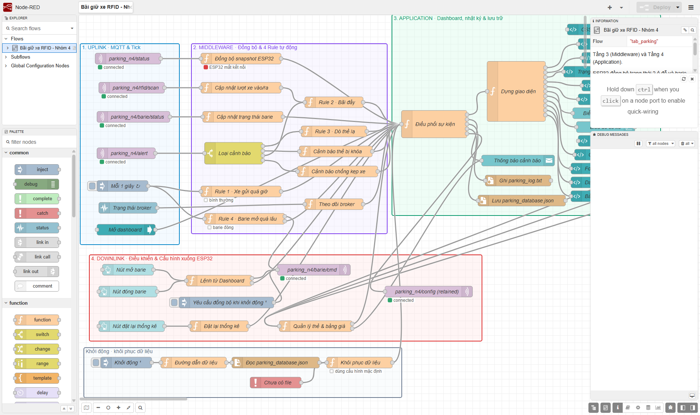

# KỊCH BẢN VÀ NỘI DUNG SLIDE THUYẾT TRÌNH (13 SLIDES)
**Đề tài: Hệ thống bãi giữ xe máy tự quản sử dụng RFID (Mô hình IoT 4 tầng)**  
*Thời lượng trình bày dự kiến: 8 – 10 phút (kèm demo trực tiếp sau phần trình bày)*

---

## SLIDE 1: TRANG MỞ ĐẦU
* **Tên đề tài**: HỆ THỐNG BÃI GIỮ XE MÁY TỰ QUẢN SỬ DỤNG RFID
* **Mô hình**: Kiến trúc IoT 4 tầng — Mô phỏng Wokwi & Node-RED trên Docker
* **Trường / Khoa**: Trường Đại học Công Thương TP. Hồ Chí Minh (HUIT) — Khoa Công nghệ Thông tin
* **Học phần**: Internet of Things (IoT)
* **Giảng viên hướng dẫn**: Thầy Võ Hoàng Hải
* **Nhóm thực hiện**: Nhóm 4 — `2001230069` Nguyễn Lê Duy Cương · `2001230894` Đinh Tấn Thành · `2001230938` Bùi Tấn Thông

> **Lời nói gợi ý:**  
> Em chào thầy Hải và các bạn. Hôm nay Nhóm 4 xin trình bày đề tài **Hệ thống bãi giữ xe máy tự quản dùng thẻ RFID**. Phần trình bày gồm: bài toán và công nghệ sử dụng, kiến trúc 4 tầng, kết quả kiểm thử thực tế, hạn chế và sau đó nhóm em sẽ demo trực tiếp hệ thống.

> **Chuyển ý:**  
> Trước hết, nhóm em xin trình bày bài toán đặt ra và phạm vi thực hiện.

---

## SLIDE 2: BÀI TOÁN, MỤC TIÊU & PHẠM VI

* **Vấn đề**: Ở bãi xe truyền thống, ghi vé tay vừa chậm, vừa khó đối soát; barie đóng cứng theo giây dễ va chạm xe.
* **Mục tiêu**: Tự động nhận diện xe vào/ra bằng RFID, chống kẹp dưới `15 cm`, giám sát từ xa và khóa đăng nhập web.
* **Phạm vi mô phỏng**: Bãi giữ xe `2` ô đỗ, quản lý tối đa `16` thẻ RFID và `1` cổng barie trên Wokwi.

> **Lời nói gợi ý:**  
> Ở bãi xe truyền thống, ghi vé tay vừa chậm, vừa khó đối soát khi có sự cố. Ngoài ra, barie đóng theo thời gian cố định dễ hạ trúng xe đang đi qua. Vì vậy, nhóm em xây dựng mô hình mô phỏng 2 ô đỗ dùng thẻ RFID, có cảm biến siêu âm chống kẹp và đồng bộ dữ liệu lên web có đăng nhập.

> **Chuyển ý:**  
> Để làm hệ thống này, nhóm em sử dụng các linh kiện và phần mềm sau.

---

## SLIDE 3: THIẾT BỊ & CÔNG CỤ SỬ DỤNG

| Tầng | Thiết bị / Công cụ sử dụng | Vai trò chính |
| :--- | :--- | :--- |
| **Tầng 1 (Cổng)** | **ESP32 DevKit V1** (Wokwi, PlatformIO), **RFID-RC522**, **HC-SR04**, **Servo SG90**, **LCD 1602 I2C**, **LED Đỏ/Xanh**, **Buzzer** | Đọc thẻ, đo vật cản, đóng/mở barie, hiện LCD và báo còi/đèn |
| **Tầng 2 (Mạng)** | **Wi-Fi (`Wokwi-GUEST`)** + **MQTT (`broker.hivemq.com`)** | Truyền tin hai chiều giữa cổng và phần mềm |
| **Tầng 3 (Xử lý)** | **Node-RED** (Docker), `parking_log.txt` & `parking_database.json` | Đồng bộ dữ liệu, chạy 4 rule tự động và lưu lịch sử |
| **Tầng 4 (Web)** | **Web Dashboard 3 tab** + **Basic Auth (`bcrypt`)** | Theo dõi bãi xe, điều khiển barie, quản lý thẻ/giá, xuất CSV |

> **Lời nói gợi ý:**  
> Phần cứng mô phỏng trên Wokwi gồm ESP32 kết nối đầu đọc thẻ RC522, cảm biến siêu âm HC-SR04, servo làm barie, màn hình LCD, đèn và còi. Dữ liệu gửi qua MQTT trên HiveMQ về Node-RED chạy trong Docker để xử lý tự động, lưu ra hai tệp dữ liệu và hiển thị lên Web Dashboard có đăng nhập.

> **Chuyển ý:**  
> Tiếp theo là kiến trúc kết nối giữa bốn tầng của hệ thống.

---

## SLIDE 4: KIẾN TRÚC 4 TẦNG & LUỒNG HAI CHIỀU

* **Luồng Uplink**: Đẩy sự kiện quẹt thẻ, trạng thái barie, cảnh báo và snapshot bãi xe từ ESP32 lên web.
* **Luồng Downlink**: Gửi lệnh mở/đóng barie, danh sách thẻ và bảng giá mới từ web hoặc Rule 4 xuống ESP32.
* **Nguyên lý tại cổng**: Theo thiết kế, toàn bộ quyết định vào/ra và chống kẹp chạy ngay trên ESP32 để cổng không phụ thuộc mạng.

> **Lời nói gợi ý:**  
> Hệ thống chia làm 4 tầng với hai luồng dữ liệu tách biệt. Chiều đi lên đưa thông tin quẹt thẻ và cảnh báo lên web; chiều đi xuống đưa lệnh barie và cấu hình thẻ, giá mới về cổng. Theo thiết kế, phần xử lý tại cổng chạy trực tiếp trên ESP32 nên dù mất mạng tạm thời, cổng vẫn kiểm soát xe bình thường.

> **Chuyển ý:**  
> Các luồng chức năng chính đi xuyên qua 4 tầng được thể hiện qua sơ đồ tuần tự sau.

---

## SLIDE 5: LUỒNG CHỨC NĂNG XUYÊN 4 TẦNG

* **Điểm thống nhất**: Quyết định thực tế luôn đi qua cổng ESP32; lệnh đóng từ web hay Rule 4 đều phải qua kiểm tra siêu âm `< 15 cm`.

> **Lời nói gợi ý:**  
> Sơ đồ tuần tự chuẩn UML này gộp hai luồng chính xuyên suốt 4 tầng. Ở luồng vào ra, ESP32 tự kiểm tra thẻ rồi mở cổng, sau đó đẩy MQTT lên Node-RED để lưu file và cập nhật web; trường hợp thẻ lỗi hoặc bãi đầy thì cổng chặn tại chỗ rồi mới báo cảnh báo. Ở chiều ngược lại, lệnh đóng barie hay cấu hình thẻ, giá mới đi từ web qua MQTT xuống ESP32, và khi đóng đều phải kiểm tra siêu âm dưới 15 cm mới hạ thanh chắn.

> **Chuyển ý:**  
> Bây giờ nhóm em đi vào chi tiết triển khai từng tầng, bắt đầu từ Tầng 1.

---

## SLIDE 6: TẦNG 1 — ĐẤU NỐI, XỬ LÝ THẺ & CHỐNG KẸP XE

| Linh kiện | GPIO ESP32 | Chức năng |
| :--- | :--- | :--- |
| **RFID-RC522** (`SPI`) | `5`, `18`, `23`, `19`, `4` | Đọc UID thẻ 13,56 MHz |
| **HC-SR04** | `27` (`TRIG`), `32` (`ECHO`) | Đo vật cản dưới thanh chắn |
| **Servo** / **Buzzer** / **LED** / **LCD I2C** | `13` / `14` / `25, 26` / `21, 22` | Nâng hạ barie `0°–90°`, báo còi, đèn và hiện thông tin |

* **Xử lý thẻ**: Chống đọc trùng `1,5s`; xe vào lấy ô trống `1–2`; xe ra tính giờ và tiền (`0đ` vé tháng); chặn thẻ lạ, khóa, đầy `2/2`.
* **Chống kẹp & 3 trạng thái**: Hết `3s` giữ mở hoặc nhận lệnh đóng, HC-SR04 đo mỗi `0,3s`, dưới `15 cm` giữ `90°` (*Đóng*, *Mở hẹn giờ*, *Giữ mở*).

> **Lời nói gợi ý:**  
> Ở Tầng 1, ESP32 nối 7 linh kiện theo bảng chân như trên, trong đó còi tách kênh PWM riêng để không xung đột servo. Firmware chặn đọc trùng thẻ trong 1,5 giây, tự chia lượt vào ra và tính tiền. Khi chuẩn bị đóng barie, cảm biến siêu âm đo lại mỗi 0,3 giây: còn vật cản dưới 15 cm thì giữ mở 90 độ cho đến khi an toàn mới hạ xuống.

> **Chuyển ý:**  
> Dữ liệu từ cổng được truyền lên hệ thống qua Tầng 2 MQTT.

---

## SLIDE 7: TẦNG 2 — TRUYỀN THÔNG MQTT, RETAINED & LAST WILL (LWT)

| Topic (`parking_n4/...`) | Chiều | Cơ chế | Nội dung chính |
| :--- | :---: | :---: | :--- |
| `rfid/scan` / `alert` | Lên | Thường | Lượt xe vào/ra, cước phí và cảnh báo sự cố |
| `barie/status` / `status` | Lên | Retained (+ LWT ở `status`) | Trạng thái barie, snapshot 2 ô và báo `online=false` khi đứt kết nối |
| `barie/cmd` / `config` | Xuống | Thường / Retained ở `config` | Lệnh đóng mở barie; đồng bộ tối đa `16` thẻ và bảng giá |

*Ghi chú: Ảnh chụp từ kịch bản kiểm thử dùng script giả lập ESP32 kết hợp Node-RED chạy trên Docker (cùng nhật ký `Rule 4 · Barie mở quá lâu` lúc `13:50:50`).*

* **Retained & LWT**: `Retained` giữ cấu hình và trạng thái mới nhất trên Broker; khi ngắt kết nối đột ngột, **LWT** báo đỏ **`NGOẠI TUYẾN`**.
* **Theo thiết kế firmware**: Mất mạng ESP32 tự thử nối lại mỗi `5 giây` *(chưa tách ca test cắt Wi-Fi riêng trên Wokwi)*.

> **Lời nói gợi ý:**  
> Tầng 2 dùng 6 topic MQTT qua HiveMQ Broker. Bản tin Retained giúp giữ lại trạng thái barie và bảng thẻ mới nhất trên Broker để đồng bộ ngay khi kết nối lại. Còn Last Will dùng để phát hiện mất kết nối đột ngột; như ảnh kiểm thử bằng script giả lập ESP32 kết hợp Node-RED trên Docker, khi ngắt kết nối đột ngột thì Dashboard chuyển ngay sang trạng thái Ngoại tuyến màu đỏ. Theo thiết kế firmware, ESP32 cũng tự thử nối lại mỗi 5 giây khi mất mạng.

> **Chuyển ý:**  
> Các bản tin MQTT sau đó được đưa vào Tầng 3 Node-RED để xử lý tập trung.

---

## SLIDE 8: TẦNG 3 (1/2) — LUỒNG XỬ LÝ TRÊN NODE-RED

* **Cấu trúc 5 cụm rõ ràng**:
  1. **Uplink**: Tiếp nhận 4 topic từ ESP32 và xung kiểm tra định kỳ `1 giây`.
  2. **Middleware & Rules**: Đồng bộ vào một biến trạng thái chung và kiểm tra 4 quy tắc tự động.
  3. **Dashboard & Lưu trữ**: Cập nhật giao diện web, hiển thị cảnh báo và ghi tệp `parking_log.txt`, `parking_database.json`.
  4. **Downlink & Khởi động**: Đẩy lệnh/cấu hình xuống ESP32 và nạp lại dữ liệu cũ khi bật Node-RED.

> **Lời nói gợi ý:**  
> Lên tới Tầng 3 Node-RED trên Docker, nhóm em chia flow thành các cụm rõ ràng: nhận dữ liệu từ MQTT, gom hết vào một biến trạng thái dùng chung để các bảng không bị lệch số liệu, rồi đẩy ra giao diện web, lưu tệp và gửi lệnh xuống mạch. Cụm dưới cùng dùng để đọc lại dữ liệu cũ mỗi khi khởi động lại Node-RED.

> **Chuyển ý:**  
> Trong cụm xử lý giữa, nhóm em cài đặt 4 quy tắc tự động như ở slide tiếp theo.

---

## SLIDE 9: TẦNG 3 (2/2) — 4 QUY TẮC TỰ ĐỘNG & KẾT QUẢ CHẠY THẬT

| Quy tắc | Điều kiện demo | Hành động hệ thống |
| :--- | :--- | :--- |
| **Rule 1 — Xe quá giờ** | Gửi vượt `30 giây` | Gắn nhãn vàng `QUÁ GIỜ` trên ô đỗ, hiện cảnh báo và ghi log |
| **Rule 2 — Bãi đầy** | Đạt `2/2` xe / nhận `LOT_FULL` | Đổi Tổng quan sang đỏ; **Node-RED chỉ cảnh báo, từ chối xe do ESP32 thực hiện** |
| **Rule 3 — Dò thẻ lạ** | Thẻ lạ `>= 3` lần / `60 giây` | Bật cảnh báo đỏ `Nghi vấn dò thẻ` và giữ lại UID để đăng ký |
| **Rule 4 — Barie mở lâu** | Mở giữ `> 10 giây` | Node-RED tự gửi lệnh đóng xuống ESP32 *(vẫn qua chống kẹp)* |

*Ghi chú: Ảnh chụp kiểm thử bằng script giả lập ESP32 trên Node-RED Docker kích hoạt đồng thời Rule 1, 2, 3; nhật ký `Rule 4 · Barie mở quá lâu` hiển thị trong ảnh ở Slide 7.*

> **Lời nói gợi ý:**  
> Hệ thống chạy 4 quy tắc tự động mỗi giây theo ngưỡng demo rút gọn. Rule 1 nhắc xe quá giờ, Rule 2 báo đỏ khi bãi đầy — còn việc chặn xe thực tế vẫn do ESP32 làm tại cổng — Rule 3 báo động đỏ khi quẹt thẻ lạ 3 lần trong 60 giây, và Rule 4 tự đóng barie nếu mở quên quá 10 giây. Ảnh trên là kết quả chạy kiểm thử bằng script giả lập ESP32 kích hoạt cùng lúc ba cảnh báo đầu trên Dashboard, còn dòng log của Rule 4 đã hiển thị ở ảnh Slide 7.

> **Chuyển ý:**  
> Toàn bộ trạng thái và nút điều khiển nằm ở Tầng 4 Web Dashboard.

---

## SLIDE 10: TẦNG 4 — WEB DASHBOARD & BẢO MẬT ĐĂNG NHẬP

* **Tab 1 — Giám sát chính (1 màn hình)**: Gồm 4 thẻ tổng quan, sơ đồ Ô 1 & Ô 2, nút `MỞ` / `ĐÓNG BARIE`, 12 sự kiện và 2 biểu đồ.
* **Khóa truy cập 2 lớp**: Dashboard (`/ui`) dùng **HTTP Basic Auth**, Flow Editor (`/`) dùng màn hình đăng nhập; mật khẩu lưu dạng băm `bcrypt`.
* **Kiểm thử xác thực**: Gửi request thiếu hoặc sai mật khẩu trả mã `401`, đúng tài khoản trả `200`.

> **Lời nói gợi ý:**  
> Ở Tầng 4, Tab 1 xếp gọn trong một màn hình để người trực theo dõi số xe, trạng thái hai ô, bấm mở hoặc đóng barie và xem nhật ký cùng biểu đồ. Về bảo mật, cả trang Dashboard và trang chỉnh flow đều khóa đăng nhập bằng mật khẩu băm bcrypt, thử gửi truy cập sai mật khẩu đều trả mã 401. Tuy nhiên Basic Auth chạy trên HTTP cục bộ chưa mã hóa đường truyền, điểm này nhóm em đã ghi ở phần hạn chế để cải thiện nếu đưa lên mạng ngoài.

> **Chuyển ý:**  
> Tiếp theo là các phần mở rộng quản trị và cơ chế lưu trữ bền vững trong Docker.

---

## SLIDE 11: MỞ RỘNG & LƯU TRỮ — 16 THẺ, GIÁ ĐỘNG, CSV & KHÔI PHỤC

* **Tab 2 & Tab 3 (Mở rộng)**: Quản lý tối đa `16` thẻ (`Lấy UID này`, vé tháng `0đ`, khóa/xóa thẻ), chỉnh bảng giá đồng bộ `retained` xuống cổng; đối soát vào–ra và xuất CSV cho Excel.
* **Lưu trữ bền vững (`data/`)**: Ghi `parking_log.txt` và `parking_database.json` gọn nhẹ trong Docker, không cần dựng máy chủ SQL rời.
* **Kiểm chứng `docker restart iot_parking_middleware`**: Khôi phục nguyên **`5.000đ` doanh thu**, **`2` giao dịch** (`GIAO DỊCH ĐÃ LƯU: 2`) và `12` sự kiện như ảnh thật.

> **Lời nói gợi ý:**  
> Phần mở rộng gồm Tab 2 để thêm, khóa thẻ, chọn vé tháng và chỉnh bảng giá đẩy thẳng xuống ESP32 mà không cần nạp lại code; Tab 3 dùng để tra cứu và xuất file CSV mở trên Excel. Toàn bộ dữ liệu được lưu ra file log và file JSON trong Docker. Khi nhóm em thử chạy lệnh restart container Docker, web mở lại vẫn nạp nguyên 5.000 đồng doanh thu, 2 giao dịch đã lưu và bảng nhật ký 12 sự kiện như trên ảnh.

> **Chuyển ý:**  
> Sau đây nhóm em đối chiếu kết quả kiểm thử với các mốc yêu cầu của môn học.

---

## SLIDE 12: KIỂM THỬ & ĐỐI CHIẾU YÊU CẦU MÔN HỌC (M1–M4)

| Mốc / Yêu cầu | Minh chứng kiểm thử thực tế | Trạng thái |
| :--- | :--- | :---: |
| **M1 — Thiết bị tại cổng (Wokwi thật)** | Quẹt thẻ vào/ra, tính cước, bãi đầy `2/2`, thẻ lạ, chống trùng `1,5s`, chống kẹp `< 15 cm` | Đạt (Wokwi) |
| **M2 — Kết nối MQTT (Script + Docker)** | Uplink sự kiện, Downlink lệnh barie, `config` retained và LWT báo ngoại tuyến *(tự nối lại `5s` theo thiết kế)* | Đạt (Script + Docker) |
| **M3 — Web Dashboard & Xác thực** | Giao diện 3 tab điều khiển từ xa; kiểm thử HTTP trả `401` khi thiếu/sai mật khẩu và `200` khi đúng | Đạt |
| **Automation & Lưu trữ (Docker)** | Kích hoạt đủ 4 rule tự động, ghi `parking_log.txt` và khôi phục `5.000đ`, `2` giao dịch sau `docker restart` | Đạt (Docker) |
| **M4 — Liên hoàn toàn hệ thống** | Đã kiểm chứng logic 9 bước bằng script MQTT + Node-RED; **nhóm em demo trực tiếp ngay hôm nay** *(video liên hoàn đang bổ sung)* | Demo trực tiếp |

* **Điều kiện Pass**: Đáp ứng đủ mô phỏng 4 tầng IoT, Uplink/Downlink, tối thiểu 2 rule và tình huống bất thường.

> **Lời nói gợi ý:**  
> Đối chiếu theo từng mốc môn học: phần xử lý tại cổng và chống kẹp M1 nhóm em đã chạy trực tiếp trên Wokwi; các phần MQTT, LWT ở M2, Dashboard kèm đăng nhập 401/200 ở M3 cùng 4 quy tắc tự động và khôi phục sau docker restart đều đã kiểm chứng thực tế trên Docker Node-RED. Với mốc liên hoàn M4, nhóm đã test logic qua script, video liên hoàn đang bổ sung và ngay sau đây nhóm em sẽ chạy demo trực tiếp cả mạch Wokwi lẫn Dashboard cho thầy kiểm tra.

> **Chuyển ý:**  
> Trước khi vào phần demo trực tiếp, nhóm em xin tổng kết ngắn gọn những gì đã làm được và hạn chế còn lại.

---

## SLIDE 13: TỔNG KẾT, HẠN CHẾ & HƯỚNG PHÁT TRIỂN

* **Đã làm được**:
  * Hoàn thiện các phân hệ **4 tầng IoT** và kiểm chứng bằng Wokwi, script MQTT và Node-RED trên Docker.
  * Xử lý vào/ra, chống đọc trùng `1,5s`, chống kẹp `< 15 cm`, chạy `4` rule, LWT, khóa đăng nhập 2 lớp, lưu JSON/log và phần mở rộng (16 thẻ, giá động, CSV).
* **Hạn chế hiện tại**:
  * Chạy mô phỏng trên Wokwi (`2` ô đỗ, ngưỡng thời gian demo ngắn), chưa lắp mạch thật để kiểm chứng độ ổn định cơ khí ngoài thực tế.
  * Dùng public broker và Basic Auth trên HTTP cục bộ chưa bật mã hóa TLS/HTTPS; phần kiểm thử liên hoàn đang bổ sung video và hôm nay nhóm chạy demo trực tiếp.
* **Hướng phát triển sát thực tế**:
  * Ráp mạch ESP32 thật với nguồn riêng cho servo, dùng MQTT broker riêng có tài khoản + TLS/HTTPS và gắn cảm biến cho từng ô đỗ.

> **Lời nói gợi ý:**  
> Tóm lại, nhóm em đã hoàn thiện các phân hệ của mô hình bãi giữ xe RFID 4 tầng và kiểm chứng qua Wokwi, script MQTT và Node-RED trên Docker, gồm xử lý vào ra, chống kẹp dưới 15 cm, 4 rule tự động, đăng nhập bảo mật và các tính năng mở rộng quản lý thẻ, bảng giá, xuất CSV. Hạn chế hiện tại là mô phỏng 2 ô dùng public broker và HTTP cục bộ chưa bật mã hóa TLS/HTTPS, đồng thời video liên hoàn đang được bổ sung. Hướng tiếp theo nhóm muốn làm là ráp mạch thật có nguồn riêng, chuyển sang broker có TLS và thêm cảm biến từng ô. Em cảm ơn thầy Hải và các bạn đã lắng nghe, sau đây nhóm em xin bắt đầu phần demo trực tiếp ạ.
