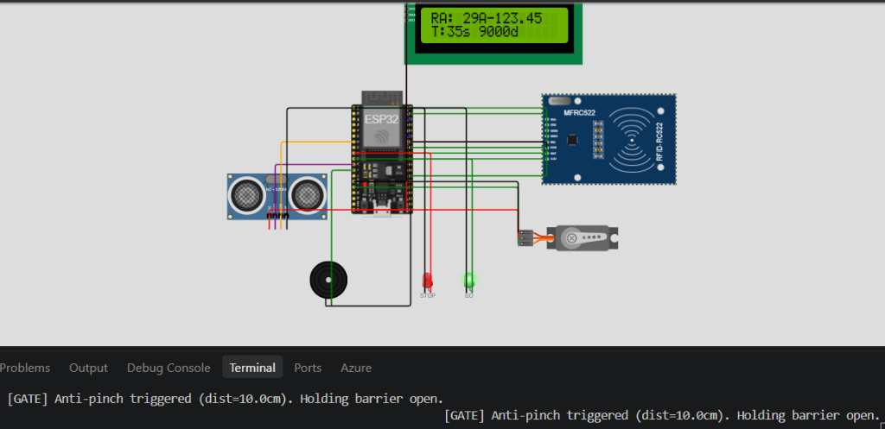
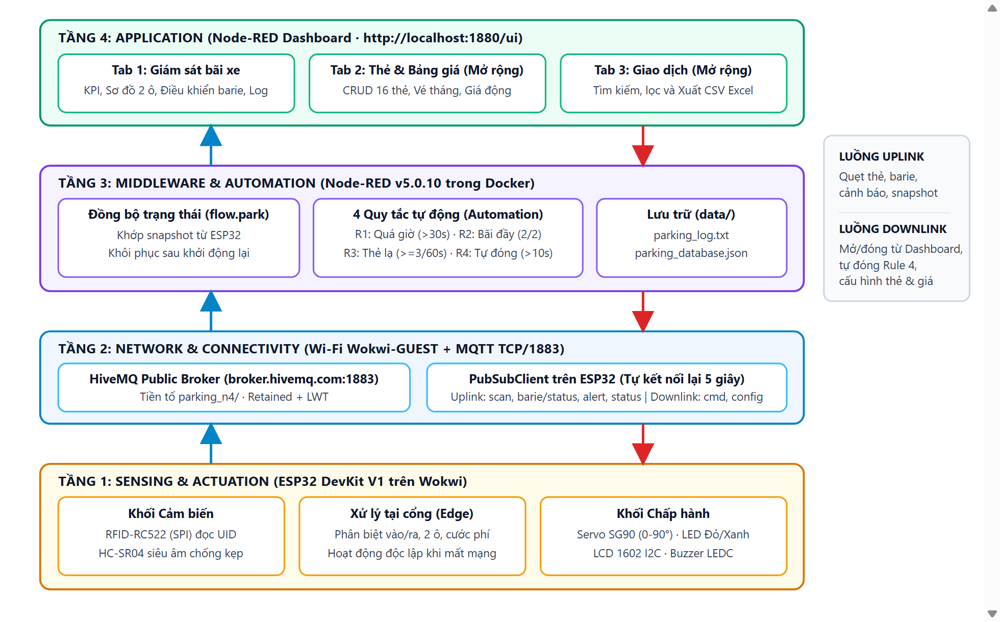
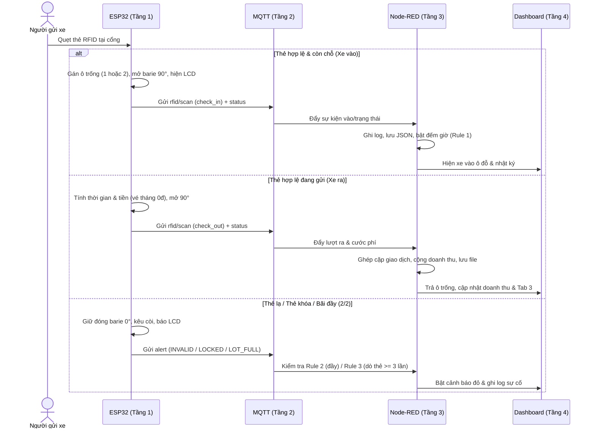
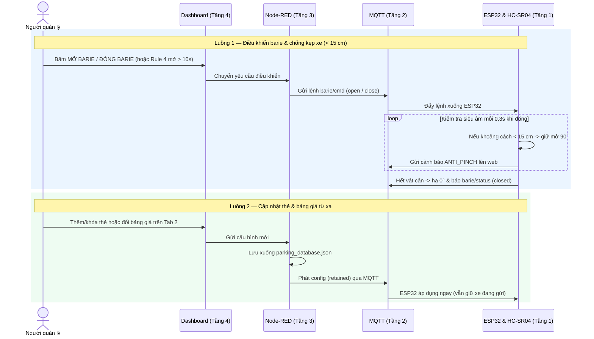
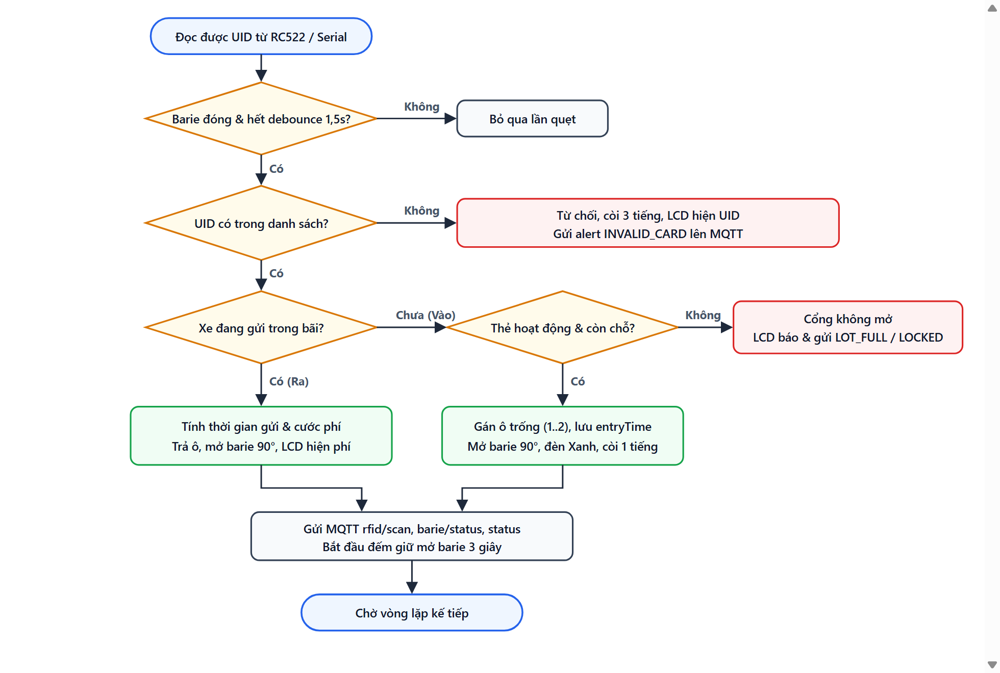

# KỊCH BẢN VÀ NỘI DUNG SLIDE THUYẾT TRÌNH (17 SLIDES)
**Đề tài: Hệ thống bãi giữ xe máy tự quản sử dụng RFID (Mô hình IoT 4 tầng)**  
*Thời lượng trình bày dự kiến: 12 – 15 phút*

---

## SLIDE 1: TRANG MỞ ĐẦU
* **Tên đề tài**: HỆ THỐNG BÃI GIỮ XE MÁY TỰ QUẢN SỬ DỤNG RFID
* **Mô hình**: Kiến trúc IoT 4 tầng — Mô phỏng phần cứng trên Wokwi & Xử lý bằng Node-RED / Docker
* **Trường / Khoa**: Trường Đại học Công Thương TP. Hồ Chí Minh (HUIT) — Khoa Công nghệ Thông tin
* **Học phần**: Internet of Things (IoT)
* **Giảng viên hướng dẫn**: Thầy Võ Hoàng Hải
* **Nhóm thực hiện**: Nhóm 4 — `2001230069` Nguyễn Lê Duy Cương · `2001230894` Đinh Tấn Thành · `2001230938` Bùi Tấn Thông

> **Lời nói gợi ý:**  
> Dạ em chào thầy Hải và các bạn. Hôm nay Nhóm 4 tụi em xin trình bày đề tài **Hệ thống bãi giữ xe máy tự quản dùng thẻ RFID**. Bài báo cáo gồm 4 phần chính: nhóm đặt ra bài toán gì, dùng linh kiện và phần mềm nào, từng tầng đã làm chạy được những gì kèm ảnh thực tế, và cuối cùng là kết quả kiểm thử cùng những chỗ còn hạn chế.

> **Chuyển ý:**  
> Trước hết em xin nói qua lý do làm đề tài và phạm vi nhóm tụi em thực hiện ạ.

---

## SLIDE 2: BÀI TOÁN, MỤC TIÊU & PHẠM VI MÔ PHỎNG (*Nhóm làm gì?*)

* **Vấn đề thực tế cần giải quyết**:
  * Ghi vé giấy và nhập biển số bằng tay dễ kẹt xe giờ cao điểm.
  * Barie hạ theo giờ cố định dễ va trúng xe đang đi qua.
  * Người quản lý không thấy được số chỗ trống và lịch sử ra/vào trên web.
* **Phạm vi hệ thống nhóm xây dựng**:
  * Mô phỏng bãi giữ xe quy mô `2` ô đỗ, hỗ trợ quản lý tối đa `16` thẻ RFID và `1` cổng barie.
  * Đủ quy trình: quẹt thẻ vào/ra, chống kẹp dưới `15 cm`, đồng bộ MQTT, cảnh báo tự động trên Node-RED và khóa đăng nhập Web Dashboard.

> **Lời nói gợi ý:**  
> Ngoài bãi xe truyền thống thì ghi vé tay vừa chậm vừa khó đối soát khi mất xe, còn barie đóng cứng theo giây thì dễ hạ trúng xe đang chạy qua. Trong đồ án này tụi em dựng mô hình 2 ô đỗ, quản lý tối đa 16 thẻ và 1 cổng barie: xe quẹt thẻ tự mở cổng, có cảm biến chống kẹp ở dưới, đẩy dữ liệu lên web có đăng nhập để người quản lý theo dõi và bấm mở/đóng barie từ xa.

> **Chuyển ý:**  
> Để chạy được hệ thống này thì nhóm em sử dụng những linh kiện và công cụ sau ạ.

---

## SLIDE 3: LINH KIỆN & CÔNG CỤ SỬ DỤNG (*Nhóm dùng gì?*)

| Tầng | Thiết bị / Phần mềm nhóm dùng | Vai trò |
| :--- | :--- | :--- |
| **Tầng 1 (Cổng)** | **ESP32 DevKit V1** (trên **Wokwi**, code bằng **PlatformIO**) | Xử lý quẹt thẻ, tính phí, điều khiển cổng tại chỗ |
| | **RFID-RC522**, **HC-SR04**, **Servo SG90**, **LCD 1602 I2C**, **LED Đỏ/Xanh**, **Buzzer** | Đọc thẻ, đo vật cản, nâng hạ barie, hiện LCD, đèn và còi |
| **Tầng 2 (Mạng)** | **Wi-Fi (`Wokwi-GUEST`)** + **MQTT (`broker.hivemq.com`)** | Truyền tin hai chiều giữa ESP32 và Node-RED |
| **Tầng 3 (Xử lý)** | **Node-RED**, tệp `parking_database.json` & `parking_log.txt`, **Docker Compose** | Gom trạng thái, chạy 4 luật tự động và lưu dữ liệu |
| **Tầng 4 (Web)** | **Node-RED Dashboard (3 tab)** + **Basic Auth (`bcrypt`)** | Xem trực tiếp bãi xe, quản lý thẻ/giá, xuất CSV và khóa truy cập |

> **Lời nói gợi ý:**  
> Đây là toàn bộ thiết bị và công cụ tụi em dùng trong bài. Phần cứng làm trên Wokwi gồm ESP32 nối với đầu đọc thẻ RC522, cảm biến siêu âm HC-SR04, servo làm barie, màn hình LCD, đèn xanh đỏ và còi. Dữ liệu gửi qua MQTT trên HiveMQ lên Node-RED đóng gói bằng Docker, lưu ra 2 file JSON và text rồi đưa lên Web Dashboard có đăng nhập.

> **Chuyển ý:**  
> Tiếp theo em xin trình bày cách 4 tầng này nối với nhau và truyền dữ liệu qua lại.

---

## SLIDE 4: KIẾN TRÚC 4 TẦNG & LUỒNG DỮ LIỆU HAI CHIỀU

* **Hai luồng dữ liệu tách biệt**:
  * **Uplink (Đi lên)**: ESP32 gửi sự kiện quẹt thẻ, trạng thái barie, cảnh báo và snapshot bãi xe qua MQTT lên Node-RED và Web Dashboard.
  * **Downlink (Đi xuống)**: Web Dashboard hoặc luật tự động gửi lệnh mở/đóng barie, danh sách thẻ và bảng giá mới xuống ESP32.
* **Xử lý độc lập tại cổng**: Mọi quyết định cho xe vào/ra và chống kẹp đều chạy trực tiếp trên ESP32 $\rightarrow$ **rớt mạng cổng vẫn hoạt động bình thường**, có mạng lại tự đồng bộ lên web.

> **Lời nói gợi ý:**  
> Hệ thống chia đúng 4 tầng. Chiều đi lên là dữ liệu từ cổng gửi lên web; chiều đi xuống là lệnh đóng mở barie hay thẻ và bảng giá mới từ web gửi ngược xuống mạch. Tụi em cho ESP32 tự quyết định mọi thứ ở cổng trước, nên lỡ mạng Wi-Fi hay MQTT bị ngắt giữa chừng thì cổng vẫn cho xe quẹt thẻ ra vào bình thường, khi nào nối lại được nó tự đồng bộ lại trên web.

> **Chuyển ý:**  
> Trước khi đi vào chi tiết từng tầng, tụi em mô tả nhanh hai luồng chức năng chính chạy từ đầu tới cuối của hệ thống ạ.

---

## SLIDE 5: LUỒNG CHỨC NĂNG (1/2) — XE VÀO / RA & XỬ LÝ TỪ CHỐI

* **Luồng xuyên suốt 4 tầng**: Mọi lượt quẹt thẻ đều xử lý ở cổng trước rồi mới đồng bộ lên web và lưu lịch sử.

> **Lời nói gợi ý:**  
> Nhìn theo chiều dọc từ người gửi xe đi hết 4 tầng thì luồng xe vào/ra chạy như thế này ạ: khi người dùng quẹt thẻ, ESP32 tự kiểm tra thẻ hợp lệ trước. Nếu là xe vào thì tự gán ô trống, mở barie 90 độ rồi đẩy tin qua MQTT cho Node-RED ghi log, lưu JSON và hiện lên web. Lúc quẹt ra thì ESP32 tự tính tiền, Node-RED ghép cặp thành một giao dịch hoàn chỉnh rồi cộng doanh thu. Còn nếu gặp thẻ lạ, thẻ khóa hay bãi đầy thì cổng chặn lại tại chỗ luôn, xong mới báo cảnh báo đỏ lên web.

> **Chuyển ý:**  
> Tiếp theo là luồng chức năng đi theo chiều ngược lại từ web xuống cổng và cơ chế bảo vệ chống kẹp xe ạ.

---

## SLIDE 6: LUỒNG CHỨC NĂNG (2/2) — ĐIỀU KHIỂN CHỐNG KẸP & CẬP NHẬT TỪ XA

* **Đồng bộ an toàn**: Dù đóng barie bằng nút bấm trên web hay bằng Rule 4 tự động, ESP32 vẫn kiểm tra siêu âm `< 15 cm` trước khi hạ thanh chắn; sửa thẻ/bảng giá trên web cũng tự cập nhật xuống cổng mà không cần nạp lại code.

> **Lời nói gợi ý:**  
> Ở slide này là hai luồng chức năng còn lại đi từ trên web xuống cổng. Luồng thứ nhất là điều khiển barie từ xa hoặc do Rule 4 tự kích khi quên đóng quá 10 giây: lệnh đi qua MQTT xuống ESP32, trước khi hạ thanh chắn mạch bắt siêu âm đo liên tục mỗi 0,3 giây, hễ còn vướng dưới 15 cm là giữ mở và báo lên web chứ không đóng bừa. Luồng thứ hai là lúc quản lý thêm thẻ hay đổi giá ở Tab 2: Node-RED lưu vô file JSON trước rồi đẩy tin retained xuống ESP32 cập nhật luôn, vẫn giữ nguyên xe đang gửi bên trong không bị mất dữ liệu.

> **Chuyển ý:**  
> Sau khi nắm hết các luồng chạy chính, giờ tụi em đi vô phần chi tiết kỹ thuật từng tầng, bắt đầu từ Tầng 1 ạ.

---

## SLIDE 7: TẦNG 1 (1/2) — ĐẤU NỐI CHÂN & XỬ LÝ QUẸT THẺ VÀO/RA

| Linh kiện | Chân ESP32 (GPIO) | Chức năng chính |
| :--- | :--- | :--- |
| **RFID-RC522** (`SPI`) | `5`, `18`, `23`, `19`, `4` | Đọc UID thẻ xe 13,56 MHz |
| **HC-SR04** | `27` (`TRIG`), `32` (`ECHO`) | Đo vật cản dưới barie |
| **Servo SG90** / **Buzzer** | `13` (Servo) / `14` (Còi) | Đóng mở barie `0°–90°`, tách kênh PWM không xung đột |
| **LED Đỏ/Xanh** / **LCD I2C** | `25`, `26` / `21`, `22` (`0x27`) | Báo trạng thái và hiện biển số, ô đỗ, tiền phí |

* **Logic tại cổng**: Chống đọc trùng `1,5 giây`; xe vào tự lấy ô trống (`1` hoặc `2`); xe ra tính thời gian gửi & tiền (`0đ` với vé tháng); từ chối tại chỗ nếu gặp **thẻ lạ**, **thẻ bị khóa** hoặc **bãi đầy (`2/2`)**.

> **Lời nói gợi ý:**  
> Ở Tầng 1, bảng bên dưới là sơ đồ chân tụi em đấu trên ESP32, trong đó còi với servo tách kênh PWM riêng để không bị đụng nhau. Khi có người quẹt thẻ, mạch chạy theo lưu đồ này: chặn đọc lặp trong 1,5 giây để giữ thẻ lâu cũng không bị tính thành 2 lần; kiểm tra thẻ hợp lệ rồi mới chia nhánh cho xe vào lấy ô trống hoặc cho xe ra tính tiền, còn thẻ lạ, thẻ khóa hay bãi đầy thì chặn luôn tại chỗ kèm còi và chữ báo trên LCD.

> **Chuyển ý:**  
> Phần thứ hai ở Tầng 1 là cơ chế cảm biến chống kẹp xe khi barie hạ xuống ạ.

---

## SLIDE 8: TẦNG 1 (2/2) — CHỐNG KẸP XE & MÁY TRẠNG THÁI BARIE

* **Chống kẹp xe (`HC-SR04`)**:
  * Khi hết `3 giây` giữ mở hoặc có lệnh đóng từ xa, cảm biến đo khoảng cách mỗi `0,3 giây`.
  * Nếu vật cản dưới `15 cm` $\rightarrow$ **hoãn đóng**, giữ góc `90°`, hiện `TAM HOAN DONG` và gửi cảnh báo lên web; hết vật cản mới hạ `0°`.
* **3 trạng thái điều khiển barie**: **Đóng** (`0°`), **Mở hẹn giờ** (`3s` khi quẹt thẻ) và **Giữ mở** (khi bấm từ Dashboard cho tới khi có lệnh đóng).

> **Lời nói gợi ý:**  
> Khi barie chuẩn bị đóng — bất kể là tự đóng sau 3 giây hay do người trực bấm nút đóng trên web — ESP32 đều bắt cảm biến siêu âm đo lại mỗi 0,3 giây. Hễ còn thấy vật cản dưới 15 cm thì barie giữ nguyên góc 90 độ cho an toàn, chừng nào xe đi qua hết mới hạ xuống. Barie được chia đúng 3 trạng thái: Đóng, Mở 3 giây cho xe qua và Giữ mở khi điều khiển từ web.

> **Chuyển ý:**  
> Mọi sự kiện xảy ra ở cổng sẽ được gửi qua Tầng 2 MQTT để lên hệ thống quản lý.

---

## SLIDE 9: TẦNG 2 — TRUYỀN THÔNG MQTT HAI CHIỀU, RETAINED & LWT

| Topic (`parking_n4/...`) | Chiều | Cơ chế | Nội dung chính |
| :--- | :---: | :---: | :--- |
| `rfid/scan` | Lên | Thường | Lượt xe vào/ra, ô đỗ và cước phí |
| `barie/status` | Lên | Retained | Trạng thái barie (`open` / `closed`) và góc mở |
| `alert` | Lên | Thường | Cảnh báo thẻ lạ, thẻ khóa, bãi đầy hoặc có vật cản |
| `status` | Lên | Retained + LWT | Snapshot 2 ô đỗ; tự báo `{"online":false}` khi mất kết nối |
| `barie/cmd` | Xuống | Thường | Lệnh đóng/mở/đồng bộ barie từ web hoặc Rule 4 |
| `config` *(Mở rộng)* | Xuống | Retained | Gửi danh sách tối đa 16 thẻ và bảng giá mới xuống ESP32 |

* **Tự nối lại & báo mất kết nối**: Mất mạng ESP32 tự thử lại mỗi `5 giây`; bản tin `Retained` giúp web và mạch vừa bật lên là có ngay trạng thái mới nhất; ngắt kết nối đột ngột thì **LWT** báo đỏ **`NGOẠI TUYẾN`** ngay trên Dashboard.

> **Lời nói gợi ý:**  
> Qua Tầng 2 truyền tin MQTT, nhóm em dùng 6 topic gửi lên và nhận xuống qua HiveMQ Broker. Hai cơ chế chính tụi em tận dụng là Retained và Last Will: Retained giúp lưu lại cấu hình thẻ với trạng thái barie mới nhất để mạch vừa khởi động lại là tự lấy xuống dùng ngay. Còn Last Will như trên ảnh kiểm thử, lúc nhóm thử ngắt kết nối đột ngột thì Broker tự báo tin để Dashboard chuyển sang màu đỏ Ngoại tuyến báo cho người trực biết.

> **Chuyển ý:**  
> Dữ liệu từ 6 topic này sẽ đi vào Tầng 3 Node-RED để xử lý tập trung.

---

## SLIDE 10: TẦNG 3 (1/2) — LUỒNG XỬ LÝ TRUNG GIAN NODE-RED

* **Cách tổ chức flow theo 5 cụm rõ ràng trên Node-RED**:
  1. **Nhóm Uplink**: Nhận tin từ 4 topic gửi lên và bộ đếm định kỳ mỗi `1 giây`.
  2. **Nhóm Middleware & Luật**: Cập nhật toàn bộ dữ liệu vào một biến trạng thái dùng chung và chạy 4 quy tắc tự động.
  3. **Nhóm Dashboard & Lưu trữ**: Đẩy dữ liệu ra giao diện 3 tab và ghi tệp `parking_log.txt`, `parking_database.json`.
  4. **Nhóm Downlink**: Nhận thao tác bấm nút/sửa thẻ/giá trên web để đẩy lệnh xuống ESP32.
  5. **Nhóm Khởi động**: Đọc lại `parking_database.json` mỗi khi bật lại Node-RED.

* **Gợi ý chèn thêm vào PowerPoint (nếu cần)**: `docs/figures/fig_3_5_flow_checkcard_nodered.png`.

> **Lời nói gợi ý:**  
> Lên tới Tầng 3 Node-RED, để flow không bị rối và số liệu các bảng không bị đá nhau, nhóm em chia thành 5 cụm khung màu rõ ràng: nhận dữ liệu từ mạch vào, gom hết vào một trạng thái chung ở giữa để xử lý, đẩy ra giao diện web kèm lưu file, gửi lệnh ngược xuống mạch, và một cụm dưới cùng để nạp lại dữ liệu cũ khi khởi động lại Node-RED.

> **Chuyển ý:**  
> Trong cụm xử lý giữa này, nhóm em cài sẵn 4 quy tắc tự động như ở slide tiếp theo ạ.

---

## SLIDE 11: TẦNG 3 (2/2) — 4 QUY TẮC TỰ ĐỘNG & KẾT QUẢ CHẠY THẬT

| Quy tắc | Điều kiện (Ngưỡng demo) | Hệ thống làm gì |
| :--- | :--- | :--- |
| **Rule 1 — Xe quá giờ** | Xe gửi vượt `30 giây` *(chỉnh được trên web)* | Gắn nhãn vàng `QUÁ GIỜ` trên ô đỗ, hiện cảnh báo và ghi log |
| **Rule 2 — Bãi đầy** | Đạt `2/2` xe hoặc nhận tin từ chối đầy bãi | Thẻ Tổng quan đổi sang màu đỏ `Bãi đã đầy` |
| **Rule 3 — Dò thẻ lạ** | Quẹt thẻ lạ `>= 3` lần trong `60 giây` | Bật cảnh báo đỏ `Nghi vấn dò thẻ` và lưu UID để đăng ký nhanh |
| **Rule 4 — Barie mở lâu** | Barie giữ mở `> 10 giây` | Node-RED tự gửi lệnh đóng xuống ESP32 (vẫn qua chống kẹp) |

* *(Lưu ý: Các mốc `30s`, `10s`, `2` xe là thông số rút gọn để tiện demo; khi dùng thật chỉ cần đổi ngưỡng thành vài giờ hoặc vài chục giây ngay trên web/cấu hình).*

> **Lời nói gợi ý:**  
> Nhóm em cài đủ 4 quy tắc tự động chạy kiểm tra mỗi giây: báo xe gửi quá giờ, báo đỏ khi bãi đầy 2/2, phát cảnh báo nghi vấn dò thẻ nếu ai quẹt thẻ lạ liên tiếp 3 lần trong 1 phút, và tự động bắn lệnh đóng barie nếu lỡ mở quên quá 10 giây — tất nhiên xuống tới cổng vẫn check siêu âm dưới 15 cm mới đóng. Ảnh bên dưới là lúc tụi em test kích hoạt cùng lúc cả Rule 1, Rule 2 với Rule 3 chạy thật trên Dashboard.

> **Chuyển ý:**  
> Giờ em sang Tầng 4 để xem phần giao diện web mà người trực bãi sử dụng hàng ngày.

---

## SLIDE 12: TẦNG 4 (1/2) — WEB DASHBOARD GIÁM SÁT CHÍNH (TAB 1)

* **Tất cả thông tin cần thiết nằm gọn trong 1 màn hình**:
  * **4 thẻ Tổng quan**: Số xe đang gửi (`x/2`), trạng thái barie, tình trạng online ESP32, tổng doanh thu.
  * **Sơ đồ 2 ô đỗ**: Hiện biển số, chủ xe, giờ vào, bộ đếm giây và nhãn `QUÁ GIỜ` / `VÉ THÁNG`.
  * **Điều khiển barie & Cảnh báo**: Mô phỏng góc mở barie, banner cảnh báo và 2 nút `MỞ BARIE` / `ĐÓNG BARIE`.
  * **Nhật ký & Biểu đồ**: Danh sách 12 sự kiện mới nhất cùng biểu đồ doanh thu và số xe theo thời gian.

> **Lời nói gợi ý:**  
> Đây là giao diện chính ở Tab 1. Nhóm em bố trí hết trên một màn hình máy tính để người trực nhìn vô là nắm được ngay bãi đang có mấy xe, ô nào còn trống, barie đang đóng hay mở, bên dưới có bảng nhật ký 12 sự kiện mới nhất với hai biểu đồ cập nhật trực tiếp mà không cần cuộn trang lên xuống.

> **Chuyển ý:**  
> Để người lạ không tự ý vào trang này bấm mở barie được thì nhóm em làm thêm phần đăng nhập ở slide sau ạ.

---

## SLIDE 13: TẦNG 4 (2/2) — BẢO MẬT ĐĂNG NHẬP HAI LỚP

* **Khóa cả 2 đường vào hệ thống**:
  * **Web Dashboard (`/ui`)**: Bắt buộc xác thực **HTTP Basic Auth** trước khi xem dữ liệu hoặc bấm nút barie.
  * **Trang chỉnh flow Node-RED (`/`)**: Có màn hình đăng nhập quản trị riêng như hình trên.
* **Không lưu mật khẩu thô**: Mật khẩu đều được băm bằng `bcrypt`; kiểm thử gửi request không đăng nhập hoặc sai mật khẩu đều bị chặn trả về mã `401 Unauthorized`, đúng tài khoản mới cho vào (`200 OK`).

> **Lời nói gợi ý:**  
> Về phần bảo mật truy cập, tụi em khóa cả hai cửa: người trực vô Dashboard phải nhập tài khoản HTTP Basic Auth, còn người sửa flow Node-RED ở cổng 1880 phải đăng nhập qua màn hình quản trị như trên ảnh. Mật khẩu trong file cấu hình đều được băm bằng bcrypt chứ không để chữ thường; khi test bằng lệnh curl lúc chưa đăng nhập hoặc gõ sai mật khẩu hệ thống đều trả lỗi 401 chặn lại ngay.

> **Chuyển ý:**  
> Ngoài các yêu cầu bắt buộc, nhóm em làm thêm hai tab quản trị mở rộng trên Dashboard.

---

## SLIDE 14: TÍNH NĂNG MỞ RỘNG — QUẢN LÝ 16 THẺ, GIÁ ĐỘNG & XUẤT CSV

* **Tab 2 — Quản lý thẻ & Bảng giá động**:
  * Thêm, sửa, khóa/mở khóa và xóa tối đa `16` thẻ; khi vừa quẹt thẻ lạ có nút **`Lấy UID này`** điền nhanh; phân biệt **Vé lượt** và **Vé tháng (`0đ`)**; tự khóa nút xóa nếu xe đang gửi trong bãi.
  * Đổi chế độ miễn phí, sửa 3 mức giá và ngưỡng quá giờ Rule 1 rồi đẩy `retained` xuống ESP32 không cần nạp lại code.
* **Tab 3 — Đối soát lịch sử & Xuất CSV**:
  * Ghép cặp giờ vào–ra thành từng dòng giao dịch, lọc/tìm theo biển số hoặc chủ xe, xuất file `.csv` mở chuẩn tiếng Việt trên Excel.

> **Lời nói gợi ý:**  
> Hai tab mở rộng này giúp hệ thống thực tế hơn khi quản trị. Ở Tab 2, người quản lý tự thêm hoặc khóa thẻ, chọn vé tháng miễn phí, hay bấm nút Lấy UID này ngay khi có thẻ lạ mới quẹt ở cổng; sửa bảng giá xong bấm lưu là nó đẩy thẳng xuống ESP32 luôn khỏi phải sửa code nạp lại. Còn Tab 3 tự ghép giờ vào với giờ ra của từng xe thành từng giao dịch hoàn chỉnh để tìm kiếm và xuất ra file CSV xem trên Excel.

> **Chuyển ý:**  
> Toàn bộ dữ liệu thẻ, giá và lịch sử đó được lưu xuống ổ cứng như thế nào ạ?

---

## SLIDE 15: LƯU TRỮ DỮ LIỆU & ĐÓNG GÓI DOCKER COMPOSE

* **Lưu trữ bền vững trong thư mục `data/`**:
  * `parking_log.txt`: Ghi nối tiếp từng sự kiện theo giờ để mở lên đọc hoặc truy vết nhanh.
  * `parking_database.json`: Lưu danh sách thẻ, bảng giá, doanh thu, xe đang gửi và tối đa `100` giao dịch gần nhất.
  * *Lý do chọn JSON*: Gọn nhẹ ngay trong container Node-RED, không cần cài thêm máy chủ SQL rời mà vẫn đủ chức năng thêm/sửa/xóa và khôi phục số liệu.
* **Đóng gói Docker Compose & Kiểm chứng restart**:
  * Dùng `docker-compose.yml` để khởi chạy trọn bộ Node-RED kèm cấu hình bảo mật và thư mục `data/`.
  * Test chạy lệnh `docker restart` khi đang có doanh thu `5.000đ` và `2` giao dịch: bật lại xong toàn bộ tiền thu, giao dịch và bảng nhật ký được nạp lại nguyên vẹn như hình trên.

> **Lời nói gợi ý:**  
> Để tắt mở lại không bị mất sạch dữ liệu, nhóm em lưu lịch sử dạng chữ vô file parking_log.txt và lưu cấu hình thẻ, giá, doanh thu vô file JSON. Cách này gọn vì chạy chung trong một container Node-RED không cần dựng thêm database rời. Như ảnh chụp sau khi nhóm thử chạy lệnh restart container Docker, mở web lại vẫn giữ nguyên 5.000 đồng doanh thu với toàn bộ giao dịch trước đó.

> **Chuyển ý:**  
> Em xin tóm tắt lại quá trình kiểm thử và kịch bản chạy thử 9 bước của hệ thống ạ.

---

## SLIDE 16: KẾT QUẢ KIỂM THỬ & KỊCH BẢN DEMO 9 BƯỚC

| Phân hệ kiểm thử | Cách nhóm đã chạy kiểm tra | Kết quả |
| :--- | :--- | :---: |
| **Tầng 1 (Cổng Wokwi)** | Chạy trực tiếp trên Wokwi: xe vào/ra, tính tiền, bãi đầy `2/2`, thẻ lạ, chống lặp `1,5s`, chống kẹp `< 15 cm` | Đạt |
| **Tầng 2 & 3 (MQTT + Docker)** | Script MQTT gửi tới Node-RED thật: đồng bộ `config` retained, LWT báo ngoại tuyến, chạy đủ 4 rule, khôi phục sau `docker restart` | Đạt |
| **Tầng 4 (Bảo mật HTTP)** | Test trực tiếp cổng `/ui`: thiếu/sai mật khẩu trả `401`, đúng mật khẩu trả `200` | Đạt |
| **Chạy liên hoàn 9 bước E2E** | Logic 9 bước đã test qua script MQTT + Node-RED; **đang quay nốt video chạy liền trên Wokwi thật** | Đang quay video |

* **Trình tự 9 bước demo**: `(1)` Đăng nhập & mở Wokwi $\rightarrow$ `(2)` Xe 1 vào $\rightarrow$ `(3)` Kéo vật cản `< 15 cm` rồi thả $\rightarrow$ `(4)` Chờ quá giờ Rule 1 $\rightarrow$ `(5)` Xe 2 vào đầy bãi & chặn xe 3 (Rule 2) $\rightarrow$ `(6)` Quẹt thẻ lạ 3 lần (Rule 3) $\rightarrow$ `(7)` Tab 2 thêm thẻ/đổi giá xuống ESP32 $\rightarrow$ `(8)` Mở barie `> 10s` kích hoạt Rule 4 $\rightarrow$ `(9)` Cho xe ra & xuất CSV ở Tab 3.

> **Lời nói gợi ý:**  
> Về kiểm thử thì phần nào chạy trên Wokwi thật tụi em ghi riêng, phần nào chạy kiểm tra bằng script MQTT với Docker Node-RED thật tụi em cũng tách riêng cho rõ ràng: các thao tác quẹt thẻ, chống kẹp dưới 15 cm, LWT mất kết nối, đủ 4 rule, khóa đăng nhập 401/200 với restart Docker không mất dữ liệu đều đã chạy qua hết. Hiện nhóm còn khâu quay liền mạch đủ 9 bước demo trên Wokwi thật kẹp vô video nộp bài là xong hoàn chỉnh.

> **Chuyển ý:**  
> Cuối cùng là phần tổng kết ngắn gọn những gì đã làm được và hướng khắc phục các hạn chế ạ.

---

## SLIDE 17: TỔNG KẾT — LÀM ĐƯỢC GÌ, HẠN CHẾ & HƯỚNG PHÁT TRIỂN

* **Những gì hệ thống đã làm được**:
  * Chạy hoàn chỉnh mô hình **IoT 4 tầng** cho bãi giữ xe RFID với luồng dữ liệu hai chiều Uplink / Downlink.
  * Cổng tự xử lý vào/ra độc lập kể cả khi rớt mạng và có **chống kẹp `< 15 cm`**.
  * Node-RED chạy đủ **4 quy tắc tự động**, báo mất kết nối **LWT**, khóa **đăng nhập 2 lớp**, lưu file khôi phục được qua restart và đóng gói bằng **Docker Compose**.
  * Bổ sung hoàn chỉnh phần mở rộng: quản lý tối đa `16` thẻ (vé tháng, lấy UID nhanh), bảng giá động và đối soát xuất CSV.
* **Hạn chế hiện tại**:
  * Bài mới chạy trong môi trường mô phỏng Wokwi (`2` ô đỗ, các ngưỡng thời gian demo ngắn), chưa lắp mạch thật nên chưa kiểm chứng độ ổn định cơ khí hay nhiễu môi trường ngoài thực tế.
  * Giao tiếp hiện dùng public broker (`broker.hivemq.com`) và HTTP nội bộ, chưa bật mã hóa TLS/HTTPS.
* **Hướng phát triển sát thực tế**:
  * Thi công thử nghiệm trên mạch thật với nguồn riêng ổn định cho servo và đầu đọc thẻ.
  * Dùng MQTT broker riêng có tài khoản + mã hóa TLS/HTTPS nếu đưa lên mạng ngoài, và lắp thêm cảm biến tại từng ô đỗ nếu mở rộng số lượng chỗ gửi xe.

> **Lời nói gợi ý:**  
> Tóm lại tới giờ, nhóm em đã dựng và chạy được trọn vẹn mô hình bãi giữ xe RFID 4 tầng: dưới cổng xử lý được vào ra kể cả lúc mất mạng và có siêu âm chống kẹp, trên Node-RED chạy đủ 4 luật cảnh báo, web có khóa đăng nhập, dữ liệu tắt mở lại vẫn giữ nguyên, kèm thêm quản lý 16 thẻ, đổi bảng giá từ xa và xuất Excel CSV. Nhóm cũng thấy rõ hạn chế là đồ án đang dừng ở mô phỏng 2 ô và xài broker công cộng chưa mã hóa TLS. Nếu nâng cấp thêm cho đúng thực tế thì việc đầu tiên tụi em làm là ráp mạch thật có nguồn riêng cho servo, chuyển sang broker riêng có HTTPS/TLS và gắn thêm cảm biến từng ô đỗ. Phần trình bày của Nhóm 4 tới đây là hết, em cảm ơn thầy Hải và các bạn đã lắng nghe ạ.
